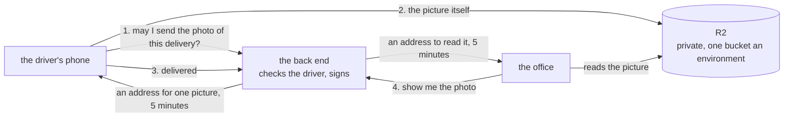

# Delivery photos kept on R2

## At a glance

A driver's delivery photo leaves the records and goes to Cloudflare R2, so a box of companies does not
fill with pictures (about 170 GB a year for twenty, by the architecture page). The driver sees nothing
new; the office sees one new line when a photo never arrived.

**The cheapest safe path:** the legacy app's signed upload, rewritten so the back end signs after its
own checks, with no worker, no new vendor and no dependency. **Price:** no fixed charge; R2's own price
is read in step 2.

## The slice

One driver delivers one request with a photo that travels phone to R2, and the office opens that
delivery and sees it, walked on the fake, then on the local stack against a stand-in for R2, then on
ridge against a real bucket. Out of the slice, each named: a waiting room for photos sent later, a
stamp burned into the picture, deleting one photo, a deleted company's photos (open item 266), and how long photos are kept (open item 267).

## The three differences, settled

The machine's decisions until real clients, each vetoable on sight.

1. **Who signs: the back end, inside its own process.** It is the only part that knows who is asking
   (`bff/src/routes/orders.ts#L427-L440`), and signing an address is arithmetic on a key and the
   clock, not a call, so the back end's network with no way out (`ops/network.yml#L32`) does not stop
   it. That last claim is the architecture page's and unverified: step 2 holds it with a test that
   runs with every outbound call refused. The legacy's separate worker
   (`workspace/workers/dolga/src/lib/media.ts#L64-L74`) is left: it would be a second deployed part
   that has to check the caller again.
2. **Checked, never open.** An upload address is signed only for the signed-in driver of that waiting
   request, in that company, for that request's one object; a read address only after today's read
   check; the bucket stays private, with no public address. The legacy's routes are "Public by design"
   (`workspace/workers/dolga/src/routes/media.ts#L13-L22`) and store a public, permanent address
   (`workspace/workers/dolga/src/lib/media.ts#L143`); both are left.
3. **Three calls, the photo first.** Ask for the address (the back end writes the photo's record), send
   the picture, then mark delivered, which is refused when no address was asked for. The back end
   cannot reach R2 to see the picture arrived, so the order and a fixed object name are what bound a
   half-done delivery: a stop between leaves a waiting request and at most one object under that
   request's own name, which the next try overwrites. No waiting room, no orphan list. Where the
   picture never arrived, the office's view says so.

**Taken from the legacy, rewritten:** the five-minute signed PUT straight to R2
(`workspace/workers/dolga/src/lib/media.ts#L29`, `#L133-L141`); the object name with the day in it,
built by the back end from ids it holds rather than a folder sent by the browser
(`workspace/uis/c-mngt/src/utils/uploadPath.ts#L95-L109`); a bounded upload with a fresh address per
try (`workspace/uis/c-mngt/src/utils/photoUpload.ts#L78-L94`), cut to one 20-second try, Send again
being the retry. **Kept from the new app:** the phone's shrink (`ui/src/photo.ts#L44-L56`, 1280 px,
200 KB, `shared/src/photo.ts#L12`), the photo before the delivery (`bff/src/routes/orders.ts#L489-L492`)
and one message for a failed send (`ui/src/pages/client/MyDeliveryPage.tsx#L134-L138`): Send again
resends the photo the phone still holds, so the legacy's second sentence for "sent but not attached"
buys nothing here.

**One correction to the comparison page:** its "leave" list says the back end, holding the key, "can
check the object exists before it marks the delivery done". It cannot: holding a key gives no route
out of the network. The check the back end can make is that an address was asked for.

## What the plan rests on and where each is checked

| Premise | Checked by |
| --- | --- |
| R2 accepts an address signed by AWS's query signing, region `auto`, at its S3 endpoint by path | step 2's `fetch` read of R2's own pages; step 6's probe on the real bucket |
| R2 refuses a body whose length differs from the signed one | the same read and probe; if not, a larger picture is bounded only by one object a request and five minutes, and the plan says so in the recap |
| A browser PUT needs a cross-origin rule on the bucket; an `` read needs none | the read; the stand-in answers the same preflight, so the stack walk exercises it |
| No content-security rule blocks a picture from another origin | grep of `ops/`, `ui/`, `bff/`, `scripts/` for `content-security` and `img-src` found none this run |
| The legacy's R2 piece is the model, and the new app keeps no photo on R2 | both true on disk: the legacy signs in `workspace/workers/dolga/src/lib/media.ts`; the new app keeps the picture as text in a record (`shared/src/records.ts#L47-L50`, `shared/src/photo.ts#L33`), and `git grep` for R2 or presign in code finds none |
| No stored photo needs moving | ridge holds invented companies only, re-seeded at its re-up; production holds none |

## The case table

| # | The case: one behaviour, one sentence | Held by |
| --- | --- | --- |
| 1 | A driver's photo goes from the phone to the photo store, the request is marked delivered after it, and the office sees that photo | the driver's and the orders walks; BFF route |
| 2 | A photo another company asks for, to send or to read, is a 404: no address signed, nothing written | BFF route, `cross-tenant.route.test.ts` |
| 3 | A photo that cannot be sent (no address, the picture refused, or no answer in 20 seconds) stays on the phone, the driver reads that it could not be sent, the request stays waiting, and Send again asks for a new address | UI, `MyDeliveries.test.tsx`; walk screen `driver-5-send-failed` |
| 4 | A delivery done without one: marking delivered with no address asked for that request is refused with a 400 naming the photo, and the request stays waiting | BFF route |
| 5 | A delivered request whose picture never arrived shows the office "the photo did not arrive", never a broken picture | UI, `DeliveriesPages.test.tsx`; walk screen `orders-15-photo-missing` |
| 6 | Anyone but the request's own driver (the root, the office, another driver) asking for an upload address is a 403, nothing written | BFF route |
| 7 | A request already delivered or cancelled gets no upload address: a 409 carrying it as it is now | BFF route |
| 8 | A read address goes only to those who may read the request today, only once it is delivered, and lives five minutes | BFF route |
| 9 | The object's name is built by the back end from the company's minted id, the day and the request's id; nothing the phone sends names a folder or a key | unit, `records.test.ts`; BFF route |
| 10 | An ask for a picture that is not a JPEG, or is over 200 KB, is a 400; the address signs the type and the exact length | BFF route |
| 11 | A second ask for one request signs the same name, so a retry overwrites and never leaves a second object | BFF route |
| 12 | The signer gives AWS's published example signature exactly, with every outbound call refused | unit, `bff/src/photo-store.test.ts` |
| 13 | With no photo store set, asking an address is a 503 and nothing is written, so no driver can deliver (the delivered mark, with no address asked for, is a 400); every other route runs, and the environment check is red until the box's `photo-store.env` is written | BFF route; `bash ops/test.sh` |
| 14 | The stand-in refuses an expired address, a wrong signature and a longer body than signed | unit, `scripts/src/running/photo-store.test.ts` |
| 15 | A deploy writes the photo store's three settings into the function from the box's file, and with no file prints that photos are off and that no driver can deliver, and sends none; a box that cannot be asked stops the deploy | `bash ops/test.sh` |

## The steps

Sizes are the minutes of the same shape's last rows in the runs log; a first shape is about five
minutes a part.

- [x] **Step 1. The fake, end to end on the phone and the office's screen** (about 25 minutes: a fake
  UI build ran 8, 21 and 29, plus the whole check, since it crosses `shared` and `ui`). `shared` gains
  the address's reply and the new photo reply (an address, not the picture) beside the old ones, which
  step 3 removes. `ui/src/api.ts#L692-L707` gains the ask, the PUT (through the one API object, so the
  fake stubs it, code.md's C11) and the deliver without the picture; `MyDeliveryPage.tsx#L63-L78`
  runs the three legs, 20 seconds on the PUT; `ProofPhoto` (`ui/src/parts/OrderParts.tsx#L275-L289`)
  draws the picture from the address and the "did not arrive" line on the picture's own error, in
  `en.ts` and `vi.ts`; `ui/src/fake.ts` answers all three and holds one delivered request whose
  address leads nowhere (code.md's C16 list). *Done when:* `pnpm check` ends `== exit 0`, and cases 3
  and 5 were each seen red once.
  *Done 2026-11-12:* the `shared` and `ui` gates each ended `== exit 0` on the committed tree; case 3 was seen
  red (the PUT not awaited, so the request was marked delivered after a failed send) and case 5 was seen red
  (the picture's error ignored, so no "did not arrive" line), each reverted and compared equal. `ui/tests/unused.ts`
  gained the two new members `askPhotoAddress` and `putPhoto` for the dead-code check. One run of the `ui` gate
  reddened on `fake.test.tsx` (the fake's address reply was parsed with its `kind` field, which the strict
  schema refuses; the test now parses `{ url }`), and one run reddened once on the My deliveries landing test,
  green alone three times and on the rerun: a timing flake under load, unfiled.
- [x] **Step 2. The platform's own words, then the signer** (about 15 minutes: a first shape, three
  parts). A `fetch` read, verbatim with its page, of R2's pages on signed addresses, the cross-origin
  rule, object lifecycles and the price, and of AWS's page holding the published example of a signed
  address. Then `bff/src/photo-store.ts`, a file with no directory sentence so at the top (bff's
  CLAUDE.md): one function signing a PUT or a GET for one object name, a type and a length, five
  minutes, the time handed in. No AWS client and no new package: one short function, held by AWS's own
  example. *Done when:* `pnpm --filter @credo/bff check` ends `== exit 0`; case 12 seen red with one
  byte of the example's secret changed; the read's quotes are in the recap. A premise the read
  contradicts stops the step and is reported, never planned around.
  *Done 2026-11-14:* the `bff` gate ended `== exit 0` on the committed tree; case 12 was seen red (one byte of
  the example's secret changed) and reverted. The read contradicted no premise: R2's page says a signed address is
  made "with no communication with R2" and a signed type is enforced, and it is silent on a body's length and on
  path-style addresses (both left to step 6's probe); the quotes are in `docs/recaps/2026-11-14-delivery-photos.md`.
  AWS's own page returned 9 characters to every fetch, so its example was read from a search result quoting it, and
  the signer reproduces that signature exactly. The merge of `pre-merge` was taken in first.
- [x] **Step 3. The routes through the stack, at its thinnest** (about 25 minutes: route steps ran 5,
  5, 8, 10 and 20; three route parts at about eight). The ask is a new route in its own module,
  `bff/src/routes/delivery-photo.ts`, as code.md's C10 asks of the next route added to `orders.ts`;
  it reuses the finding and reading of a request from `registerOrderRoutes`, passed in rather than
  copied, and declares its activity-log action (`bff/src/audit.ts#L84-L88` is the other way, not
  this one: the ask writes a company's record). The photo's record now holds the object's name only,
  under the key it has (`shared/src/records.ts#L47-L50`); the object's name is built beside it, the
  layout's one home. `deliver` (`bff/src/routes/orders.ts#L475-L517`) takes the version alone and
  refuses with no record; the read (`#L429-L439`) answers a read address. The settings join
  `bff/src/env.ts` optional, as the activity log's pair is (`#L24-L25`). The old picture schemas go,
  and with them the three copies of the test photo (open item 228). *Done when:* `pnpm --filter
  @credo/bff check` ends `== exit 0`; cases 2, 4, 6 to 11 and 13 each seen red once.
  *Done 2026-11-14:* the `bff` gate ended `== exit 0` on the committed tree (and the `shared` gate); cases 2, 4, 6,
  7, 8, 9, 10, 11 and 13 were each seen red by one mutation, reverted and compared equal (case 8's "delivered only"
  by the stop-after-the-ask test, which holds a record on a waiting request; case 11 by the second ask's name in
  case 9's and 10's one test). The ask is `bff/src/routes/delivery-photo.ts`, which also answers the read address;
  `orders.ts` returns the finding and reading of a request to it. The settings are `PHOTO_STORE_URL` (the bucket
  by path), `PHOTO_STORE_KEY_ID` and `PHOTO_STORE_KEY_SECRET`, all three or none. The lines this plan cites that
  moved on the merged tree: `orders.ts`'s deliver (`#L475-L517`) is now `#L466-L516`, its read of the photo left
  for `delivery-photo.ts`, `#L413-L422` is `#L427-L440`, and `env.ts#L24-L25` is no longer the audit pair, which is
  `#L58-L60`; `records.ts#L47-L50` and `audit.ts#L84-L88` did not move. The old picture schemas are gone from
  `shared`; the seed and the generator still write the old record and move with step 4, and `scripts/src/stack.test.ts`
  leaves the three settings out of its list of the back end's variables until step 4 hands them.
- [x] **Step 4. The stand-in for R2, the stack and the seed** (about 25 minutes: four parts, the
  stand-in a first shape, the rest the same call changed in place, plus the whole check).
  `scripts/src/running/photo-store.ts` keeps pictures in memory behind the same signed addresses,
  checking each with the back end's own signer and answering the browser's cross-origin preflight as
  the bucket will, beside `front.ts`, which stands for CloudFront; `scripts/src/stack.ts#L106-L127` (`bffEnvironment`)
  hands the back end its address and a key made per stack; the demo seed
  (`scripts/src/demo/apply.ts#L509-L516`), the generator (`scripts/src/generator.ts#L341`) and the walk
  that delivers by request (`walk/specs/reconcile.spec.ts#L118-L126`) ask, send, then deliver.
  *Done when:* `pnpm check` ends `== exit 0`; case 14 seen red; `pnpm stack -- <a command that
  delivers one request and reads its photo back by its address>` exits 0.
  *Done 2026-11-14:* the `scripts`, `walk` and `bff` gates ended `== exit 0` on the committed tree, with the
  citation test alone (the whole `pnpm check` runs on `pre-merge`); case 14 was seen red by two mutations of
  `photo-store.ts`, each reverted and compared equal (the expiry test removed, and the signature compared to
  `!== null ||`, each leaving the refusal case at 200 where 403 is expected); `pnpm stack -- node --import tsx
  <the command>` exited 0, the command asking, sending to the stand-in, reading the preflight of the app's own
  address, delivering and reading the same bytes back (the same command is a case in `scripts/src/stack.test.ts`).
  The stand-in is `scripts/src/running/photo-store.ts`, the seed's and the generator's way into it a `PhotoSink`
  (the seed's clock is the data set's past, so it hands bytes in by the address's path, not by a signed PUT; the
  walk sends by a real PUT). The stand-in allows the stack's own app address as the stack serves it today; the
  bucket's rule for each company's own address, once each opens at `<company>.ridge.<domain>`, is step 6's
  question (whether R2's rule takes a wildcard origin is on no page read). Items 469 to 471.
- [x] **Step 5. The walk: one screen appended, every other screen unmoved** (about 15 minutes: walk
  steps ran 15 and 26). `orders-15-photo-missing`, after `orders-14-repriced`: the office opens a delivery whose
  picture never arrived. On the fake its address leads nowhere; on the stack the walk asks and delivers
  by request without sending, as `reconcile.spec.ts` delivers. The human's one walk run (stage 3,
  their act, step 7's list). *Done when:* the run's log shows 0 moved pixels on every screen of the
  driver's, the orders and the reconcile walks but `orders-15-photo-missing`, which is new, in all three lanes.
  *Written 2026-11-14 (the human's walk run still owed):* the `ui`, `visual` and `walk` gates ended `== exit 0` and
  the citation test exit 0; the screen's id is `orders-15-photo-missing` (every screen's id carries a name). The
  fake and the stack must open the same request, so both use today's waiting request of `EMP-0006`: the fake
  gained a `?photo-lost` flag (`ui/src/fake.ts`, passed by `scene.ts`, `visual/src/scene.tsx` and `ui/tests/open.tsx`)
  that has it delivered with no picture sent, and the spec's stack lane has the driver ask for the address and
  deliver without sending (`deliveredUnsent`, `walk/specs/orders.spec.ts`); step 1's lost past-day request stays
  for its unit case. The screen is on the wrong path in `visual/src/walks.ts` with its Vietnamese question in
  `visual/site/questions-vi.json`. Seen red by one mutation each, reverted and compared equal: the flag ignored
  (the fake's test and the page's replay of the screen, `DeliveriesPages.test.tsx`, both red), and the spec's opening
  without `photoLost: true` (`visual/src/walks.test.ts`'s opening test red); the spec's `deliveredUnsent` has no
  guard but the typecheck. The first `visual` run ended red on two counts that moved with the new screen (the
  Vietnamese question, the list of signed-in persons), both fixed in the same commit.
  *Done 2026-11-15:* the human's walk run with `--write` (10:42 to 10:51) ended `== verdict: green: 9 comparisons`:
  `driver-deliveries`, `office-orders` and `office-reconcile`, each fake to the stack, the stack's two runs to each
  other and the stack to the bases, every one 0 moved; the one bases comparison with anything new was the orders
  walk's, 6 new pictures, all `orders-15-photo-missing` (English and Vietnamese at 390, 768 and 1280), and the
  other two walks' bases 0 new; the pictures are committed. The human's check run without flags (10:54 to 11:04)
  ended `== verdict: green: 9 comparisons`, 0 moved and 0 new in every one, the orders walk's bases now 90 pictures.
- [x] **Step 6. The key's way to the function** (about 15 minutes: ops steps ran 8, 8 and 15).
  `ops/lib.sh`'s `bff_settings_set` (`ops/app.sh` and `ops/keys.sh` both call it) sets the function's whole
  environment, so a setting left out of it is wiped by the next deploy or key run: `ops/app.sh` reads
  `photo-store.env` from the box as it reads the other keys, masks it, and adds the three settings, or prints
  "photo-store.env: absent, photos off" and adds none. Two one-offs in the credo root's `one-off/`, outside git, for the human's terminal:
  one writes the file on ridge's box from four values typed without echo, the secret on a pipe from
  `printf`, never a here-document or an argument; one probes the bucket with the product's own signer
  (a signed PUT, a PUT of the wrong length, a signed GET, the preflight from ridge's address). *Done
  when:* `shellcheck -x ops/*.sh` and `bash ops/test.sh` exit 0, case 15 seen red.
  *Written 2026-11-15:* the box's file is `/etc/c-storage/photo-store.env`, beside `bff.env`, holding the three
  settings under their own names (`PHOTO_STORE_URL` is the bucket's address with its name, by path); `lib.sh`'s
  `photo_store_read` reads and masks it (all three or none: a file with some is refused by name before the function
  is touched), and `bff_settings_set` adds the three when it holds them. The key run (`ops/keys.sh`) reads it too, or
  its settings call would wipe the three. The check wants the function's eleven names
  (`BFF_ENV_NAMES_PHOTOS`) and is red on the eight, naming the file (see the fix pass below). The line citation `#L131-L132` had
  moved with the company address and the activity log: the environment is now written in `lib.sh`, not in `app.sh`.
  Case 15 is five checks in `ops/test.sh` (no file: "photos off" and none of the three; a file: the three as the file
  has them, the eleven names, each masked and in no log; a file with two of the three refused), seen red by two
  mutations in one run, each in its own function (`bff_settings_set`'s photo clause switched off, and the "photos
  off" line shortened), three lines red, both reverted and compared equal; `shellcheck -x ops/*.sh` and `bash ops/test.sh`
  exit 0. The two one-offs are in the credo root's `one-off/`, outside git: `photo-store-env-write.sh` (four values
  typed without echo, the file written through `box_secret_write` on a pipe from the shell's `printf`, read back by
  `photo_store_read`) and `photo-store-probe.sh` (the product's own `signUrl`, five checks: the signed PUT, the PUT
  longer than it signed, the signed GET, then the preflight from ridge's app address and, separately, from
  `<company>.<the stack's Domain>`, the company an optional argument). The probe's reads ran once against a stand-in
  on this machine; the box, the stack and R2 were not run here, and R2's cross-origin wildcard rule is the probe's
  fifth line, not a guess in the script. Item 480.
  *Fix pass 2026-11-15 (the review of `34dd2770..11b4c817`):* (1) the signer put a blank line between the signed headers
  of a PUT (`...names.map(...)` spread into the array joined on `\n`), which R2 would have refused with every upload;
  `canonicalRequest` is now its own export, held by a test against AWS's GET Object example (four headers, the
  request hashing to `7344ae5b...4946972`, taken from the example's published text and checked against the review's
  fingerprint, AWS's page itself not being readable from here), seen red on the old line, then the one `.join('')`.
  (2) With no photo store no driver can deliver, so the check is red on the eight names, naming the file; a box
  that cannot be asked (ssh's 255) stops the deploy and never reads as an absent file; `bff_settings_set` refuses a
  call that never ran `photo_store_read`; case 13's row and its test say what is true; step 6's own checks gained
  the check's red on eight names. (3) No key's value goes through a here-string in `ops/lib.sh` (a guard in
  `ops/test.sh` refuses one), since bash 3.2 writes a here-string to a temp file. (4) Act 2 above carries both origins.
  (5) The one-offs default to `main`'s `ops/`. Items 481, 482 and 486 are deferred.
- [ ] **Step 7. The human's acts, in order** (theirs; the machine's minutes are step 6's).
  1. Make ridge's bucket: Cloudflare's dashboard, R2, Create bucket, a name of their choosing, the
     location automatic. They will see it listed, empty.
  2. Its cross-origin rule: the bucket, Settings, CORS policy, Add, allowing two origins:
     ridge's app address spelled out, and `https://*.ridge.<domain>` for each company's own address (R2 takes one
     `*` in an origin and it spans periods, so the pattern matches every company but not the bare `ridge.<domain>`,
     which is why the app address is its own entry), methods PUT and GET, header `content-type`. They will see the
     rule listed with both origins.
  3. Its key: R2, Manage API tokens, Create, Object Read & Write, this bucket only. The page shows the
     key's id, its secret and the S3 address once; it stays open for the next act.
  4. The first one-off, which puts the key on ridge's box. It prints "photo-store.env: written, mode
     600", nothing of the key.
  5. The probe one-off. It prints one line a check, each "as expected" or what R2 answered.
  6. The push that ships it to ridge; the deploy job copies the key into the function.
  The clicks above are the machine's memory of the dashboard; step 2's read corrects them before they
  are handed, each with what the human will see. Production's bucket and key are the same six acts at
  the production milestone, not now. *Done when:* the machine reads the probe's log whole and every
  check reads as expected; a check that does not stops here, before the push.
- [ ] **Step 8. Ridge, the review, the recap** (about 25 minutes: a review with its fix pass about 20,
  a recap about 3). The architecture pages say what is now true: the photo store in
  `docs/architecture.md`'s picture, the photos' line in `docs/architecture-detail.md#L178-L182`.
  Another model reviews; one fix pass; the recap with the products row; the landing on `pre-merge`.
  *Done when:* the citation test exits 0 and the review's findings are each tagged.

**The four stages:** stage 1 is steps 1 and 3 to 4, the fake and then the stack at its thinnest (each
step's cases are seen red as it is built, since the gate holds 100 % at every commit); stage 2 each
step's gate; stage 3 step 5's
walk; stage 4 ridge, stood up because the piece ships a new resource and a new key, after acts 1
to 6. About 145 machine minutes in all, the seven steps that are the machine's, summed.

## Where this meets the other lanes

- **The storage client for one company** owns how the back end reaches a company's records. This
  piece consumes only a read and a write of the photo's record under the company's own keys; if that
  client lands first, step 3 calls through it. Both lanes will touch `bff/src/routes/orders.ts`,
  `shared/src/records.ts` and `bff/src/routes/cross-tenant.route.test.ts`.
- **The front door and its keys** owns the key replacement script: the R2 key is one more key it
  replaces (a new token, the box's file rewritten, a deploy, the old token deleted). Both lanes add a
  setting to `bff_settings_set` in `ops/lib.sh`. A content-security rule added at the front door must allow
  R2's address for pictures and for the PUT.
- **Ridge's re-up**: the key lives in a file on the box, so a new box needs act 4 again. If the
  re-up replaces the box more than rarely, the key moves to a parameter the deploy reads instead.
- **The architecture pages** are edited by several lanes; step 8 takes `pre-merge` in first.

## The human's points

1. **The office's new line, on the walks page (step 5).** The orders walk's new last screen: the
   office opens a delivery whose picture never reached storage and reads "the photo did not arrive"
   where the picture would be, so they ask the driver. Every other screen of the driver's and the
   orders walks is unchanged. Does that line tell the office enough? A yes keeps it; a no reopens
   step 1 with your words.
   *Answered yes by the human on 2026-11-15 at 10:57 ("thanks, it's ok").*
2. **A real photo on ridge (stage 4).** After the push, deliver one request on ridge from your phone
   with a picture you take, then open that delivery as the office. Did your picture show on the
   office's page? A yes means the photos travel the real way; a no reopens step 6 with the probe's
   log read first.
