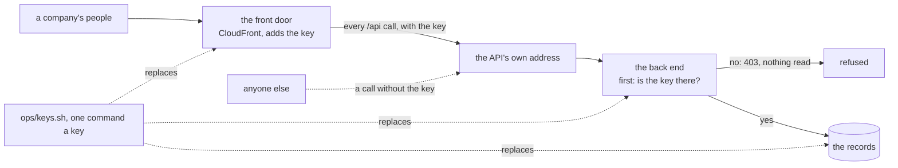

# The back end answers only the front door, and every key is replaced by one command

## At a glance

Today anyone who finds the back end's own address can call it (`ops/env.yml#L262`), and no key can
be replaced: each is made once and left, and the back end's own key in the store has no way to be
changed at all (`ops/README.md#L180-L182`). After this piece:

| What happens | Where it is held |
| --- | --- |
| The front door (CloudFront) adds a secret key to every call it passes on | the distribution, the key's one home |
| The back end refuses any call without it, 403, before anything is read | the back end's first hook |
| Each deploy copies the door's key into the back end's settings | the deploy script |
| A leaked key is replaced by one command, `ops/keys.sh <env> <key>`, and its old value is read back refused | the new script |

The cheapest safe path: a header, $0 a month, over a firewall at about $5 a month fixed, which your
cost line keeps out; an earlier remake of this app used the same shape
(`opus/credo/shared/base-bff/src/guards.ts#L21-L27`). About 2 h 15 of the machine's time, over the
cut's 1 h 20, because the store needs a route to change a key and the stack's part must ship first.
Every act on ridge is yours (👤).

## The slice

One slice, walkable when it ends: on ridge, a call through the app's address answers, the same call
to the API's own address is refused, and each of the four keys has been replaced once by the script
with its old value read back refused.

**The four keys and every copy of each**, grepped rather than taken from open item 134
(`docs/open-items.md#L898`), whose "four" counts the back end's service code, a name and no secret:

| Key | Made by | Its copies | Read by |
| --- | --- | --- | --- |
| the store's internal key | the first release (`ops/release.sh#L91-L109`) | the box's `keys.env`; the function's settings | the store, the back end, every ops script through the tunnel (`ops/lib.sh#L526`) |
| the store's super-admin key | the same file | the box's `keys.env` | the store and the ops scripts' `register`; never the back end (`bff/src/env.ts#L55-L57`) |
| the back end's service key | the first app ship (`ops/app.sh#L99-L114`) | the box's `bff.env`; the function's settings; its hash in the store | the store; the back end, which also signs the operator's sign-in challenges with it (`bff/src/routes/operator-auth.ts#L78`) |
| the front door's key | **new**: `ops/stack.sh`, once a stack | the distribution's origin header; the function's settings | CloudFront, the back end |

The ops scripts read the box's files at every run, so they follow a replacement unchanged. GitHub
holds no key (`ops/stack.sh#L291-L305` sets the role's name alone). The activity log's key is not
on ridge yet and joins the script when that lane carries it there (open item 251).

**Not in this slice:** the wait after wrong passwords (its own lane, owner of the sign-in routes);
the terminal scripts made safe for production (this lane's third milestone); the door's throttle
for a box of companies (the production milestone's setting).

## How each part is decided

- **The key's one home is the distribution.** The API's origin gets an `OriginCustomHeaders` entry,
  `x-front-door-key`, from a `NoEcho` parameter `FrontDoorKey` with no default. `ops/stack.sh` makes
  one (32 random bytes, as `ops/release.sh#L100` does) on a creation and once for a stack made
  before the parameter (as `ops/lib.sh#L395`'s `add_subject_param` does for its own), keeps it on
  every other run, and prints `(not printed)` where `ops/stack.sh#L198` prints each parameter.
  `ops/app.sh` reads the header from the distribution at each deploy, so the back end's copy is
  always what the door sends. *Price:* the deploy role gains one read,
  `cloudfront:GetDistributionConfig` on its own distribution, and `ops/test.sh#L311`'s guard, which
  asserts no CloudFront right today, asserts that read and no write.
  - *Rejected:* the key on the box, like the other three. A stack is made before its box, so the
    door's value would have no source at creation, and a new box would make a key the door does
    not send. *Rejected:* a parameter store resolved into both copies, the earlier remake's way
    (`opus/ops/apps/credo/stack.yml#L354-L356`): a new AWS service and right, and whether a change
    set re-reads a changed value under an unchanged template is unchecked. *Rejected:* a CloudFront
    Function adding the header, which puts the key in the template and git.
- **The check sits in `bff/src/server.ts#L7`'s `buildBff`**, the build the Lambda and the local
  listener share: the first `onRequest` hook, on every route and the not-found handler, before
  `bff/src/app.ts#L160`'s `resolveTenant`. It compares SHA-256 digests with
  `bff/src/calling/constant-time.ts`'s `constantTimeEqual`. `FRONT_DOOR_KEYS` holds one key, or two
  during a replacement, and is required by `readEnv` and `readLambdaEnv` (`bff/src/env.ts#L58`,
  `#L66`). The in-process callers of `buildApp` (the route tests, the generator, the demo and
  root-password commands) pass no door and stay as they are. *Rejected:* `x-origin-key`, the
  earlier remake's name: here "origin" already means the app's address (`APP_ORIGIN`).
- **The local stack stands where the door stands** (`scripts/src/running/front.ts#L42-L48`): it
  mints a key a run, the front adds it to each `/api` call, and the stack's wait for the back end
  (`scripts/src/stack.ts#L253`) sends it.
- **The store gains `POST /api/services/rekey`, behind the super-admin key**, replacing a service's
  key hash, 404 for an unknown code. Registering twice keeps the first key
  (`services/c-storage/internal/store/store.go#L40-L43`), so a leaked service key strands its
  records today, and the memo names this as its trigger (`docs/memo/c-storage.md#L108-L114`). Its
  call goes beside `shared/src/c-storage.ts#L187`'s `registerCStorageService`.
- **Each replacement is one run of `ops/keys.sh <env> front-door|internal|admin|service`**, in
  `ops/seed.sh`'s shape (`ops/CLAUDE.md`'s file to copy). The function's settings are written by one
  `ops/lib.sh` helper taken out of `ops/app.sh#L124-L140`, so the deploy and the key run write them
  alike. Box files are rewritten as the release writes them: 0600, root's, by a temporary file.

| Key | The order | Calls refused meanwhile |
| --- | --- | --- |
| front door | the back end takes old and new; a change set sends the new (refused if it changes anything else); the distribution deploys; the back end takes the new alone | none |
| internal | new `keys.env`, the store restarted and answering; the function's copy set | from the restart to the function's update |
| super-admin | new `keys.env`, the store restarted | none: the back end never holds it |
| service | the store's `rekey`; new `bff.env`; the function's copy set | from the rekey to the function's update |

## The cases

| # | One behaviour, one sentence | Held by |
| --- | --- | --- |
| 1 | A call without the front door's key, or with a wrong one, is 403, and no company is looked up | `bff/src/server.test.ts` |
| 2 | An unknown path without the key is 403, not 404 | `server.test.ts` |
| 3 | While two keys are set, a call with either is answered | `server.test.ts` |
| 4 | The Lambda refuses a call without the key, as the listener does | `bff/src/lambda.test.ts` |
| 5 | A back end without `FRONT_DOOR_KEYS` does not start, and the error names the variable, never a value | `lambda.test.ts` |
| 6 | No log line of a refused call holds the key | `server.test.ts` |
| 7 | The local front adds the stack's key to every `/api` call, and the back end's own port refuses a call around it | `scripts/src/running/front.test.ts`, `scripts/src/stack.test.ts` |
| 8 | The API's origin carries `x-front-door-key` from a `NoEcho` parameter with no default | `ops/test.sh` |
| 9 | The deploy role reads its own distribution and writes nothing on CloudFront | `ops/test.sh` |
| 10 | `stack.sh` makes a key on a creation and once for a stack without one, keeps it otherwise, and never prints it | `ops/test.sh` |
| 11 | `app.sh` sets the function's key from the distribution's, and refuses by name when there is none | `ops/test.sh` |
| 12 | The environment check reads the API's own address refusing a call, and the app answering one sent with a wrong key | `ops/test.sh` |
| 13 | `rekey` replaces a service's key: the old one is refused, the records stay; without the admin key 401, an unknown code 404 | c-storage's Go tests |
| 14 | Each of the four keys is replaced in its order, and the old one read back refused | `ops/test.sh` |
| 15 | A front-door run refuses a change set that touches anything but the distribution, before it runs | `ops/test.sh` |
| 16 | No key reaches a key run's log: the end-of-run search finds none | `ops/test.sh` |

## The steps

Sizes are the runs log's for the same shape: a template change with its guard 10 to 14 minutes, an
`ops/` script change 5 to 7, a back-end hook with its tests 6 to 10, a local-stack change about 8, a
review with its fix pass about 20, a recap 3 to 8; the store's route is a first run, about five a
part. A step's gate is its package's plus the citation test; "the ops gate" is `CLAUDE.md`'s rows 3
to 5 (ShellCheck, cfn-lint, `bash ops/test.sh`).

**Why the stack's part comes before the local slice.** `ops/stack.sh` reads the template from
`origin/main`, and a push to `main` runs the deploy job at once
(`docs/architecture-detail.md`, "How it reaches a machine"). Shipped together, the deploy would look
for a key the door does not send yet. So step 1 lands on `pre-merge` alone, and the door sends a key
nothing checks until the rest lands. It waits for ridge's re-creation (step 1 of
`docs/plans/2026-11-09-ridge-reup.md`, on ridge's branch), so that run does not try the new
`stack.sh` path first; ridge's count of 21 resources holds, as this piece adds none.

- [x] **1. The door's half of the stack.** `ops/env.yml`: the parameter, the origin's header, the
  role's read; `ops/stack.sh`: the key made, kept, taken from a
  0600 file for a key run, masked. Cases 8 to 10. *Done when:* the ops gate's three commands exit
  0, each new guard seen red once. Lands on `pre-merge` alone. **About 20 min**: the template and
  guards about 12, `stack.sh` about 7.
  *Done 2026-11-12, `ac85857e`:* AWS's Service Authorization Reference (JSON form,
  https://servicereference.us-east-1.amazonaws.com/v1/cloudfront/cloudfront.json) lists
  `GetDistributionConfig` with `"Resources":[{"Name":"distribution"}]` and the `distribution`
  resource as `"ARNFormats":["arn:${Partition}:cloudfront::${Account}:distribution/${DistributionId}"]`,
  so the role's read on one distribution's ARN is allowed and matches the template's form. ShellCheck
  (CI form), `cfn-lint ops/env.yml --regions ap-southeast-5` and `bash ops/test.sh` all exit 0 on the
  committed tree. Seen red once each: row 8 with `NoEcho` set false ("FrontDoorKey is not a NoEcho
  string parameter"), row 9 with the role's resource set to `*` ("does not read its own
  distribution's configuration"), row 10 with `stack.sh` printing the key (the "prints as (not
  printed)" cases wanted `1 0`, got `0 2`); each reverted, the files equal to their backups.
- [ ] **2. The cheap end-to-end, on the local stack.** The check and its variable; the front, the
  stack's key and its wait. Cases 1 to 7. *Done when:* `pnpm --filter @credo/bff check` and `pnpm
  --filter @credo/scripts check` each end `== exit 0`, each case red once; one `pnpm stack --
  <command>` run prints a call through the front answered and the same call to the back end's own
  port 403. **About 18 min**: the back end about 10, the stack about 8.
- [ ] **3. The deploy copies the key; the check reads the door.** `ops/app.sh` reads and sets it;
  `ops/lib.sh#L777`'s variable list gains `FRONT_DOOR_KEYS`; `ops/check.sh` reads case 12; the
  comment at `ops/env.yml#L262`, true until now, rewritten. Cases 11
  and 12. *Done when:* `shellcheck` and `bash ops/test.sh` exit 0, each case red once. **About 14
  min**: two scripts at about 7. Your first point here (stage 3).
- [ ] **4. The store replaces a service's key.** The route and its tests, its Bruno request, the
  call beside `registerCStorageService`, a `rekey` command in `scripts/src/ridge.ts`, and the
  memo's hazard rewritten as the promise it now is. Case 13. *Done when:* `make check` in
  `services/c-storage/`, `pnpm --filter @credo/shared check` and `pnpm --filter @credo/scripts
  check` exit 0, the case red once. **About 15 min**: three parts at about 5.
- [ ] **5. The key script.** `ops/keys.sh` and its four orders, the settings helper, its row in
  `ops/README.md`'s table and its runbook section, `ops/README.md#L180-L182` rewritten. Cases 14
  to 16. *Done when:* `shellcheck` and `bash ops/test.sh` exit 0, each case red with its order
  broken. **About 30 min**: four kinds at about 7, the runbook about 3. Your second point here.
- [ ] **6. The review.** Another model reads code, tests and this table (QA's rule 5): one review,
  one fix pass, each finding tagged. *Done when:* each finding is fixed, rejected or deferred with
  its reason, and the fix pass's gates exit 0. **About 20 min.**
- [ ] **7. The prose it makes false, and the recap.** `docs/architecture-detail.md#L321-L330`
  ("answers anyone"), `docs/client-readiness.md`'s sections on the open address and the keys,
  `docs/architecture.md`'s "What is never there" (a row: no call reaches the back end but through
  the door, held by case 1), `docs/memo/bff.md`'s promise; items 121 and 134 closed. *Done when:*
  the citation test exits 0 and `git grep -nE '/Users/|~/'` finds nothing. **About 8 min.** The
  rest lands on `pre-merge`.
- [ ] **8. Ridge, stage 4.** 👤 Each act needs your AWS session, in your own terminal:
  1. With step 1 in `main`: your push; `ops/stack.sh env ridge --plan`, where you will see one
     `Modify` of `Distribution` and one of `DeployRole`, nothing removed or replaced, and
     `FrontDoorKey=(not printed)`; then `ops/stack.sh env ridge`, ending on its verdict.
  2. With the rest in `main`: your push, whose deploy closes the door; then `ops/check.sh ridge`,
     ending `== green` with step 3's two door lines.
  3. One script the machine writes in the credo root's `one-off/`, running `ops/keys.sh ridge` for
     each key and then `ops/check.sh ridge`. You will see each run end on its verdict, its old key
     refused, and its seconds of refused calls where it has any.

  *Done when:* each log, read whole, reads as said, and the recap carries the seconds measured.
  **About 12 min** of the machine's: the one-off about 2, six log reads at about 2.

**Where it meets the other lanes.** Ridge's re-creation builds first and changes no committed file
of this one; step 8 needs ridge up. The continuous copy's plan changes `ops/env.yml`, `ops/check.sh`,
`ops/lib.sh`, `ops/stack.sh`, `ops/test.sh` and the store's `server.go`, all touched here: the
second to land takes `pre-merge` in. The storage client's lane is likely to touch
`shared/src/c-storage.ts`, where step 4 appends one call; the Slack alarm's will add alarms to
`ops/env.yml`; the password wait's routes are not touched. This lane owns the back end's first hook
and `ops/keys.sh`.

## The four stages

1. The cheap build: step 2, the local front standing for the door.
2. Verified locally: each step's gate and its log.
3. A visual a non-coder judges: the diagram below, with step 3's two check lines.
4. Ridge: step 8, since this piece changes what ships, a key and a check.

Drawn from `ops/env.yml#L382-L404`, `bff/src/server.ts#L7` and the script of step 5.

## Your points

1. **The picture of the door, at step 3.** You will see the diagram above and two lines from the
   environment check: the API's own address refused, and the app answering even when a caller sends
   a wrong key of its own. This is the piece's whole promise, said without code. *Is this what you
   mean by "the back end answers only the front door"?* A yes sends it on to ridge as built; a no
   reopens step 2 with what the picture gets wrong.
2. **A few seconds of refused calls while two of the keys are replaced, at step 5.** Replacing the
   store's internal key or the back end's own key changes the store before the back end has the new
   one, so for a few seconds calls fail and the screens show their failed state; you pick the
   moment. *Is a few seconds, measured on ridge, acceptable for production?* I recommend yes: a
   leak is rare and closing it fast matters more. A no adds a step of about 10 minutes, the store
   taking both keys while they switch.
3. **The keys replaced on ridge, at the end of step 8.** You will see the one-off's log summed in
   four lines: each key replaced, its old value refused, the app answering, and the seconds of
   refused calls. *Does ridge show every key replaceable by one command?* A yes closes the
   milestone; a no reopens the key whose line is wrong.

## What was not verified

- That CloudFront overwrites a header of the same name a caller sends: case 12 reads it on ridge.
- That `cloudfront:GetDistributionConfig` takes one distribution's ARN as its resource: read in
  AWS's own words at step 1, before the guard is written.
- How long a changed header takes to deploy, and each window: measured at step 8.
