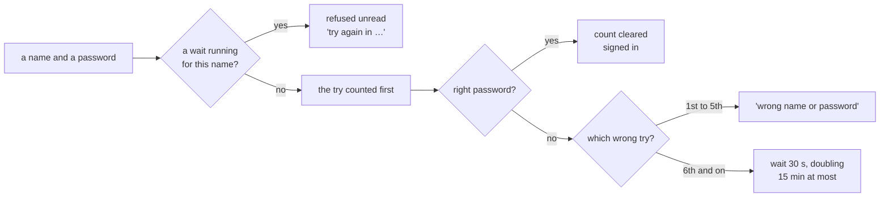

# A growing wait after wrong passwords, plan, 2026-11-11

## At a glance

**The decision most worth your veto: a right password typed during a wait is refused too, unread.**
Otherwise the wait slows nobody, since a guesser would simply keep guessing through it. The screen
says how long is left.

What it is for: someone guessing a company person's password gets five tries free, then waits 30
seconds, twice as long after each next wrong try, at most 15 minutes; a right password clears the
count. It covers the sign-in and changing one's own password, the two places a password is checked.

The cheapest safe path is what exists: one small record a name among the company's records,
written as the sign-in record already is, and one more message on the card that already says
"wrong name or password". The price: that record, that message, one walk run of yours.

## The slice

On the local stack, at a company's sign-in, someone types a name nobody holds and a wrong password
six times: the first five answer "wrong name or password", the sixth "Too many wrong tries. Try
again in 30 seconds." A try within those 30 seconds is refused the same way with what is left; after
them a seventh wrong try waits a minute. The root's right password, typed once no wait runs, signs
in and clears the root's count. The same count stands behind changing one's own password. The walk
"Set up the company" gains screen 12, that sixth answer.

## What the code says, and what the plan decides

**Two routes check a password, and nothing slows either.** The sign-in, `bff/src/app.ts#L319-L341`,
takes a code or an email (`accountOf`, `#L305-L317`, turns an email into the person's code) and
answers one 401 for every refusal (`#L335`). One's own password, `#L401-L424`, checks the current
one at `#L409` and answers 403 when it is wrong. The operator signs in by passkey
(`bff/src/routes/operator-auth.ts` checks no password) and a phone by a QR code (`#L347-L385`). A
grep of `bff/src`, `shared/src`, `ui/src`, `scripts/src`, `walk`, `visual/src` and
`services/c-storage/internal` for lockout, rate limit, attempts, backoff, retry-after, 429 and "too
many" finds only the bounded write retries. The legacy app had no wait either: its sign-in service
checks the password and answers "Invalid email or password" with nothing counted
(`workspace/bffs/credo-sso/src/services/auth.service.ts#L100-L117`), and its guideline reads "No
rate limiting in code — handled at API Gateway level" (`workspace/bffs/credo-sso/CLAUDE.md#L69`).
Open item 28 (`docs/open-items.md#L218`) is this piece, parked "before the first client's own
stack"; the human's numbers replace the count in a window it proposed.

**Decided, the machine's until real clients, each one vetoable:**

1. **Counted per name, in each company, on both routes together.** The name is the one the sign-in
   record is kept under (`shared/src/records.ts#L29`): an email counts on the code it names, and
   one's own password on the signed-in name, so neither route is the way round the other, item 28's
   own reason. *Rejected:* per company, which lets one guesser shut a whole company out; per
   address, which the back end cannot read (Fastify has no `trustProxy`,
   `docs/client-readiness.md#L180`), and one office often shares one.
2. **A name nobody holds is counted and waits like any other**, so the wait says nothing about who
   exists, and the sign-in's one answer for every refusal (`docs/memo/bff.md`'s "A 401 ends the
   session; a 403 ends only the act", its price line) stays true.
3. **The count lives in the store, one record a name**, `tenant.<id>.signin-wait.<SHA-256 of the
   name>`, beside `signInEmail` (`shared/src/records.ts#L69`), holding the wrong tries and when the
   wait ends. So it survives a restart and every copy of the function sees it, which memory would
   not. The key holds a hash because a name nobody holds is often a password typed into the wrong
   box. It sits under the company's prefix (`#L27`), so a company's delete sweeps it
   (`bff/src/records/clients.ts#L163`).
4. **Each try is counted before its password is checked**, and the record removed on a right one.
   Counted after, a burst of tries sent at once would all be checked before any count landed. The
   write goes over the record's tag and is read again on a moved one, `ATTEMPTS` times
   (`shared/src/c-storage.ts#L27`), then a 503 with no password checked, as `rewriteSignIn` does
   (`bff/src/records/staff-records.ts#L108-L113`, `bff/src/errors.ts#L23-L24`).
5. **The numbers, in one home, `shared/src/signins.ts`**, which the back end and the fake both
   import: wrong tries one to five wait nothing; the sixth starts 30 seconds, each next doubles, and
   from the eleventh it is 15 minutes (30 seconds × 2⁵ would be 16).
6. **A try during a wait is refused unread and does not lengthen it**: nothing was checked, so it
   is no wrong try. A new password given by the root or the operator does not clear a wait, which
   ends by itself within 15 minutes.
7. **The answer is a 429, `{ error: 'Wait', waitSeconds }`**, for a wrong try that starts a wait
   and for every try during one; the first five wrong stay today's 401, or 403 on one's own
   password. The card says "Too many wrong tries. Try again in 30 seconds." — seconds under a
   minute, whole minutes rounded up from one — in both languages, in the red alert that already
   draws a refusal (`ui/src/pages/SignIn.tsx#L151-L155`), so no style rule changes. A 429 not in
   the back end's shape, the door's own throttle, still reads "service unavailable", as every
   status but 401 does today (`ui/src/ClientApp.tsx#L205-L210`).
8. **No decay with time:** only a right password clears a count. A name nobody holds is never
   cleared, so a guess over many names leaves one small record each, bounded by the door's
   throttle; filed as item 256.

**What moves that the piece must keep true.** The email sign-in's reads, pinned at four and five
(`bff/src/sign-ins.route.test.ts#L503-L504`), each gain the wait's one read: counts to raise, not
reds to chase. The demo seed's freshness check (`scripts/src/demo/apply.ts#L159-L175`) accepts a
new copy holding the root, its settings and sessions; it accepts waits too, or one wrong name typed
into a new copy makes it "not fresh". `api.signIn` throws on every refusal while `changePassword`
returns its kinds (`ui/src/api.ts#L297-L301`, `#L789-L794`): the wait follows each call's own
pattern, a thrown wait for the first and `{ kind: 'wait', seconds }` for the second. Two walks try
a wrong password and stay below five: the second walk's wrong current password is one try on a
company of its own each opening (`walk/specs/piece-2.spec.ts#L511-L520`, `#L91`), and the root
password walk tries one old password then the new one (`walk/specs/operator-root-password.spec.ts#L118-L121`).

## The case table

| # | The case: one behaviour, one sentence | Held by |
| --- | --- | --- |
| 1 | Five wrong passwords in a row for one name make nobody wait, and the sixth try is still checked | unit, `shared/src/signins.test.ts`; BFF route, `bff/src/sign-in-wait.route.test.ts` |
| 2 | The sixth wrong password answers a wait of 30 seconds, and a try within it is refused with the seconds left, its password unread | BFF route |
| 3 | Each wrong try after a wait doubles it: a minute at the seventh, two at the eighth | unit; BFF route, the seventh |
| 4 | No wait passes 15 minutes: the eleventh wrong try and every later one wait 15 | unit |
| 5 | A right password once no wait runs signs in and clears the count, so the next wrong try is the first of five free | BFF route |
| 6 | A try during a wait does not lengthen it | BFF route |
| 7 | A name nobody holds is counted and waits with the same answers as a real one | BFF route |
| 8 | A sign-in by email and one by the same person's code count on one name | BFF route |
| 9 | A wrong current password on one's own password counts on the signed-in name, and during a wait it answers 429 unread | BFF route |
| 10 | A right current password clears the count the sign-in left | BFF route |
| 11 | Of ten tries sent at once on a name at four wrong, at most two have their password checked | BFF route, the real c-storage |
| 12 | A count's record that moved on every attempt answers 503 with no password checked | BFF route, a client that moves the record |
| 13 | A second back end over the same store refuses during the wait the first one started | BFF route, two apps on one c-storage |
| 14 | The store holds no typed name: a wait's key ends in the name's SHA-256 | unit, `shared/src/records.test.ts` |
| 15 | A wait's key starts with its company's prefix, so the company's delete takes it | unit, `shared/src/records.test.ts` |
| 16 | The sign-in card draws a wait as "Try again in 30 seconds", and in whole minutes from one minute up, in both languages | UI, `ui/src/pages/SignIn.test.tsx` |
| 17 | A 429 not in the back end's shape still reads as the service unavailable | UI, the api's test |
| 18 | One's own password page draws the same wait | UI, the page's test |
| 19 | The fake answers a name's sixth wrong try with a wait of 30 seconds | UI, the fake's test |
| 20 | A new copy whose only extra records are waits still reads fresh to the demo seed | scripts, the seed's test |
| 21 | Screen 12 shows the sixth answer, and no other picture of the walk moves | the walk, `walk/specs/piece-1.spec.ts`, your run |

## The steps

Each size is the minutes the same shape took in its last runs (`worktrees/runs.tsv`), or about five
for a first run of its shape. Every gate is `pnpm --filter @credo/<pkg> check`, plus the citation
test, `pnpm --filter @credo/scripts exec vitest run src/citations.test.ts`.

- [x] **1. The fake first: the rule, the words, the screen.** About 13 minutes: the rule in
  `shared/`, a first run of its shape, 5; the screen state on the fake, 8, as the last steps that
  added a state to a screen. The numbers, `waitAfter` and the wait's reply schema in
  `shared/src/signins.ts`; the thrown wait and `changePassword`'s kind in `ui/src/api.ts`; the
  card's `wait` state and the own-password page's; both dictionaries; the fake counting wrong tries
  per name with `waitAfter` (`ui/src/fake.ts#L589-L602`, where any other name is refused); mock
  screen 12 (`ui/src/mock/screens.tsx`, beside screen 2 at `#L80-L86`); and the walks page's screen
  12 of "Set up the company", appended after screen 11 (`visual/src/walks.ts#L444-L455`) with a
  question of its own, never `SIGN_IN_LOOK`, so the doors test (`visual/src/walks.test.ts#L39-L56`)
  stays as it is. Cases 1, 3, 4 (unit), 16 to 19. *Done when:* the checks of `shared`, `ui` and
  `visual` each end `== exit 0`, the citation test exits 0, and `pnpm report` builds a page whose
  grep for screen 12's sentence counts 1. Your point 1 opens here, and the work goes on.
  *Done, 2026-11-12:* the rule, the words and the screen are on the fake; the checks of `shared`, `ui`
  and `visual` each ended `== exit 0` on the committed tree, the citation test exited 0, and the
  built page's grep for screen 12's sentence counted 1. Cases 1, 3, 4 and 16 to 19 were each seen red
  on a one-line break and put back; the cap of 15 minutes was seen red alone, and a doubling clamp
  that no case could redden was removed. Two things differed from the step as written: the walk
  specs test of `visual` named every screen against the spec lines, so it now exempts screen 12 by
  id until step 4 adds its line (step 4 empties that list); and the Vietnamese of screen 12's
  question went into `visual/site/questions-vi.json`, which the step did not name.
- [x] **2. The thinnest slice through the stack: the sign-in waits.** About 10 minutes, as the last
  step that gave every route of one kind one behaviour. The record, its schema and its key in
  `shared/src/records.ts`; `bff/src/records/sign-in-wait.ts`, the count-first write and the clear,
  copying `rewriteSignIn`'s bounded loop; the sign-in route reading it after `accountOf` and before
  `checked` (`bff/src/app.ts#L326-L331`). Cases 1, 2, 3, 5, 7, 8, 14, 15. *Done when:* the checks
  of `shared` and `bff` end `== exit 0`, with the email test's counts raised to five and six, and
  the citation test exits 0.
  *Done, 2026-11-12:* the sign-in waits through the real back end. The checks of `shared` and `bff`
  each ended `== exit 0` on the committed tree, with the email test's counts at five and six and
  coverage at 100 %; the citation test exited 0. Cases 1, 2, 3, 5, 7, 8, 14 and 15 were each seen
  red on a one-line break (the refusal removed, the clear removed, the typed email counted in place
  of the person's code, the wait read one try early, the key without its company's prefix, the key
  without the hash) and put back. Differed from the step as written: the module takes the company's
  client (`request.storage`) and `now`; two older tests that watch for removals now ignore the
  sign-in's own clear of its wait; and case 12 (the 503 on a moved record) was added here, since
  the module's coverage needed its line, so step 3 keeps cases 6, 9 to 11, 13 and 20.
- [x] **3. Hardened: one's own password, tries at once, a second back end, the seed.** About 25
  minutes: 20, as the last step that held every route of one behaviour by its own test, and 5 for
  the seed's check, a first run of its shape. Cases 6, 9 to 13 and 20, each seen red once by
  breaking its line and putting it back; coverage at 100 %. *Done when:* the checks of `bff` and
  `scripts` end `== exit 0`, and the recap's evidence names each case's red.
  *Done, 2026-11-12:* the wait holds on one's own password, for tries at once, over a second back end
  and in the demo seed's freshness check. The checks of `bff` and `scripts` each ended `== exit 0` on
  the committed tree, `bff` with coverage at 100 %; the citation test exited 0. Cases 6, 9, 10, 11,
  13 and 20 were each seen red on a one-line break and put back: case 6 with the refused try
  writing a count (it reddened 11 too), 9 with the own-password route not counting, 10 with its
  clear removed, 11 with the write's moved answer ignored, 13 with the count keyed by the app
  instance, 20 with the seed not accepting a wait's key. Differed from the step as written: the
  own-password route did not count at all yet (step 2 wired the sign-in only), so this step wired it
  there, counting on the signed-in name; case 6 already held in the code from step 2 and is now
  pinned by a test; two older tests were wrong for the new write, one interfering hook of
  `sign-ins.route.test.ts` disarmed on the wait's own write, and the in-memory store of
  `scripts/src/dashboard-list.test.ts` removed nothing, so the generator's sign-ins left waits and
  the second of one person answered 429 (seen red first).
- [x] **4. The walk's screen 12, appended.** About 8 minutes, as the last step that added a look's
  screen, plus 5 to read your run's log and commit its pictures, a first run of that shape. In
  `walk/specs/piece-1.spec.ts`, right after screen 2 (`#L91-L96`), while the settings are still as
  the stack made them: a name nobody holds, one for each language and width, since a pass's six
  tests share one stack (`walk/run.sh#L46`); six wrong passwords; the shot `12-sign-in-wait`; then
  the root's name typed back, since screen 3 types only the password (`#L99`). The header becomes
  twelve screens, 72 pictures. *Done when:* the check of `walk` ends `== exit 0`; then **your run**
  (point 2) ends "== verdict: green" with no screen named as moved; the machine reads its log whole
  and commits the six new pictures.
  *Done, 2026-11-12:* the walk's screen 12 is in `walk/specs/piece-1.spec.ts` after screen 2, the
  header at twelve screens and 72 pictures, and the walks test's exemption for screen 12 is gone.
  The checks of `walk`, `visual` and `ui` each ended `== exit 0` on the committed tree. The step
  is replayed in jsdom on the fake with the real router (`ui/src/pages/SignInWaitWalk.test.tsx`, both
  languages): five refusals, the sixth the wait of 30 seconds, and the root's name typed back; seen
  red with the loop one try short. Six wrong tries need no real waiting, since the wait starts on
  the sixth answer. Not yet run: the full walk, which is point 2, the human's; its six pictures are
  committed after it.
- [x] **5. The pages the piece makes true.** About 10 minutes, as the last step that brought a memo
  and a guideline in line with the code. `docs/memo/bff.md` gains a section titled as its claim,
  "Six wrong passwords make a name wait, and a right one is refused during the wait", with its
  price and the hazard of item 256; `docs/client-readiness.md`'s lines that say nothing slows a
  guess (`#L156`, `#L168`, `#L289`, `#L546`) and `docs/products.md#L92`'s say what holds now.
  *Done when:* the citation test exits 0 and `git grep -n -i -e "nothing slows a" -e "only brake on
  a guess" -e "limit on wrong" docs ':!docs/open-items.md' ':!docs/plans' ':!docs/recaps'` counts 0.
  *Done, 2026-11-12:* `docs/memo/bff.md` has the section titled as its claim, with its numbers, the
  two routes counted together, the right password refused during a wait, the price (anyone who knows
  a name can make it wait) and the hazard of item 256, and a row in its table. `docs/client-readiness.md`
  (the heading, the guess paragraph, the log sentence, the fourth gap and the product-reader
  paragraph) and `docs/products.md`'s first known gap now say the wait holds and what it leaves.
  The grep counts 0 and the citation test ended `== exit 0`. Each sentence was read against
  `bff/src/records/sign-in-wait.ts`, the two routes in `bff/src/app.ts`, `shared/src/signins.ts` and
  `scripts/src/demo/apply.ts`. Item 28 stays for the recap to delete.
- [ ] **6. The review**, on opus, the code being sonnet's (QA rule 5): one review, one fix pass,
  that pass's own checks the re-check, and the reviewer's reread of the fixed lines. About 23
  minutes: 11, 9 and 3, the last rows of each. *Done when:* every finding is tagged in the recap
  and the fix pass's packages' checks end `== exit 0`.
- [ ] **7. The recap.** About 5 minutes, the last recaps' median: half a page, open item 28
  deleted, and `docs/products.md`'s row for the sign-in. *Done when:* after `git merge
  pre-merge`, the citation test exits 0; the landing on `pre-merge` is the orchestrator's.

About 99 minutes of machine time in all, against the milestone's 40, which counted the back end
alone; the fake, the walk screen, the pages and the review are what the difference buys.

**The four stages.** Stage 1 is steps 1 and 2, the fake first. Stage 2 is every step's own checks,
step 3's reds and step 6. Stage 3 is screen 12 on the walks page after step 1 (point 1), and your
walk run after step 4 shows the real stack draws it. **Stage 4, ridge, is not stood up for this
piece:** it adds no resource, hop or key (collaboration's hand-off 3), so stage 2 stands in; ridge
gets it with the next deploy of `main`, from your push.

## Your points

1. **After step 1, a look.** On the walks page, the walk "Set up the company: its name, colour and
   languages", screen 12, "Sign-in after six wrong passwords": the sign-in card with one red line,
   "Too many wrong tries. Try again in 30 seconds." **Would someone who mistyped their password
   know from it how long to wait before trying again?** A yes closes it; a no reopens step 1's
   words, and nothing else waits on it.
2. **After step 4, your act, not a look:** `bash walk/run.sh piece-1 --write` in your terminal,
   from the piece's worktree, since no browser starts in the machine's sandbox. Green with no
   screen named as moved proves only screen 12 is new and the other eleven did not move a pixel.
   The machine reads the log and commits the six pictures; a red names the one that moved.

**Yours alone:** the walk run (point 2) and the push that takes it to ridge, after the landing.

## Where it meets the other lanes

- **The front door and its keys**, whose check sits at the back end's way in, will likely touch
  `bff/src/app.ts`, where both routes sit, and `docs/client-readiness.md`'s section at `#L156`,
  where item 121 stands beside item 28. Different lines; whichever lands second takes `pre-merge`
  in and keeps both.
- **The one-company storage client** puts one guarded client on each request once the company is
  known and refuses any key outside the company's prefix; it changes the sign-in handlers in
  `bff/src/app.ts` only in which store they read through. The wait's key is built by
  `recordKeys.tenant(id)`, inside that prefix (decision 3, case 15), so the guarded client admits
  its three calls (a read, a write over a tag, a remove). If that client is on `pre-merge` when step
  2 starts, the new module is handed it; if not, it takes `storage` as every route does today, and
  that lane's own step moves it with the rest. It reads `shared/src/records.ts`, where this piece
  adds the wait's key, and changes nothing there. Whichever lands second takes the other's lines in.
- **The Slack alarm** shares no file with this piece.
