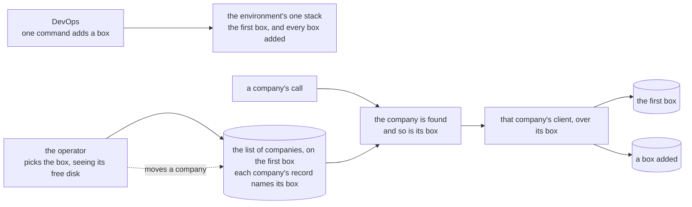

# Companies pooled on boxes, plan, 2026-11-11

## At a glance

**What it is for:** several companies share a box, DevOps decides how many boxes there are and adds
one with a command, and an operator decides which box each company lives on, seeing each box's free
disk, and can move a company later. No number of companies a box is written anywhere: it is the
operator's choice. A company's people see no change.

**The cheapest safe path** keeps one box working as it does: the first box keeps the list of
companies; a company's record names its box, no name meaning the first; the back end is handed the
other boxes in one more setting; a box added is one more name in a list the stack command takes.
About 3 h 15 of machine time in three landings (90, 72 and 35 minutes), each after another lane;
three looks of yours, your push, a walk run and four acts on ridge.

## The slice

DevOps adds a second box to ridge by one command. The operator adds a company and puts it on that
box, picking it from a list that shows each box's free disk and how many companies it holds. The
company's people sign in and work, every record landing on the second box and only the company's
line in the list on the first. The operator then moves the company to the first box, its people
sign in again and find their records, and the second box holds none of them.

## What the code says, and what the plan decides

**Today.** One box an environment. The back end is handed one store, four variables in
`bff/src/env.ts`'s `storageShape`, and `bff/src/server.ts`'s `buildBff` makes the one client.
`bff/src/app.ts`'s `resolveTenant` reads the company's line, `client.<code>` to
`shared/src/records.ts`'s `storedClientSchema` (`id`, `name`, `madeAt`, strict, naming no box). The
operator's form sends a code and a name (`shared/src/wire.ts`'s `createClientRequestSchema`). In
`ops/env.yml` one `Box`; every rule into it names its group, not the box: `BoxGroup`, `BoxFromBff`,
and `BffGroup`'s one egress rule to `BoxGroup`. Only the deploy role names the box itself
(`PushKeyToOwnBox` on `${Box}`, `TunnelToOwnBox` on `${Box.PrivateIp}`). Every ops script reaches
"the box" through `ops/lib.sh`'s `box_open`, which reads the stack's `BoxId` and `BoxAddress`.

**Nothing routes a company to one of several boxes already.** In the repository, `bff`, `shared`,
`scripts` and `ui` hold no list of boxes. The legacy back end takes one storage address from its
settings (`workspace/bffs/credo-sme/src/configs/env.ts`, `connectors.storage`), its `target` an
upstream for the whole deployment, and its storage knows callers by service code, never a company
(`workspace/services/c-storage/CLAUDE.md`).

**Decided, the machine's:**

1. **The first box is the home box and keeps the list of companies** and the operator's records:
   `ops/env.yml`'s `Box`, unchanged. *Rejected:* a box of the operator's own, as the final
   architecture page draws: a fixed charge of about $4 a month an environment that buys nothing yet,
   since it would still be the one place every call reads first. *Flips it:* the home box's disk or
   writes are the ones that bind.
2. **A company's line names its box.** `storedClientSchema` gains `box`, optional: a line without one
   is on the home box, so every company made before reads as today and nothing rewrites it. A new
   company's line always names its box. A box's name is a few lowercase letters and digits; `home` is
   the first box's.
3. **The back end is handed the other boxes in one setting,** `STORAGE_BOXES`, JSON, each box by
   name with its address, internal key and service key; the four variables stay the home box's.
   Absent, there is one box, as every route test, `pnpm stack` and the tunnel's callers of
   `readStorageEnv` have today. *Rejected:* one list replacing the four, which changes every caller.
4. **The lookup reads the line on every call, with no memory.** `resolveTenant` reads it from the
   home box, then makes the company's client over the box it names. *Why no memory:* the read costs
   under 2 cents a company a month (the routing page's price), and without one a move's mark is seen
   by the very next call, so the move waits only for calls already running. *Flips it:* a measured
   lookup that is the slow part of a call.
5. **A line naming a box the back end was not handed answers 503,** as a store that does not answer
   does, so the screens offer a retry; the log names the box and never a key.
6. **The box's own check that it holds the company is held by an absence**, at no read: sessions,
   people and the root exist only on the company's own box, so on a wrong line a signed-in call is
   refused, a sign-in finds nobody, and the root password route throws on the missing root
   (`bff/src/routes/root-password.ts`, "a client's root sign-in record is missing"). Only the delete
   would harm, sweeping nothing and removing the line; so `deleteClient` first reads the company's
   settings on the named box and stops, nothing removed, when there are none.
7. **The operator's form takes the box.** `createClientRequestSchema` gains `box`, optional (absent
   is home, so a page built before still works); a box not held is a 400 naming the field.
   `createClient` writes settings and root on the chosen box, the line last on the home box.
8. **The operator sees each box** through one new route: its name, how many companies it holds
   (from `listClients`' lines) and its free disk, from the continuous copy's c-storage reading (`GET
   /api/status`, behind the internal key), which `shared/src/c-storage.ts`'s `CStorageClient` gains a
   call for. A box that does not answer is shown so, the others still. The services page keeps to the
   home box (item 272).
9. **Item 246's scripts** (`scripts/src/demo/apply.ts`, `apply-support.ts`, `ledger.ts`,
   `scripts/src/root-password.ts`) reach a company through `tenantStorage` over the home box, and
   refuse by name, writing nothing, a demo copy whose line names another box: the six demo copies
   live on ridge's home box, and one moved off it is no longer seeded (item 271).
10. **A box added by command, in the environment's one stack.** `Box` stays as ridge's re-up and the
    continuous copy leave it. More boxes come from one loop over a `MoreBoxes` list (CloudFormation's
    `Fn::ForEach`), its body the home box's block (the instance, and the continuous copy's disk,
    attachment, role and bucket path) with outputs by name, held equal to `Box` but for its names by
    `ops/test.sh`. A box added joins `BoxGroup`, so the rules into it already hold; the deploy role's
    two box statements name the environment's boxes by `Env` tag and subnet, not `${Box}`.
    `ops/stack.sh env <env> --more-boxes b2,b3` passes the list, and without the flag the stack keeps
    its own; a box taken out is a removal the fence refuses unless named. `box_open` learns a box by
    name; `ops/app.sh` registers the back end on each box and writes `STORAGE_BOXES`; `ops/release.sh`
    and `ops/check.sh` go over every box; `ops/tunnel.sh` and `ops/drill.sh` take `--box`. **The
    step starts by reading AWS's own pages**, since nothing here has used the loop: where it may
    stand, an empty list, outputs, the capability a change set then needs, Instance Connect's two
    actions under a tag and a subnet, and cfn-lint 1.46's reading. *Fallback if it refuses:* a block
    per box, copied from `Box` in minutes, so a box is a commit and a push before the command.
    *Rejected:* a small stack a box, against the human's own "deploy all in a single cloudformation"
    (2026-11-11); every box in the loop, `Box` included, which renames ridge's box and replaces it.
11. **The move routes; the copy is the store's.** The operator marks the company moving (its line
    gains `moving` and the box it goes to), and from the next call every call of it answers 503, its
    screens offering a retry. The move waits out the back end's 10-second limit (`ops/env.yml`'s
    `Bff`, `Timeout`), so no call that read the line before the mark still writes; the copy tool
    copies and compares; the switch, refused unless the comparison was equal, points the line at the
    new box and clears the mark; the old copy is swept as a deleted company's is. The operator's page
    gains "Move to another box", with the same list.

## What it consumes, and where other lanes meet it

- **The one-company storage client** (`docs/plans/2026-11-11-store-one-company.md` on its own
  branch, "What the pooled shape consumes"): `tenantStorage(store, tenantId)`, called in four places,
  whose first argument becomes the company's box; landed on `pre-merge` before step 1.
- **The continuous copy**: its c-storage reading (its step 4) before step 3's second part; the whole
  piece landed before step 6, whose loop copies the box's block it leaves and whose scripts it also
  changes.
- **The copy tool** (the store's second milestone, planned on its own branch): one company's records
  copied from one store to another in bounded, resumable calls, and a comparison by count and by each
  record's tag that says equal or not. Step 7 consumes those two and nothing else, whatever their
  final names, and does not plan the copy.
- **Ridge back by its command** (its re-up plan) before the human's acts on ridge.
- **Files in common.** `bff/src/app.ts` and `bff/src/records/clients.ts` with the one-company client,
  which lands first. `ops/env.yml`, `ops/lib.sh`, `ops/release.sh`, `ops/check.sh`, `ops/drill.sh`
  and `ops/test.sh` with the continuous copy and ridge's re-up, and the scripts with the door's third
  milestone (every terminal script safe on production); step 6 takes `pre-merge` in before its gate
  and builds on their lines, never beside them.

## The steps

Each gate is the touched package's `pnpm --filter @credo/<pkg> check`, `pnpm check` where a step
crosses packages, `bash ops/test.sh` and `shellcheck -x ops/*.sh` for `ops/`, plus the citation test
`pnpm --filter @credo/scripts exec vitest run src/citations.test.ts`, each by its own exit code; each
case red once on its own assertion, then put back. Stage 1 is step 1, two boxes on invented data;
stage 2 each gate; stage 3 point 1; stage 4, ridge, is stood up, since the piece adds a resource, a
hop and keys. Under a day of machine time, it lands three times on three waits, each landing a
milestone if the orchestrator wants one.

**First landing: the box in the record and the operator's choice** (after the one-company client).

- [x] **1. One company on a second box, end to end.** Decisions 2 to 5 and 7, with a route test whose
  second service on the file's c-storage stands for a second box. *Done when:* `pnpm check` ends `==
  exit 0`; cases 1 to 5 and 7 red once; `git diff --stat pre-merge -- '*.test.ts'` names new files
  alone. *Size:* 10, the last step adding one mechanism with its test and routes on it (the activity
  log's third, 10). *Ticked 2026-11-14:* a line's `box` and the form's, `STORAGE_BOXES` read at
  start, the lookup over the box a line names (503 for one not held), the create on the chosen
  box; cases 1 to 5 and 7 each red once by a mutation of its code (a default box `b2`, settings
  written on the home box, the company's client made over the home box, a held-box fallback to
  home, a malformed value read as no boxes, the form's unheld-box check removed), put back;
  `pnpm check` ended `== exit 0`; new test files alone, and `bff/tests/tenant.ts`'s `bffOn`
  gained a `boxes` option; the local stack's BFF environment carries `STORAGE_BOXES` as `{}`, which the
  old test of its exact variable list needed until step 4 hands it a second box.
- [x] **2. Every act on its box, and the scripts.** Two parts. The delete and the root password
  (decision 6): *done when* the bff gate ends `== exit 0`, cases 6 and 10 red once; *size* 10, the
  same shape. Item 246's four scripts (decision 9): *done when* the scripts gate ends `== exit 0`,
  case 11 red once, and `grep -rnE 'recordKeys\.tenant\(' scripts/src --include='*.ts'
  --exclude='*.test.ts'` shows calls on a company's client alone; *size* 15, the last step that
  taught the seed where to write (the local copy's fourth, 15).
  *Ticked 2026-11-14:* the delete and the root password take the company's store from the line's
  box (503 for one not held); the deletion record names a box that is not home, so a resumed press
  sweeps the right one; a delete whose box lists none of the company's records answers 409 and
  removes nothing, the line included (a check on the route before the touch, not inside
  `deleteClient`, so the terminal scripts' deletes keep their answers). Cases 6 and 10 red once
  (the 409 check disabled; the company's client made over the home box). The seed, its ledger, its
  freshness check, the support readers, the root password script and the drill record go through
  `tenantStorage`; the seed and the root password script refuse a copy whose line names another box,
  naming it, writing nothing; case 11 red once in each (the refusal disabled). The grep shows
  calls keyed on a company's client alone. `pnpm check` ended `== exit 0`.
- [x] **3. The operator's choice.** Two parts. The form's list on the fake first (`pnpm fake`,
  `ui/src/fake.ts` answering two boxes): *done when* the ui gate ends `== exit 0`, case 9 red once;
  *size* 8 (the shared record page's add screen, 8). Then the boxes route and the status call
  (decision 8), once the continuous copy's reading is on `pre-merge`: *done when* `pnpm check` ends
  `== exit 0`, case 8 red once; *size* 10, step 1's shape.
  *First part ticked 2026-11-14:* the add-company form lists each box (name, free disk in GB, its
  companies) when there is more than one, the home box chosen, a box that did not answer shown so and
  not choosable; the home box chosen sends no box, another sends it; the page reads the list through
  `operatorBoxes`, and a list that does not come leaves the form as before. `shared/src/wire.ts` gains
  the route name and the reply's shape, `DEMO_BOXES` the fake's two boxes (`home`, `b2`), the fake
  counts a company made on `b2` there. Case 9 red once by three mutations (the form's default box
  `b2`, the page not passing the box, a down box left choosable), put back. Two old tests gained a
  stub line for the new call (`App.test.tsx`, `OperatorApp.test.tsx`) and `fake.test.tsx`'s list of
  the fake's calls one name, no expectation changed. Look: `pnpm fake`, the operator's
  add-a-client screen.
  *Second part ticked 2026-11-14:* the store already served `GET /api/status` (`freeBytes`,
  `lastWriteAt`); `CStorageClient` gains `status()` (the internal key alone, waiting 3 seconds as
  `health` does), and `GET /api/operator/boxes` answers each box the back end holds, the home box
  first, with its companies counted from the lines on the home box (`companiesByBox`) and its free
  disk, null for a box whose status did not answer, the others still shown, and the log naming the
  box. Case 8 red once by three mutations (every company counted on the home box, a failed status
  left to fail the route, a down box shown with 0 free), put back. `operator.route.test.ts`'s
  pinned list of routes gained the new line, and three scripts tests' in-memory stand-ins of the
  client (`dashboard-list`, `generator`, `local`) one `status` line each. Gates: shared, bff, ui and
  scripts each `== exit 0`.
- [x] **4. Two boxes on this machine, and the screen to look at.** `pnpm stack` registers a second
  service as box `b2` and hands it in `STORAGE_BOXES`; the operator walk gains, appended and never
  inserted, the form with its list of boxes. *Done when:* `pnpm --filter @credo/scripts check` and
  `pnpm --filter @credo/walk check` end `== exit 0`, `scripts/src/stack.test.ts` gaining the case
  that a company added on `b2` through the stack's own front is read back from `b2`'s service, red
  once. *Size:* 10, the last step that taught the local stack a part (the local copy's second, 10).
  Then 👤 point 1: `bash walk/run.sh operator`, in your terminal.
  *Ticked 2026-11-14:* `pnpm stack` (`withStack`) starts a second c-storage as box `b2` on a folder of
  its own, registers the BFF's service there and hands it in `STORAGE_BOXES`; `startStack` takes the
  names in `moreBoxes` and runs none by default, so `pnpm local` keeps one box (its handle holds no
  second box's keys, a resume runs none). The stack hands a command no box's keys. The walk's operator
  spec gains screen 10, appended (`op-10-box-chosen`: the form with `b2` chosen, then made), its
  visual scene and question (Vietnamese line added), and `walks.test.ts`'s count of the walk's screens
  went from nine to ten. The list's lines hold the machine's own free disk, so screens 2, 4, 8, 9, 10
  and the passkeys walk's screen 6 mask the list; screens 2, 4, 8 and 9 show the list now and move
  against their bases (`--moved op-2-new-client,op-4-code-taken,op-8-code-invalid,op-9-make-failed`
  with passkeys' `pk-6-sign-in-ended`). `stack.test.ts` gains the case that a company added on `b2`
  through the front is read back from `b2`'s service and not from the home box's, red once (the
  stack's BFF handed no boxes: the make answers 400). The walk was not run: it is the human's.
- [x] **5. Hardened, the pages true.** Coverage at 100 % with no new hint; `docs/architecture.md`'s
  and `docs/architecture-detail.md`'s pooled sections rewritten to what is built (no figure of
  companies a box, no box of the operator's own, no memory of the lookup), `docs/memo/bff.md` on the
  lookup and the 503. *Done when:* `pnpm check` ends `== exit 0` at 100 %, the citation test exits 0,
  `git grep -nE '/Users/|~/'` finds nothing new. *Size:* 10 (the store's step 3, 10).
  *Ticked 2026-11-14:* coverage held at 100 % by the whole gate with no new hint (the code of steps 1
  to 4 carried its own tests; nothing was added to the code). `docs/architecture.md`'s and
  `docs/architecture-detail.md`'s pooled sections now say what is built (the line's box, `STORAGE_BOXES`,
  the lookup with no memory, the 503, the operator's list of boxes, two boxes on the local stack) and
  what is not (a box added to ridge by command, the move, the address), with no figure of companies a
  box and no box of the operator's own; `docs/memo/bff.md`'s tenant section carries the lookup, the
  absence that holds the box's check, and the 503. Two walk changes of step 4 made with it: the
  boxes' mask is now a block over each line's figures alone (`boxFigures` in `walk/support.ts`, used
  by screens 2, 4, 8, 9 and 10 of the operator walk and `pk-6-sign-in-ended` of both passkeys
  passes), so those pictures show each box's name, its radio and the chosen one. The citation test
  exited 0 and `git grep` for local paths found nothing new. The walk was not run: it is the human's.
- [x] **5r. Reviewed, fixed, recapped.** A model other than the author's, one fix pass, a recap.
  *Done when:* every finding tagged in the recap, the fix pass's gate `== exit 0`, the recap
  committed. *Size:* 14 and 3 (the cross-company tests' review, fix and reread, 6, 6 and 2; recap 3).
  *Ticked 2026-11-14:* opus reviewed (two must-fix findings, six Lows); the fix pass made the delete read the company's settings on its box and `deleteClient` refuse a box it was not handed, with `ridge.ts`'s two other commands, and filed five Lows as items 440 to 443 and 445; the bff and scripts gates each ended `== exit 0` on the fix; every finding is tagged in the recap, item 246 is closed and the memo's sentence made true; the recap is committed with its markers for the reread, the whole check, `main` and ridge.

**Second landing: a box added by command** (after the continuous copy is on `pre-merge`).

- [ ] **6. The loop, the role, the scripts.** Four parts, in order, each *done when* `bash ops/test.sh`
  exits 0 with its cases red once: AWS's and cfn-lint's reading, quoted in the tick (done when each
  of the six questions has a sentence of AWS's own, or the fallback is taken and said; *size* 5, a
  first run); the loop and its guard, cases 12 and 13 (*size* 10, the box's retention step, 10); the
  deploy role, case 14 (*size* 8, the access log's guard, 8); the scripts learning a box, case 15,
  `shellcheck -x ops/*.sh` at 0 too (*size* 14, the ten scripts' guard, 14). The runbook gains
  "Adding a box".
  *Part 1 ticked 2026-11-14 (AWS's and cfn-lint's reading; the loop stands, no fallback).* Pages fetched:
  the `Fn::ForEach` and `AWS::LanguageExtensions` pages of the Template Reference, its Outputs examples,
  `CreateChangeSet`'s API page, and the service reference JSON for `ec2-instance-connect`.
  (1) *Where it may stand:* "`Fn::ForEach` can contain other intrinsic functions, including `Fn::ForEach`
  itself, and be used within the `Conditions`, `Outputs`, and `Resources` (including the resource
  properties) sections." (`https://docs.aws.amazon.com/AWSCloudFormation/latest/TemplateReference/intrinsic-function-reference-foreach.html`);
  and "If you use the `Fn::ForEach` intrinsic function in your template, you must also use the
  `AWS::LanguageExtensions` transform." (same page).
  (2) *An empty list:* not found on the pages fetched (the `Fn::ForEach` page, its Resources, Outputs
  and Conditions examples index, the transform's page); the loop's collection is "an array in this
  parameter, or ... a `Ref` to a `CommaDelimitedList`" (same first page), so the loop takes
  `MoreBoxes` as a `CommaDelimitedList` with default `''`, and ridge's `--plan` (point 2) is where an
  empty one is first read by CloudFormation itself; item 446.
  (3) *Outputs from the loop:* "These examples demonstrate using the `Fn::ForEach` intrinsic function
  in the `Outputs` section." with an output key `S3Bucket${Identifier}${Property}` per item
  (`https://docs.aws.amazon.com/AWSCloudFormation/latest/TemplateReference/intrinsic-function-reference-foreach-example-outputs.html`);
  the key is built from the identifier as a resource's logical id is, so `Box${Name}Id`.
  (4) *The capability:* "This capacity doesn't apply to creating change sets, and specifying it when
  creating change sets has no effect." about `CAPABILITY_AUTO_EXPAND`
  (`https://docs.aws.amazon.com/AWSCloudFormation/latest/APIReference/API_CreateChangeSet.html`); the
  transform page itself names "when you create or update a stack using a change set" and no
  capability. So the change set needs none beyond `CAPABILITY_IAM`; `stack.sh` still passes
  `CAPABILITY_AUTO_EXPAND` beside it, which AWS says has no effect there.
  (5) *Instance Connect's two actions under a tag and a subnet*, from the service reference JSON
  (`https://servicereference.us-east-1.amazonaws.com/v1/ec2-instance-connect/ec2-instance-connect.json`):
  `SendSSHPublicKey` has the resource `instance` (`arn:${Partition}:ec2:${Region}:${Account}:instance/${InstanceId}`),
  its resource condition keys `aws:ResourceTag/${TagKey}` and `ec2:ResourceTag/${TagKey}`, its action
  condition key `ec2:osuser`, and no subnet key; `OpenTunnel` has the resource `instance-connect-endpoint`
  with the condition keys `ec2-instance-connect:privateIpAddress`, `ec2-instance-connect:remotePort`,
  `ec2-instance-connect:MaxTunnelDuration` and the two tag keys. So a tag scopes the key push, and the
  subnet scopes the tunnel by its address range (`privateIpAddress` as the subnet's CIDR), which is
  what the deploy role will say.
  (6) *cfn-lint:* 1.46.0 would not install here (no package host in the sandbox) and its source path
  404s, so this was read at the installed 1.59.0, its `_language_extensions.py`: a collection that is a
  `Ref` is resolved from the parameter's default or value, and an inline empty list raises "Fn::ForEach
  could not be resolved" (E0001), while a `CommaDelimitedList` parameter whose default is `''` passes with
  no loop error; run on a loop in `Resources` and `Outputs` it printed only the hardcoded-zone warning of
  the scratch template. CI pins 1.46.0, so the loop's commit is the first proof at that version; its
  `ops` job reads it.
  *Part 2 ticked 2026-11-14 (the loop and its guard, cases 12 and 13).* `ops/env.yml` gains the transform,
  `MoreBoxes` (a `CommaDelimitedList`, default none), one loop in `Resources` whose body is the home box's
  block (instance, role, profile, records disk, attachment) with the box's name as its path in the copy's
  bucket, and one in `Outputs` (`Box<name>Id`, `Box<name>Address`, `RecordsVolume<name>Id`); `Box` and every
  other resource are as they were. `ops/stack.sh env <env> --more-boxes b2,b3` passes the list (checked first:
  a lowercase name, not `home`, none twice, blank is none) and without the flag keeps the stack's own, none
  for a stack made before the parameter; the change set carries `CAPABILITY_AUTO_EXPAND` beside IAM. The
  guards read `env-full.json` for the loop and `env.json` (the loop taken out) for everything they read
  before. Case 12 red once (before the loop existed: the transform missing; then by ten mutations of the
  loop, put back: another instance type, an unencrypted records disk, a disk without its keeping, an
  attachment to the home disk, a role over `Box/`, a wider list prefix, a sixth resource, an output
  missing, an output reading the home box, the transform missing). Case 13 red once by four mutations of
  `stack.sh` (the kept list not passed, the flag's value not passed, `home` allowed, no capability), put
  back; a removed box is named by the fence and taken by its names (`testdata/changeset-boxremoved.json`).
  `cfn-lint` at 1.59.0 passes on all three templates; CI's 1.46.0 is the first run at that version.
- [ ] **6r. Reviewed, fixed, recapped**, done as 5r. *Size:* 20 and 12, then 3 (a review about 20 by
  this ledger; the ops fixes ran 4 and 23).
- [ ] 👤 **Once the landing is on `main`, your push**; its deploy runs on the one box. Then, in one
  sitting, ridge being a test environment that returns to one box: `ops/stack.sh env ridge
  --more-boxes b2 --plan`, point 2, then without `--plan`; `ops/release.sh ridge`, `ops/app.sh ridge`,
  then `ops/check.sh ridge`; then `b2` taken out of the list and its retained box removed by the
  runbook's "A retained box". *Done when:* the machine reads the logs: the box and its disk added, the
  home box unchanged, each log ending `== exit 0`, the check reading both boxes, then the removal
  ending `== exit 0` with ridge on its one box.

**Third landing: the move** (after the store's copy tool is on `pre-merge`).

- [ ] **7. The move.** Decision 11: the mark, the wait, the switch, the sweep, and the operator's
  page. Two parts, *size* 10 and 8, the shapes of steps 1 and 3. *Done when:* `pnpm check` ends `==
  exit 0`; cases 16 and 17 red once.
- [ ] **7r. Reviewed, fixed, recapped**, done and sized as 5r: 14 and 3.
- [ ] 👤 **On ridge, in its own sitting:** `b2` added again (`ops/stack.sh env ridge --more-boxes b2`),
  a company added on `b2` at `/operator`, signed into, then moved to the home box: point 3. Then `b2`
  taken out of the list and its retained box removed by the runbook's "A retained box", since ridge
  runs one box and a second one is a fixed charge with no need after the rehearsal.

## The case table

| # | The case | Held by |
| --- | --- | --- |
| 1 | A company whose line names no box is served from the home box | BFF route, every existing route test unchanged |
| 2 | A company made on box two has its settings and root there, and only its line on the home box | BFF route, two services |
| 3 | Every call of a company on box two reaches box two, and the home box for its line alone | BFF route |
| 4 | A line naming a box the back end was not handed answers 503, the log naming the box and no key | BFF route |
| 5 | With no `STORAGE_BOXES` the back end has the home box alone; a malformed one is refused at start, naming the variable | unit, `bff/src/env.ts`'s test |
| 6 | A delete whose box holds no settings for the company stops and removes nothing, the line included | BFF route |
| 7 | The form's box absent adds on the home box; a box not held is a 400 naming the field | BFF route |
| 8 | The boxes route names each box, its companies and free disk; a box not answering is shown so, the others still | BFF route |
| 9 | The form lists each box with its free disk and companies, the home box chosen unless another is | ui, `NewClient.test.tsx`; the fake walk |
| 10 | On a line naming the wrong box a signed-in call is refused and nothing is written there | BFF route |
| 11 | The seed and the root password script serve a home-box copy and refuse one on another box by name, writing nothing | scripts unit |
| 12 | A box in the list is the home box's block but for its names: instance, disk, attachment, role, path, outputs | `ops/test.sh` |
| 13 | Without `--more-boxes` the stack keeps its list | `ops/test.sh` |
| 14 | The deploy role reaches this environment's boxes and no other, by tag and subnet | `ops/test.sh` |
| 15 | `ops/app.sh` writes every box's address and keys, and a box that does not answer stops it before any setting is written | `ops/test.sh` |
| 16 | A company marked moving answers 503 to every call from the next one | BFF route |
| 17 | The switch is refused unless the comparison was equal; after it every call reaches the new box, and the old box holds none of the company's records | BFF route |
| 18 | No existing test was changed to pass | `git diff --stat pre-merge -- '*.test.ts'` |

## The human's points

**Point 1, after step 4: the operator's choice of a company's box.** The operator walk gains one
screen: the add-company form with its list of boxes, each with its free disk and how many companies
it holds, the first box chosen unless another is picked. Is this how you and the other operators
want to choose a new company's box? A yes builds the rest on it; a no says what the list should show
or do, and step 3 reopens.

**Point 2, at ridge's change: the second box.** `ops/stack.sh env ridge --more-boxes b2 --plan` shows
what the stack would change. It should add the box, its disk and its outputs, and leave the first box
and everything else as they are. A yes: run it again without `--plan`. A no, anything else changed or
replaced: nothing is run (a replacement the fence has already refused), and step 6 reopens.

**Point 3, after the move on ridge: a company moved.** You add a company on the second box, sign in
as its root and add a customer, then move it to the first box and sign in again. Do you find the
customer, with the company closed only while it moved? A yes: the move ships to production with the
rest; a no reopens step 7.

## What stays out

The copy itself (the store's), each box's disk, copy and free-disk reading (the continuous copy's),
the services page learning each box (item 272), a demo copy seeded on another box (item 271), the
activity log per box, and each company's own address.
