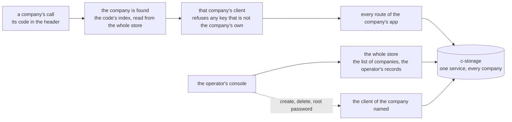

# The storage client that serves one company, plan, 2026-11-11

## At a glance

**What it is for:** once the back end knows which company a call is for, every read and write it
makes for that call goes through a client that can reach that company's records and nothing else.
Today each route is handed the whole store and builds each key itself, so one slip in one route would
reach another company's records, and only the tests at the routes would notice. After this piece the
slip meets a refusal. Nobody sees a change on screen.

**The cheapest safe path** is a thin guard over the storage client that exists, made once per call
where the company is found, with every route moved onto it and no route's behaviour changed. About
54 minutes of machine time; one look of yours, at a picture.

## The slice

A person opens their customer list; the call finds the company, makes that company's client, and the
list is read through it. A key of another company handed to that client is refused before anything
reaches the store. Then every other route of the company's app, and the operator's three acts on one
company, go the same way, and every route test already written passes unchanged.

## What the code says, and what the plan decides

**Today.** `bff/src/server.ts`'s `buildBff` makes the one storage client; `bff/src/app.ts`'s
`buildApp` hands that whole client to every route module (`bff/src/routes/staff.ts`'s `Deps`, which
`lists.ts`, `orders.ts` and `reconciliations.ts` import), and `bff/src/records/records.ts`'s header
says so: "a route module is handed the whole client, so nothing but review stops a list written
inline again". Each route builds its key from `request.tenantId` through `shared/src/records.ts`'s
`recordKeys`, and 34 helper calls in `bff/src` pass the whole client beside a company's id
(`readEmployee(storage, tenantId, …)` and its siblings). c-storage knows no company: its routes are
keyed by the service (`services/c-storage/internal/server/server.go`, `/api/records/{serviceCode}`),
and zero lines of its Go say `tenant`. What holds the wall today is the route tests:
`bff/src/tenants.route.test.ts`, `bff/src/routes/cross-tenant.route.test.ts`, and "reaches one client
only" in the delete and root-password route tests. Open item 227 lists the handlers no second-company
case reaches.

**Nothing like it exists already.** Not in the back end: no function in `bff/src` or `shared/src`
binds a client to one company (searched by role, not only by name). Not in the legacy app either:
its records engine takes the company as an argument on every call
(`workspace/shared/modules/src/mode-records/single.ts`, its key `${scope}:single:${entity}`), and its
c-storage has no word for a company. So this is new code, small, over what exists.

**Decided, the machine's:**

1. **One function makes a company's client:** `tenantStorage(storage, tenantId)` in
   `bff/src/records/records.ts`, beside `recordTools`, the file that already holds what every record
   route shares. It returns the four record calls of `shared/src/c-storage.ts`'s `CStorageClient`
   (`getRecord`, `listRecords`, `putRecord`, `removeRecord`; not `health`, which is the box's, not a
   company's) and a read-only `tenantId`. Each call first checks its key, or its list's prefix,
   starts with `recordKeys.tenant(tenantId).all`, the trailing dot included, so one id that begins
   another's cannot pass; a key that does not is thrown as a fault before anything is sent.
2. **The fault is a 500 naming no key**, by `bff/src/errors.ts`'s `replyFor`, and the error handler
   logs it as every 500 is logged. It is a bug of the back end, never a caller's mistake, so it is
   never a 403 or a 404, and it is a plain `Error`, never a `CStorageError`, which `replyFor` would
   answer 503 as if the store were down. Its message names the call (`GET`, `a list`) and not the key, as
   `shared/src/c-storage.ts`'s `recordCall` already does.
3. **The company's client is made in one place for the company's app:** `resolveTenant`, after it has
   read the code's index with the whole client, puts it on the request as `request.storage`, beside
   `request.tenantId`, decorated `null` as `audit` is.
4. **The route modules are handed no whole client.** `storage` leaves `staff.ts`'s `Deps`, so `lists`,
   `orders`, `reconciliations` and `staff` can reach only `request.storage`; the inline client routes
   in `buildApp` (settings, sign-in, the QR sign-in, the own password, sign-out, me) and the tenant
   sessions (`sessionsOf`) use it too.
5. **The `tenantId` field is also the client's brand:** the whole client has none, so handing it where
   a company's client is typed is a type error. That is the check that holds the wiring; the guard's
   own test holds the refusal.
6. **The helpers keep their arguments.** `bff/src/records/staff-records.ts`'s functions and
   `bff/src/calling/sessions.ts`'s `createSessions` take a `RecordStore` (the four record calls)
   instead of the whole `CStorageClient`, so both clients fit and the scripts package, which imports
   `readSignIn`, `setSignInPassword`, `createSessions`, `createClient` and `deleteClient` through
   `@credo/bff`'s entries, does not change. *Rejected:* dropping the company id from their arguments
   and reading the client's own. It removes a mismatch at compile time, but it changes functions the scripts
   call, which brings that package's gate into the step, and the guard already refuses a mismatch at
   its first call.
7. **The operator's three acts on one company** make that company's client from the id they have just
   read or minted: `bff/src/records/clients.ts`'s `createClient` (its first settings and root),
   `deleteClient` (the sweep of the company's records), and `bff/src/routes/root-password.ts`'s
   route. What stays on the whole client is then exactly: the code's index (`client.<code>`), the
   deletion's mark (`client-deletion.<code>`), every `operator.` record, and `/health`.
8. **The name `storage` is kept for the company's client**, so `pnpm counts`'s C5, which counts
   `storage.<call>(` and nothing held under another name (`scripts/src/counts.ts`'s note on C5), still
   sees every call.

*Rejected:* keys relative to the company (`company.customer(id)` in place of building the key). It
rewrites about sixty key builders in the two largest route files for no refusal the guard does not
already give. *Rejected:* the check in c-storage. It gives the store a notion of a company, which is
the "one file a company" layout's cost in the final architecture page, a change to the Go service and
not this piece. *Rejected:* finding the company from a per-call context instead of the request. It
hides which company a call is for from whoever reads the route.

## What the pooled shape consumes

The shape's plan is written after this one, and this is the surface it builds on:

- **`tenantStorage(store, tenantId)`** makes a company's client over whichever store holds that
  company's records. Today that is the one service client; in the pooled shape it is the box's client
  that the company's index record names. The shape changes only that first argument.
- **It is called in exactly four places:** `resolveTenant` for every call of a company's app;
  `createClient`, where the operator's choice of box will land; `deleteClient`; and the root password
  route. No route module calls it or holds a whole client, so no route changes when the shape lands.
- **What stays on the whole client** is the list of companies, each deletion's mark and the operator's
  own records: the "operator's own records" box of the final picture, and nothing else.
- **What it does not hold, left to the shape:** the box's own check that it holds that company, the
  memory of the lookup, a company marked as moving, and the free-disk reading. Lists in pages, and the
  copy tool that moves one company, are the store lane's second milestone.

It holds under SQLite as decided, and under either layout of it: one file a box or one file a company
is below `RecordStore`, never above it.

## Where another lane meets this one

`bff/src/app.ts` is the file in common. **The password wait** owns the sign-in routes and its count:
this piece changes those handlers in one way only, the store they read through, and whichever lane
lands second takes the other's lines in (`git merge pre-merge` before its gate). Its count must sit
under the company's prefix (`recordKeys.tenant(id)`), or the company's client refuses it; and if it is
written through the whole client, this piece's step 2 moves it, since nothing in `app.ts` stops a
handler there from reaching the whole client. **The front door** owns the check at the back end's way
in, likely a hook in the same file; the two touch different lines. `shared/src/records.ts` is read
here and not changed.

## The steps

Each step's gate is `pnpm --filter @credo/bff check` plus the citation test,
`pnpm --filter @credo/scripts exec vitest run src/citations.test.ts`, each by its own exit code. No
ridge run: the piece adds no resource, hop or key, so stage 2 stands in for stage 4, and it reaches
ridge with the human's next push like any merged work.

- [x] **1. One list, end to end.** `tenantStorage` and `RecordStore` in `bff/src/records/records.ts`,
  its own test `bff/src/records/records.test.ts` over a fake client that records what is sent,
  `resolveTenant` putting it on the request, and the customer and product lists
  (`bff/src/routes/lists.ts`) reading and writing through it. *Done when:* the gate's log ends
  `== exit 0`; `git diff --stat pre-merge -- '*.test.ts'` names the new test file alone, so
  `lists.route.test.ts` and the cross-company lists case passed unchanged; and each case is seen red
  on its own assertion, then put back: cases 1 to 3 with the prefix check made to pass everything,
  case 4 with it made to refuse everything, case 5 with the key put in the message.
  *Done, 2026-11-11:* `tenantStorage` and `RecordStore` in `bff/src/records/records.ts`, five cases in
  `bff/src/records/records.test.ts`, `resolveTenant` setting `request.storage`, and the two lists
  reading and writing through it. The back end's check ended green at 100 % after one typecheck red
  (the request's decoration typed `null`), fixed; the citation test exited 0. Seen red on its own
  assertion, then put back: the prefix check passing everything reddened cases 1 to 3 (and 5, which
  needs a refusal to read); the check refusing everything reddened case 4 (and the own-prefix half of
  case 2); the key put in the message reddened case 5 alone. `git diff --stat pre-merge -- '*.test.ts'`
  names the new file alone.
  *Size:* 10 minutes, the last back-end step that added one mechanism with its own test and wired
  routes onto it (the activity log's step 3, 10 minutes).
- [x] **2. Every call for a company.** The other three route modules, the inline client routes and
  the tenant sessions onto `request.storage`; `storage` out of `staff.ts`'s `Deps`; the helpers
  widened to `RecordStore`; the operator's three acts making the named company's client. *Done when:*
  the gate's log ends `== exit 0`; `grep -rnE '\(storage, (request\.)?tenantId' bff/src --include='*.ts'`
  counts 0 (34 today); `grep -nE '(^|[^.A-Za-z_])storage\.(getRecord|listRecords|putRecord|removeRecord)\(' bff/src/app.ts`
  shows one line, `resolveTenant`'s index read (five today); `git diff --stat pre-merge -- '*.test.ts'`
  still names the new test file alone; `pnpm --filter @credo/scripts typecheck` exits 0, a read and
  not a gate, since that package imports these files through the back end's entries; and with `resolveTenant` handing the
  whole client, `pnpm --filter @credo/bff typecheck` goes red naming `tenantId`, then it is put back.
  *Done, 2026-11-11:* the other three route modules, the inline client routes and the tenant sessions
  read through `request.storage`; `storage` is out of `staff.ts`'s `Deps`; the helpers take a
  `RecordStore`; the operator's create, delete and root password make the named company's client. The
  back end's check ended green at 100 %; the first grep counts 0 and the second shows one line,
  `resolveTenant`'s index read; the test-file diff against `pre-merge` names the new file alone; the
  scripts package's typecheck exited 0; with `resolveTenant` handing the whole client the back end's
  typecheck went red naming `tenantId` missing, then it was put back.
  *Size:* 17 minutes, the last step that moved several files of one package onto a shared piece
  with nothing on screen changed (the shared record page's step 5, 17 minutes), here with this
  package's two largest files.
- [ ] **3. Hardened, and the pages true.** Coverage at 100 % with no new hint; the pages that say the
  route is handed the whole client rewritten: `docs/memo/bff.md`'s "The tenant prefix is this
  package's alone, and the store does not enforce it" (what stops a breach now, and what still does
  not: a route in `buildApp` reaching the whole client), `docs/architecture.md`'s row "No second file
  builds a record key" in "What is never there", the storage line in `bff/CLAUDE.md`,
  `bff/src/records/records.ts`'s header, and the reason item 227 gives for deferring. *Done when:*
  the gate's log ends `== exit 0` at 100 %; the citation test exits 0; `git grep -nE '/Users/|~/'`
  finds nothing new. *Size:* 10 minutes, the last step that rewrote a memo and two guidelines to a
  new shape (the shared record page's step 10, 10 minutes).
- [ ] **4. Reviewed.** A model other than the author's reads the code, its tests and this table,
  asking of each test whether breaking its case would turn it red; one fix pass, its own gate the
  re-check. *Done when:* every finding is tagged in the recap and the fix pass's gate ends
  `== exit 0`. *Size:* 14 minutes, the cross-company tests' review, fix and reread (6, 6 and 2).
- [ ] **5. Recap.** Half a page, with the picture of point 1 drawn from the committed code. *Done
  when:* committed, the citation test at exit 0. *Size:* 3 minutes, the cross-company tests' recap.

## The case table

| # | The case | Held by |
| --- | --- | --- |
| 1 | A read, a write or a removal of a key outside the company is refused, and nothing is sent | unit, `records.test.ts` |
| 2 | A list under a prefix outside the company is refused; one under the company's own prefix, the whole of it included, is sent | unit |
| 3 | The company's prefix without its last dot, and an id that begins with the company's, are refused | unit |
| 4 | A key inside the company reaches the store as given, and its answer comes back unchanged: a record, none, saved or moved | unit |
| 5 | The refusal names the call and never the key, and answers 500 | unit, with `replyFor` |
| 6 | A company's client cannot be given the whole store where it is typed | the typecheck, under step 2's mutation |
| 7 | Every route of a company's app is served for the company its code names, and no other | BFF route, `tenants.route.test.ts` and `routes/cross-tenant.route.test.ts`, unchanged |
| 8 | The operator's delete and root password reach the company named and leave another as it was | BFF route, "reaches one client only" in both files, unchanged |
| 9 | Making a company writes its settings and its root under its new id, the index last | BFF route, "leaves the code free when a write before the index fails, and a retry makes the client" in `operator.route.test.ts`, unchanged |
| 10 | No existing test was changed to pass | `git diff --stat pre-merge -- '*.test.ts'`, the new file alone |

## The human's points

**After step 5: one picture of the wall.** The recap draws, from the committed code, every route of a
company's app reaching the store only through that company's client, and beside it what is left on
the whole store: the list of companies, each deletion's mark and the operator's own records. You
judge one thing: is this the wall you want between companies that share a box? A yes means the pooled
shape builds on it as drawn; a no names what should also be walled, and step 2 reopens.

## What stays out

The scripts that reach a company's records with the whole store (the demo seed and the root password
script), which are the terminal's and not the back end's: open item 246, for the shape. Lists in pages, the copy tool, the box named in a company's record, and any change to
c-storage.
