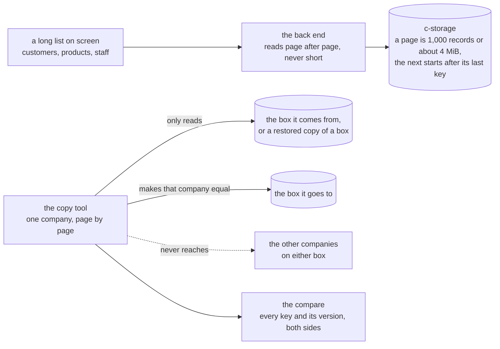

# Lists in pages, and one company copied whole, plan, 2026-11-11

## At a glance

**What it is for:** today a list stops working once a company holds more than 1,000 of anything,
and nothing can take one company's records out of a box. After this piece the store answers a list
in pages and the back end reads every page, so a long list still comes back whole, and an order save
reads only what it names. One command copies one company's records to another store, then compares
the two record by record: the pooled shape's move uses it to carry a company to another box, and a
restore uses it to put one company back from the continuous copy while its neighbours stay as they
are now. Nothing changes on screen.

**The cheapest safe path:** one more parameter on the store's existing list, and one function over
two company clients in the deletion sweep's shape. About 95 machine minutes; two looks of yours,
the second a run on ridge.

## The slice

A company of 2,500 customers on a local store: its list comes back whole, read in three pages. That
company is then copied to a second store holding two others, one whose id begins with the first's;
the copy is stopped halfway and run again, and ends with the compare at zero and the other two
unchanged to the byte. On ridge the same command puts one demo copy back to a restored moment and
leaves a second copy's later change in place: that run is yours.

## What the code says, and what the plan decides

**Today.** c-storage's `List` (`services/c-storage/internal/store/store.go#L163`) reads one prefix as
a range over the primary key, at most `MaxList`, 1,000 (`#L132`), and answers `more`; its handler
takes `prefix` alone (`services/c-storage/internal/server/handlers.go#L92`). The back end's one list
read, `recordTools`' `every` (`bff/src/records/records.ts#L16-L18`), throws on `more`; twelve
callers in four route modules and `listClients` use it. The deletion sweep
(`bff/src/records/clients.ts#L163-L177`) lists one company's prefix, removes at most `DELETE_BOUND`,
200, a call (`#L116`), 20 at once (`#L118`), and answers what is left: the nearest sibling of a copy.
The order save's `priced` (`bff/src/routes/orders.ts#L144-L147`) reads every customer and product,
though both are keyed by id (`shared/src/records.ts#L37-L40`).

**A record can be large.** A delivery's photo is a record under the company's prefix
(`shared/src/records.ts#L47-L50`), up to 50 KB before its encoding (`shared/src/photo.ts#L7`): a page
of 1,000 is about 70 MB, on a box the continuous copy's plan reads at 273 to 279 MiB free, so a count
alone cannot bound a page.

**The brief's premise, checked: half true.** No one-company copy exists, here (copy, export, clone,
migrate beside company, client or tenant, every package and `ops/`) or in the legacy app, whose
client removal deletes by prefix and copies nothing
(`workspace/bffs/c-mngt/docs/memo/admin-client-operations.md#L85-L89`). **Paged lists exist twice:**
the legacy store pages after the last row's id, one row over the limit saying there are more
(`workspace/services/c-storage/src/repositories/record.repository.ts#L586-L625`), and this
repository's activity service pages by a cursor pinned to its feed
(`services/audit-backbone/internal/activity/store.go#L126`). The shape is taken, not the code.

**Decided, the machine's:**

1. **A page starts after a key.** The list takes an optional `after`, and the page holds the keys
   under the prefix greater than it: the legacy's shape, one more bound on the same range, no schema
   change. The answer stays `{records, more}`; the next `after` is the last key read. An `after`
   outside the prefix is a 400, a cursor of another list: the activity service's pin in one
   comparison. It only narrows the range, so the one-company client's prefix check stays the wall.
2. **A page ends at 1,000 records or about 4 MiB of data, whichever is first, and holds at least
   one**, `MaxListBytes` beside `MaxList`. A company with photos pages safely, a page being encoded
   sits far under the box's 96 MiB floor (`ops/lib.sh#L18`), and no caller sizes its own pages.
3. **`every` reads pages until `more` is false**, every route keeping its call and its answer. A page
   whose first key is not past the last one read is a fault, never a loop: a c-storage too old for
   `after` answers so, and one can meet a new back end, since the deploy ships the box first
   (`.github/workflows/ci.yml#L302`, `#L311`) and a release by hand ships it alone.
4. **The order save reads the customer and each distinct product by key**; one the company lacks is
   the same 400 as today.
5. **The screens keep one answer.** None nears a size a phone cannot draw, and nothing calls a
   screen's page now: item 276, parked with its trigger.
6. **The copy tool is a back-end function over two company clients**, as the final architecture page
   has it: "the back end copies that company's records box to box while the company is paused, then
   compares; the same tool serves the one-company restore". It sits in
   `bff/src/records/company-copy.ts` beside the sweep, exported through a `@credo/bff` entry as
   `./clients` is.
7. **Its writes keep the version:** each names the tag the walk read in the target, or none, so a
   save landing there mid-copy answers `moved` and stops the copy, named. Never a write over
   whatever is there (root `CLAUDE.md`: recover, never bypass, a concurrency token).
8. **The compare is by key and tag**, the SHA-256 of the stored text (`store.go`'s `Tag`); every
   record is the text `JSON.stringify` makes, which a read and a write give back unchanged.
9. **Now, from the terminal:** `copy-company` in `runRidge` (`scripts/src/ridge.ts#L111`), source and
   target from its environment, a line per company on the target before and after. Its wrapper,
   `ops/company-restore.sh ridge <code>`, takes ridge and the demo copies alone, as
   `ops/root-password.sh` does: it restores the box's file to a new path by the continuous copy's
   restore, serves it with a second c-storage for the run alone, and copies one company back.

*Rejected:* a copy inside c-storage, attaching the restored file and copying the prefix in one
transaction. Atomic and fast, but only where both files sit on one machine, so a move would carry a
file between boxes first, and c-storage would gain a second writer and a notion of a company.
*Rejected:* an offset; a save between pages moves every later page. *Rejected:* a `limit`
parameter, which makes each caller size pages by its records. *Rejected:* a route writing many
records at once; step 4 measures per-record writes, 20 at once. *Trigger:* a copy whose pause the
operators find too long.

## The copy tool, for the pooled shape

The surface the shape's move consumes:

- **`copyCompany(from, to, { after, bound })`.** `from` and `to` are two boxes' company clients, the
  one-company plan's `tenantStorage(box, tenantId)`, so neither reaches another company. It walks
  both in key order from `after`, writes into `to` each record missing or different, removes each
  one `from` lacks, stops at `bound` changes (200, the sweep's figure for one back-end call), and
  answers `{ copied, removed, after, done }`. On a pair already equal it writes nothing.
- **`compareCompany(from, to)`.** The same walk, writing nothing: `{ records, differ }`. A move
  switches the company's index only at `differ` 0.
- **What it asks of its caller:** the company paused on both boxes through the copy and the compare.
  A save landing in `to` stops the copy; one in `from` shows in the compare. The pause, the index's
  switch and the old box's records are the move's; `deleteClient`'s sweep already removes a
  company's prefix in bounded calls.
- **What it does not copy:** the operator's records (the index, a deletion's mark), which stay on the
  whole store, and the company's activity entries, in the activity service's own file: item 277.

Under one box a company, the human's fallback, the same call carries a company to its own box.

## What it consumes, and where another lane meets it

- **The one-company client** (`docs/plans/2026-11-11-store-one-company.md`, branch
  `store-one-company`): `RecordStore` and `tenantStorage`, whose `listRecords` gains `after`, its
  prefix check unchanged. The build starts once that piece is on `pre-merge`; c-storage's half of
  step 1, and step 2, touch none of its files and may go first.
- **The continuous copy** (`docs/plans/2026-11-11-continuous-copy.md`, branch `continuous-copy`):
  `ops/restore.sh`'s restore to a new path, and its drill's second c-storage on a restored file,
  called by step 6 as an `ops/lib.sh` helper, never a copy. Step 6 builds after that piece merges.
- **Files another lane is likely to touch:** `bff/src/records/records.ts`, `bff/src/routes/orders.ts`
  (the one-company client); `services/c-storage/internal/server/handlers.go`, `server_test.go`,
  `bruno/`, `docs/memo/c-storage.md` (the continuous copy's status route and its "only copy"
  section, not this list section); `ops/lib.sh`, `ops/test.sh`, `ops/README.md` (the continuous copy,
  the shape's box by command); `scripts/src/ridge.ts` (the shape, the key replacement). Whichever
  lands second takes the other's lines in.

## The steps

Each step's gate is its package's `pnpm --filter @credo/<pkg> check`, or `make check` in
`services/c-storage/`, plus the citation test, each by its own exit code; each case is seen red once
on its own assertion, then put back. Sizes are the last run of the same shape, in machine minutes.

**The four stages.** 1: steps 1, 4 and 5, on local stores and invented companies. 2: each step's
gate, its log read whole. 3: point 1, the recap's picture. 4: ridge, by your run at step 11, since
the copy is a new command reaching the box and a second c-storage on it; the paging adds no
resource, hop or key, so stage 2 stands for it and it reaches ridge with your next push.

- [x] **1. The slice at its thinnest.** `after` in `List` and its handler, with a server test;
  `listRecords(prefix, after?)` in `shared/src/c-storage.ts` and `RecordStore`; `every` reading
  pages, with a BFF route test of 2,500 customers coming back whole, in code order; and a bare
  `copyCompany`, no bound and no tag yet, copying that company to a second real c-storage in one
  test. *Done when:* `make check` exits 0 at 100 %; the `shared` and `bff` gates end `== exit 0`;
  cases 1, 2 and 8 red once, 1 and 8 with one page read. *Size:* 20: c-storage's part and the bare
  copy, first runs of their shapes, 5 each; one mechanism wired with its test, 10 (the activity
  log's step 3). *Done 2026-11-12:* c-storage's `make check` ended 0; the `shared` and `bff` gates ended 0 on the committed tree (bff 657 tests, 100 % coverage); the citation test ended 0; cases 1, 2 and 8 each seen red once on a mutation and put back.
- [x] **2. The page hardened in c-storage.** The byte bound; `after` outside its prefix refused; two
  requests in `bruno/02-records/` (a second page, the refusal); the memo's "A list reads one prefix"
  rewritten, its rejection of paging and its 8 MB hazard replaced. *Done when:* `make check` exits 0
  at 100 %, `collection_test.go` passing; cases 3 to 5 red once. `bash scripts/e2e.sh` stays CI's
  (the Bruno CLI). *Size:* 10, two parts of a first-run shape. *Done 2026-11-12:* c-storage's `make check` ended 0 at 100 % with `collection_test.go` passing; cases 3 (the bound, and one record however large), 4 and 5 each seen red once on a mutation and put back; the citation test ended 0; the e2e run is CI's.
- [x] **3. The back end true to pages.** `every`'s fault on a page that does not move; `priced` by
  key; the other `listRecords` callers read: the sweep stays, the seed's `isFresh` already refuses on
  `more` (`scripts/src/demo/apply.ts#L158-L167`), and `everything`
  (`scripts/src/demo/apply-support.ts#L68-L69`), one page of a whole test company, moves onto pages.
  *Done when:* the `bff` and `scripts` gates end `== exit 0`; cases 6 and 7 red once;
  `git diff pre-merge -- '*.test.ts' | grep -c '^-[^-]'` counts 0. *Size:* 7, one change through
  one package's callers (the list kind's step 7). *Done 2026-11-12:* `every`'s fault was already in step 1's code and is now pinned by case 6 in `bff/src/records/records.every.test.ts`; `priced` gets the customer and each distinct product by key; `everything` reads pages in `scripts/src/demo/apply-support.ts`; the sweep and `isFresh` stay. The `bff` gate (660 tests) and the `scripts` gate (423 tests) each ended `== exit 0` on the tree committed; cases 6 and 7 each seen red once on a mutation and put back. **Row 18 does not hold for one assertion:** in `bff/src/routes/orders-records.route.test.ts`, the test "answers 500 to the orders, the requests and the drivers when c-storage says there are more or a record does not parse..." had an order save in its short-list case expecting 500 because `priced` listed; `priced` now lists nothing, so that save answers 201. The POST and its fourth expected 500 were removed (2 lines removed), and the new describe in `bff/src/routes/orders.route.test.ts` holds the POST's reads instead (the customer and each product by key, none listed). The step's diff count of removed test lines is 2, not 0. `scripts` `staffOf` still lists one page of a test company's employees.
- [ ] **4. The copy tool hardened.** The bound and `after`, the tags on each write, the removals,
  `compareCompany`, their entry in `bff/package.json`'s `exports`, and
  `bff/src/records/company-copy.test.ts` over two real c-storages (`bff/tests/c-storage.ts`): three
  companies and 2,500 records, photos among them, on the source, two others on the target. *Done
  when:* the `bff` gate ends `== exit 0` at 100 %; cases 9 to 14 red once (the prefix check opened
  for 9, the walk stopped with no `after` for 10, the tag dropped for 12, a write left in the
  compare for 14); records copied a second read from the test's log. *Size:* 11: one more part, 5;
  the cross-company cases, 6 (the cross-company tests' step 1).
- [ ] **5. The command.** `copy-company <code>` in `runRidge`, its usage line, its test over two real
  c-storages. *Done when:* the `scripts` gate ends `== exit 0`; case 15 red once. *Size:* 5, a ridge
  command over the product's own function (the stranded check clients' step 1).
- [ ] **6. The ridge wrapper, after the continuous copy merges.** `ops/company-restore.sh ridge
  <code>` refuses another environment and a code not a demo copy before the box; restores the box's
  file to a new path; serves it with a second c-storage on loopback, ended by a `timeout` in its own
  arguments and at exit, through a second forward (`ops/lib.sh#L429`, `box_open`); writes a drill
  record into the named copy and a second one, copies the named one back, reads the compare at 0,
  its record gone and the other's kept, then removes the other's; a row in `ops/README.md`. *Done when:* `bash ops/test.sh` and `shellcheck -x ops/*.sh` exit 0; case 16
  red once. *Size:* 10, an `ops/` script with its guards (the backup policy's step 1).
- [ ] **7. The prose made true.** "at most 1,000 records, and past that bound it is an error" in
  `docs/architecture.md#L138-L140`, its twin in `docs/architecture-detail.md#L65-L67` (line citations
  made symbol ones), and the comments at `shared/src/c-storage.ts#L83-L84`, `#L92`,
  `shared/src/records.ts#L41-L42` and `every`. *Done when:* the citation test exits 0;
  `git grep -nE '/Users/|~/'` finds nothing new. *Size:* 3 (the architecture page's five fixes).
- [ ] **8. Reviewed, and the whole check.** A model other than the author's reads the code, its tests
  and this table. *Done when:* a verdict line, each finding with its line. *Size:* 20.
- [ ] **9. The fix pass.** *Done when:* each finding fixed, rejected or deferred with its reason, the
  touched steps' gates at `== exit 0`. *Size:* 6 (the cross-company tests' fix pass).
- [ ] **10. Recap.** Half a page: point 1's picture from the committed code, the copy rate and what it
  means for a year's company, case 17 marked not yet known. *Done when:* committed, the citation
  test at exit 0. *Size:* 3 (the cross-company tests' recap).
- [ ] **11. 👤 The drill on ridge, yours,** once ridge is back with the continuous copy running:
  `bash ops/company-restore.sh ridge <a demo copy's code>`. *Done when:* the machine reads its log
  whole: compare at 0, the named copy's drill record gone, the other's kept, `== exit 0`. *Size:* 5
  to read; your run about two minutes.

About 95 machine minutes for steps 1 to 10, within a day: no cut.

## The case table

| # | The case | Held by |
| --- | --- | --- |
| 1 | A list past one page comes back whole, in code order | BFF route, `lists.route.test.ts` |
| 2 | A page holds the prefix's keys after `after`, in key order, at most 1,000, and says if more are left | Go, `internal/server` |
| 3 | A page ends at about 4 MiB with `more`, and holds one record however large | Go, `internal/store` |
| 4 | An `after` outside the prefix is a 400 | Go, `internal/server` |
| 5 | A list with no `after` answers as today | the `TestAList…` tests, unchanged |
| 6 | A page that does not move past the last key is a fault, never a loop | unit, `records.test.ts` |
| 7 | An order save reads only the customer and products it names; one the company lacks is a 400 | BFF route, `orders.route.test.ts` |
| 8 | A copy leaves the target holding exactly the source's records under the prefix, each with its tag | `company-copy.test.ts`, two c-storages |
| 9 | **A copy leaves every other company on the target as it was, one whose id begins with the copied one's included** | the same |
| 10 | **A copy stopped halfway and run again ends equal; until then the compare names how many differ** | the same |
| 11 | **A one-company restore removes what the restored copy lacks and puts back what changed; the neighbours keep their newer records** | the same |
| 12 | A record changed in the target mid-copy stops it, named, and is never written over | the same |
| 13 | The source is only read: its records and tags are unchanged | the same |
| 14 | The compare writes nothing, and a source record changed after its copy turns it red | the same |
| 15 | The command refuses a code with no company before writing, and prints each company before and after | `scripts`, its test |
| 16 | The wrapper refuses any environment but ridge and any code but a demo copy; its second c-storage ends with the run | `ops/test.sh` |
| 17 | **On ridge, one demo copy restored alone loses its later change, and a second keeps its own** | your run, step 11 |
| 18 | No existing test was changed to pass | step 3's count |

## The human's points

**1, after step 10: one picture of the copy.** The recap draws, from the committed code, what is read
from one box, what is written to the other, what is compared, and the other companies on that box,
which nothing reaches; beside it, the local run's numbers. Is this the copy you want a move and a
one-company restore to stand on? A yes lets the pooled shape build its move on it; a no names what
to change, and step 4 reopens.

**2, at step 11: one company put back on ridge.** You run one command. It puts one demo copy back to
a moment just before, from the continuous copy, while a second copy's later change stays. The log
ends with both copies before and after and the compare at zero. Does that read as one company
restored without touching its neighbours? A yes closes the restore; a no reopens the piece where it
did not convince you.

## What stays out

A list screen in pages (item 276); a company's activity entries in a copy (item 277); the move, its
pause, its index switch and a second box, the pooled shape's; a one-company restore on production,
which waits for the terminal scripts made safe for it; a route writing many records at once, on its
trigger above.
