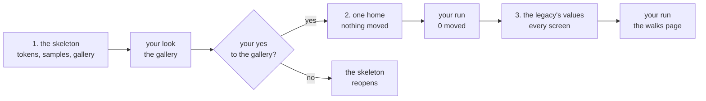

# The design system: one home for the look, in the legacy app's values

## At a glance

**Amended 2026-11-16, at the human's ask:** a first landing builds the skeleton (the legacy's values
in a new folder, six sample components in three levels, a gallery page that shows them) and changes
no screen. The two landings of 11-12 follow as landings 2 and 3 only after the human's yes at
landing 1's look: "I think I should confirm the skeleton first". **Amended again 2026-11-16:** the
gallery's final shape, the human's yes of today, is landing 4, opened when the components pass 15.

What it is for: the partners asked that the new app look like the legacy one. The look goes into one
folder, `ui/src/design-system/`, its parts onto a page of their own, then the few values that still
differ onto every screen.

The cheapest path is what exists: the theme already holds most of the legacy's values, and the
gallery is one more page of the ui's own Vite. The price: about 50 machine minutes and one look, then
about 100 more and two of your picture runs; light only.

## The slice

One slice: the look in one home, from a gallery of its parts to every screen of both apps. It lands
on `pre-merge` up to three times, each walkable: the gallery, no screen changed; the look moved into
the home, nothing moved, so every pixel the third moves is a value's doing; the values with the
screens they move, landed the day its run is read. **Landings 2 and 3 start only after the human's
yes at point 1**: "thanks, plz wait for later / I think I should confirm the skeleton first".
A fourth, the gallery's final shape, is opened by a count, not by a landing's order (below).

Light only (the human's answer of 2026-11-11 23:01); no company's own ten shades (2026-11-03 17:47);
the side menu's labels at 14 px and 600 (2026-11-16, replacing the "more bold" of 11-03, built as 16
at 500). The screens landed since 11-12 read the same theme and need no step.

Stage 3 of landing 1 is the gallery, in the human's browser. Stage 4 is not stood up: nothing new
ships, the gallery is in no bundle, and ridge gets landing 3's look by the human's push.

## Landing 1: the skeleton, and what was decided for it

The human's words of 2026-11-16: a simple version of Storybook, a skeleton first with sample
components; "we should not touch current code", the new components in `ui/src/components/`; atomic
design. Each line is the machine's decision, vetoed on sight.

- **The gallery, a page of our own, no Storybook.** `ui/gallery.html`, beside `mock.html`, loads
  `ui/src/design-system/main.tsx`, which draws `Gallery`: the values (palette, type, gaps, read from
  the theme in context), Mantine's button and field in the theme, then each sample by level, in its
  states. Vite's dev server serves any page in the package's root, so no config names it; the app's
  build reads `index.html` alone; knip reaches the entry through its test, every test file being a
  knip entry (measured). *Rejected:* Storybook, a dependency to install online; a one-file build like
  the mock's, whose config `ui/tsconfig.json`'s `include` would have to name; the entry excluded from
  coverage in `ui/vitest.config.ts`, where a test that mounts it costs nothing.
- **Atomic design: can we, yes; should we, yes, three levels and no more** (`atoms/`, `molecules/`,
  `organisms/`), since `frame/` and `pages/` already are the templates and the pages.
  [Code](../conventions/code.md)'s C17 lets `ui/` write its own directory set, and its "never by
  imitation" is met by a rule a check holds rather than by a count of six files: a component imports
  only from the levels below its own, the tokens and packages. Mantine is the base under the atoms,
  themed, never wrapped only to make an atom. `design-system/` stays flat, as the 11-12 plan held.
- **The direction is a lint rule, measured cheap:** core ESLint's `no-restricted-imports` with a
  `regex` pattern went red (exit 1) on `ui/src/parts/PageShell.tsx`'s `../frame/Loaded` in 3
  seconds, nothing to install; one block a level in `eslint.config.js`. *Rejected:* a test parsing
  imports as text, red only at the gate.
- **The tokens, laid over today's theme.** `tokens.ts` holds only the legacy's values the app lacks
  and landing 1 reads: the main shade 6, the badge's corners, a table row's hover, the dialog's
  title, a label's small capitals, the card's padding and grey icon tile (the table below).
  `theme.ts`'s `designThemeOf(colour)` lays them over the app's `themeOf` with Mantine's
  `mergeThemeOverrides`, light; `ui/src/theme.ts` is read, never changed. *This corrects "a theme
  built from the tokens":* a copy of the greys, green, red, font, gaps and shadows the app's theme
  already holds would be a second home that drifts with nothing red.
- **Six samples, two a level**, each drawn by the legacy in 23 to 53 files and by the new app by
  hand: atoms `StatusBadge` (the legacy's `ActiveBadge`; the staff list's chips) and `FieldLabel`;
  molecules `DetailField` (a label over its value) and `SectionTitle` (a grey icon tile beside a
  label, `ui/src/parts/Settings.tsx#L124-L131`); organisms `SectionCard` (the new app's `DetailCard`)
  and `PageHeader` (`ui/src/parts/PageShell.tsx`'s heading). Each takes its words as props and knows
  no record, word or call; no edit mode, no phone variant.
- **The rule of three, one sentence in `ui/CLAUDE.md`'s directory notes:** a piece joins
  `components/` at its third use in the app, with its gallery entry; its first two stay in their
  screen or in `parts/`. The six are the skeleton's day-one set, the memo's "Phase 1".
- **Two homes, `parts/` (19 sources) and `components/`, is the price:** a part moves across only at
  a landing that changes its look (landing 3, for `DetailCard` and `PageShell`), never in a sweep
  (open item 498).
- **The existing files landing 1 changes:** `ui/CLAUDE.md` (C17's directory set, written in the
  change that makes it), `eslint.config.js` (the direction), and the landing's row in
  `docs/products.md`. No app code, and no file the app's build, the fake build or the walks read
  (case 6).

## What the new app holds today, against the legacy

The new app's lines are this tree's; the legacy's are the old repository's `workspace/uis/`.

| The value | The new app | The legacy | After landing 3 |
| --- | --- | --- | --- |
| Greys, green, red, font, corners, gaps, shadows, the fields' line | one theme, `ui/src/theme.ts#L12-L64`, `#L105-L137`, `ui/src/theme.module.css#L3-L10` | the same values | moved, unchanged |
| The nine palettes | `ui/src/palettes.ts#L2` | the same nine | moved, unchanged |
| Colours written by hand | 11 in `ui/src/frame/frame.module.css`, 15 in `ui/src/frame/frameLook.module.css`, 2 in `ui/src/frame/Shell.tsx#L142` and `#L242`, 2 in `ui/src/pages/SignIn.tsx#L30` and `#L100` | none outside the theme, a rule of the old app | tokens, the same values |
| Dark | follows the device, `ui/src/frame/Providers.tsx#L32`; 16 dark rules in the two frame stylesheets | forced light, `c-mngt/src/main.tsx#L75` | light only, the 16 rules gone |
| The main colour's depth | shade 7, `ui/src/theme.ts#L109`, set by the first mock | Mantine's default, light 6 (the installed Mantine 9.6.3's `default-theme.mjs`; the legacy's Mantine 8 is not on disk to reread) | 6 |
| Badge corners | Mantine's pill: the theme has no badge entry | 4 px, `c-mngt/src/theme/index.ts#L109-L115` | 4 px |
| A table row under the pointer | Mantine's grey | the brand's shade 0, `#L184-L188` | brand 0 |
| A dialog | Mantine's title, 16 px, regular | centred, title large at 550, `#L84-L97` | the legacy's |
| The section card | `ui/src/parts/DetailCards.tsx#L21-L30`: title 22 px at 600, padding 16, no icon; 27 uses in 7 files | padding 24, a 24-px grey icon tile, title 12 px at 700 in capitals spaced 0.5 (`c-mngt/src/components/SectionCard.tsx#L40`, `#L63-L72`; `base/src/components/common/FieldLabel.tsx#L19`) | the legacy's |
| The menu's labels | 16 px at 500, `ui/src/frame/frame.module.css#L79-L80` | 14 px at 600, `base/src/components/app/PCAppLayout.css#L47-L51` | 14 at 600, the human's word of 11-16 |
| The phone's header and foot bar | no shadow, no line | a soft shadow under the header and a line and soft shadow above the bar, `base/src/components/app/MobileAppLayout.tsx#L167`, `#L268-L269` | the legacy's |
| The page title | 22 px at 700, `ui/src/theme.ts#L115` | 22 px at 600 (`c-mngt/src/components/ListPageHeader.tsx#L130`) | kept: the 700 was the human's look of 2026-11-03 |

Control sizes differ nowhere: the legacy's shared `sm` entries (`base/src/utils/mantine-theme.ts#L78-L97`)
are replaced whole by its app's own, which leave Mantine's. The settings screen already draws the
legacy's card by hand (`ui/src/parts/Settings.tsx#L122-L131`), the model for the organism's body.

## Where the home lives, and how a screen reads it

- **`ui/src/design-system/`, flat** (C17), the human's memo's name. Landing 1 makes `tokens.ts`,
  `theme.ts`, `Gallery.tsx` and `main.tsx`; landing 2 moves in `themeOf` and `shadesOf`, the
  palettes, `ui/src/theme.ts`'s values as tokens, the fields' line as `fields.module.css`, and a
  `cssVariablesResolver` that writes the values Mantine has no slot for (the frame's 56, 250, 60 and
  64) as `--credo-*` variables. *Rejected:* the memo's `tokens/`, `theme/` and `primitives/` folders,
  a layout copied ahead of a count; a CSS file of variables, a second home beside the palettes.
- **A screen reads it through Mantine, by name**, as every screen already does (`gap=` 137 times,
  `c=` 86, `color=` 113 in `ui/src`'s screens, parts and frame), and a stylesheet through a variable
  (`var(--mantine-color-brand-6)`, `var(--credo-…)`). **No colour literal outside the folder**, the
  components' included (case 7).
- **Button, text field and badge stay Mantine's**: a wrapper would touch the 42 files that draw 102
  buttons and move no pixel. **The confirm dialog** waits for its first caller (open item 306).

## Landing 4: the gallery's final shape, and what was decided for it

- **When: as the components pass 15, which landings 2 and 3 do not.** Landing 2 names no part;
  landing 3's step 10 draws the two organisms already there, so step 2's count,
  `ls ui/src/components/*/*.tsx | grep -vc test`, stays 6. The rest come one at a time, by the rule
  of three and item 498; item 507's dialog and table are Mantine's. Landing 4 opens when that count
  passes 15, first in the landing that takes it there. *This corrects "likely when the app's screens
  take the look".*
- **Built from what exists.** `LEVELS` (`ui/src/design-system/Gallery.tsx#L26-L65`) holds each
  level, its heading and its entries by name, so the groups, counts and addresses come from it, with
  `Values` and `Mantines` (`#L67-L95`) as two more groups. The app's React Router
  (`ui/package.json#L25`, `ui/src/main.tsx#L41`) gives `HashRouter`, `/gallery.html#/atoms/field-label`,
  a hash since the page is one file at one path; tests open an address in `MemoryRouter`
  (`ui/src/mock/Frame.tsx#L38`); the list sits in the frame's `AppShell`
  (`ui/src/frame/Shell.tsx#L129-L134`). Nothing to install. *Rejected:* the sketch's
  `#atoms/field-label`, a hash reader beside the router.
- **The page.** Each entry's states become named nodes (`StatusBadge`'s active and inactive), none
  added; the counts stay whole while the search hides names; no address opens the first part.
  `LEVELS` moves to `ui/src/design-system/entries.tsx`, the file that grows to 50.
- **No legacy pane, and no picture per part in the picture run, until their callers.** No
  picture of a legacy part exists: the capture takes whole screens of real people, outside git
  (open item 516). A `walk/specs/gallery.spec.ts` would open each address and call
  `walk/support.ts`'s `shot`, which names pictures by screen, but the run lacks four things (open
  item 515).

## The cases

| # | The case: one behaviour, one sentence | Held by |
| --- | --- | --- |
| 1 | The design system's theme draws the main colour at shade 6 while shade 7 stays the colour itself, a badge with 4-px corners, a table row under the pointer in the brand's shade 0, and a dialog centred with its title large at 550 | `ui/src/design-system/theme.test.ts`, the shade's case now at `ui/src/theme.test.ts#L52-L58` |
| 2 | Each sample draws its states: a status badge green when active, grey when not; a detail field with no value a dash; a section title its icon in a grey tile; a page header its title as the page's heading | a test beside each, `ui/src/components/<level>/<Name>.test.tsx` |
| 3 | The gallery shows every component of the three folders under its level's heading (from landing 4, in its list), light whatever the device asks | `ui/src/design-system/Gallery.test.tsx`, which reads the folders and mounts the entry on a `#root` |
| 4 | A component imports nothing from a level above its own, nor from the app outside `components/` and the tokens | `eslint.config.js`, one block a level |
| 5 | The gallery is served at `/gallery.html` by the ui's own Vite | the serve probe, step 1 |
| 6 | Landing 1 changes no file the app, the fake build or the walks read | `git diff --name-only --diff-filter=MDR pre-merge...HEAD -- ui visual walk` prints `ui/CLAUDE.md` alone |
| 7 | No stylesheet, component, part, frame or screen outside the design system writes a colour of its own | `ui/src/design-system/literals.test.ts` over every `*.module.css`; an ESLint rule on `ui/src` strings |
| 8 | The app is light whatever the device asks | `ui/src/frame/Providers.test.tsx`, its case at `#L7` rewritten |
| 9 | The values the frame reads as variables are written with the tokens' values | `ui/src/frame/Providers.test.tsx` |
| 10 | Moving every value into one home moves no picture | the picture run, all twelve walks, 0 moved |
| 11 | The app's theme is the design system's for every company's colour: case 1 holds over `themeOf` | case 1's test over both; the session-ended snapshot in `ui/src/frame/frameKept.test.tsx` |
| 12 | A section card shows its icon in a grey tile and its title small, bold, in capitals | `ui/src/parts/DetailCards.test.tsx` |
| 13 | The menu's labels are 14 px at 600; the phone's bar has a line and a soft shadow above, its header a soft shadow below | `ui/src/frame/Shell.test.tsx` |
| 14 | A part's address, `#/atoms/field-label`, opens that part alone, its states side by side under `Atoms › Field label` | `ui/src/design-system/Gallery.test.tsx`, on `MemoryRouter` |
| 15 | Each group of the list counts the parts its level holds, the components' read from their folders | the same |
| 16 | The search narrows the list to the names holding its words, case ignored | the same |
| 17 | An address that names no part says so beside the list and draws no part | the same |

## The steps

Each step's check is `pnpm --filter @credo/ui check` plus the citation test,
`pnpm --filter @credo/scripts exec vitest run src/citations.test.ts`; a step that changes what the
walks page draws adds `pnpm --filter @credo/visual check`. Sizes are the runs log's last rows of the
same shape: a new part with its tests through the ui gate ran 23, 13 and 14 minutes (piece 125's step
1, piece 127's steps 3 and 4); the UI's extractions of 2026-11-10 ran 3 to 18, about 8 at the median;
a review with its check about 20.

**Landing 1: the skeleton, no screen changed.**

- [x] **1. The skeleton, end to end.** `tokens.ts` and `theme.ts` (case 1, red once on a planted
      shade 7), `StatusBadge` and its test, `Gallery.tsx`, `main.tsx` and `ui/gallery.html` (case 3),
      and `ui/CLAUDE.md`'s sentences for `design-system/`, `components/` and `atoms/`. _Done when:_
      both checks exit 0, and the serve probe exits 0: in one invocation, Vite's dev server up on a
      spare port, `curl -sf` of `/gallery.html` and `/src/design-system/main.tsx`, then stopped.
      **14 min.** _Done 2026-11-16: `pnpm --filter @credo/ui check` exit 0 (typecheck, eslint, prettier, test, knip all 0); the citations test exit 0 (32 passed); serve probe on port 5391, `curl -sf` of `/gallery.html` and `/src/design-system/main.tsx` both exit 0, server stopped in the same invocation; case 1 red on a planted shade 7 (exit 1), case 3 red with the badge's entry renamed (exit 1), both put back._
- [x] **2. The other samples, and the direction.** The five other samples, a test beside each
      (case 2), the gallery showing them (case 3, red with one left out); `eslint.config.js`'s three
      blocks (case 4, each red on a planted upward import, put back); `ui/CLAUDE.md`'s `molecules/`,
      `organisms/` and the rule of three. _Done when:_ both checks exit 0, the four red receipts in
      the tick, and `ls ui/src/components/*/*.tsx | grep -vc test` counts 6. **14 min.**
      _Done 2026-11-16: `pnpm --filter @credo/ui check` exit 0 (typecheck, eslint, prettier, test, knip all 0); the citations test exit 0 (32 passed); `ls ui/src/components/*/*.tsx | grep -vc test` prints 6; case 4 red on a planted upward import in each level (an atom importing `../molecules/DetailField`, a molecule `../organisms/PageHeader`, an organism `../../theme`, eslint exit 1 each), case 3 red with `PageHeader` left out of the gallery (exit 1), all put back (the tests are outside the lint block)._
- [x] **3. Review, the null proof, and landing.** Another model reads steps 1 and 2; one fix pass;
      case 6; the recap and the gallery's row in `docs/products.md`; the landing; point 1. _Done
      when:_ case 6's command prints `ui/CLAUDE.md` alone, and the branch merges. **20 min.**
      _Done 2026-11-16: the review and its fix pass read green (items 504 to 508 filed), the reread said may merge (items 513 and 514 filed, 508 corrected); `pre-merge` taken in; case 6's command prints `ui/CLAUDE.md` alone; the citations test exit 0; the recap and the gallery's row written; the landing on `pre-merge` is the orchestrator's, after this tick._

**Landing 2: one home, nothing moved** (after the human's yes at point 1: "I think I should
confirm the skeleton first").

- [x] **4. The app's theme joins the home.** `ui/src/theme.ts`, `ui/src/palettes.ts` and
      `ui/src/theme.module.css` move in as above; every importer follows; `ui/CLAUDE.md`'s sentence
      grows. The session-ended, passkeys and ways snapshots are rewritten, their diff read to hold
      renamed classes only. _Done when:_ both checks and visual's exit 0; `git ls-files` of the three
      old paths prints nothing. **8 min.**
      _Done 2026-11-16: `pre-merge` taken in (one conflict, `docs/open-items.md`, both sides kept in number order); the three files moved to `ui/src/design-system/` as `appTheme.ts` (the name `theme.ts` is `designThemeOf`'s, which step 9 joins), `palettes.ts` and `theme.module.css`, `theme.test.ts` as `appTheme.test.ts`, nine importers followed, `ui/CLAUDE.md` grew; one snapshot moved, the ways one (the session-ended and passkeys ones held), its text equal to the old once the hashes in class names are masked; `pnpm --filter @credo/ui check` exit 0 (typecheck, eslint, prettier, test, knip all 0); the citations test exit 0 (32 passed); `git ls-files` of the three old paths prints nothing; `pnpm --filter @credo/visual check` exit 0 (all five steps 0)._
- [ ] **5. The hand-written values to tokens.** The frame stylesheets' 26 colours, the shell's two
      whites and the sign-in card's two washes become variables of the same value; the gradients come
      from `tokens.ts`. Case 9. _Done when:_ the checks exit 0 and
      `grep -cE '#[0-9a-fA-F]{3,8}\b|rgba?\(' ui/src/frame/*.module.css` counts 0 in each. **8 min.**
- [ ] **6. Light only.** `Providers` forces light, as the legacy's entry does; the 16 dark rules go,
      with the mock harness's dark choice (`ui/src/mock/MockPage.tsx#L15`) and the cases that pin
      dark (`ui/src/frame/Shell.test.tsx#L437`, `#L395`; `ui/src/mock/Frame.test.tsx#L8`, `#L40`).
      Case 8 red first. _Done when:_ the checks exit 0 and `grep -rc "color-scheme='dark'" ui/src`
      counts 0. **8 min.**
- [ ] **7. The literal check.** Case 7: the test globs every stylesheet as text and asserts at least
      four found, so a move cannot quiet it; the ESLint rule skips the design system, the tests and
      the mock harness. Each red once on a planted `#fff`, put back. _Done when:_ the checks exit 0,
      the two red receipts in the tick. **5 min.**
- [ ] **8. Review and landing.** Another model reads steps 4 to 7; one fix pass; `pre-merge` taken
      in; the picture run (case 10); the landing; point 3. _Done when:_ your run of all twelve walks with no `--moved` and
      no `--write` reads `== verdict: green` with every count 0, and the branch merges. **20 min, and
      your run, about 16.**

**Landing 3: the legacy's values.**

- [ ] **9. The app takes the design system's theme.** `themeOf` takes the main shade and the badge,
      table and dialog entries `designThemeOf` lays over it, and the two become one. Case 11, seen
      red first. _Done when:_ the checks exit 0. **8 min.**
- [ ] **10. The card and the page header.** `DetailCard` draws `SectionCard`, each card with the
      legacy's icon for the same section where one exists, else the nearest; `PageShell`'s heading
      draws `PageHeader`; the settings copy becomes a `DetailCard`. Case 12. _Done when:_ the checks
      and visual's exit 0, and `grep -c 'tt="uppercase"' ui/src/parts/Settings.tsx` counts 0.
      **10 min.**
- [ ] **11. The frame's values.** The menu's labels at 14 and 600; the phone bar's line and shadow
      and the header's shadow; each a token. Case 13, seen red first. _Done when:_ the checks exit 0.
      **5 min.**
- [ ] **12. Review, the picture run, and landing.** One review and fix pass; `pre-merge` taken in;
      your run, `bash walk/run.sh` over all twelve walks with `--moved all --write`, then with no
      flags. The machine reads both logs, counts the screens moved per walk from the base folders'
      diff, commits the bases and the recap, and lands; point 4. _Done when:_ the second run reads
      `== verdict: green` with every count 0, and the branch merges. **25 min, and your runs, about
      32.**

**Landing 4: the gallery's final shape** (when the components pass 15; the human's yes of
2026-11-16).

- [ ] **13. The list, one part at a time, each at its address.** `LEVELS` to `entries.tsx`, the
      values and Mantine's controls as two groups, each entry's states by name; `Gallery` reads the
      part from `useLocation` beside the list, its counts and its search; `main.tsx` under
      `HashRouter`. Cases 14 to 17 and case 3 over the list, each red once (every part drawn, a count
      off by one, a search hiding nothing, an unknown address drawing the first part, a component
      left out), put back. _Done when:_ both checks and step 1's serve probe exit 0, the five red
      receipts in the tick, and `git diff --name-only pre-merge...HEAD -- ui visual walk | grep -vc
      '^ui/src/design-system/'` counts 0. **6 min**, as this piece's step 1 ran, a page and its tests
      through the ui gate (row 2026-11-16 14:01; step 2's, 4).
- [ ] **14. Review and landing.** Another model reads step 13; one fix pass; `pre-merge` taken in;
      the recap and the gallery's row in `docs/products.md`; the landing. _Done when:_ the checks
      exit 0 after the fix and the branch merges. **26 min**, as step 3's review, fix, reread and
      recap ran 12, 3, 9 and 2 (rows 14:18 to 14:44).

About 150 machine minutes: about 50 for landing 1, about 100 for landings 2 and 3; about 32 for
landing 4 when it opens.

## Keeping every test and walk green

- **Landing 1 can move no test of the app and no walk**: no file they read changes (case 6).
- **No case is edited to fit a move.** A test red in landing 2 is the move being wrong; the cases
  that change are each red with the new rule first: the theme (11), dark (8) and the menu (13).
- **The snapshots in `frameKept.test.tsx` pin markup**, class names included, so a moved stylesheet
  and the dialog's new title rewrite them; each rewrite is read as a diff, never accepted blind.
- **The icon strip's tip is held by a test that reads `frameLook.module.css` as text**
  (`ui/src/frame/Shell.test.tsx#L10`), so step 5 keeps the selectors it reads.
- **The walks page asks again for every screen in the frame at landing 2**, though no pixel moves:
  a screen's version is its markup and the style rules that match it (`visual/src/capture.ts#L260-L265`).
  The run's 0 is the proof there; your look waits for landing 3.
- **The walks are light already** (`walk/playwright.config.ts#L26`), so dropping dark moves no base.

## The human's points

1. **The gallery (step 3).** You open it in your own browser (in the piece's `ui/` folder,
   `pnpm exec vite --open /gallery.html`; Ctrl-C ends it): the colours and type, Mantine's button and
   field in the theme, then the six samples by level, in their states. Does the gallery read as the
   legacy app? A yes closes it; a no names the sample or value, and step 1 or 2 reopens.
2. **The screens take the look: answered 2026-11-16.** "thanks, plz wait for later / I think I
   should confirm the skeleton first": landings 2 and 3 start only after your yes at point 1, never
   before it. On Storybook, "I personally think that storybook is over-kill", which the gallery of
   landing 1 already holds.
3. **Nothing moved (step 8).** You run the twelve walks once and read the verdict line. Green with
   every count 0 means every picture (786 on 11-16) is pixel for pixel what it was, while every
   colour now comes from one folder. A yes closes it; a no names the screen that moved, and the step
   that touched it reopens.
4. **The legacy's look, on the walks page (step 12).** Every walk redrawn: buttons a shade lighter,
   badges with small corners, a pale tint under the pointer in a table, card titles small in capitals
   beside a grey icon, a centred dialog, the menu's labels smaller and bolder. Does each walk read as
   the legacy app? Yes per walk closes it; a no names the screen and part, and its step reopens.
5. **The gallery's final shape: answered 2026-11-16.** You asked: "when we have more components to
   check, let say, 50 components, a single long page is not realistic, right?" Shown the sketch (the
   list by level with counts and a search, one part with its states, the legacy's beside it, an
   address a part), you said "yes, thank you, let go on with your suggestion". Landing 4 builds it;
   no look is asked again, the gallery opening as at point 1.

## Not in this piece, and named rather than dropped

- **The parts moved whole into `components/`**, never in a sweep (open item 498).
- **The samples' fuller forms**: the legacy card's edit mode, its page header's phone variant and
  cache status, until a screen needs them.
- **The confirm dialog as a part**, until a screen opens one (open item 306).
- **Dark mode**, parked until the human asks; it returns from the same tokens (open item 307).
- **The phone's page title**, a level smaller on the legacy's phone (18 against 22,
  `c-mngt/src/components/ListPageHeader.tsx#L109`), until a look asks for it (open item 308).
- **Weights written as numbers in screens** (`fw=` 18 times), outside the literal check (open item
  309).
- **The static looks `ui/frame-mock/` and `ui/signin-mock/`**: dated records, outside lint, not
  redrawn.
- **One picture per part in the picture run** (open item 515) and **the legacy's own part beside
  each** (open item 516), each at its caller.
- **Storybook itself**, until knobs to play with a part's settings live, or a page for people
  outside the team, are needed: a dependency to install and keep up to date.
