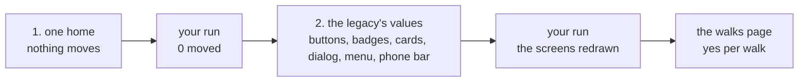

# The design system: one home for the look, in the legacy app's values

## At a glance

**What measuring changed:** the screens are already drawn from one theme. No screen writes a colour
of its own; only the frame's two stylesheets, the shell and the sign-in card write about thirty by
hand. So the screens do not move one by one: the values change in one place, and every screen
follows at once.

What it is for: the partners asked that the new app look like the legacy one. This piece puts every
colour, size and gap in one named folder, `ui/src/design-system/`, then sets the few values that
still differ to the legacy's.

The cheapest path is what exists: the theme already holds the legacy's greys, green, red, font,
corners, gaps and shadows. The price: about 100 machine minutes, two of your picture runs, light
only.

## The slice

One slice: every screen of both apps drawn from one home, in the legacy's values. It lands on
`pre-merge` twice, each landing walkable: first the home with nothing moved, then the values with
the screens they move. Two landings so that every pixel the second moves is a value's doing: the
first proves the move itself moves none. The second lands the day its run is read, since a base
image another lane rewrites meanwhile would conflict with ours.

Light only, by the human's answer of 2026-11-11 23:01; no company's own ten shades, by the answer
of 2026-11-03 17:47 (nine palettes and any colour stay as they are).

**The screens written before this lands move with the rest.** The wrong-password wait appends a
sign-in screen to the first walk as screen 12, and delivery photos appends the office's "the photo
did not arrive" to the orders walk and a send-failed screen to the driver's. Both read the same
theme, so neither needs a step here; each landing takes `pre-merge` in before its run, so their
bases are in it.

Stage 4 is not stood up: nothing new ships (no resource, hop or key), and stage 2 stands in its
place. Ridge gets the look by the ordinary push, which is the human's act.

## What the new app holds today, against the legacy

The new app's lines are this tree's; the legacy's are the old repository's `workspace/uis/`.

| The value | The new app | The legacy | After this piece |
| --- | --- | --- | --- |
| Greys, green, red, font, corners, gaps, shadows, the fields' line | one theme, `ui/src/theme.ts#L12-L64`, `#L105-L137`, `ui/src/theme.module.css#L3-L10` | the same values | moved, unchanged |
| The nine palettes | `ui/src/palettes.ts#L2` | the same nine | moved, unchanged |
| Colours written by hand | 11 in `ui/src/frame/frame.module.css`, 15 in `ui/src/frame/frameLook.module.css`, 2 in `ui/src/frame/Shell.tsx#L142` and `#L242`, 2 in `ui/src/pages/SignIn.tsx#L29` and `#L97` | none outside the theme, a rule of the old app | tokens, the same values |
| Dark | follows the device, `ui/src/frame/Providers.tsx#L32`; 16 dark rules in the two frame stylesheets | forced light, `c-mngt/src/main.tsx#L75` | light only, the 16 rules gone |
| The main colour's depth | shade 7, `ui/src/theme.ts#L109`, set by the first mock | Mantine's default, light 6 (the installed Mantine 9.6.3's `default-theme.mjs`; the legacy's Mantine 8 is not on disk to reread) | 6 |
| Badge corners | Mantine's pill: the theme has no badge entry | 4 px, `c-mngt/src/theme/index.ts#L109-L115` | 4 px |
| A table row under the pointer | Mantine's grey | the brand's shade 0, `#L184-L188` | brand 0 |
| A dialog | Mantine's title, 16 px, regular | centred, title large at 550, `#L84-L97` | the legacy's |
| The section card | `ui/src/parts/DetailCards.tsx#L21-L30`: title 22 px at 600, padding 16, no icon; 27 uses in 7 files | padding 24, a 24-px grey icon tile, title 12 px at 700 in capitals spaced 0.5 (`c-mngt/src/components/SectionCard.tsx#L40`, `#L63-L72`; `base/src/components/common/FieldLabel.tsx#L19`) | the legacy's |
| The menu's labels | 16 px at 500, `ui/src/frame/frame.module.css#L79-L80` | 14 px at 600, `base/src/components/app/PCAppLayout.css#L47-L51` | 14 at 600 (point 3) |
| The phone's header and foot bar | no shadow, no line | a soft shadow under the header and a line and soft shadow above the bar, `base/src/components/app/MobileAppLayout.tsx#L167`, `#L268-L269` | the legacy's |
| The page title | 22 px at 700, `ui/src/theme.ts#L115` | 22 px at 600 (`c-mngt/src/components/ListPageHeader.tsx#L130`) | kept: the 700 was the human's look of 2026-11-03 |
| Control size | Mantine's `sm` (its stylesheet: `--button-height: var(--button-height-sm)`) | `sm`: the shared theme's `sm` entries (`base/src/utils/mantine-theme.ts#L78-L97`) are replaced whole by the app's own (`#L118`'s spread; `c-mngt/src/theme/index.ts#L116`, `#L153`, `#L168`), which leave Mantine's | nothing differs |

**What the comparison of 2026-11-11 had wrong**, each reread above: the control size differs in no
button, text field or picker; the new app's theme has no badge, table, dialog or tabs entry (the
page cited lines past the file's last, 137); and it did not rank the section card, which 27 cards
show. The settings screen already draws the legacy's card by hand (`ui/src/parts/Settings.tsx#L122-L131`):
it is the model for the card's body.

## Where the home lives, and how a screen reads it

- **`ui/src/design-system/`, flat**, the human's memo's name: `tokens.ts` (every value: the
  palettes, the greys, the washes on the brand's ground, type, gaps, corners, shadows, the frame's
  56, 250, 60 and 64), `theme.ts` (`themeOf` and `shadesOf` moved, the base parts' entries, and a
  `cssVariablesResolver` that writes the values Mantine has no slot for as `--credo-*` variables),
  and `fields.module.css` (the fields' line, renamed). Flat because three files earn no folders
  inside ([code](../conventions/code.md)'s C17); its sentence goes into `ui/CLAUDE.md` in the step that
  makes it. *Rejected:* the memo's `tokens/`, `theme/` and `primitives/` folders, a layout copied
  ahead of a count; and a CSS file of variables, a second home beside the palettes in TypeScript.
- **A screen reads it through Mantine, by name**, as every screen already does (`gap=` 136 times,
  `c=` 86, `color=` 111 in `ui/src`'s screens, parts and frame), and a stylesheet through a variable
  (`var(--mantine-color-brand-6)`, `var(--credo-…)`). **No colour literal outside the folder**, held
  by a check (case 1).
- **The base parts, from the skeleton.** Button, text field and badge: their look is the theme's
  entry for each, and the screens keep importing Mantine; a wrapper would touch the 42 files that
  draw 102 buttons and move no pixel. The section card: `DetailCard` stays in `parts/`, where
  `ui/CLAUDE.md` and the 7 files that draw it find it, its body drawn from tokens. The confirm dialog: no screen
  opens one (the deletes confirm on a page of their own), so its look is the theme's dialog entry,
  which the session-ended prompt wears today, and the part waits for its first caller, the memo's
  own rule (open item 306). The machine's decision; the human vetoes on sight.

## The cases

| # | The case: one behaviour, one sentence | Held by |
| --- | --- | --- |
| 1 | No stylesheet, part, frame or screen outside the design system writes a colour of its own | `ui/src/design-system/literals.test.ts` over every `*.module.css`; an ESLint rule on `ui/src` strings |
| 2 | The app is light whatever the device asks | `ui/src/frame/Providers.test.tsx`, its case at `#L7` rewritten |
| 3 | The values the frame reads as variables are written with the tokens' values | `ui/src/frame/Providers.test.tsx` |
| 4 | Moving every value into one home moves no picture | the picture run, all twelve walks, 0 moved |
| 5 | The main colour is the brand's shade 6, while shade 7 stays the colour itself | `ui/src/design-system/theme.test.ts`, the case now at `ui/src/theme.test.ts#L52-L58` |
| 6 | A badge has 4-px corners, and a table row under the pointer takes the brand's shade 0 | `ui/src/design-system/theme.test.ts` |
| 7 | A dialog is centred, its title large at 550 | the theme test; the session-ended snapshot in `ui/src/frame/frameKept.test.tsx` |
| 8 | A section card shows its icon in a grey tile and its title small, bold, in capitals | `ui/src/parts/DetailCards.test.tsx` |
| 9 | The menu's labels are 14 px at 600; the phone's bar has a line and a soft shadow above, its header a soft shadow below | `ui/src/frame/Shell.test.tsx` |

## The steps

Each step's check is `pnpm --filter @credo/ui check` plus the citation test,
`pnpm --filter @credo/scripts exec vitest run src/citations.test.ts`; a step that changes what the
walks page draws adds `pnpm --filter @credo/visual check`. Sizes are the last runs of the same
shape in the runs log: the UI's extractions of 2026-11-10 ran 3 to 18 minutes, about 8 at the
median; a first shape about 5; a review with its check about 20.

**Landing 1: the home, nothing moved.**

- [ ] **1. The home.** `ui/src/design-system/` with `tokens.ts`, `theme.ts` and `fields.module.css`;
      `ui/src/theme.ts`, `ui/src/palettes.ts` and `ui/src/theme.module.css` move into it, every
      importer follows, and `ui/CLAUDE.md`'s directory list gains its sentence. The session-ended,
      passkeys and ways snapshots are rewritten, and their diff is read to hold renamed classes
      only. _Done when:_ both checks and visual's exit 0; `git ls-files` of the three old paths
      prints nothing. **8 min.**
- [ ] **2. The hand-written values to tokens.** The 26 colours of the two frame stylesheets, the
      shell's two whites and the sign-in card's two washes become `var(--credo-…)` or Mantine's own
      variables, each the same value; the shell and the sign-in doors take the gradients from
      `tokens.ts`. _Done when:_ the checks exit 0 and
      `grep -cE '#[0-9a-fA-F]{3,8}\b|rgba?\(' ui/src/frame/*.module.css` counts 0 in each. **8 min.**
- [ ] **3. Light only.** `Providers` forces light, as the legacy's entry does; the 16 dark rules go,
      with the mock harness's dark choice (`ui/src/mock/MockPage.tsx#L15`) and the cases that pin
      dark (`ui/src/frame/Shell.test.tsx#L437`, `#L395`; `ui/src/mock/Frame.test.tsx#L8`, `#L40`).
      Case 2 seen red first. _Done when:_ the checks exit 0 and
      `grep -rc "color-scheme='dark'" ui/src` counts 0. **8 min.**
- [ ] **4. The literal check.** Case 1: the test globs every stylesheet as text and asserts at least
      four found, so a move cannot quiet it; the ESLint rule skips the design system, the tests and
      the mock harness. Each seen red once with a planted `#fff`, then put back. _Done when:_ the
      checks exit 0, the two red receipts in the tick. **5 min.**
- [ ] **5. Review and landing.** Another model reads steps 1 to 4 and the cases; one fix pass; the
      picture run (case 4); the landing on `pre-merge`. _Done when:_ your run of all twelve walks
      with no `--moved` and no `--write` reads `== verdict: green` with every count 0, and the
      branch merges. **20 min, and your run, about 16.**

**Landing 2: the legacy's values.**

- [ ] **6. The parts' values.** In `theme.ts`: the main shade 6; the badge, table and dialog
      entries; cases 5 to 7, each seen red first. _Done when:_ the checks exit 0. **8 min.**
- [ ] **7. The section card.** `DetailCard` takes the settings screen's hand-drawn card
      (`ui/src/parts/Settings.tsx#L122-L131`) as its body, with an icon each; each card takes the
      legacy's icon for the same section where one exists, else the nearest. The settings copy
      becomes a `DetailCard`. Case 8. _Done when:_ the checks and visual's exit 0, and
      `grep -c 'tt="uppercase"' ui/src/parts/Settings.tsx` counts 0. **10 min.**
- [ ] **8. The frame's values.** The menu's labels at 14 and 600; the phone bar's line and shadow and
      the header's shadow, as tokens. Case 9, seen red first. _Done when:_ the checks exit 0.
      **5 min.**
- [ ] **9. Review, the picture run, and landing.** One review and fix pass; `pre-merge` taken in;
      then your run, `bash walk/run.sh` over all twelve walks with `--moved all --write`, then again
      with no flags. The machine reads both logs, counts the screens moved per walk from the base
      folders' diff, commits the bases and the recap, and lands. _Done when:_ the second run reads
      `== verdict: green` with every count 0, and the branch merges. **25 min, and your runs, about
      32.**

About 100 minutes of the machine over nine steps, and two of your runs.

## Keeping every test and walk green

- **No case is edited to fit the move.** Landing 1 changes no behaviour, so a test that goes red
  there is the move being wrong. The cases that change are named above and each is seen red with
  its new rule first: the shade (5), dark (2) and the menu (9).
- **The snapshots in `frameKept.test.tsx` pin markup**, class names included, so a moved stylesheet
  and the dialog's new title rewrite them; each rewrite is read as a diff, never accepted blind.
- **The icon strip's tip is held by a test that reads `frameLook.module.css` as text**
  (`ui/src/frame/Shell.test.tsx#L10`), so step 2 keeps the selectors it reads and changes only the
  values.
- **The walks page asks again for every screen in the frame at landing 1**, though no pixel moves:
  a screen's version is its markup and the style rules that match it (`visual/src/capture.ts#L260-L265`),
  and both change. The run's 0 is the proof there; your look waits for landing 2, when the screens
  have moved for real.
- **The walks are light already** (`walk/playwright.config.ts#L26`), which is why dropping dark
  moves no base.

## The human's points

1. **Nothing moved (step 5).** You run the twelve walks once, as they stand, and read the verdict
   line. Green with every count 0 means every picture (768 today) is pixel for pixel what it was, while
   every colour now comes from one folder. A yes closes the point; a no names the screen that moved,
   and the step that touched it reopens.
2. **The legacy's look, on the walks page (step 9).** Every walk redrawn: buttons a shade lighter,
   badges with small corners, a pale brand tint under the pointer in a table, card titles small and
   in capitals beside a grey icon, a centred dialog. Does each walk read as the legacy app? Yes per
   walk closes it; a no names the screen and the part, and that part's step reopens.
3. **The side menu's labels, 14 at 600 (step 8).** The legacy draws them a size smaller and bolder
   than today. The 16 of 2026-11-03 came from a misread of the legacy, and the 500 from your "more
   bold" then; the legacy's 600 is bolder still. A yes keeps the legacy's; a no puts 16 at 500 back
   for the menu alone, one line in the tokens.

## Not in this piece, and named rather than dropped

- **The confirm dialog as a part**, until a screen opens one (open item 306).
- **Dark mode**, parked until the human asks; it returns from the same tokens (open item 307).
- **The phone's page title.** The legacy draws it a level smaller on a phone (18 against 22,
  `c-mngt/src/components/ListPageHeader.tsx#L109`); the skeleton did not show it, so it waits for a
  look (open item 308).
- **Weights written as numbers in screens** (`fw=` 18 times), outside the literal check (open item
  309).
- **The static looks `ui/frame-mock/` and `ui/signin-mock/`**: dated records, outside lint, not
  redrawn.
