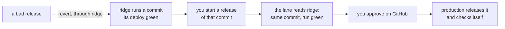

# Production: its own environment, its own lane, the way back rehearsed, plan, 2026-11-12

## At a glance

**Against the premise:** production needs **no template of its own**. `ops/env.yml` is already one
environment named by its `Env` parameter, and `ops/stack.sh env <name>` already makes any named
stack, its deploy role and its GitHub environment. What is missing is the lane, two settings and the
way back's rehearsal.

**For whom:** the first real company, and you as the one who ships to it. Production takes only the
commit ridge runs and has checked, by your act and your approval; nothing reaches it on a push. The
way back is the runbook's revert, **timed once on production while it holds no company**. **Price:**
about 77 minutes of the machine's, about $5 a month for an empty production, about fifteen acts of
yours.

## The slice

One slice, walkable when it ends: production's stack made from `main`'s templates by your stack run;
a release of the commit ridge runs, refused for any other, approved by you, production's own check
green through its app's address; an operator signed in there. Then a harmless commit and its revert
travel the whole path, production ends on the revert with the code from before, and the minutes from
the revert's commit to production running it are read off the stamps.

**The four stages.** Stage 1 has no local stand-in: GitHub's environments, the role exchange and the
approval exist only there, so stage 1 is `ops/test.sh`'s guards over the parsed workflow and its
stand-in commands; stage 2 the `ops` rows of the gate; stage 3 your look at the receipt; stage 4 is
production itself, not ridge, since this piece is what ships to it.

## What the repository already has, and what production adds

| What production needs | What exists in `main` | What this piece adds |
| --- | --- | --- |
| a stack | `ops/stack.sh env <name>`, the stack named for it (`ops/stack.sh#L68-L69`); `ops/env.yml`'s `Env` (`#L10-L13`) | nothing; your stack run |
| its own deploy role | trusted only by `${SubjectPrefix}:environment:${Env}` (`ops/env.yml#L454`), its rights on its own stack (`#L460-L537`) | nothing |
| its own keys | made on its own box by its first release; GitHub holds only the role's name (`ops/stack.sh#L291-L305`) | nothing |
| its own GitHub environment | made by the stack run, admitting `main` alone (`ops/stack.sh#L294-L298`) | you as its required reviewer |
| a lane | none: the one deploy job names `environment: ridge` (`.github/workflows/ci.yml#L215-L220`) and runs on every push to `main` (`#L217`) | a workflow you start by hand |
| the door sized for companies | 10 calls a second, bursts of 50 (`ops/env.yml#L293-L294`) | two parameters; ridge's values unchanged |
| a deploy stopped halfway names no commit it does not run | the description goes with the settings, before the code (`ops/app.sh#L124-L143`); open item 29 | the description written last |
| a way back | "revert the commit on `main` and release that" (`ops/README.md#L117`); a release never moves backwards (`ops/lib.sh#L612-L619`) | the same way, timed |
| no demo data, ever | `ops/seed.sh#L38` refuses anything but ridge | nothing |

## Decided, the machine's

1. **The environment is named `production`**: one stack, the home box first; DevOps adds a box by
   the pooled shape's `--more-boxes` when needed, so no number of boxes is designed in.
2. **The lane is its own workflow, `.github/workflows/production.yml`, started by hand**, its one
   input the commit, **copied from `seed.yml`**, the repository's one hand-started workflow (main
   alone, environment ridge, its own group). Two jobs. The first, under **ridge's** role, runs the
   reading `ops/seed.sh#L58-L79` already makes, "/health and the BFF's function name this commit",
   moved into `ops/lib.sh` so both call one helper, and asks GitHub that `ci.yml`'s push run for the
   commit ended green. The second needs the first and, under **production's** role behind your
   approval, runs the deploy job's own steps (`ci.yml#L231-L315`) with `production`, in a group of
   its own, never cancelled. *Rejected:* a job in `ci.yml`, one `if` away from every push.
   *Rejected:* releases from your terminal, which rebuild the commit on your Mac under your whole AWS
   session, where the job builds as ridge's did under a role that reaches one stack.
3. **"A commit ridge already ran" is the commit ridge runs now**, which the ship script reads for you.
   *Rejected:* any commit ridge once ran, which needs a deploy history only GitHub's run list holds,
   where a superseded run also ends green (`ops/release.sh#L9-L12`).
4. **The way back stays the revert, through ridge**, timed on production. *Rejected:* a release
   straight to production's previous commit, which breaks "never backwards" for one environment and
   ships a tree ridge is not running; it is what a no at point 4 starts.
5. **The door's limit becomes `ApiRateLimit` and `ApiBurstLimit`**, defaulting to ridge's 10 and 50;
   production's creation passes 30 and 150, over the final page's peak of about 21 calls a second
   for a box of twenty. **Every value production sets apart from a default is kept on each update**,
   beside `SubnetCidr` and `ImageId` (`ops/stack.sh#L193-L194`): a left-out parameter takes the
   template's default, which for an instance type replaces the box.
6. **The harmless commit is one comment line under `ops/`**, a path `ci.yml` deploys on, so it reaches
   ridge as a real release does; it and its revert stay in `main`'s history, said in their subjects.
7. **The records' way back is the continuous copy's restore**, drilled once on production while it
   holds no company; after that the drill is an act on production.

## What production takes from each earlier lane

Built last, production consumes what each lane leaves in `main` and redoes none of it; each row is
read again at the stack run.

| Lane | What production takes |
| --- | --- |
| ridge back by a command (landed) | its release and live-read hand-offs, copied with `production`. Its recap's open mark, the deploy job's first run onto the new role, must read green first: the lane refuses a commit whose run is not |
| the continuous copy | its bucket, box role, records disk and Litestream by the template; the network's S3 door is shared and already made; its drill once (decision 7) |
| the store, one company then pages and the copy tool | nothing of its own; a one-company restore on production waits for the safe scripts (that plan's "What stays out") |
| the activity log on ridge (planned now) | its unit, rule, key and release step by the template; **production's instance type is that lane's memory reading**, kept on update (decision 5) |
| the Slack alarm | the same four alarms, into the same channel unless you say otherwise (that plan's line) |
| the front door and its keys | its own door key at its creation; **the door's limit, which that plan hands here** (decision 5) |
| the wrong-password wait | nothing of its own |
| each company's own address (planned now) | its own name under the same domain, and your certificate and DNS acts for it, at that plan's values |
| every terminal script safe on production (planned now) | which of `check.sh`, `operator.sh`, `drill.sh` and `keys.sh` run here, and how; **production's check is the one that plan makes safe**, since today's makes a check company where it checks (`ops/check.sh#L178`) |
| companies pooled | production starts on its home box; a second box is DevOps' command later |
| delivery photos | the same six acts for production's own bucket and key, which that plan names as this milestone's |

## The case table

| # | The case | Held by |
| --- | --- | --- |
| 1 | `production.yml` runs only when started by hand, from `main`: no push, pull request or schedule | `ops/test.sh`, the parsed workflow |
| 2 | Only `production.yml` names `environment: production`, and `ci.yml`'s deploy names ridge alone | `ops/test.sh` |
| 3 | The release job needs the read job and checks out the commit the read job passed on | `ops/test.sh` |
| 4 | The read refuses a commit ridge's `/health` or function does not name, naming both, for seed and lane alike | `ops/test.sh`, a stand-in `aws` |
| 5 | The read refuses a commit whose `ci.yml` push run on `main` did not end green | `ops/test.sh`, a stand-in `gh` |
| 6 | Every step of both jobs carries `!env.ACT`; one release at a time, never cancelled; the account id masked | `ops/test.sh` |
| 7 | The stack run gives production's environment the person running it as required reviewer, and ridge's none | `ops/test.sh`, a stand-in `gh` |
| 8 | The door's two parameters default to 10 and 50, so ridge's change set moves nothing | `ops/test.sh`, the parsed template |
| 9 | Production's creation passes 30 and 150, and an update keeps every value set apart from a default | `ops/test.sh`, a stand-in `aws` |
| 10 | `ops/app.sh` writes the description only after the code's checksum matches; a failed code write leaves the old one | `ops/test.sh`, a stand-in `aws` |
| 11 | After the revert, production runs the revert's commit, whose deployed tree equals the one before the harmless commit | the rehearsal's log, `git diff --quiet` over `ci.yml`'s push paths |
| 12 | No existing test was changed to pass | `git diff pre-merge -- ops/test.sh`, additions only |

## The steps

Sizes are the ledger's for the same shape (`worktrees/runs.tsv`): a script with its guards in
`ops/test.sh` 14 (the tree-guard piece's step 3), a template change with its guards 10 (the
backup-policy piece's step 1), a one-line order fix with its stand-in 5 (that piece's step 3), a
review with its whole check about 20, a one-off 2 to 3, a log read 1 to 2, a recap about 8. Each
machine step's gate is rows 3 to 5 of the gate plus the citation test, each case red once on its own
assertion. 👤 is your act, handed as one command or one script, since no credentialed cloud command
runs here.

- [ ] **1. The lane.** `production.yml` (decisions 2 and 3, `run-name` naming the commit), the reading
  moved out of `ops/seed.sh` into one helper, and the guards, copied from the seed workflow's
  (`ops/test.sh#L925`). *Done when:* cases 1 to 6 each red once; `bash ops/test.sh` and
  `shellcheck -x ops/*.sh` at exit 0. **14.**
- [ ] **2. The stack's two settings.** The reviewer at `ops/stack.sh#L291-L305`, read from GitHub at
  run time and never committed; the door's parameters and their keeping. **First, GitHub's own page on
  required reviewers is read** (the `fetch` kind): the repository's logs are public
  (`ci.yml#L283`), and a reviewer on a private repository needs a paid plan; if unavailable, the
  reviewer half is dropped and point 3 says so. *Done when:* cases 7 to 9 red once; `cfn-lint
  ops/env.yml` and `bash ops/test.sh` at exit 0. **10.**
- [ ] **3. The description written last.** Open item 29's fix, on `ops/app.sh` as the earlier lanes
  leave it. *Done when:* case 10 red once; `bash ops/test.sh` at exit 0; item 29 deleted. **5.**
- [ ] **3r. Reviewed, fixed, landed.** A model other than the author's, one fix pass; `pre-merge`
  taken in first; landed there; `main` moves at the whole check. **20.**
- [ ] 👤 **4. Your push of `main`**, then `ops/stack.sh env production --plan`, your decision point,
  then without `--plan`; points 1 and 2 asked first. *Done when:* the plan's log names `origin/main`'s
  commit and lists additions only, the door at 30 and 150, the instance type the activity log's
  reading chose; the create's log reads `environment production admits branches main` and `holds
  secrets AWS_ROLE_ARN` (`ops/stack.sh#L303-L305`) and the reviewer read back. **4.**
- [ ] 👤 **5. The photos' six acts for production**, that lane's one-offs copied with `production`.
  *Done when:* the probe's log reads every check as expected. **3.**
- [ ] 👤 **6. The first release.** One one-off, `<stamp>-production-ship.sh`: it reads the commit
  ridge runs, starts the workflow with it, waits while you approve, and fetches the run's log; then
  `ops/operator.sh production`. *Done when:* `bash -n` and `shellcheck` clean; the run's log reads the
  two facts, the release, the app and the check green through the app's address; the operator's log
  reads the join link shown and no key. **5.**
- [ ] 👤 **7. The way back, timed.** The machine commits the harmless line (decision 6); it lands,
  `main` moves, you push, ridge deploys it, step 6's one-off ships it. Then its revert, the same way.
  Then `ops/drill.sh production`. *Done when:* the second ship's log names the revert; case 11's diff
  is empty; the minutes from the revert's commit to production's check are read off the stamps; the
  drill's log reads its restore row green. **8.**
- [ ] **8. The recap and the pages.** `docs/recaps/<date>-production.md` with the readings and the
  minutes; `docs/architecture-detail.md#L236`'s "not built", `docs/products.md`'s production line and
  open item 4 made true. *Done when:* the citation test green; `git grep -nE '/Users/|~/'` finds
  nothing new. **8.**

**About 77 minutes in all**: the cut's 50, plus the review and the photos' and the rehearsal's reads.
Steps 1 to 3 build while the other lanes land; step 4 waits for every lane above in `main`.

## The human's points

**Point 1, before the stack run: an empty production, paid for now.** Production would stand from
your stack run until a first company signs, holding nothing, for about $5 a month: the box at $4.20
all in, the copy's disk at about 69 cents, cents for the rest. Is it worth paying now, so the way back
is timed while nothing real is there? I recommend yes. A yes runs step 4 once the lanes land; a no
holds steps 4 to 7 until a first company.

**Point 2, before the stack run: the same AWS account as ridge.** Production would sit in ridge's
account and network, kept apart by its own subnet, keys, deploy role and GitHub environment; your own
session reaches both. Is one account fine for the first companies? I recommend yes, until a client's
contract asks for its own. A yes runs step 4 as planned; a no
makes a second account its own piece: the network and GitHub's provider made there, and every script
told which account it is in.

**Point 3, at step 2: who may release to production.** Each production release would wait on GitHub
until you approve it: anyone who can start the workflow can ask, only you can let it through. Is that
who should ship to a client's records? I recommend yes. A yes sets you alone as the reviewer; a no names who else, by
a label such as p1, each added beside you.

**Point 4, after step 7: how long the way back takes.** One number: the minutes from a revert being
written to production running the code from before the bad release, through ridge, the whole check
and your two acts. Records written meanwhile stay; theirs is the restore. Is that length acceptable
for a live company? A yes closes it; a no starts a faster way back as its own piece.

**Point 5, at step 8: production, ready for a first company.** One page: the stack's additions, the
lane refusing a commit ridge does not run, your approval, the check green through production's
address, an operator signed in, the harmless commit and its revert with the minutes, the restore
drilled. Does that read true as production ready for its first company? A yes closes the milestone; a
no reopens the step that did not convince you.

## What stays out

A company on production, an operator's act after point 5; a production alarms channel apart from
ridge's (the Slack lane's); a second box (DevOps' command); a read-only role for ridge's commit (open
item 302); the scripts' safety (its own lane).

## Hazards no gate catches

- **The way back waits on `pre-merge`'s whole check**, which runs at most every two hours
  (`docs/conventions/qa.md`, "The whole check on `pre-merge`"), so a revert can wait that long before
  `main` may move. Step 7 is timed with the check started at once; open item 301 asks for that to be
  the rule for a revert of what production runs.
- **The harmless commit is a real release**: step 7 runs when nothing else is landing, or the revert's
  tree differs by another piece's work and case 11 is red for a reason not the way back's.
- **An update that leaves a production value out replaces the box**: decision 5's keep is the guard,
  and case 9 holds it only for the values listed; a new production-only value joins that list.
