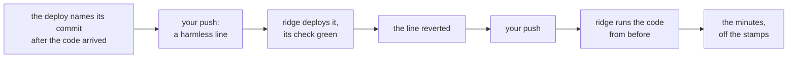

# Production, re-cut: ridge's deploy order fixed and its way back timed, the rest parked until a paying company has a date, plan, 2026-11-12

## At a glance

**Re-cut the same day, on your yes** to parking everything but the deploy-label fix and the timed way
back on ridge until a paying company has a date. There is no production until a paying company
comes, and ridge runs the same code, so two steps run now, on ridge. The lane, its settings and
production's own acts stay below as the record, parked.

**For whom:** ridge's partners now, the first paying company later. Today a deploy stopped halfway
leaves the BFF's function naming a commit whose code never arrived, and the seed's own check then
passes against a BFF a commit behind (open item 29); the fix writes that name last. The way back, a
revert through the whole path, gets one measured time on ridge: production's way back is the same
path with ridge in front. **Price:** about 35 minutes of the machine's, 45 if the review asks for a
fix; two pushes of yours; nothing a month.

## The slice

One slice, walkable when it ends: `ops/app.sh` writes the function's description only after its code
arrived, seen red then green on the stand-ins, and ridge's deploy after your push reads green with
`/health`, the function and the app naming one commit. Then a harmless line and its revert each
travel the whole path to ridge, ridge ends on the revert with the line's file as it was, and the
minutes from the revert's commit to ridge's check green are read off the stamps.

**The four stages.** Stage 1, `ops/test.sh`'s stand-in `aws` (cases 1 to 5); stage 2, the `ops` rows
of the gate; stage 3, your look at the minutes in the recap (point 2); stage 4, ridge itself, the
deploy after each push (cases 6 and 7).

## What the repository already has

| What the steps need | What exists | What this piece adds |
| --- | --- | --- |
| the order | the step "the BFF: settings, then code" sends the environment, the VPC settings and the description in one `update-function-configuration`, then the code (`ops/app.sh#L125-L148`); open item 29 names the fix and its test | the description in a call of its own, after the checksum |
| the role's rights | `SetBffSettings` lets the deploy role change settings only in a call that names the subnet and the BFF's group (`ops/env.yml#L505-L522`) | nothing: the second call names both |
| the description's readers | never backwards, `running_description` (`ops/app.sh#L89-L95`) over `superseded` (`ops/lib.sh#L648-L659`); the check (`ops/check.sh#L166-L173`); the seed (`ops/seed.sh#L77-L78`) | nothing: each then reads the commit whose code runs |
| the tests | the stand-in's lambda calls (`ops/test.sh#L1521-L1538`); the order row (`#L2149-L2152`); the checksum run (`#L2179-L2184`) | four rows; the order row rewritten |
| prose the fix makes false | `docs/client-readiness.md#L234-L238`; `ops/app.sh`'s header and the two comments in that step | those rewritten |
| a way back | revert on `main` and push, and the next deploy ships the reverted tree (`ops/README.md#L150`, `#L183-L185`); a release never moves backwards (`superseded`) | the same way, timed |
| the deploy | `ci.yml`'s `deploy` job, `environment: ridge`, on a push to `main` touching `ops/**` (`.github/workflows/ci.yml#L12`, `#L216-L221`) | nothing |
| `main`'s move | the whole check on `pre-merge`, at most every two hours (`docs/conventions/qa.md`, "The whole check on `pre-merge`") | started at once for the timing (open item 301) |

## The case table

| # | The case | Held by |
| --- | --- | --- |
| 1 | The first settings call carries the environment and the VPC settings and no `--description`, and goes before the code | `ops/test.sh`, the stand-in's call list |
| 2 | The description, the commit's sha, goes in a later call, after the code's checksum matched and before the UI's files, with ridge's subnet and the BFF's group in that call | `ops/test.sh`, the call list and the stand-in's recorded VPC settings |
| 3 | A code write that fails leaves the description as it was, and the run stops before the UI's files | `ops/test.sh`, a new stand-in switch failing `update-function-code` (item 29's test) |
| 4 | Code whose checksum is not the one sent leaves the description as it was | `ops/test.sh`, one row added to the `FAKE_BAD_SHA` run |
| 5 | Of the existing rows only the order row changes, to environment, code, description, UI | `git diff pre-merge -- ops/test.sh`: that row's lines, and additions |
| 6 | Ridge's deploy after the fix lands: `== green`, with `/health`, the function and `index.html` naming one commit | the first push's run, read by the script |
| 7 | After the revert, ridge runs the revert's commit, and the harmless line's file is as it was before that line | the second push's run; `git diff --quiet <harmless>^ <revert> -- <its file>` |

Cases 1 to 4 are red on today's `ops/app.sh`, each on its own assertion, before it changes; then
green. One mutation after, the description moved back into the first call, turns 1 to 4 red
together, and is reverted before the commit.

## Decided, the machine's

1. **Two settings calls, not one.** The environment still goes before the code, so new code never
   runs a moment on old settings (that step's own comment); the description goes last. Each call
   names the VPC settings, as `SetBffSettings` demands, and each is followed by `lambda_wait`.
   *Rejected:* the code first, which runs new code on the old environment.
2. **The stand-in's settings branch records the environment file only when the call names one**, so
   the second call leaves the first call's rows (0600 when read, gone by the next call) reading what
   they read today.
3. **The timing reads four stamps:** the revert's commit, `main`'s move, your push's run starting,
   its deploy ending green. The total is the answer; the parts say where the minutes went.
4. **Case 7 diffs the harmless line's own file**, not every push path, so other pieces landing
   between the two pushes cannot redden it.
5. **The harmless commit is one comment line under `ops/`**, a path the deploy runs on, so it reaches
   ridge as a real release does; it and its revert stay in `main`'s history, said in their subjects.

## The steps

Sizes are the ledger's for the same kind and shape (`worktrees/runs.tsv`, by `glance.sh --size
<kind>`): a build step 8, a review 5, a fix pass 10, a one-off 7, a log read 2, a recap 3. Each machine
step's gate is `bash ops/test.sh` and `shellcheck -x ops/*.sh`, plus the citation test. 👤 is your
act, handed as one script.

- [ ] **1. The description written last.** Item 29's fix in `ops/app.sh` (decision 1), the stand-in's
  switch and settings branch (decision 2), cases 1 to 5; the header, the step's two comments and
  `docs/client-readiness.md`'s passage rewritten. *Done when:* cases 1 to 4 red before and green
  after, and the mutation's receipt; `bash ops/test.sh`, `shellcheck -x ops/*.sh` and the citation
  test at exit 0; item 29 deleted. **8.**
- [ ] **1r. Reviewed, fixed, landed.** A model other than the author's reads one script's order and
  its rows; `pre-merge` taken in first; landed there; `main` moves at the whole check. **5**, and **10**
  more if the review asks for a fix pass.
- [ ] **2. The harmless line, then its revert.** The line (decision 5) on its own branch, landed, the
  whole check started at once; after your first push, its revert the same way. *Done when:* each
  lands with the gate green and `main` moved. **8.**
- [ ] 👤 **2h. Your two pushes, by one script.** `<stamp>-way-back.sh`, run once for each: it pushes
  `main`, waits for `ci`'s run on that commit, and prints its conclusion, the deploy's `released <sha>`
  and `== green` lines, and its start and end stamps. *Done when:* `bash -n` and `shellcheck` clean;
  the first run reads case 6, the second case 7. **7**, and a read of each run, **2** each.
- [ ] **3. The recap.** `docs/recaps/<date>-production.md`: the order fix, the four stamps and the
  total; open item 301 given the minutes it waits for. *Done when:* the citation test at exit 0; `git
  grep -nE '/Users/|~/'` finds nothing new. **3.**

**About 35 minutes in all**, 45 with a fix pass. Step 1 builds now. Step 2 waits for step 1 in `main`,
so the first push also carries the fix to ridge, and case 6 is its stage 4.

## The human's points

**Point 1, before the first push: two pushes for the timing.** The harmless line and its revert each
reach ridge by a push of yours, run by one script that waits for the deploy and prints its stamps.
Each push is a deploy like any other: c-storage restarts on ridge for a moment, and whatever else
`main` holds goes with it. Is it fine to push twice for this, outside your usual push? I recommend
yes. A yes runs the script twice; a no leaves the way back untimed until production comes back.

**Point 2, after the second push: how long the way back takes.** One number, read off the stamps: the
minutes from a revert being written to ridge running the code from before, through the whole check
started at once and your push, with the parts named. Records written meanwhile stay; theirs is the
restore. Is that length acceptable as the way back for a live company? A yes closes it; a no makes
item 301, the whole check started at once for a revert, a piece of its own now.

## Hazards no gate catches

- **The way back waits on `pre-merge`'s whole check**, at most every two hours. Step 2 starts it at
  once, so the minutes are the way back at its best; item 301 asks whether that becomes the rule.
- **A deploy already queued can show a push's run cancelled** (`ops/README.md`, "shown cancelled");
  the script then reads the run that took its place, and case 7 still holds on the commit ridge runs.
- **A deploy stopped halfway still leaves the new environment on the old code**: the fix moves only
  the name. The check's "name one commit" row reads that red, as it does today, and the seed then
  refuses rather than passing.

## Parked until a paying company has a date

**The flip:** the steps below come back when a paying company has a date close enough that they
would not fit before it: about 36 minutes of the machine's as first sized, a review of the lane, and
your acts for the stack, the photos and the first release. Their sizes are read from the ledger again then, and every citation
reread, since `main` will have moved under them.

| Step as first planned | What it held | Size then | Why it waits |
| --- | --- | --- | --- |
| 1. The lane | `.github/workflows/production.yml`, started by hand from `main`, copied from `seed.yml`: a read job under ridge's role checks ridge runs the commit and its `ci` run ended green (the reading behind `fn_commit` in `ops/seed.sh`, moved into `ops/lib.sh`); a release job under production's role, behind your approval, runs the deploy job's own steps; the first cut's cases 1 to 6 | 14 | nothing calls it: the one deploy job names `environment: ridge` |
| 2. The stack's two settings | you as production's required reviewer, read from GitHub at run time, after GitHub's page on it is read (a paid plan on a private repository); the door's limit as two parameters, ridge's 10 and 50 kept (`ApiStage` in `ops/env.yml`), production's 30 and 150; the first cut's cases 7 to 9 | 10 | both exist only for a second environment |
| 3r, the lane's half | the review of 1 and 2 | in 3r's 20 | nothing to review |
| 👤 4. Your stack run | `ops/stack.sh env production --plan`, then without; the reviewer read back | 4 | there is no production |
| 👤 5. The photos' six acts | that lane's one-offs, with `production` | 3 | the same |
| 👤 6. The first release | a one-off that starts the lane on ridge's commit and waits while you approve; then `ops/operator.sh production` | 5 | the same |

**Dropped, not parked: the restore drill on production.** The first cut's step 7 ran `ops/drill.sh
production`, which refuses every environment but ridge (`refuse_real`, `ops/drill.sh#L24`); the safe
scripts kept it so. Its decision 7, the drill once on production, falls with it: the records' way back
is drilled on ridge, in the continuous copy's lane.

**The guard against an update that replaces the box parks with the stack.** The first cut kept, on
each update, every value production sets apart from a default, beside `SubnetCidr` and `ImageId` (the
update branch's `add_param` lines in `ops/stack.sh`), since a left-out `InstanceType` falls to
`t4g.nano` (`ops/env.yml#L38-L40`). While every environment runs the defaults it protects nothing. It
comes back with the stack run, or sooner if the activity log's lane sets ridge's instance type.
Either way `ops/stack.sh --plan` already refuses a change set that replaces the box unless the plan's
step takes it with `--take Box` (`ops/test.sh`, "a Conditional change refused").

**The first cut's decisions, as the record:** the environment named `production`, one stack, the home
box first; the lane its own hand-started workflow, not a job in `ci.yml` one `if` away from every
push, nor releases from your terminal; "a commit ridge ran" is the commit ridge runs now; the way back
stays the revert through ridge (kept, step 2); the door's two parameters and the keep (parked, above);
the harmless commit (kept, decision 5); the drill on production (dropped, above).

**What production takes from each earlier lane**, read again at the stack run:

| Lane | What production takes |
| --- | --- |
| ridge back by a command (landed) | its release and live-read hand-offs, copied with `production` |
| the continuous copy | its bucket, box role, records disk and Litestream by the template; its drill on ridge |
| the store, one company then pages and the copy tool | nothing of its own |
| the activity log on ridge | its unit, rule, key and release step by the template; production's instance type is that lane's memory reading, kept on update |
| the Slack alarm | the same alarms, into the same channel unless you say otherwise |
| the front door and its keys | its own door key at its creation; the door's limit, which that plan hands here |
| the wrong-password wait | nothing of its own |
| each company's own address | its own name under the same domain, and your certificate and DNS acts for it |
| every terminal script safe on production (landed) | `ops/check.sh` only reads on an environment not listed as invented (`real_ok`); which of the others run there, by `ops/README.md`'s "On production" |
| companies pooled | production starts on its home box; a second box is DevOps' command later |
| delivery photos | the same six acts for production's own bucket and key |

**Open items that wait with the lane:** 296, 297, 332 and 333 name the production lane's plan as
their trigger, and 302 its read job. Item 301 stays live: its trigger is this plan's timing, now on
ridge. **The first cut's points** (an empty production paid for now, the same AWS account as ridge,
who may release, production ready for a first company) are asked again when the lane comes back.

## What stays out

Production itself, until the flip; a company on it; a faster way back than the revert, which a no at
point 2 starts.
