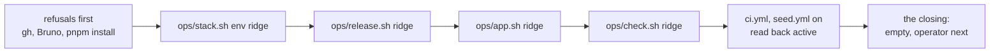

# Ridge down and back up, one command each, from your terminal

## At a glance

Ridge can be destroyed on a Friday night and remade on a Monday morning, each by one command in
your terminal. Deploying already works both ways: by hand (`ops/release.sh`, `ops/app.sh`,
`ops/check.sh`) and from GitHub (a push or the `ci` button on `main`). The 11-08 destroy is a
one-off outside git that ran green once, on its second try. The 11-11 remake was six commands.

| Act | Today | After this piece |
| --- | --- | --- |
| down | the 11-08 one-off, outside git | `ops/destroy.sh ridge`, plus typing `ridge` |
| up | six commands | `ops/remake.sh ridge`, then `ops/operator.sh ridge` for your passkey |

The cheapest safe path: copy the one-off into `ops/` with six changes, and chain the scripts that
exist. Nothing new is designed. The price: about 78 of the machine's minutes. Your part is a push
of `main` and one rehearsal on ridge, about 25 minutes of your terminal. The six demo copies and
production stay out, by your word.

## What was measured

**The premises hold.** The 11-08 one-off is the whole of a destroy, and the template has not changed
since. `ops/env.yml` last moved at 11-08 15:48, before the one-off was written, and its 21
resources are the types the one-off allows. The 11-11 remake ran six commands: the stack's
`--plan` and its creation, the release, the app, the check and the workflows on. Its live reading
was a check, not a step.
**What the brief and the inventory had wrong:**

- The destroy's first run went 23:35:59 to 23:42:08, not from 23:08 (that is the script's name). Its
  rerun took 3 minutes 39. The header's "20 to 30 minutes" has never happened.
- The first run's stop has no known cause. The bucket read after emptying throws away AWS's error.
  The board's receipt says the same, and it found the delete count cut by a `tail -n 3`.
- The Slack alarm changes `ops/env.yml` too: an SNS topic, four alarms, a Slack channel and its role.
  The continuous copy also changes `ops/env.yml`, `ops/network.yml`, `ops/c-storage.service` and
  `ci.yml`. The front door and the address have committed their plans only, no `ops/` change yet
  (15:2x).
- `walks.yml` never reaches ridge: its job names `environment: walks`. Only `ci.yml#L221` and
  `seed.yml#L29` name `environment: ridge`.
- Open item 314 is already this destroy script, parked. Your 11-10 word was: "let skip it from
  github action for now (will add later)". This piece closes its terminal half. The workflow half
  stays parked.
- The account holds other stacks beside ridge's, a client's among them. That is the stake: a script
  that deletes by name, in that account, gets a second model's read.

## The slice

One slice, walkable when it ends: on ridge, `ops/destroy.sh ridge` ends on its verdict. Then
`ops/remake.sh ridge` brings ridge back from `main` and ends `== green`, with `ops/check.sh ridge`
green through the app's address and the two workflows back on. Ridge is then empty. It holds no
operator and no demo copy, and the remake's last lines say so and give the operator's command.

**Out, by your word:** the six demo copies and their data, parked 15:0x for you to re-think
(`docs/plans/2026-11-12-ridge-by-script.md`). Production is parked too. Both scripts refuse every
environment but ridge.

## The destroy: the one-off, copied with six changes

The copy keeps the one-off's order and its refusals. It enumerates from the live account and
refuses anything it cannot attribute to ridge: a second stack with "ridge" in its name, a wrong `Env`
or `Network` parameter, exported outputs, termination protection, a stray box, interface or log group,
or a versioned bucket. Then it prints what will go, asks for the typed name, and deletes: the box,
its disk, the bucket's files, the stack and the two log groups, each read back as gone. It sources
`ops/lib.sh`. Its log goes where every ops log goes, `log_start destroy`, ending `== exit <n>`.
`refuse_real` comes at column 0, between `log_start` and `main_synced`, so `ops/test.sh`'s stance
check (`#L3189`) reads it; open item 322 says that check skips an indented call. It reads the
repository with `repository` and the worktree with `$REPO_DIR`, where the one-off used a hard-coded
`main/`. **No `ops/` script calls `one-off/`.**

| # | The change | Why |
| --- | --- | --- |
| 1 | The typed name comes **before** the workflows go off. A wrong word changes nothing | the one-off turned the workflows off first, so a wrong word left them off |
| 2 | Only the workflows that name `environment: ridge` go off: `ci.yml` and `seed.yml`, read from the files by a new `workflows_of <env>` in `ops/lib.sh`. `walks.yml` stays on | it never reaches ridge, so turning it off only stopped the walks page's deploys |
| 3 | The allowed resource types come from `origin/main`'s `env.yml`, by `aws cloudformation get-template-summary` on the file `stack.sh` already reads | a lane that adds a type is allowed with no second list; the body limit is the one `stack.sh#L206-L207` already meets |
| 4 | The bucket read after emptying keeps AWS's own words in the log. The receipt counts every delete, not three | the 11-08 stop, and its 33 files counted against 3 deletes shown, had to be worked out from the code |
| 5 | The account id goes through `mask` with a label, and the resource listing replaces every run of twelve digits | the one-off masked its own lines but not AWS's listing, so the id reached both logs once |
| 6 | The RE-UP section names `ops/remake.sh ridge` and what nothing re-creates. The header says what it removes and keeps, and its measured length. "UNTESTED" goes | the tests and the rehearsal stand where that word stood |

**Removes:** the box and its disk, the UI bucket and its files, the function, the API, the
distribution, both roles, the security groups, ridge's subnet and both log groups. **Keeps:**
`credo-network` and `credo-github` (shared), GitHub's environment `ridge` and its secret, and every
workflow file. `RIDGE_KEEP_DISK_SNAPSHOT=1` keeps one snapshot of the records, as before.

## The remake: the scripts that exist, in the 11-11 order

Each call has parameters and no copied line. Each child writes its own log, and its output goes to
the terminal (fd 3), not into the remake's log. The remake's log holds only its own lines: each
step's start, its exit and its log's name. So a key a child masks is never copied into a log that
does not know it. A red stops the run at that step, and the workflows stay off. Every step can be
rerun, so after a stop the remedy is to run the remake again. One case: when the box never answered
(`stack.sh#L285`), the rerun is an update, and it reaches the secret step.

Decided here, each yours to veto:

- **No `--plan`.** On a creation there is nothing to remove, and `stack.sh`'s own guard (`#L229-L237`)
  still refuses any removal or replacement. Its log prints every resource added.
- **The workflows go on last**, over a ridge checked green. With them on first, a push would deploy
  onto a stack that does not exist yet (`docs/plans/2026-11-09-ridge-reup.md`, "Why the workflows go on fourth").
- **The operator stays its own command, `ops/operator.sh ridge`.** Its link works once and is shown
  only on a terminal (`operator.sh#L40`). You open it in the browser to make your passkey, and a
  rerun of the remake must not make a second operator.
- **No timer.** The deploy role can only read its stack (`env.yml#L462`), so GitHub cannot do this.
  A Monday 6:00 run is yours, in a terminal signed in to AWS.

## What the lanes in flight change here

Lanes that change the templates land one at a time, each taking the earlier ones in. This piece
writes two new scripts, a function appended to `ops/lib.sh`, two new sections in `ops/test.sh` and
one section in `ops/README.md`. The only overlap is lines appended at the ends of two files.

| Lane | Its files | What it changes here, and which step meets it |
| --- | --- | --- |
| front door | `env.yml`, `stack.sh`, `test.sh` | none. `stack.sh` makes the door's key on a creation, so the remake's stack step gets one, and no resource is added |
| address | `app.sh`, `env.yml`, `lib.sh`, `stack.sh`, `test.sh` | the remake's stack step. A creation takes `CREDO_DOMAIN` and `CREDO_CERTIFICATE_ARN` again, from your environment, passed through unchanged. The certificate is outside the stack and survives. The DNS records then point at the old distribution: repointing them is yours, every cycle |
| continuous copy | `lib.sh`, `release.sh`, `test.sh`, `drill.sh`, `env.yml`, `network.yml` | the destroy's step 2. The box gets a second disk (the one-off refuses any but one), `RecordsVolume` leaves a snapshot by its `Snapshot` policy, and `CopyBucket` outlives the stack by `Retain`. Both are deleted unless the keep switch is set |
| Slack alarm | `env.yml`, `test.sh` | none in the destroy: the topic, the alarms and the channel go with the stack, and their types come from the template. Its Slack ids, on a creation, come the way `stack.sh` takes them, passed through unchanged |

**The guard that makes a later lane meet it:** row 14 below. Every `env.yml` resource that a stack
delete keeps (a `Retain`, `RetainExceptOnCreate` or `Snapshot` policy), and every bucket, must be
named in the destroy's list (`Box UiBucket` today). The template is read through `tojson`
(`test.sh#L204`). Whichever lands second, the copy or this piece, its `ops/test.sh` turns red on
`CopyBucket` and `RecordsVolume`. That lane extends the destroy.

## The cases

| # | The case: one behaviour, one sentence | Held by |
| --- | --- | --- |
| 1 | The destroy refuses any environment but ridge before any AWS or GitHub call | `ops/test.sh`, the destroy's section |
| 2 | Without a terminal it refuses, and makes no call that changes anything | the same |
| 3 | A typed word other than `ridge` ends it with no workflow disabled and nothing deleted | the same |
| 4 | It disables `ci.yml` and `seed.yml` after the typed name, never `walks.yml`, and deletes no file | the same |
| 5 | A run of either workflow in progress or queued stops it before any delete | the same |
| 6 | A stack holding a type that `origin/main`'s `env.yml` does not declare is refused, nothing destroyed | the same |
| 7 | A stack whose `Env` parameter is not `ridge` is refused, nothing destroyed. The one-off's other attribution refusals are copied unchanged, held by the rehearsal's enumeration, not by a case | the same |
| 8 | On a whole ridge it deletes in the one-off's order, the box, its disk, the bucket's files, the stack, the log groups, each read back, and ends on its verdict | the same |
| 9 | The account id is in neither the log nor the terminal | the same |
| 10 | A failed bucket read after emptying stops before the stack delete, and AWS's words are in the log | the same |
| 11 | The bucket's deletes counted equal the files counted before, or it stops | the same |
| 12 | With no stack and no ridge box it deletes nothing, lists the unattached disks, and ends 0 | the same |
| 13 | `RIDGE_KEEP_DISK_SNAPSHOT=1` takes one snapshot before the box goes; any value but 0 or 1 is refused | the same |
| 14 | Every `env.yml` resource a stack delete keeps, and every bucket, is in the destroy's list | `ops/test.sh`, through `tojson` |
| 15 | `workflows_of ridge` names `ci.yml` and `seed.yml` | `ops/test.sh` |
| 16 | The remake refuses any environment but ridge before any call | `ops/test.sh`, the remake's section |
| 17 | It refuses before its first step without `gh` logged in, the Bruno CLI, or `pnpm install` done | the same |
| 18 | It runs the stack, the release, the app and the check, in that order, then turns the two workflows on and reads them back active | the same |
| 19 | A red at any step stops it there: no later step runs, the workflows stay off, and its last line names the step | the same |
| 20 | Its closing says ridge holds no operator and no demo copy, and gives `ops/operator.sh ridge` as your next step | the same |
| 21 | A stack whose `Repository` parameter is not this clone's origin, or is missing, is refused before the name is asked, nothing destroyed (the review's M1) | `ops/test.sh`, the destroy's section |
| 22 | An id in `DESTROY_BY_HAND` (`ops/lib.sh`) that no step of the destroy deletes stops it before the name is asked (the review's L1) | the same |
| 23 | A stop after the workflows went off, by `fail` or by a command failing, says they are off and gives `ops/remake.sh ridge` (L4) | the same |
| 24 | AWS's error text on a failing call is scrubbed: the account id it quotes is in neither the log nor the terminal (L2) | the same |
| 25 | `workflows_of` stops on an `environment:` line that is not the plain form (L5) | `ops/test.sh` |
| 26 | A failed `gh workflow enable` ends the remake on its stop line naming step 5 (L3) | the same |
| 27 | The Bruno CLI version is declared once, in `ops/lib.sh` (L6) | the same |

## The steps

The sizes come from `runs.tsv`: an `ops/` step with its test rows each seen red ran 15 to 18
minutes (pieces 131, 119, 122, 124), the code shape's median is 11, and a review about 20. That is
more than five a step, and the measured sizes stand. 🤖 is the machine's, 👤 yours.

- [x] **1. The cheap build, end to end.** `ops/destroy.sh` is the one-off with the mechanical
  changes only (the log, the stance, `$REPO_DIR`, `repository`). `ops/remake.sh` is its five calls.
  `workflows_of` goes in `lib.sh`. Two sections in `ops/test.sh` run each script whole once, on
  stand-ins for `aws` and `gh` and stand-in scripts, in the style of the `stack.sh` section
  (`#L2622`). *Done when:* `shellcheck -x ops/*.sh` and `bash ops/test.sh` each exit 0, with rows 8
  and 18 green, and the stance check names neither script. **About 15 min.**
  *Done 11-12, commit `ec867872`, 14 min:* ShellCheck 0.11 over `ops/*.sh` exited 0, and `bash ops/test.sh`
  whole exited 0 with row 8 (the destroy on a whole ridge, ending on its verdict) and row 18 (the
  remake, ending `== green`) green, row 15 too; the stance check passed with both scripts counted.
  Beyond the row: the destroy reads the typed name from its input when `OPS_TEST_NO_TTY=1`, the tests'
  switch as `operator.sh` has it; with no stack it asks for no name and changes no workflow (change 1
  follows); the count of the bucket's files is read before the name is asked, and the run stops when it
  fails. Rows 1 to 7 and 9 to 14 are not yet seen red.
- [x] **2. The destroy's cases, each seen red.** Rows 1 to 7 and 9 to 15, each broken once by a
  mutation in its own line, and each mutation put back. If the copy has landed, `CopyBucket` and
  `RecordsVolume` are handled here (row 14 says so). *Done when:* `bash ops/test.sh` exits 0, the tick
  names each row's red, and `git diff` holds no mutation. **About 17 min.**
  *Done 11-12, 12 min:* ShellCheck over `ops/*.sh` exited 0 and `bash ops/test.sh` whole exited 0. Each
  mutation was made in a scratch copy of `ops/` run through a trimmed copy of the destroy's section, and
  the tree holds none. Seen red, each by its own mutation: row 1, `refuse_real` turned into `true`
  (the refusal's words missing); 2, the no-terminal `die` turned into `true`; 3, the typed-name test
  made always true (workflows disabled, six destroying calls); 4, `walks.yml` added to the disable loop;
  5, the in-progress test made false, and separately the `queued` status dropped from the loop; 6 and 7,
  their refusals turned into a print; 9, `scrub` turned into `cat` (the id reached log and terminal, and
  the run ended 1 on its own search; `mask` alone is a backstop whose removal changes nothing seen);
  10, the failed read made a print, and separately AWS's words dropped from the message; 11, the count
  test made always true; 12, the orphan listing made never print; 13, the snapshot made never taken, and
  separately the value check widened to 2; 14, `UiBucket` taken out of the new `BY_HAND` list in
  `destroy.sh`; 15, `workflows_of` matching any `environment:` line. Beyond the rows: a new `BY_HAND`
  line in `destroy.sh` is the list row 14 reads; row 2 is held with no test switch and really refuses;
  row 12 asks no name and changes no workflow, as step 1 chose; row 1's "before any call" check was not
  red alone, since the mutated run died earlier without an aws call. `CopyBucket` and `RecordsVolume`
  are shown by a synthetic template, the copy not having landed.
- [x] **3. The remake's cases, each seen red.** Rows 16 to 20, the same way. *Done when:* as in
  step 2. **About 11 min.**
  *Done 11-12, 9 min:* ShellCheck over `ops/*.sh` exited 0 and `bash ops/test.sh` whole exited 0. Rows 16, 17,
  19 and 20 had no cases yet, so they were written (the stand-ins gained `FAKE_BRU` and `FAKE_GH_OUT`), then
  each was broken in a scratch copy of `ops/` run through a trimmed copy of the section; the tree holds none.
  Seen red, each by its own mutation: row 16, `refuse_real` turned into `true` (the words missing, and `gh`
  reached); 17, the `gh auth status` line, the Bruno version test and the `node_modules` test each turned into
  `true`, each its own case red; 19, the exit test made false (app and check ran, workflows on), and
  separately the step line's words changed (the log no longer names the step), the `exit 1` dropped, and an
  early `gh workflow enable` (a workflow on); 20, the operator line dropped, and separately "It is empty: it
  holds no operator and no demo copy." reworded. Row 18 stays green from step 1. Beyond the rows: row 20 reads
  the row 18 run's log, so its two checks sit right after row 18.
- [x] **4. The runbook.** In `ops/README.md`: two "At a glance" rows, two rows in "On production"
  (both scripts refuse), and a section "Ridge down and back". It holds the two commands, the
  operator after, what each run's last lines read, and the address lane's two settings. Item 314
  is rewritten to its workflow half. *Done when:* the citation test exits 0, and
  `git grep -nE '/Users/|~/'` finds nothing new. **About 5 min.**
  *Done 11-12, 2 min:* `pnpm --filter @credo/scripts exec vitest run src/citations.test.ts` run alone exited 0 (32
  passed), and the diff adds no `/Users/` or `~/` match. `ops/README.md` gained two "At a glance" rows after the
  operator's, two "On production" rows (both refuse), and a section "Ridge down and back" with the three commands,
  each log's last lines read off the scripts' own lines (the destroy's verdict comes before its closing, then
  `== exit 0`; the remake ends `== green`), and the address lane's two settings named as not yet in `main`. Item 314
  is rewritten to its workflow half.
- [x] **5. A second model's read**, then one fix pass with its own gate (QA rule 5). *Done when:*
  each finding is tagged fixed, rejected or deferred, and `shellcheck -x ops/*.sh` and
  `bash ops/test.sh` exit 0 after the fix pass. **About 20 min.**
  *Done 11-12 (the review, then the fix pass, 12 min):* the second model's read held one Medium and seven Lows,
  all fixed, none rejected or deferred, each checked on disk first. M1: the destroy refuses a stack whose
  `Repository` parameter is not this clone's origin (a missing one too) before the name is asked (row 21).
  L1: the list of ids a stack delete keeps is one line in `ops/lib.sh`, and an id no step deletes stops the run
  before the prompt (row 22). L2: every `aws` call in the destroy passes its error text through the scrub
  (row 24). L3: a failed `gh workflow enable` ends the remake on its step-5 stop line (row 26). L4: a stop after
  the workflows went off says they are off and gives `ops/remake.sh ridge`, by `fail` and under `set -e` alike
  (row 23). L5: `workflows_of` stops on any `environment:` line that is not the plain form (row 25). L6: the
  Bruno version is one line in `ops/lib.sh` (row 27). L7: row 1 runs on `walks`. Each new row was seen red by
  its own mutation, each reverted and compared equal. `shellcheck -x ops/*.sh` and then `bash ops/test.sh`
  whole, run under the lock on the tree committed here with only this tick added after, exited 0. The "Done
  reads" paragraph now matches the scripts' endings.
- [x] **6. The recap**, with the row in `docs/products.md`. Then the landing on `pre-merge`. *Done
  when:* committed, with the citation test green. **About 5 min.**
  *Done 11-12:* the recap, the products row (and the client-delete row, now proven on ridge), and items 369 to 371
  (the reread's three Lows) are in one commit. `pre-merge` was taken in first; ShellCheck over `ops/*.sh` and the whole
  `bash ops/test.sh` exited 0 on the merged tree, and the citation test exited 0. The rehearsal's outcome stays open
  in the recap.
- [ ] **7. 👤 Your rehearsal on ridge** (below). 🤖 reads the logs whole: the destroy's, the
  remake's and its four children's. *Done when:* they read as "what done reads" below. **About 5
  min of the machine's**, about 25 of your terminal's.

Steps 1 to 6 come to about 73 minutes, and with step 7, 78. Stage 2 is steps 1 to 3. Stage 3 is
your read of the two verdicts. Stage 4 is ridge itself.

## How you rehearse it, and what done reads

The rehearsal comes after `main` holds the piece and you have pushed `main`. Every ops script refuses
code that differs from `origin/main` (`lib.sh#L175`). Run it in your terminal, from `main`'s
worktree, signed in to AWS, with `gh` logged in. Pick a slot when no other lane is acting live on
ridge. Ridge holds no operator and no demo copy today, so the rehearsal loses nothing.

1. `bash ops/destroy.sh ridge`, then type `ridge`. About 5 minutes.
2. `bash ops/remake.sh ridge`. About 15 minutes: the stack about 5, the release and the app 3 to 7,
   the check about 3.
3. `bash ops/operator.sh ridge`, then open its link and make your passkey at the new address.

**Done reads:** the destroy's log holds `== verdict: ridge is destroyed, ci.yml and seed.yml are
off`, then its closing paragraph (`== CLOSING, in plain words:` and the two commands), and ends on
`ok   no key in this log` and `== exit 0`. The remake's log ends `== green` and `== exit 0`, and so does each of its
four children's logs. The check's step 7 ran through the app's address and was not skipped. Both
workflows read back `active`, and no log holds the account id. Each log is the newest
`<stamp>-<script>-ridge.log` in the credo root's `logs/`.

## Your points

**1. After step 7: do the two verdicts read true as ridge going down and coming back?** One page:
what the destroy removed, each read back as gone; the remake's five steps green; the check through
the app's new address; both workflows on. A yes lets the ridge guide (piece 135) give both commands
as yours. A no reopens this piece at the script whose verdict did not convince you.

**2. Asked now, nothing waits on it: every weekend, or only a proof that ridge can be rebuilt?**
Nothing here needs either answer. A weekend down saves about $1.35 a month (54 of 168 hours of a $4.20 box and disk). It costs partners
every record, the operator and every passkey, and the hand-made demo copies, and a weekend push runs
no CI. *Recommended:* a proof, rehearsed after a template change lands or once a month, with ridge up
on weekends. A yes for every weekend opens four pieces: records kept and restored, the copies by
script, a timer, and the DNS repoint.
