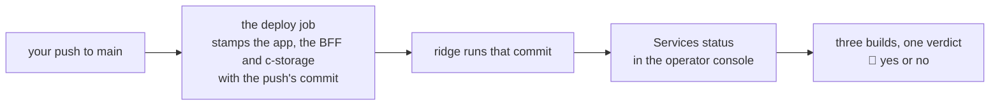

# The build version, seen by eye after a push, plan, 2026-11-14

## At a glance

You asked for a way to see by eye which build is running. It is already on ridge: the operator
console's **Services status** page shows the build of the app's page, of the BFF and of c-storage,
each as the first seven characters of its commit, and says in one line whether all three run one
build. You asked for that page on 2026-10-29, as "monitor services status". After a push, open the
app on ridge at `/operator`, give your passkey if asked, then click Services status in the menu:
one click. **Nothing is built**: the cheapest path is the screen that exists. The legacy app showed
only its own page's build, at the foot of its menu. This page also shows the two servers' builds and
compares them. The price is your one look after the next push that deploys.

## What the legacy's two components show

Both are in the old repository's `workspace/` folder, the legacy app. Its earlier remake, in the same
checkout, is not what is read here.

| Component | What it shows | Where | To whom | How it opens |
| --- | --- | --- | --- | --- |
| `workspace/uis/base/src/components/common/BuildInformation.tsx` | `v` and the package's version, the commit's first eight characters in brackets, and `Build:` with a timestamp; small grey italics (`#L9-L16`) | the foot of the PC app's left menu, left out when the menu is folded to icons (`workspace/uis/base/src/components/app/PCAppLayout.tsx#L562-L567`); on a phone, the same as one line at the foot of the More page (`workspace/uis/c-mngt/src/pages/MorePage.tsx#L160-L169`) | every signed-in user of the management app, on every page | always shown; nothing to open |
| `workspace/uis/c-mngt/src/components/DevClientCodeModal.tsx` | a developer's tool: change the client code, the API group and an admin key, and wipe every cache. At its foot, the build's timestamp only (`#L139-L141`) | a dialog over any page, mounted in every build (`workspace/uis/c-mngt/src/App.tsx#L153`) | anyone who knows the key: the component checks no role | Cmd+G, or Cmd+Shift+K on production (`#L11-L12`, `#L21`) |

The commit and the time come from the build machine, from `GITHUB_SHA` or `git` (`workspace/uis/c-mngt/vite.config.ts#L39-L61`).
Neither component shows anything of the server's build. Only the first one serves this piece. The
second is a developer's switchboard, and the new app takes its client code from the join link.

## What the new app already stamps and shows

- **The stamp.** The deploy job's build step sets `CREDO_BUILD` to the push's commit for the BFF's
  bundle and the UI alone (`.github/workflows/ci.yml#L397-L406`). The UI takes it in at build time
  (`ui/vite.config.ts#L10-L12`, read at `ui/src/main.tsx#L32`). The BFF's `BUILD` (`bff/src/build.ts#L3`)
  is replaced in the bundle (`bff/src/bundle.ts#L21`). c-storage is stamped by `make box` from the
  same checkout (`services/c-storage/Makefile#L27-L31`, run at `ci.yml#L408-L412`). Every deploy releases c-storage
  and then ships the BFF and the UI, all under that one commit (`ci.yml#L449-L466`).
- **The refusals.** A bundle or UI without the commit is never shipped (`ops/app.sh#L76-L77`). A
  workflow whose build step drops the stamp is red in `ops/test.sh`'s guards (`ops/test.sh#L1675-L1676`).
  After the deploy, the job's Check step reads c-storage's health, the function's description and
  `index.html`'s metadata back through ridge and requires one commit (`ops/check.sh#L220`). That is the
  machine's check. The page is the human's.
- **The screen.** `/operator/services` (`ui/src/OperatorApp.tsx#L249-L254`) draws three rows, one each for the app's
  page, the BFF and c-storage (`ui/src/pages/operator/ServicesPage.tsx#L144-L160`). Each row shows its build as seven
  characters (`#L127`, `#L191`). Builds are compared in full (`#L141-L143`), a green or yellow
  verdict line goes above the rows (`#L164-L166`), and a "Different build" badge marks the odd one out (`#L193-L197`).
  The page asks each minute while it is in view, and on "Check now" (`#L84-L99`, `#L105-L112`).
- **The UI's own build** is the app's-page row. It is the commit compiled into the scripts this tab
  loaded, so a tab opened before a deploy keeps showing the older build until it is reloaded
  (open item 435).
- **The BFF's and c-storage's** come from `GET /api/operator/services` (`bff/src/app.ts#L491-L499`).
- **Who can open it: an operator only.** The route asks for an operator's sign-in (`bff/src/app.ts#L492`),
  and the page exists only in the operator console, which is drawn on `/operator` addresses
  (`ui/src/App.tsx#L28-L34`). A client's root, manager, staff or driver sees no build anywhere:
  `ui/src/ClientApp.tsx` takes no `build`, and the BFF has no open health route (`/api/health` is a
  404, `bff/src/operator-services.route.test.ts#L95-L97`).
- **The clicks.** `/operator` lands on Clients (`ui/src/OperatorApp.tsx#L259`). Services status is
  the third menu entry (`ui/src/operatorNav.ts#L16`) and sits on the phone's bar too, which holds
  the first four (`ui/src/frame/Shell.tsx#L31`, `#L109`). That is one click or one tap, none when
  `/operator/services` is opened directly, and a passkey touch first when the device's operator
  sign-in has ended (`ui/src/OperatorApp.tsx#L73-L75`, `#L165-L171`).

## What the brief had, and what the reading found

- **Held:** "the build version" means the commit the running app and its BFF were built from, and
  the stamp exists in `main`.
- **Corrected, wider:** c-storage is stamped and shown too, and the page compares all three, which
  neither legacy component did.
- **Corrected, narrower:** the piece's record says "anyone who opens the app on ridge" can see the
  build. Only an operator can. For the purpose (your look after a push, and the look in the
  rehearsal of the way back) that is enough, because you are ridge's operator
  (`docs/plans/2026-10-29-operator-console.md#L64`). Whether partners such as `p1` should see a build
  on the client's pages is a choice about what a partner sees. It is not asked here: the look's no
  opens it.
- **Found, not blocking:** the stale tab above. The page's two-builds sentence says that c-storage
  is updated first, then the BFF and the app (`ui/src/i18n/en.ts#L260-L261`). For a tab left open
  across a deploy, that reads as "wait", when a reload is the whole remedy. `index.html` is served
  `no-cache` (`ops/app.sh#L156-L157`), so a reload shows the new build. Filed as open item 435 and
  not fixed here: it moves the services walk's half-done screen, and the look works around it by
  opening the page fresh.

## The slice

There is nothing to build. The slice is already walkable end to end in `main`: a push to `main`,
then the deploy job, then ridge, then the page. This piece adds where to look and one look.

## The cases

The behaviours the look leans on, each already held in `main`. One is not held, and is filed.

| # | The case | Held by |
| --- | --- | --- |
| 1 | The deploy's build step stamps the BFF and the UI with the push's commit | `ops/test.sh#L1675-L1676`, the workflow's guards |
| 2 | A bundle or a UI whose scripts lack the commit is never shipped | `ops/test.sh#L3359`, `#L3366` |
| 3 | The UI's built scripts carry the commit given, and none without one | `scripts/src/fake.test.ts#L61` |
| 4 | The BFF's bundle carries the commit given, and says dev without one | `bff/src/bundle.test.ts#L101` |
| 5 | The services answer names the BFF's build and c-storage's | `bff/src/operator-services.route.test.ts#L43` |
| 6 | With no operator's sign-in it is a 401, and c-storage is not asked | `bff/src/operator-services.route.test.ts#L72` |
| 7 | The page shows the three builds and says all three run one build | `ui/src/pages/operator/ServicesPage.test.tsx#L45` |
| 8 | A half-done deploy is said, and the odd build marked | `ui/src/pages/operator/ServicesPage.test.tsx#L59` |
| 9 | A build is shown by seven characters and compared in full | `ui/src/pages/operator/ServicesPage.test.tsx#L85` |
| 10 | After a deploy, ridge's three parts name one commit | `ops/check.sh#L220`, the deploy job's Check step |
| 11 | A tab opened before a deploy shows its own older build and calls the deploy half done | not held; open item 435 |

## The steps

- [ ] **1. The machine reads the next deploy's own check.** After your next push to `main` that
  touches a path the workflow watches (`ci.yml#L9-L27`; a documents-only push deploys nothing, and
  the page then names the last deployed commit), the machine reads the GitHub run's deploy job.
  *Done when* its Check step passes `/health, the function's description and index.html's metadata
  name one commit` and the job ends green, read in the run's log. *Size:* about 5 minutes, a first
  run of this shape.
- [ ] **2. 👤 Your look on ridge.** Your point 1, below. *Done when* your yes or no is recorded in
  the piece's record. *Size:* about 2 minutes of yours.
- [ ] **3. The close.** On a yes, the piece closes with this plan as its record. There is no review,
  because no code changes, and no recap, because nothing ships; `docs/products.md`'s row "C, services
  status" already names the page and its address. *Done when* the piece's record is closed. On a no, a
  second one-page plan is written for what your no names.

**The build is 0 minutes.** The piece costs about 5 minutes of the machine after the push, and
your look.

## The four stages

| | Stage | Here |
| --- | --- | --- |
| 1 | the cheap build, end to end | `main`'s page; nothing new. The gap is named: there is nothing to build |
| 2 | verified locally | the cases above, all in `main` and unchanged, so nothing is rerun (a piece that changes no code runs no gate) |
| 3 | a visual a non-coder judges | the live page on ridge (step 2), not a picture. The services walk's 30 pictures already show this page on invented data, and the look is about a real deploy |
| 4 | ridge | the same look |

**No fake-data walk.** No screen moves, so there is nothing new for a fake walk to show. The
services walk's base pictures stay as they are. A second slice that adds a line to a screen would
need its walk run again.

## Your point

**Point 1, at step 2: the build on ridge's Services status.** After your next push that deploys,
open `/operator/services` on ridge, fresh or reloaded. Do its three rows show the commit GitHub's
run shows, by its first seven characters? A yes: this page is how a deploy is confirmed, and the
piece closes with nothing built. A no: say what is missing. The machine then recommends the app's
commit as one line on the client's More page, which moves six pictures.

## What stays out

- **A build line in every page's menu**, the legacy's PC placement. The menu is on every
  signed-in screen, and a screen's version is read from its markup (`visual/src/capture.ts#L260-L265`).
  It would move most of the 516 base pictures taken at 768 and 1,280 pixels wide, of the walks'
  774, and each one would be asked of you again, for a minor point.
- **The legacy's developer tool**: none of it serves the build, and the client code comes by link.
- **A build time**: the commit names the build, and GitHub's run holds the time.
- **The stale tab's sentence**: open item 435.
