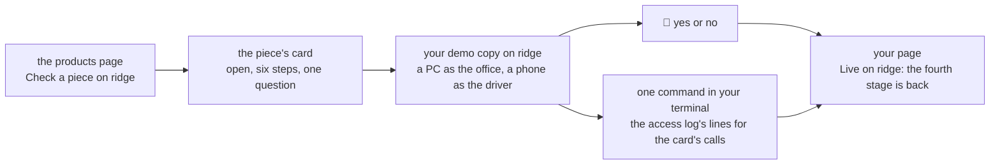

# Checking a piece on ridge without code, plan, 2026-11-16

## At a glance

The fourth delivery stage is ridge, where somebody who does not read code checks a piece. Most of it
exists: ridge runs `main` with the six demo copies, and the human already checks pieces there, but
each time from steps relayed in a chat. Two things are missing: a card a person finds alone, and a
receipt read off ridge. **The cheapest path joins what exists:** one section of cards on
`docs/products.md`, the delivery photos' card first; a read-only one-off copied from the access log
read of 2026-11-08; one sentence in two conventions so the next piece adds its own card; and the
human's page shows the stage through the `seen` line it already draws. The price: about 32 machine
minutes, the human's one check of the photos on ridge and one command.

## What exists, and what each gives a person who does not read code

| What | What it gives today | Where it opens | What is missing for one piece's check |
| --- | --- | --- | --- |
| The walks page | every screen's picture in both languages, a yes or no each; partners sign in to it by an emailed code (`docs/products.md#L56-L57`) | the page by name, "walks" | nothing on it comes from ridge: a walk reads its address from `CREDO_URL` (`walk/playwright.config.ts#L25`), which `walk/run.sh#L396` sets inside `pnpm stack`, and each walk makes its own client through c-storage, which ridge keeps private (item 13) |
| The ridge guide | nine acts to run ridge, each a block to paste; its first line promises the check (`docs/ridge-guide.md#L3`) | in the editor | every act needs an AWS session, `gh` and Node (`#L14-L18`); none is a check of a piece |
| `ops/check.sh` | the machine's check: a throwaway company signed in through the app's address and its own, a customer added and found in the activity log (`ops/check.sh#L252-L329`); its verdict is one line | the human's terminal | it never opens a demo copy or a piece's screen, so its green says ridge is sound, not that a piece works |
| The access log | a line a call with ten fields (`ops/env.yml#L633`), kept 14 days; three lines were read back once (`docs/products.md#L91`) | only with an AWS session, by the one-off of 2026-11-08 | its path field names a piece's own calls; it has no host field, so no line tells which company or address. The addresses it keeps are item 157, open |
| The activity log | who did what to a record; read on the box by `ops/check.sh` for its own client only (`#L292-L329`), and on this Mac by `pnpm local activity` (`docs/products.md#L69`) | nowhere a person reads on ridge: the console's Activity page is "coming soon" (`ui/src/operatorNav.ts#L18`) | a reader on ridge, which this piece does not need |
| `docs/products.md` | each product, what it does and the menu to open (`#L18`) | in the editor, linked from the human's page | nothing about ridge's copies; and two rows this piece leans on are stale (below) |
| The human's page | "Live on ridge, which means somebody read it working there", one line per merged piece whose `where` is live, with its `seen` (`worktrees/glance.sh#L788-L789`, on the orchestrator's branch); it lists the photos, the human's phone photo of 11-16 07:57 | the human's page | it names no stage |
| The stage itself | row 4 of the four stages (`docs/conventions/collaboration.md#L184`); plans stand it up one at a time as a point told in the plan (`docs/plans/2026-11-11-delivery-photos.md#L295-L298`, `docs/plans/2026-11-12-company-address.md#L248-L253`) | a plan, relayed by the orchestrator | a standing place for the check, and a receipt |

## What the brief had, and what the reading found

- **No walk runs against ridge, and the ridge guide is the operator's page** (rows 1 and 2).
- **The access log gives a person nothing without AWS**, but it can be the receipt, because the
  photos' calls have paths of their own.
- **Both pieces the brief offered are on ridge and in `main`, and the human has looked at both**
  there: the photo from a phone (`docs/recaps/2026-11-15-delivery-photos.md#L20`) and the first copy's
  own sign-in page (`docs/recaps/2026-11-14-company-address.md#L19`). `87be838c` and `58a24141` are
  both ancestors of `main`.
- **The products page is stale on both:** My deliveries reads "on `pre-merge` (the photo store:
  local only, ridge open…)" (`docs/products.md#L27`), and Frame and Clients "not yet in `main` and
  not yet run on ridge" (`#L37`). Correcting them is part of this piece.
- **"Declared restored on the human's page" needs no change to `glance.sh`:** a merged piece whose
  `where` is live is drawn under "Live on ridge" with its `seen`, and the script refuses a live one
  without it (`worktrees/glance.sh#L344`).
- **The products page is not a living document** to the citation test (`scripts/src/citations.ts#L15-L30`):
  its links are checked by step 1's own `ls`, not by the test.

## What "check a piece" means for a person

**They open the products page's section "Check a piece on ridge, without code"** (linked from the
page's first lines, from the piece's row, and from the ridge guide's first line), and read the
piece's card. A card says, in plain words and the app's own labels:

- **Who can check:** anyone holding a demo copy's link and its root password. The `-1` copies are
  `p1`'s, the `-2` copies `p2`'s and the `-3` copies the human's (`scripts/src/demo/mapping.ts#L21-L39`);
  the human sends a partner their link and password by their own channel, as the remake asks
  (`docs/ridge-guide.md#L134-L135`).
- **What to open, then at most six steps, then what one should see.**
- **One question.** A yes: the piece has passed the fourth stage, and the human's page lists it as
  live with what was read. A no, with the step where it went wrong: the piece reopens with those
  words.
- **The receipt:** within two hours, the human runs one command that prints the card's calls from
  the access log: time, method, path and answer, never an address or a browser's name.

A card makes its own records for the check, so it does not depend on how fresh the demo copies are
(`docs/ridge-guide.md#L147`).

## The piece checked first: delivery photos

1. **It isolates what this piece adds.** The human already passed the same check from a chat. A no
   from the card alone therefore points at the card, not at the photos.
2. **Its receipt names the piece.** The driver's ask for an address, the delivery and the office's
   look are three calls with paths of their own, `…/photo-address`, `…/deliver` and `…/photo` under
   `/api/deliveries/<day>/<id>` (`shared/src/wire.ts#L70-L73`, called at `ui/src/api.ts#L727`,
   `#L741`, `#L771`). The company's own address leaves no line that names the address it came
   through, since the format has no host (`ops/env.yml#L633`).
3. **It is the flow a partner checks next:** an office and a driver, a PC and a phone.

Its card, in outline, for step 1 to write in the app's labels: on a PC, sign in to a `-3` copy as its
root; under Orders, make an order for today, confirm it with a driver and send it; under Staff, open
that driver and press "Show a QR code" (the demo copies keep the QR sign-in on,
`scripts/src/demo/scenarios.ts#L174`); scan it with the phone, which opens My deliveries as the
driver; open today's request, take a photo, press "Delivered"; back on the PC, under Delivery
requests, open that delivery. One should see one's own picture, not "The photo did not arrive."
Question: did your photo show on the office's page?

## The slice

One: the card on the products page, the human's check on ridge from it, the receipt read in the
human's terminal, and the stage shown on the human's page. It is walkable when the plan ends, and
it is the whole milestone.

## The cases

| # | Case | Held by |
| --- | --- | --- |
| 1 | Each label the card quotes is one the app shows, in English and in Vietnamese | step 1's `grep` of each label in `ui/src/i18n/en.ts` and `ui/src/i18n/vi.ts` |
| 2 | Every link step 1 adds opens a file that exists | step 1's `ls` of each target; the citation test for the ridge guide's line |
| 3 | The two stale rows read what their recaps say: in `main`, and on ridge | step 1's `grep` of both rows |
| 4 | The receipt prints, for each of the card's calls in the window, its time, method, path and answer, and nothing else | step 2's green stand-in run |
| 5 | A window that lacks one of the three calls ends red naming that call, exit 1, with the count of all lines read beside it | step 2's red stand-in run |
| 6 | Nothing the receipt writes holds an address or a browser's name: its last step counts address shapes in its own files, 0 expected | step 2's own count, seen red once by letting the address field through |
| 7 | An unreadable log group (no session, no permission) is a refusal before anything is written, exit 2 | step 2's stand-in `aws` that fails |
| 8 | The receipt makes one kind of AWS call, `logs filter-log-events`, and writes nothing there | step 2's stand-in, which records every call it is given |
| 9 | No committed file names a log, a local path or a person | the citation test's `logCitations`; the documentation convention's grep for a home folder, on the diff |
| 10 | The human's page lists the piece as live only with what was read | `worktrees/glance.sh#L344`'s refusal; step 6's read |

## The steps

- [x] **1. The card and its pointers.** In `docs/products.md`: one sentence after the opening lines
  pointing to a new section "Check a piece on ridge, without code", placed before "Known gaps"; that
  section's short intro (who can check, how they get the link, what a yes and a no each start, the
  receipt); the delivery photos' card from the outline above; in the My deliveries row's "Open or
  start" cell, a link to the card; the My deliveries row's state and the Frame and Clients row's
  state corrected to `main` and ridge. In `docs/ridge-guide.md#L3`, the sentence links to the section.
  *Done when:* `grep -c "Check a piece on ridge, without code" docs/products.md` prints 2; `grep -n
  "local only, ridge open\|not yet run on ridge" docs/products.md` prints nothing; each quoted label
  is found in both word files (case 1); each new link's file exists (case 2); the citation test
  exits 0. *Ran:* the first grep printed 2; the second printed the two other rows' own "not yet run on ridge" (the demo copies' remake, the continuous copy's restore), none of the two stale rows (the grep was meant for the My deliveries and Frame and Clients rows only); step 3 then corrected those two other rows, which the recaps of 2026-11-13 (long-runs, "On ridge") and 2026-11-12 (continuous-copy, "On ridge") say ran on ridge, so the grep now prints nothing; every label found in both word files; each link's target exists; the citation test exited 0. *Size 8:* rows `2026-11-13 08:27` (135, guide, 4) and `08:51` (135, guide-fix, 4), a
  living page of acts read against the code and then linked.
- [x] **2. The receipt, a one-off outside git.** Copied from the access log read of 2026-11-08 with
  its changes: no requests sent, no stack read; one optional argument, the minutes back (120 by
  default, a whole number from 1 to 1440, else refused); one read of `/aws/apigateway/credo-ridge`,
  parsed by the same `.events[].message | fromjson?` that read three real lines off ridge that day;
  each line on one of the three photo paths printed as time, method, path and answer, no raw reply
  kept; the counts of all lines and of each call; the address count; the verdict. That day's raw
  reply is no longer kept, so the stand-in's reply is that parse's shape around `ops/env.yml#L633`. *Done when:* `bash -n` and ShellCheck print nothing; four stand-in runs read
  whole: green with the three calls (exit 0), red with the office's look left out (exit 1, naming
  it), a refusal when the stand-in fails (exit 2), and the address count red once with the address
  field let through, then 0 (cases 4 to 8). *Ran:* `bash -n` and ShellCheck printed nothing (one `SC2329` disable on `cleanup`, which the EXIT trap calls); the four stand-in runs read whole: green with the three calls, exit 0; the office's look left out, exit 1 naming `photo`; the stand-in `aws` failing, exit 2, a refusal before any receipt line; the address field let through, count 3 and red, then the real script 0; the stand-in recorded only `logs filter-log-events` calls. A second read by another model may change the script; its tick holds whatever it fixes, since it names the cases. *Size 10:* row `2026-11-16 13:56` (128,
  restore-oneoff, 10), one script with green and red stand-in runs.
- [x] **3. The convention line.** In `docs/conventions/collaboration.md`, after "Stage 4 is stood up
  only for a piece that changes what ships" (`#L186`): where it is stood up, the piece's check is a
  card under the products page's "Check a piece on ridge, without code", and its receipt is the
  access log's lines for the card's calls, read in the human's terminal. In
  `docs/conventions/documentation.md#L169`, the recap's row: the recap's commit also adds the card
  where the piece stands up stage 4. It lands with the piece because the piece declares the stage
  standing, and without the line the next piece's check goes back to a chat. *Done when:* `git grep -n "Check a piece on ridge"
  docs/conventions/` prints two lines, one in each file; the citation test exits 0. *Ran:* the grep printed two lines, `collaboration.md#L188` and `documentation.md#L169`; the citation test exited 0; the two rows step 1 left were checked against the close-out recaps and both corrected. *Size 3:* row
  `2026-11-11 18:16` (120, step 3, 3), one rule in two conventions.
- [ ] **4. 👤 Your check, then your command.** Your point below, then the receipt in your terminal;
  the orchestrator hands the command. *Done when:* your yes or no is in the piece's record, and the
  receipt's log is read whole: its verdict, the three calls each with a 2xx answer, and an address
  count of 0. *Size 1*, the machine's log read: rows `2026-11-16 11:11` (130, 7-cert-log, 1) and
  `14:18` (128, restore-receipt, 1). Your own minutes are not measured yet: the card is six steps
  and one command.
- [ ] **5. The recap and two items.** The recap, in the products row's commit as the convention
  asks, says what was checked and read, naming no log; items 517 and 518 are filed `[DEFERRED]`
  for the two parts left out below. *Done when:* the recap exists, `grep -c "^## 51[78]\."
  docs/open-items.md` prints 2, and the citation test exits 0. *Size 5:* row `2026-11-13 08:55`
  (135, recap, 5), a recap of a documents piece.
- [ ] **6. The stage on your page (the orchestrator's own act, at the merge).** The piece's head
  takes `where: live on ridge` and a `seen` that starts "The fourth stage is back:", then what you
  checked and when and what the receipt read; `glance.sh` draws it under "Live on ridge", and the
  week's line counts the milestone done. *Done when:* `bash worktrees/glance.sh` prints no
  `refused` and the page's "Live on ridge" list holds that line. *Size 5*, by the first-run rule:
  no row records an orchestrator's own head write.

**Machine minutes: 8 + 10 + 3 + 1 + 5 + 5, about 32.** No review: the change is documents and a
read-only script outside git, whose one hazard, an address printed, is case 6, held by its own count.
No whole check: for a change to `.md` files only, the citation test is the whole check
(`docs/conventions/qa.md#L211`).

## The four stages

| | Stage | Here |
| --- | --- | --- |
| 1 | the cheap build, end to end | steps 1 and 2: the card, and the receipt on stand-ins |
| 2 | verified locally | the citation test; the receipt's four stand-in runs and ShellCheck |
| 3 | a visual a non-coder judges | the card itself, read by you on the products page |
| 4 | ridge | step 4: your check from the card, and its receipt |

## Your point

1. **The delivery photos on ridge, from their card alone (step 4).** On the products page, follow
   the photos' card on one of your `-3` copies, with a PC and your phone and nothing from a chat,
   then run the one command handed to you. Did the card alone bring you to your photo on the
   office's page? A yes declares the fourth stage back on your page; a no, with the step that lost
   you, rewrites the card for a second check.

## What stays out, and what would bring it in

- **A walk against ridge.** It needs a walk mode with no local stack, a client made without
  c-storage's private door, and pictures that would never match the bases, since ridge holds other
  data: hours of build, against a card. Not filed.
- **The card on the walks page, item 517.** Partners already sign in there and their answers arrive
  in the block the machine reads, so it is the right home once a partner checks a piece. The price is
  a code step in `visual/` with its tests, and a push to redeploy. *Brought in by* the first piece a
  partner is to check on ridge.
- **The receipt as an `ops/` script, item 518,** with its cases in `ops/test.sh`. *Brought in by* the
  second piece whose card wants a receipt, when the copy would be the third.
- **The activity log read on ridge.** The access log already names the photos' calls, and a reader
  of a demo copy's entries on the box is a new script for no gap the check has.
- **Any change to `glance.sh`**, and any address printed (item 157 stays as it is).

## Where this meets the other lanes

- **One demo copy restored on ridge**, the close-out's milestone: a restore puts a copy back to an
  earlier moment, so your check and the restore drill never run at once on the same copy.
- **`docs/products.md` is changed by every recap**: step 1 takes `pre-merge` in first.
- **The design system** touches nothing here.
