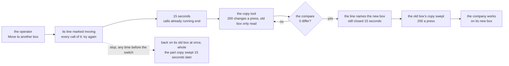

# Moving a company between boxes, plan, 2026-11-16

## At a glance

**What it is for:** an operator moves one company from one box to another from the operator's
page, and its people find every record afterwards. The company is closed, its screens offering a
retry, only while it moves. Until the line names the new box, the company is whole on its old box,
and a stop puts it back there.

**The cheapest safe path** stands on what exists: the copy tool's copy and compare, unchanged; the
delete's press-on page and its bounded sweep; the line's box and the 503 a box not held already
answers. The move adds a mark on the line, a route, a page and one helper. At least 101 machine
minutes in three steps and a review; one look of yours on invented data, and a sitting on ridge.

## The slice

On this machine first, then on ridge: a company on `b2` with a customer is moved to the home box
from `/operator`. Its people are told to try again while it moves, then sign in and find the
customer; the boxes list shows `b2` with no company and the home box with one more, and the page's
last line says `b2` holds none of its records.

## What the code says, and what the plan decides

**Today.** `copyCompany` (`bff/src/records/company-copy.ts#L68-L111`) makes one company's records on a
target equal to a source's, at most 200 changes a call (`#L10`), each write over the tag it read,
the source only read; `compareCompany` (`#L116-L124`) walks both, writing nothing, `{ records,
differ }`. Both take two company clients over the same id (`#L26-L28`). The copy leaves the pause,
the switch and the old box's records to its caller (`docs/plans/2026-11-11-store-pages-copy.md#L113-L117`).
The line (`shared/src/records.ts#L104-L109`) names a box; `resolveTenant` (`bff/src/app.ts#L186-L201`)
reads it on every call and answers 503 for a box not held. The delete is the nearest sibling: a
press does a bounded part and says what is left (`bff/src/routes/clients-delete.ts`), its sweep
removes 200 a press (`bff/src/records/clients.ts#L220-L234`), its page presses on with one touch
(`ui/src/pages/operator/DeleteClientPage.tsx#L44-L64`). **Nothing moves a company today**: a grep of
every package for `moving`, `moveCompany` and `move-client` finds none.

**Decision 11, read against the copy tool** (`docs/plans/2026-11-11-pooled-shape.md#L110-L116`). The
mark, the 503, the switch refused unless equal, the sweep and "Move to another box" hold. What
changes is in decisions 3 to 7: a press repeated, a wait written on the mark, the sweep apart from
`deleteClient`, and a second wait after a switch or a stop.

**The premises, checked.**
- *The activity entries move by the activity log's lane:* **refuted; nothing needs to move them.**
  There is one log (`bff/src/env.ts#L56-L61`), its address read off the home box (`ops/app.sh#L87`,
  `#L103-L105`), each entry under the company's id (`bff/src/app.ts#L161-L166`), which a move keeps.
  Item 277 (`docs/open-items.md#L1430-L1432`) assumed a log per box, which the pooled shape kept out
  (`docs/plans/2026-11-11-pooled-shape.md#L434-L435`); it closes at step 2. The photos sit in one
  bucket per back end (`bff/src/env.ts#L67-L73`) and stay too.
- *Item 503* (not yet in `docs/open-items.md`): **the move needs no copy-lag reading.** The restore
  copies from a file the continuous copy restored (`ops/company-restore.sh#L131-L138`), so a lag
  matters there (`ops/check.sh#L183-L184`); the move copies live box to live box, its proof the
  compare at 0.
- *Item 440* (`docs/open-items.md#L1780-L1782`), the box resolved three times, names this step as its
  trigger: it closes in step 2.

**Decided, the machine's:**

1. **The mark is one optional field of the line**, `move`, and it is in one of two forms. *Copying:*
   the box it goes to, when it was marked and the key the last press passed; the line's `box` stays
   the old box. *Sweeping:* after a switch or a stop, the box whose copy is to go and `sweepAt`, 15
   seconds after that write. The key stays on the line, never sent to the page: a key may hold a
   sign-in name (`bff/src/records/company-copy.ts#L53-L56`).
2. **One helper answers a line's store or refuses**, replacing `boxStorage` (`bff/src/app.ts#L183-L184`)
   in the three callers' deps, by the line's state (a box not held is the logged 503, as today):

   | The line | The company's calls | Delete, root password, the terminal | A press of the move | Whole on |
   | --- | --- | --- | --- | --- |
   | box A, no `move` | from A | as today | marks it | A |
   | box A, copying to B, in the wait | 503 | 409, or refused by name | copies nothing, says the seconds left | A |
   | box A, copying to B | 503 | 409, or refused | one copy; at `done`, the compare | A; B a part |
   | box A, sweeping B (stopped) | from A at once | 409, or refused | nothing before `sweepAt`, then sweeps B | A |
   | box B, sweeping A, before `sweepAt` (switched) | 503 | 409, or refused | nothing | A and B, equal |
   | box B, sweeping A, after `sweepAt` | from B | 409, or refused | sweeps A; empty, clears `move` | B |

   A press that fails (the function's limit, `moved`, a box down) leaves the line as the last press
   wrote it. Only the move's route reads past a mark.
3. **The first wait is 15 seconds** from the mark: the function's 10 (`ops/env.yml#L576`) and the
   store client's 5 (`shared/src/c-storage.ts#L24`), so every call that read the line before it has
   ended. A write that still lands on the old box shows in the compare (the copy's case 14).
4. **A press goes on from the line**: one `copyCompany` from the kept key, the key written back over
   the line's tag; at `done`, a `compareCompany`. At 0 differ the switch writes the line over its
   tag; otherwise the key is cleared and the next press walks from the start.
5. **No sweep, and no call on the new box, before `sweepAt`.** A press of the same move begun before
   the switch (two tabs, a retry) lives up to 10 seconds, and its tags do not hold it: having read a
   new-box record just after a save there, it writes the old text over the tag it read; and once
   the sweep removes a key from the old box, it reads that key as the target's alone and removes it
   from the new box over a matching tag (`bff/src/records/company-copy.ts#L44-L46`, `#L84-L85`). So
   the switch and a stop each set `sweepAt`, and a press that finds the line sweeping copies nothing.
6. **The sweep is `deleteClient`'s own half**, `sweepCompany(company)`, moved out of
   `bff/src/records/clients.ts#L220-L234` and called by both: 200 a press until a list comes back
   empty; then the line loses `move`.
7. **A stop, any time before the switch**, writes the line with no copying and the box it was going
   to as the one to sweep: the company opens at once on its old box, whole, since that box was only
   read (the copy's case 13), and the part copy goes from `sweepAt`, so a press still running leaves
   nothing behind on that box. After the switch a stop is refused: a move back is another move.
8. **The route** is one `POST` on the client's path plus `/move`: `{ to, confirm }` begins, a fresh
   touch under a new act `move-client` (`shared/src/wire.ts#L370-L378`); `{}` goes on and `{ stop:
   true }` stops, on the session alone, as a resumed delete does. It answers the state, and the
   seconds of a wait or the records left. The beginning refuses, writing nothing, a box not held or
   the company's own (400), a line already carrying `move` (409), and a target whose status does not
   answer (as the boxes route reads it, `bff/src/app.ts#L527-L539`).
9. **The activity entry** is a new action, `client.move`, "client moved", in `ACTIONS`
   (`shared/src/activity.ts#L9-L40`). The mark, the switch and a stop each declare one, naming the
   company and the two boxes; every other press declares none on purpose, as the delete's press with
   no client does (`bff/src/routes/clients-delete.ts#L63`).
10. **The terminal's acts refuse a moving company**, by one predicate beside the line's schema, read
    by the helper too: `deleteClient` refuses a line carrying `move` whatever store it is handed,
    outside the condition of `refuseOtherBox` (`bff/src/records/clients.ts#L152-L162`), which acts
    only when none is handed while the route hands one (`bff/src/routes/clients-delete.ts#L84-L90`).
    That covers both terminal deletes (`scripts/src/ridge.ts#L79`, `#L158`), its red seen in a test of
    a terminal delete, and stands behind the route's own 409. The root password script, the seed, `copy-company` and
    `drill-record` refuse it by name, writing nothing, where they refuse another box
    (`scripts/src/root-password.ts#L66-L69`, `scripts/src/demo/apply.ts#L661-L664`,
    `scripts/src/ridge.ts#L578-L581`, `#L600-L602`).
11. **The operator starts a move from the clients list**: a row's "Move to another box", shown when
    the back end holds more than one box, beside "Delete" (`ui/src/pages/operator/ClientsPage.tsx#L56-L77`),
    opening `/operator/clients/:code/move`. The page lists the other boxes with their free disk and
    companies, by the add form's list (`ui/src/parts/NewClient.tsx#L86-L111`) moved into a part both
    use, then presses on, saying what is left, until the company is moved. `listClients`
    (`bff/src/records/clients.ts#L108-L126`) adds each line's box and its mark in either form, the box
    it goes to while copying or the box being swept (`shared/src/wire.ts#L222-L227`, both optional,
    so a list written before still parses): a page opened mid-move offers to go on or to stop, and
    one opened on an unfinished sweep, after a stop or a switch, presses the sweep on to its end. *Rejected:* the terminal's `copy-company`
    as the move's door: it never marks or switches a line, and stays the restore's.

**Who serves each part the move adds, and who calls it.**

| Part | Served by | Called by |
| --- | --- | --- |
| The mark, and the predicate | `shared/src/records.ts`, beside `storedClientSchema` | `bff/src/records/company-move.ts` (new) writes it; the helper and the terminal read it |
| The line's store or a refusal | the helper in `bff/src/app.ts` | `resolveTenant`, `bff/src/routes/clients-delete.ts`, `bff/src/routes/root-password.ts` |
| One press | `bff/src/records/company-move.ts`'s `moveCompany`, over the copy, the compare and the sweep | the route |
| The sweep | `sweepCompany` in `bff/src/records/clients.ts` | `deleteClient` and `moveCompany` |
| The route, its three bodies, its entry | `bff/src/routes/client-move.ts` (new), registered beside the delete's (`bff/src/app.ts#L505-L506`); `client.move` in `shared/src/activity.ts` | `ui/src/api.ts`'s `moveClient` |
| The list's box and mark | `listClients`, through the operator's clients route | `ui/src/api.ts`'s `listClients` |
| The wire shapes, the act | `shared/src/wire.ts` | the route, `ui/src/api.ts`, `ui/src/fake.ts` |
| The page, in both languages | `ui/src/pages/operator/MoveClientPage.tsx` (new), the boxes' part, `ui/src/i18n/en.ts` and `vi.ts` | `ui/src/OperatorApp.tsx`'s route, `ClientsPage.tsx`'s button |

## The limits that shape it

- **Ten seconds a press.** No copy rate was measured (`docs/recaps/2026-11-13-store-pages-copy.md#L15`);
  the bound is the copy's 200, as the sweep's. A press cut off loses nothing: each write is over its
  tag, and the next walks from the key last written, skipping what is equal. The compare walks the
  whole company on both boxes in one press, so a company too large for that cannot switch from the
  page: item 509, filed at step 2, its trigger a press near the limit, which the sitting reads.
- **A box's disk.** A move to a box without room fails in its copy, the company whole on its old
  box, and leaves that box short for its other companies until a stop sweeps the part. The operator
  sees each box's free disk on the list; no figure is written (the pooled shape's decision 1).

## The steps

Each gate is the touched package's `pnpm --filter @credo/<pkg> check`, `pnpm check` where a step
crosses packages, plus the citation test, each by its own exit code; each case red once on its own
assertion, then put back. **Sizes** are rows of `worktrees/runs.tsv` from the pooled shape's own first
landing, each of its step's shape; `glance.sh --size build` gives 3 and `--size review` 12, the
medians of three fix steps of another shape. Steps 1 and 2 are larger jobs than their rows, so their
figure is a floor. Stage 1 is step 1 (the fake), stage 2 each gate with two real store services,
stage 3 point 1, stage 4 the sitting.

- [x] **1. The page on the fake.** Decision 11 and decision 8's wire shapes in `shared/src/wire.ts`;
  `ui/src/api.ts`'s `moveClient`; `ui/src/fake.ts` answering a move in a few presses (the wait, two
  copy presses, the switch's wait, a sweep) with a cue for a failed press; the page, the boxes' part
  taken out of `NewClient`, the row's button and the route. *Done when:* the `shared` and `ui` gates
  end `== exit 0`; cases 14 and 15 red once; `git diff --stat pre-merge -- '*.test.ts' '*.test.tsx'`
  names new files, or an old test gaining a stub line for the new call alone. *Size:* at least 13
  (the form's list on the fake, row 668). Then 👤 point 1.
  _Done 2026-11-16: the `shared` and `ui` gates each ended `== exit 0`; case 14 red once with the page's loop re-sending the beginning on every press, case 15 red once with the list offering the move on one box, both put back; the diff against `pre-merge` names new test files, and old tests gain only a `moveClient` stub line or a name in the fake's call list._
- [x] **2. The move in the back end and the terminal.** Decisions 1 to 10 and decision 11's list:
  the mark and its predicate, the helper, the press, the sweep's function, the route and its entry,
  the terminal's refusals. *Done when:* `pnpm check` ends `== exit 0` at 100 %; cases 1 to 13 red
  once; new test files alone, the delete's and the root password's tests unchanged; items 440 and
  277 closed in `docs/open-items.md` with their reasons, and item 509 filed. *Size:* at least 33
  (every act on the company's box through the line, and the scripts' refusal of another box, row 665).
  _Done 2026-11-16: `pnpm check` ended `== exit 0` at 100 %; cases 1 to 13 each red once on a named mutation and put back; new test files only, bar the route list's two counts, the operator route tree and three list expectations that gain `box`; items 440 and 277 closed, item 509 filed. The mark carries one field beyond decision 1, `closed`, to tell a switch (503 until `sweepAt`) from a stop (open at once). The human's ask after step 1's look: the list sends `box` for every company, the home box included, and the clients page has a Box column (the wire field stays optional; the fake sends it for every company)._
- [ ] **3. The pages true.** `docs/architecture-detail.md#L126-L130`, `#L164-L167` and
  `#L208-L210` and the pooled section of `docs/architecture.md` say the move is built, and how;
  `docs/memo/bff.md`'s tenant section gains the helper's table. *Done when:* the citation test exits
  0 and `git grep -nE '/Users/|~/'` finds nothing new. *Size:* 26 (the pooled pages made true, row 675).
- [ ] **3r. Reviewed, fixed, recapped.** A model other than the author's, one fix pass, a reread, a
  recap. *Done when:* every finding tagged in the recap, the fix pass's gate `== exit 0`, the recap
  committed with `docs/products.md`'s row. *Size:* 14, 11, 2 and 2 (the first landing's review,
  fix, reread and recap, rows 679, 681, 682 and 683).
- [ ] 👤 **On ridge, in its own sitting**, once the landing is in `main` and your push has deployed
  it: `b2` in the stack (`ops/stack.sh env ridge --more-boxes b2`, then `ops/release.sh ridge` and
  `ops/app.sh ridge`, if the last sitting removed it); `ops/check.sh ridge`; at `/operator` a company
  added on `b2`, its root signed in, a customer added; the company moved to the home box, signed in
  again (point 2); `ops/check.sh ridge` again; then `b2` taken out and its retained box removed by
  the runbook's "A retained box". *Done when:* the machine reads both check logs whole, each ending
  `== exit 0` and reading both boxes, and your yes. *Size:* 15 to read (the second landing's
  sitting, row 728).

## The case table

| # | The case | Held by |
| --- | --- | --- |
| 1 | From the mark to the switch, every call of the company answers 503 from the next one (the pooled shape's case 16) | BFF route |
| 2 | While the line carries `move`, the operator's delete and root password answer 409, and the terminal's delete, root password, seed, `copy-company` and `drill-record` refuse it by name, nothing written | BFF route; scripts unit |
| 3 | The beginning needs a fresh touch, and refuses a box not held, the company's own, a line already carrying `move` and a target not answering, writing nothing | BFF route |
| 4 | A press in the first wait copies nothing and says the seconds left | BFF route, the clock handed in |
| 5 | A press makes at most 200 changes and the next goes on from its key; one cut off after its writes and before its key is written back leaves the next press nothing to change, and the move ends equal | BFF route, two store services |
| 6 | The switch is refused unless the compare is 0; a save landing on the old box after its copy is copied first (the pooled shape's case 17) | BFF route |
| 7 | After the switch the company answers 503 until `sweepAt`, then every call reaches the new box | BFF route |
| 8 | A second press begun before the switch and run on after the sweep's first press leaves the new box whole: no sweep before `sweepAt`, and a press finding the line sweeping copies nothing | BFF route |
| 9 | The old box is swept in presses until it holds none of the company's records, and the line then carries no `move` | BFF route |
| 10 | A stop before the switch serves the company at once from its old box, every record as it was, and sweeps the part copy from `sweepAt`; after the switch a stop is refused | BFF route |
| 11 | Every other company on both boxes is unchanged by a move, one whose id begins with the moved one's included | BFF route |
| 12 | The mark, the switch and a stop each leave one `client.move` entry naming the company and both boxes, and no other press leaves one | BFF route |
| 13 | The clients list names each company's box and its mark in either form: the box it goes to while copying, the box being swept after a stop or a switch | BFF route |
| 14 | The page lists the other boxes with free disk and companies, presses on through the waits, the copy and the sweep saying what is left, and comes back to the list; a failed press says the company is still on its old box and offers to go on or to stop | ui, `MoveClientPage.test.tsx`; the fake |
| 15 | The list offers "Move to another box" only when the back end holds more than one box, a page opened mid-copy offers to go on or to stop, and one opened on an unfinished sweep presses it on to its end | ui, `ClientsPage.test.tsx`, `MoveClientPage.test.tsx` |
| 16 | No existing test was changed to pass | `git diff --stat pre-merge` |
| 17 | On ridge, a company moved from `b2` to the home box keeps its customer, closed only while it moved | your sitting |

## The human's points

**Point 1, after step 1: the move's page, on invented data.** Open `pnpm fake` and the operator's
list of companies. Each row gains a button to move that company to another box. Its page shows where
the company is now and the other boxes with their free space; after your passkey it shows how far
the move has gone, then returns to the list. Is this the page you want for moving a company? A yes
keeps it; a no says what to change, and step 1 reopens.

**Point 2, in the sitting on ridge: a company moved.** You add a company on the second box, sign in
as its root and add a customer, then move it to the first box from the operator's page and sign in
again. Do you find the customer, with the company closed only while it moved, and the second box
listed with no company? A yes: the move ships to production with the rest; a no reopens step 2.

## What stays out

A move from the terminal (`copy-company` stays the restore's door), a walk screen of the move, a
move of the activity log or the photos (neither is a box's), a compare in presses (item 509's
trigger), a figure for a box's room, and a move on production before the sitting's yes.
