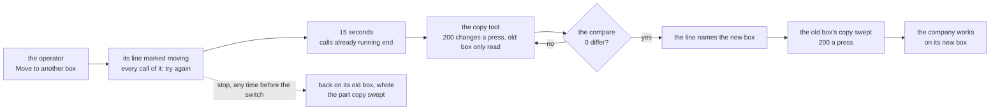

# Moving a company between boxes, plan, 2026-11-16

## At a glance

**What it is for:** an operator moves one company from one box to another from the operator's
page, and its people find every record afterwards. The company is closed, its screens offering a
retry, only while it moves. Until the line names the new box, the company is whole on its old box,
and a stop puts it back there.

**The cheapest safe path** stands on what exists: the copy tool's copy and compare, unchanged; the
delete's press-on page and its bounded sweep; the line's box and the 503 a box not held already
answers. The move adds a mark on the line, a route, a page and one helper. About 88 machine minutes
in three steps and a review; one look of yours on invented data, and a sitting on ridge.

## The slice

On this machine first, then on ridge: a company on `b2` with a customer is moved to the home box
from `/operator`. Its people are told to try again while it moves, then sign in and find the
customer; the boxes list shows `b2` with no company and the home box with one more, and the page's
last line says `b2` holds none of its records.

## What the code says, and what the plan decides

**Today.** `copyCompany` (`bff/src/records/company-copy.ts#L68-L111`) makes one company's records on a
target equal to a source's, at most `COPY_BOUND`, 200 changes, a call (`#L10`), each write over the
tag it read, the source only read, and answers `{ copied, removed, after, done }`;
`compareCompany` (`#L116-L124`) walks both, writing nothing, `{ records, differ }`. Both take two
company clients over the same id (`#L26-L28`). What the copy asks of its caller is the pause, the
switch and the old box's records (`docs/plans/2026-11-11-store-pages-copy.md#L113-L117`). The line
(`shared/src/records.ts#L104-L109`) names a box; `resolveTenant` (`bff/src/app.ts#L186-L201`) reads it
on every call and answers 503 for a box not held. The delete is the nearest sibling: a press does a
bounded part and says what is left (`bff/src/routes/clients-delete.ts`), its sweep lists and removes
200 a press (`bff/src/records/clients.ts#L220-L234`), and its page presses on with one touch
(`ui/src/pages/operator/DeleteClientPage.tsx#L44-L64`). **Nothing moves a company today**: a grep of
`bff`, `shared`, `ui/src`, `scripts/src`, `ops` and `services` for `moving`, `moveCompany` and
`move-client` finds none.

**Decision 11, read against the copy tool** (`docs/plans/2026-11-11-pooled-shape.md#L110-L116`). The
mark, the 503, the switch refused unless equal, the sweep and "Move to another box" hold. Four
things change. The copy is bounded, so one route call cannot move a company: the move is a press
repeated, the delete's shape. The wait cannot be a sleep inside a call that lives 10 seconds
(`ops/env.yml#L576`): the mark records its time and a press before the wait is over copies nothing.
The sweep cannot be `deleteClient`, which removes the line: its sweeping half becomes a function of
its own. And the switch needs a second wait, below.

**The premises, checked.**
- *The activity entries move by the activity log's lane:* **refuted; they need no move by any
  lane.** The back end has one log (`bff/src/env.ts#L56-L61`, `bff/src/app.ts#L88-L90`), whose
  address the deploy reads off the home box (`ops/app.sh#L87`, `#L103-L105`); each entry carries the
  company's id (`bff/src/app.ts#L161-L166`, `services/audit-backbone/internal/activity/store.go#L17`,
  `#L52-L53`), and a move keeps the id. Item 277 (`docs/open-items.md#L1430-L1432`) assumed a log per
  box, which the pooled shape kept out (`docs/plans/2026-11-11-pooled-shape.md#L434-L435`); it closes at
  step 2. The delivery photos sit in one bucket per back end (`bff/src/env.ts#L67-L73`) and stay too.
- *Item 503:* not in `docs/open-items.md` at `8a95b30a` (the last is 502, `#L1932`). **The move needs
  no copy-lag reading.** The restore copies from a file the continuous copy restored
  (`ops/company-restore.sh#L131-L138`), so a lagging copy restores an older moment than the check
  says (`ops/check.sh#L183-L184`). The move copies live box to live box and never reads the
  continuous copy; its proof is the compare at 0. The swept records stay in the old box's copy for
  seven days (`docs/plans/2026-11-11-continuous-copy.md#L42-L43`), and the sitting's `ops/check.sh
  ridge` reads both boxes' copies after the move.
- *Item 440* (`docs/open-items.md#L1780-L1782`): the box is resolved three times (`bff/src/app.ts`,
  `bff/src/routes/clients-delete.ts#L64-L72`, `bff/src/routes/root-password.ts#L52-L57`), and its
  trigger is this step: it closes in step 2.

**Decided, the machine's:**

1. **The mark is one optional field of the line**, `move`: while it copies, the box it goes to,
   when it was marked and the key the last press passed; after a switch or a stop, the box whose
   copy is to be swept and, after a switch, the time the company opens. The line's `box` stays the
   old box until the switch, so a line marked by a back end that dies is still a company whole
   where it names. *Why the key is kept there and not sent to the page:* a key may hold a sign-in
   name (`bff/src/records/company-copy.ts#L53-L56`).
2. **One helper answers a line's store, or refuses**, beside `boxStorage` (`bff/src/app.ts#L183-L184`)
   and handed to the three callers in its place: a box not held is the logged 503; a line carrying
   `move` is 503 to the company's calls and 409 to the operator's delete and root password, nothing
   written. Only the move's own route reads past a mark.
3. **The wait is 15 seconds**: the function's 10 (`ops/env.yml#L576`) and the store client's 5
   (`shared/src/c-storage.ts#L24`), so a call that read the line before the mark has ended. A write
   that still lands on the old box shows in the compare (the copy's case 14) and the switch waits for
   the next copy press.
4. **A press goes on from the line**: before the wait is over it copies nothing; then one
   `copyCompany` from the kept key, the key written back over the line's tag; at `done`, a
   `compareCompany`. At 0 differ the switch writes the line over its tag: the new box, the old one to
   sweep, the company opening one more wait later, so a press of the same move still running (two
   tabs, a retry) cannot write over its first saves there. Otherwise the key is cleared and the next
   press walks from the start.
5. **The sweep is `deleteClient`'s own half**, `sweepCompany(company)`, moved out of
   `bff/src/records/clients.ts#L220-L234` and called by both: 200 a press, until a list comes back
   empty; then the line loses `move`. A press of a delete then answers as today.
6. **A stop, any time before the switch**, writes the line over its tag with no mark and the box it
   was going to as the one to sweep: the company opens at once on its old box, whole, since that box
   was only read (the copy's case 13), and the part copy is swept by the same presses. After the
   switch there is no stop: a move back is another move, once the sweep is done.
7. **The first press takes a fresh touch**, a new act `move-client` in `confirmActSchema`
   (`shared/src/wire.ts#L370-L378`); the presses after it, and a stop, go on the session alone, as a
   resumed delete does. The first press refuses, writing nothing, a box not held or the company's
   own (400), a line already carrying `move` (409), and a target whose status does not answer
   (`CStorageClient`'s `status`, as the boxes route reads it, `bff/src/app.ts#L527-L539`).
8. **The operator starts a move from the clients list**: a row's "Move to another box", shown when the
   back end holds more than one box, beside "Delete" (`ui/src/pages/operator/ClientsPage.tsx#L56-L77`),
   opening `/operator/clients/:code/move`. The page lists the other boxes with their free disk and
   companies, by the add form's list (`ui/src/parts/NewClient.tsx#L86-L111`) moved into a part both
   use, then presses on, saying what is left, until the company is moved. The list item gains the
   line's box and whether it is moving (`shared/src/wire.ts#L222-L227`, both optional, so the lists
   written before still parse), so a page opened mid-move offers to go on or to stop. *Rejected:* the
   terminal's `copy-company` (`scripts/src/ridge.ts`) as the move's door: it reads the index and never
   marks or switches it, and stays the one-company restore's.

**Who serves each part the move adds, and who calls it.**

| Part | Served by | Called by |
| --- | --- | --- |
| The mark | `shared/src/records.ts`'s `storedClientSchema`, gaining `move` | `bff/src/records/company-move.ts` (new) writes it; the helper reads it |
| The line's store or a refusal | the helper in `bff/src/app.ts`, replacing `boxStorage` in the deps | `resolveTenant`, `bff/src/routes/clients-delete.ts`, `bff/src/routes/root-password.ts` |
| One press: wait, copy, compare, switch, sweep, stop | `bff/src/records/company-move.ts`'s `moveCompany`, over `copyCompany`, `compareCompany` and `sweepCompany` | the route |
| The sweep | `sweepCompany` in `bff/src/records/clients.ts` | `deleteClient` and `moveCompany` |
| The route, `POST` on the client's path `/move` | `bff/src/routes/client-move.ts` (new), registered beside the delete's (`bff/src/app.ts#L505-L506`) | `ui/src/api.ts`'s `moveClient` |
| The wire shapes, the act | `shared/src/wire.ts` | the route, `ui/src/api.ts`, `ui/src/fake.ts` |
| The page | `ui/src/pages/operator/MoveClientPage.tsx` (new), the boxes' part | `ui/src/OperatorApp.tsx`'s route, `ClientsPage.tsx`'s button |

**How a move that fails half way leaves the company.**

| The line on the home box | Its people's calls | Where it is whole |
| --- | --- | --- |
| box A, marked for B, in its wait or copying | 503, try again | A; B holds a part |
| any press fails (a timeout, `moved`, a box down) | 503 until the next press or a stop | A, unchanged: the copy only reads it |
| stopped: box A, B to sweep | served from A at once | A; B's part swept |
| switched: box B, A to sweep, opening | 503 for one more wait, then from B | B and A, equal |
| box B, no mark | served from B | B; A holds none of it |

## The limits that shape it

- **Ten seconds a press.** No copy rate was measured
  (`docs/recaps/2026-11-13-store-pages-copy.md#L15`); the bound is the copy's 200, as the sweep's.
  A press the function cuts off loses nothing: each write is over its tag, and the next press,
  walking from the key last written, skips every record already equal. The compare walks the whole
  company on both boxes in one press, so a company too large for that cannot switch from the page:
  item 509, filed at step 2, its trigger a press on ridge or production near the limit. The sitting
  reads it.
- **The line is the one door**: every write of the move to it is over its tag, so two operators,
  or a stop beside a press, leave one winner and a 409.
- **A box's disk.** A move to a box without room fails in its copy, with the company still whole
  on its old box, and leaves that box short for its other companies until a stop sweeps the part.
  The operator sees each box's free disk on the list, as the add form shows it; no figure is
  written (the pooled shape's decision 1).

## The steps

Each gate is the touched package's `pnpm --filter @credo/<pkg> check`, `pnpm check` where a step
crosses packages, plus the citation test, each by its own exit code; each case red once on its own
assertion, then put back. **Sizes** come from `worktrees/runs.tsv`'s rows of the same step shape in
the pooled shape's own first landing: `glance.sh --size build` gives 3 and `--size review` 12, the
medians of three fix steps of another shape, so they are not this step's figure. Stage 1 is step 1
(the fake), stage 2 each gate with two real store services, stage 3 point 1, stage 4 the sitting.

- [ ] **1. The page on the fake.** Decision 8: the wire shapes and the act in `shared/src/wire.ts`,
  `ui/src/api.ts`'s `moveClient`, `ui/src/fake.ts` answering a move in a few presses (the wait, two
  copy presses, the switch, a sweep) with a cue for a failed press, the page, the boxes' part taken
  out of `NewClient`, the row's button and the route. *Done when:* the `shared` and `ui` gates end
  `== exit 0`; cases 11 and 12 red once; `git diff --stat pre-merge -- '*.test.ts' '*.test.tsx'`
  names new files, or an old test gaining a stub line for the new call alone. *Size:* 13 (the pooled
  shape's step 3, the form's list on the fake, 13). Then 👤 point 1.
- [ ] **2. The move in the back end.** Decisions 1 to 7: the mark, the helper, the press, the
  sweep's function, the route. *Done when:* `pnpm check` ends `== exit 0` at 100 %; cases 1 to 10
  red once; new test files alone, the delete's and the root password's tests unchanged; items 440 and
  277 closed in `docs/open-items.md` with their reasons, and item 509 filed. *Size:* 33 (the pooled
  shape's step 2, every act on the company's box through the line, 33).
- [ ] **3. The pages true.** `docs/architecture-detail.md#L126-L130`, `#L164-L167` and
  `#L208-L210` and the pooled section of `docs/architecture.md` say the move is built, and how;
  `docs/memo/bff.md`'s tenant section gains the mark's 503 and 409. *Done when:* the citation test
  exits 0 and `git grep -nE '/Users/|~/'` finds nothing new. *Size:* 13 (the activity log's step 7,
  its pages made true, 13).
- [ ] **3r. Reviewed, fixed, recapped.** A model other than the author's, one fix pass, a reread, a
  recap. *Done when:* every finding tagged in the recap, the fix pass's gate `== exit 0`, the recap
  committed with `docs/products.md`'s row. *Size:* 14, 11, 2 and 2 (the first landing's review, fix,
  reread and recap).
- [ ] 👤 **On ridge, in its own sitting**, once the landing is in `main` and your push has deployed
  it: `b2` in the stack (`ops/stack.sh env ridge --more-boxes b2`, then `ops/release.sh ridge` and
  `ops/app.sh ridge`, if the last sitting removed it); `ops/check.sh ridge`; at `/operator` a company
  added on `b2`, its root signed in, a customer added; the company moved to the home box, signed in
  again (point 2); `ops/check.sh ridge` again; then `b2` taken out and its retained box removed by
  the runbook's "A retained box". *Done when:* the machine reads both check logs whole, each ending
  `== exit 0` and reading both boxes, and your yes.

## The case table

| # | The case | Held by |
| --- | --- | --- |
| 1 | A company marked moving answers 503 to every call from the next one; its delete and root password answer 409, nothing written (the pooled shape's case 16) | BFF route |
| 2 | The first press needs a fresh touch, and refuses a box not held, the company's own, a line already marked and a target not answering, writing nothing | BFF route |
| 3 | A press before the wait is over copies nothing and says how long is left | BFF route, the clock handed in |
| 4 | A press makes at most 200 changes and the next goes on from its key; one cut off part way loses nothing and the move still ends equal | BFF route, two store services |
| 5 | The switch is refused unless the compare is 0; a save landing on the old box after its copy is copied by the next press first (the pooled shape's case 17) | BFF route |
| 6 | After the switch the company answers 503 for one more wait, then every call reaches the new box | BFF route |
| 7 | The old box is swept in presses until it holds none of the company's records, and the line then carries no mark | BFF route |
| 8 | A stop before the switch opens the company at once on its old box with every record as it was, and sweeps the part copy; after the switch a stop is refused | BFF route |
| 9 | Every other company on both boxes is unchanged by a move, one whose id begins with the moved one's included | BFF route |
| 10 | A move leaves one activity entry naming the company and both boxes, under the company's own id | BFF route |
| 11 | The page lists the other boxes with free disk and companies, presses on through the wait, the copy and the sweep saying what is left, and comes back to the list; a failed press says the company is still on its old box and offers to go on or to stop | ui, `MoveClientPage.test.tsx`; the fake |
| 12 | The list offers "Move to another box" only when the back end holds more than one box, and a page opened mid-move offers to go on or to stop | ui, `ClientsPage.test.tsx` |
| 13 | No existing test was changed to pass | `git diff --stat pre-merge` |
| 14 | On ridge, a company moved from `b2` to the home box keeps its customer, closed only while it moved | your sitting |

## The human's points

**Point 1, after step 1: the move's page, on invented data.** In `pnpm fake`, the operator's clients
list gains "Move to another box" on each row. It opens a page naming the company and its box, lists
the other boxes with their free disk, and after your touch says how far the move has gone, with
its people told to try again, until it ends back on the list. Is this how you want to start and follow a move? A yes builds step
2 on it; a no says what the page should show, and step 1 reopens.

**Point 2, in the sitting on ridge: a company moved.** You add a company on the second box, sign in
as its root and add a customer, then move it to the first box from the operator's page and sign in
again. Do you find the customer, with the company closed only while it moved, and the second box
listed with no company? A yes: the move ships to production with the rest; a no reopens step 2.

## What stays out

A move from the terminal (`copy-company` stays the restore's door), a walk screen of the move, a
move of the activity log or the photos (neither is a box's), a compare in presses (item 509's
trigger), a figure for a box's room, and a move on production before the sitting's yes.
