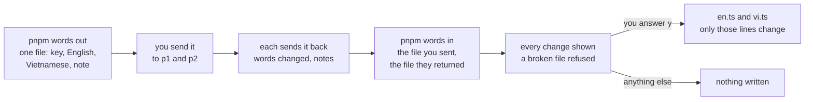

# The app's words out to a spreadsheet and back, plan, 2026-11-16

## At a glance

**What it is for:** you ask partners to check the app's words, in English and in Vietnamese, and
take the wording you judge right. One command writes every word into one spreadsheet file, a row a
word; a partner changes words in place and may add a note; a second command reads the returned file
beside the one you sent, shows each change, and writes it into the two word files when you answer
y. A file that would break the app (a placeholder like `{{name}}` lost, a cell emptied, a row
duplicated) is refused whole, naming each row.

**The cheapest safe path:** one new command in the scripts package beside its siblings, the
words read from the app's own export of them, a small reader written here, and the parser and
formatter the repository already installs. No new package.

## The slice

One slice: `pnpm words out` makes the file and you open it in a spreadsheet; `pnpm words in` takes
a returned file back into `ui/src/i18n/en.ts` and `vi.ts`. Walkable when step 3 ends: out, a
changed cell, in, one line changed in `git diff`. Stage 1 is step 1 (the real words, no fake
needed: the data is the dictionaries), stage 2 each step's gate, stage 3 points 1 and 2. **Stage 4
is not stood up:** nothing that ships changes; a partner's words reach ridge only when a returned
file lands as its own change.

## What the code says, and what the plan decides

**The words, recounted.** Both files are one nested object of single-quoted strings, `en` the
shape (`ui/src/i18n/en.ts#L2`) and `vi` typed from it (`ui/src/i18n/vi.ts#L3`, `Dictionary` at
`en.ts#L925` from `Words` at `#L922`); no `=>`, no template literal, no backslash, no double quote,
no ASCII apostrophe, no empty string, no line break, and two doc comments (`en.ts#L1`, `#L924`).
**759 words in each, not about 645:** 659 on one line, 96 split after the key by the formatter, and
4 in two inline objects (`en.ts#L3`, `#L38`). **102 words in each language carry a placeholder, not
about 94,** 29 names in all, and every key's set is the same in both languages. 237 words hold a
comma and 8 a semicolon. Counted by loading copies of both files in Node and by `grep -c`.

**1. Where it lives and how you run it.** A local command is `scripts/src/<name>.ts` with a
wiring-only `<name>-main.ts` (`docs/conventions/code.md#L117`); a command with verbs copies
`scripts/src/ridge.ts`'s `runRidge` and its `USAGE` (`scripts/CLAUDE.md#L29-L31`, `#L37-L42`). So
`scripts/src/words.ts`'s `runWords`, `scripts/src/words-main.ts`, `scripts/src/words.test.ts`;
`scripts.words` in `scripts/package.json` (beside `#L9-L21`) and the root's `pnpm words` (beside
`package.json#L13-L18`). The scripts gate covers it at 100 %, the entry excluded with its
`elsewhere:` line (`scripts/vitest.config.ts#L54-L64`), and `scripts/CLAUDE.md#L42`'s "All eight
entries" becomes nine. The words come from the app's own export, `DICTIONARIES`
(`ui/src/i18n/index.ts#L15`, exported as `@credo/ui/words` at `ui/package.json#L45`), which scripts
already reaches the same way (`scripts/src/demo-files.ts#L3`).

- Out, from any worktree whose words you send, `main`'s for the shipped ones:
  `pnpm words out <a file outside the repository>`. It refuses a file that exists: the sent file is
  what every return is read against.
- Back, in a worktree on a branch made for that partner's file, never `main`'s:
  `pnpm words in <the file you sent> <the file returned>`. Two paths, one command. A relative path
  is read from the folder you ran it in (pnpm's `INIT_CWD`), not from `scripts/`.

**2. The file's shape.** Columns `key`, `English`, `Vietnamese`, `Note`; a row a word, in the
dictionary's own order, so a screen's words sit together. UTF-8 with a byte-order mark: Excel reads
a CSV without one in the machine's own code page, which breaks every accented letter, while Sheets
and Numbers read UTF-8 either way. Comma-separated, CRLF line ends, every field in double quotes, a
quote inside doubled (RFC 4180), so the 237 words with a comma stay in their cell. **The note
column earns its place:** it costs an empty column, one read and one case, and it carries a
partner's doubt or reason ("too formal") without a rewrite, which otherwise comes in a chat beside
the file. None of the 1,518 words starts with `=`, `+`, `-` or `@`, so no formula guard; the first
word that does is the trigger.

**3. Coming back.** The returned file is read against the file you sent, the base, and against the
words now in the two files:

| The returned file | What happens |
| --- | --- |
| not UTF-8 (an older Excel's plain "CSV" save) | refused whole: "save it as CSV UTF-8" |
| a `key`, `English` or `Vietnamese` column missing | refused whole |
| a key twice, or a key not in the file you sent | refused whole, each row named |
| a cell emptied, or a line break in a cell | refused whole, each row named |
| a placeholder lost, added or renamed against the sent word of that language | refused whole, the key and both sets named |
| a word changed, the app's word still the sent one | shown: key, language, file line, now, theirs, note |
| a word changed, the app's word changed since the file went out | shown as a clash, both wordings, not written |
| a key gone from the app since | shown, not written |
| a note on an unchanged row | shown |
| a row left out, rows reordered, an extra column, empty rows, `;` for `,`, no mark, LF ends | nothing: a row left out is no change |

**Argued against the brief:** a key missing from the returned file is not refused. Pieces add words
every day, so a file out for a week lacks them, and a partner's deleted row proposes nothing.

**Shown, then written.** The command prints each change, the clashes, the notes and a count, then
asks "Write these N changes? (y/N)". The question reaches the command as a parameter, so a test
answers it. On y it locates each changed word's literal with `typescript`'s parser, replaces that
literal's span, formats the whole file with `prettier` under the repository's config
(`.prettierrc.json#L2-L4`), and parses the result again: every changed key must read its new word and
every other key its old one, or nothing is written. Both files are finished before either is
written.

**In place, not regenerated, by the diff.** The formatter is idempotent on a file it already
passed, so only a changed property's lines move, re-wrapped if the word crosses 100 columns.
Regenerating the file would have to reproduce which objects sit inline, the two doc comments and the
`Words` type, or move lines nobody changed. A line-based locator over the formatter's four layouts
was rejected for the one parser walk that covers every literal, a double-quoted one included once a
word holds an apostrophe. The type cannot break: only string values change.

**4. Several partners, simplest first.** One returned file at a time, each against the same sent
file. p1's changes are written; then p2's file shows any line p1 already changed as a clash, p1's
word beside p2's, not written. To take p2's, you change that one line at the file line shown, which
VS Code's terminal opens on a click. A line both changed alike reads "already so". *Rejected:*
comparing a return with the app's words now, under which p2's file would undo every line p1
changed, since it holds the old words; and all returns in one command with a pick per line, a
chooser to build for what the clash list already shows.

**5. A dependency or none.** The CSV reader and writer are written here, about 60 lines under the
package's 100 %; a CSV package is new to the store, so it costs your online install and a third
party's reader for those 60 lines. `typescript` and `prettier` are already installed as the root's
dev dependencies (`package.json#L26-L27`, catalog `pnpm-workspace.yaml#L49`, `#L59`); step 2 lists
`typescript` and step 3 `prettier` in `scripts/package.json`'s dependencies from the catalog, as
knip asks of a package that imports one (`knip.json#L6` excuses `prettier` at the root only). An
offline install should take them; if it refuses, your online install is the fix.

**The fallback, priced:** if point 1 finds the file in one column, or the letters wrong, in a
partner's spreadsheet, the file becomes `.xlsx` through the app's own Excel writer and reader
(`ui/package.json#L26-L27`, used by `ui/src/importDemo.ts#L63` and `#L81`), no new package, one
step. CSV stays first because you asked for it and it reads and diffs as plain text.

## What else moves when a returned file lands

Not built here; each return is its own change on its own branch, after this piece. Tests that pin a
word go red on its change and are updated with it: the doors' words (`ui/src/i18n/words.test.tsx#L11`),
`auth.submit` (`ui/src/i18n/i18n.test.ts#L40-L41`), the rule that no Vietnamese word equals its
English but three (`#L25-L31`), and, for an English change, the 384 queries by a capitalised
literal in 29 `ui` test files (item 549). Every screen showing a changed word moves on the walk,
and your next picture run takes its new base; the walks page asks those screens again.

## The steps

Each gate is `pnpm --filter @credo/scripts check` plus the citation test, each by its own exit code;
each case red once on its own assertion, then put back. **Sizes:** the one row of this shape in
`worktrees/runs.tsv`, a new scripts verb with its tests through the scripts gate (piece 128 step 5,
2026-11-13 09:30:55), ran 30 minutes, after a 17-minute partial behind the gate lock; `glance.sh
--size build` gives 10 from three steps of another shape. The scripts gate's tests alone ran about
220 seconds twice today. Step 1 is the cheap end-to-end build, the file you can open; its six cases
are red-first within it, since a commit here needs the scripts gate at 100 %
(`docs/conventions/qa.md#L204-L206`).

- [x] **1. Out, end to end.** `runWords` with `USAGE` and the verb `out`, the writer, the entry,
  both `package.json` lines, the coverage exclude, `scripts/CLAUDE.md#L42`. *Done when:* the gate
  ends `== exit 0`; cases 1 to 6 red once; `pnpm words out` into the step's scratch folder exits 0,
  `head -c 3 | xxd` reads `efbbbf` and `wc -l` 760. *Size:* 30. *Ran:* cases 1 to 6 each red once by one mutation, then put back; the scripts gate
  and the citation test green; `pnpm words out` into a scratch folder exited 0, the file's first three
  bytes `efbbbf`, 760 lines, and a second run on it refused with exit 2. Then 👤 point 1; the next step goes
  on.
- [x] **2. In, shown, nothing written.** The verb `in`, the reader, the parser of the two files, the
  comparison, the refusals and the printout; `typescript` in `scripts/package.json`, the lockfile by
  the offline install. *Done when:* the gate ends `== exit 0`; cases 7 to 17 red once; an `in` run in
  the scratch folder on a sent file and a copy with one cell changed prints that one change, and the
  word files' `git status` is clean. *Size:* 30. *Ran:* cases 7 to 17 each red once by one
  mutation, then put back; the scripts gate and the citation test green; `typescript` is not in
  `scripts/package.json` (the offline install was refused to this session; the root's copy resolves
  and knip is green), left for the human's install; an `in` run on the sent file and a copy with
  the menu's one Vietnamese cell changed printed that one change, and the word files' `git status`
  stayed clean.
- [ ] **3. In, written.** The question, the replacement in place, the formatter, the re-read before
  the write; `prettier` in `scripts/package.json`. *Done when:* the gate ends `== exit 0`; cases 18
  to 21 red once; after the walk of point 2 the word files are restored and `git status` is clean.
  *Size:* 30. Then 👤 point 2.
- [ ] **4. Reviewed, fixed, recapped.** A model other than the author's, one fix pass, a reread, the
  recap with a `pnpm words` row in `docs/products.md`. *Done when:* every finding tagged in the
  recap, the fix pass's gate `== exit 0`, the recap and the row committed, then landed on
  `pre-merge`. *Size:* 29 (piece 126's review 9, fix 10 and reread 5; piece 144's recap 5).

## The case table

All held by unit tests in `scripts/src/words.test.ts`, on files in a temporary folder; case 17 reads
the real word files, read-only.

| # | The case | Step |
| --- | --- | --- |
| 1 | `out` writes a row for each of the 759 keys, in the English dictionary's order, under the header key, English, Vietnamese, Note | 1 |
| 2 | The file starts with the UTF-8 byte-order mark and ends each row with CRLF | 1 |
| 3 | A word holding a comma, a double quote or a line break stays one field: quoted, its quotes doubled | 1 |
| 4 | `out` refuses a file that already exists and leaves it as it was, exit 2 | 1 |
| 5 | `out` with no file, or a verb the command does not know, prints the usage and exits 2 | 1 |
| 6 | A relative file name is written in the folder the command was run from | 1 |
| 7 | The reader takes back what `out` wrote, and the same rows saved with `;`, without the mark, or with LF ends | 2 |
| 8 | A returned file not in UTF-8 is refused whole, naming CSV UTF-8 as the way to save it | 2 |
| 9 | A changed word is shown with its key, language, file line, the word now and the returned word; an unchanged row shows nothing | 2 |
| 10 | A note is shown with its key, on a changed row or an unchanged one | 2 |
| 11 | A missing column, a key twice or a key not in the sent file refuses the whole file, each row named | 2 |
| 12 | An emptied cell or a line break in a cell refuses the whole file, each row named | 2 |
| 13 | A placeholder lost, added or renamed refuses the whole file, naming the key and both sets | 2 |
| 14 | A row left out, rows reordered, an extra column or empty rows change nothing | 2 |
| 15 | A word changed in the app since the file went out shows as a clash with both wordings, and a key gone since shows alone, neither written | 2 |
| 16 | A second partner's file after the first's shows the first's changed lines as clashes, and the first's words stay | 2 |
| 17 | The parser finds each of the 759 keys in each word file, and the text it finds is the word the app reads | 2 |
| 18 | Any answer but y writes nothing, exit 0 | 3 |
| 19 | On y, one changed Vietnamese word changes only that property's lines in `vi.ts`, and `en.ts` stays byte for byte | 3 |
| 20 | A written file passes the formatter's check and reads back the new word, one with an apostrophe or a backslash included | 3 |
| 21 | A re-read that finds any key not reading its intended word writes neither file, exit 1 | 3 |

## The human's points

**Point 1, after step 1: the file in a spreadsheet.** You run the one command the stop hands you,
then open the file in the spreadsheet each partner will use (Excel, Google Sheets or Numbers). Do
you see 759 rows, the key, English, Vietnamese and note each in its own column, and the Vietnamese
letters right ("Đơn hàng", "Đăng nhập")? A yes: you can send it, and the import goes on. A no: the
file becomes `.xlsx` through the app's own Excel writer, one step.

**Point 2, after step 3: one corrected word taken back.** The machine copies the sent file with one
Vietnamese word changed, the menu's "Đơn hàng" for orders (`vi.ts#L26`). You run `pnpm words in` on
the two files: it shows that one change, with the word now and the new one, and asks. You answer y;
`git diff` then shows one line changed in `vi.ts`. A yes: the piece lands. A no says what was shown
or written wrong, and that becomes a case.

## What stays out

The returns themselves (each its own branch and change, with its tests' words and its walk); a pick
between partners inside the command; `.xlsx` unless point 1 asks for it; and any word on screen
changed by this piece.
