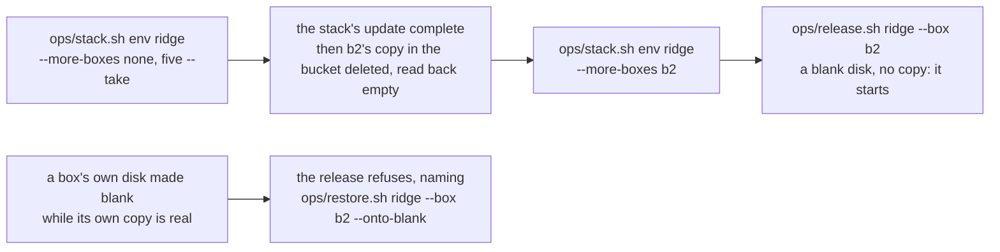

# A box taken out and added back by command, plan, 2026-11-17

## At a glance

The move's sitting of 2026-11-17 added a second box under a name used the day before, and its release
refused: the bucket still held the earlier box's copy of the records under `b2/records/`, and a blank
disk beside a copy is a restore, never a fresh start. The sitting cleared it with a hand-written delete.
**This piece makes the box command itself leave no copy behind:** `ops/stack.sh env`, the one command
that adds a box and takes it out, deletes the copy under the name of each box it takes out once the
stack has removed the box, and clears a leftover under a name it adds before the box exists, both
shown first by `--plan`. The release's refusal then names a restore that takes the box, which today
it does not. The third defect the sitting recorded is not one. The price: about 81 machine minutes,
on stand-ins alone; nothing runs on ridge in this piece, and the human answers one point.

## What the brief had, and what the reading found

- **No remove command exists under `ops/`.** Taking a box out is `ops/stack.sh env <env> --more-boxes
  <list>` with five `--take` (`ops/README.md#L634-L645`). That run keeps the instance and its root disk,
  and snapshots the records disk before deleting it. The rest is by hand: stop the box, terminate the
  instance, delete its root disk and its snapshot. A one-off script did that rest at each sitting
  (2026-11-15, 2026-11-17). **Defect 1 is confirmed**: none of these deletes the box's copy, and the
  runbook's step 6 does not mention it.
- **The removal at 12:01 today left a copy again**: the morning's b2, which a company was moved
  through, wrote under `b2/records/`. The bucket's own rule expires a copy seven days after its last
  write (`ops/env.yml#L264-L270`), so it is gone by itself around 2026-11-24. Until then, adding b2
  again meets the same refusal. Step 2 clears it at that add.
- **Defect 2 is confirmed.** `ops/release.sh#L226` names `ops/restore.sh $ENVNAME --onto-blank`, and
  the box's own line, `#L185`, names it with no environment at all. `ops/restore.sh` takes no
  `--box` (`#L33-L50`), opens the home box (`#L65`) and hands the box the home box's disk id
  (`out RecordsVolumeId`, `#L77`). Run for b2, it would reach the home box, where c-storage is
  running, and refuse at `ops/lib.sh#L751`. That is harmless, but it never restores b2. The four
  scripts the pooled shape gave a box (release, check, drill, tunnel; `ops/test.sh#L3840`) left
  restore out.
- **Defect 3 is not a defect.** The copy bucket keeps no versions. `ops/env.yml#L247-L273` declares
  no `VersioningConfiguration`, and `ops/destroy.sh#L320-L321` refuses a versioned copy bucket. On an
  unversioned bucket, `list-objects-v2` lists every object there is, so `copy_held`
  (`ops/release.sh#L178-L183`) sees the whole copy. Today's resume run listed eight objects, and each
  version id was null. What is missing is a guard on that premise: row 2's template guard
  (`ops/test.sh#L841-L851`) does not pin it. Step 2 adds the pin, so `copy_held` stays as it is.
- **Who can delete.** A box's role may put, get and list under its own name, and never delete
  (`ops/env.yml#L407-L424`). That role goes with the box when the stack run removes it, so the delete
  runs under the operator's own session, and after the update nothing can write under the path any
  more.
- **The names cannot collide.** A box's name is lower case (`ops/lib.sh#L354`) and the home box's path
  is `Box/records`. The prefix carries its slash, so `b2/records/` never reaches `b20/records/`.

## The shape, and what is rejected

**Where the delete goes: `ops/stack.sh env`.** That run is where a box's life starts and ends. The
names taken out are the stack's boxes before the run (`stack_boxes`, `ops/lib.sh#L558-L560`, read from
the stack loaded at `ops/stack.sh#L194`) that the list given leaves out. The names added are the
reverse. Without `--more-boxes` the list is kept (`#L221-L225`), and nothing is read or deleted.

- **A box taken out:** after "UPDATE complete" (`#L344-L345`), every object under `<name>/records/` is
  deleted and the path is read back empty. A delete that fails there ends the run red after a complete
  update, naming the path. The next add of that name clears what is left.
- **A box added:** before the change set runs (between the guard, `#L308-L334`, and the execute,
  `#L341-L342`), anything under `<name>/records/` is a leftover. The stack holds no box of that name,
  so nothing writes there. It is deleted and read back empty. A listing or a delete that fails stops
  the run before anything is executed, so the same command can be run again. On a creation the bucket
  does not exist yet, and nothing is read.
- **`--plan`** prints each path with its object count and newest time, says what the run would delete
  and when, and deletes nothing.
- **The helper has one home:** `copy_clear <bucket> <name>` in `ops/lib.sh`, a copy of destroy's pattern
  (`ops/destroy.sh#L320-L325` and `#L507-L514`). It refuses a bucket whose versioning reads anything but
  off, counts with `list-objects-v2` under the prefix, deletes with `aws s3 rm --recursive`, compares
  the deletes reported with the count, and reads back 0.

**The restore takes `--box <name>`** in `ops/release.sh`'s loop form (`#L41-L55`): `box_open` with the
name, `box_out RecordsVolumeId` in place of `out` (`ops/lib.sh#L571-L573`), its log named with the
box, as the other four name theirs. Its last line names `ops/release.sh <env> --box <name>`. The
release's refusal names `--box <name>` on a box added, and nothing extra on the home box.

*Rejected:* **a separate copy-delete script.** It would need a row in the runbook's table, its own
stance, and a step someone has to remember after every removal. *Rejected:* **the release telling a
stale copy from a real one by its age.** A disk replaced under a box that stays also leaves an older,
real copy, so age cannot separate the two. *Rejected:* **a removal command for the whole hand part**
(stop, terminate, root disk, snapshot). That is a remake of the 216-line one-off, bigger than this
piece; it is filed as item 563.

## The slice

One: a box taken out by `ops/stack.sh env` leaves nothing under its name. Added back under the same
name, it finds no copy, and its release on the blank disk starts. A box whose disk is blank while its
own copy is real is refused, naming the restore that takes that box. It is walkable on the ops
stand-ins when the plan ends. Its first real run is the next box sitting.

## The cases

| # | Case | Held by |
| --- | --- | --- |
| 1 | A run that takes b2 out deletes everything under `b2/records/` after the update completes, and reads the path back empty | the stand-in records one `s3 rm s3://<bucket>/b2/records/ --recursive`, after `execute-change-set`; the log line naming the path and 0 left |
| 2 | That removal's `--plan` names the path, its count and "after the update", and deletes nothing | no `s3 rm` among the stand-in's calls; the line counted |
| 3 | The delete never reaches `Box/records/` or `b20/records/` | the stand-in's listing holds keys under all three; only `b2/records/` is named in its calls |
| 4 | A delete that reports fewer deletes than the count, or a read-back that is not empty, ends the run red naming the path, exit 1 | a stand-in that answers short, then one that answers 1 left |
| 5 | An add of b2 while `b2/records/` holds objects deletes them before the change set executes; its `--plan` names them; a failed listing stops before `execute-change-set` | the order of the stand-in's calls; `execute-change-set` absent on the failed listing |
| 6 | A run that adds or takes out nothing, a run with no `--more-boxes`, and a creation make no s3 call | the existing cases at `ops/test.sh#L4843-L4863` kept green; the stand-in fails any call it does not know (`#L4733`) |
| 7 | A copy bucket whose versioning reads `Enabled` or `Suspended` stops `copy_clear` before any delete | a stand-in `get-bucket-versioning`, both values |
| 8 | The template's copy bucket declares no versioning, so `copy_held` and `copy_clear` see every object | row 2's guard gains it; a template given a `VersioningConfiguration` is refused |
| 9 | The release's refusal names `ops/restore.sh <env> --box <name> --onto-blank` on a box added, and no `--box` on the home box | row 12's `need` (`ops/test.sh#L1279`), both forms; a mutation that drops the box is refused |
| 10 | `ops/restore.sh ridge --box b2 --onto-blank` opens b2's instance, passes b2's disk id, and its log is `restore-ridge-b2` | the stand-ins with b2 in the stack (`FAKE_BOX2`, its outputs at `#L2776`) |
| 11 | `ops/restore.sh ridge --box nope` is refused before any box call, naming the boxes the stack holds; its usage names `--box` | the box-nope cases and the usage loop (`#L3827-L3842`), restore added |
| 12 | Without `--box` the restore acts on the home box as before | the row 16 and blank-disk cases (`#L3671-L3698`) kept green |
| 13 | The runbook says what the box command now deletes and that the restore takes a box | step 4's grep of the changed lines; the citation test |

## The steps

Each step's size is the median of the last five `ops/` fixes built red first on stand-ins (7, 8, 14,
31 and 40 minutes), unless the step says otherwise. Each step's gate is rows 3 and 5 of the
repository's gate, `shellcheck -x ops/*.sh walk/*.sh services/c-storage/scripts/*.sh` and
`bash ops/test.sh`, each exit 0 on the committed tree. Each new case is seen red once against the
code before its fix.

- [x] **1. The removal deletes its copy, end to end on stand-ins (cases 1, 2, 6).** Add `copy_clear` to
  `ops/lib.sh`: the count, the delete and the read-back. `ops/stack.sh` works out the names taken out,
  prints them under `--plan`, and clears each one after "UPDATE complete". The env run's `STEPS` grows
  by one (`#L92`). The stack.sh stand-in (`ops/test.sh#L4720-L4735`) gains a `CopyBucketName` output,
  `s3api list-objects-v2` and `s3 rm`. The cases go in the `--more-boxes` section (`#L4841`).
  *Done when:* cases 1, 2 and 6 each seen red, then both gate rows exit 0. Size 14.
  *Done, 2026-11-17:* cases 1 and 2 seen red on the old code, then green; case 6's cases (no list, the same list) green and seen red by a mutation clearing every held box, reverted; a creation is not on stand-ins. Added `copy_count`, `copy_newest`, `copy_clear` to `ops/lib.sh`; `STEPS=9`.
- [ ] **2. The add clears a leftover, and the delete's guards (cases 3, 4, 5, 7, 8).** `ops/stack.sh`
  works out the names added and clears each one between the guard and the execute. `copy_clear` gains
  the versioning refusal and the short-count and not-empty reds. Row 2's guard (`ops/test.sh#L841-L851`)
  gains `.Resources.CopyBucket.Properties | has("VersioningConfiguration") | not`, with its refusing
  mutation. *Done when:* each case seen red, then both gate rows exit 0. Size 14.
- [ ] **3. The restore takes a box, and the refusal names it (cases 9 to 12).** Change `ops/restore.sh`:
  its usage (`#L2`, `#L24`), with `[--box <name>]` last as in the other four, `--box` in the loop, `box_open "$ENVNAME" "" "$BOX_WANTED"`, `box_out
  RecordsVolumeId`, the log's name and the closing line. `ops/release.sh#L226` names `--box
  $BOX_WANTED` when it is not home. The box's line at `#L185` names no command, since the release's own
  line names it. *Done when:* each case seen red, then both gate rows exit 0. Size 14.
- [ ] **4. The runbook and the items (case 13).** In `ops/README.md`:
  - step 1 (`#L620-L625`): an add clears a leftover under its name, and `--plan` shows it first;
  - step 5's list (`#L632-L633`): the restore takes `--box`;
  - step 6 (`#L634-L645`): the copy goes in the same run, after the update;
  - the blank-disk paragraph (`#L756-L758`) and the table's row (`#L34`): `[--box <name>]`.

  Also item 6's restore line in `docs/open-items.md#L88`. *Done when:*
  `grep -c 'ops/restore.sh <env>.*\[--box <name>\]' ops/README.md` reads 2, and
  `pnpm --filter @credo/scripts check` exits 0 (the citation test). Size 5 (the last two documentation
  steps of an `ops/` piece, 2 and 3 minutes).
- [ ] **5. The review, on the other model** (opus, `review`, of steps 1 to 4). It reads the delete's
  reach first: the prefix, the order against the execute, and a failure at each point. *Done when:* its
  findings are written, each with its line. Size 13 (the last review of a three-step build). The fix
  pass follows, each finding fixed or filed, the gate rerun. Size 12 (the median of the last three
  fix passes: 7, 12 and 15).
- [ ] **6. The recap, and the landing on `pre-merge`.** `pre-merge` is taken in, and both gate rows plus
  row 4, `cfn-lint ops/network.yml ops/github.yml ops/env.yml`, exit 0 on the merged tree. Then the
  recap in `docs/recaps/`. *Done when:* the three rows exit 0 and the recap is committed. Size 9 (the
  last recap with a take-in).

The total is about 81 minutes, against the board's 40: three fixes, each red first, plus the review,
its fix pass and the landing, at the sizes the rows give. Steps 1 to 3 touch different lines of
`ops/stack.sh`, `ops/lib.sh` and `ops/restore.sh`, but they share `ops/test.sh`, so one builder does
them in order. Step 3 does not depend on 1 or 2.

## Nothing runs on ridge in this piece

The stand-ins prove the logic: which path, in which order, and every red. What they cannot prove is
S3's own answer to the `s3 rm` and the count. Those are the calls `ops/destroy.sh` makes, and their
real run is already item 382's. A ridge run made only to prove this piece would add a box and take it
out, about 30 minutes of the human's terminal and an hour of a box's billing, to see one delete. The
next box sitting does that anyway: its `--plan` for b2 will show the leftover under `b2/records/`, and
its run will delete it. That is the fix's first real run, and item 564 holds it until then.

## The human's point

**1. At step 1: when a box is taken out, or its name comes back, its copy in the bucket goes, by the
same command.** `--plan` shows the path and the count first. The records disk's snapshot, which the
stack keeps on a removal, stays the one record of a box taken out, until you say to delete it, as you
did for b2 today. A yes: the steps run as written, and the next b2 add clears this morning's copy. A
no: the box command only refuses, naming the copy, and a leftover stays until its seven days are up.
Recommended: yes.

The confirmation point is the human's read of the At a glance and this point.
