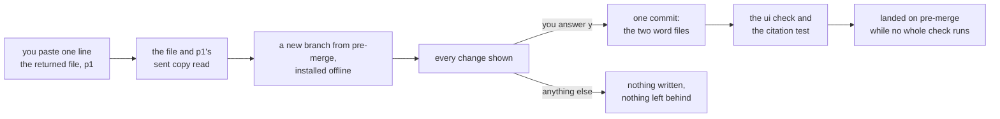

# A partner's returned words, read in by one paste, plan, 2026-11-17

## At a glance

**What it is for:** each time a partner sends the words file back, you read it into the app
yourself, without asking a session. You paste one line holding the returned file's path and the
partner's label. The script makes a branch from `pre-merge`, runs the import, which shows every
change and asks you; on your y it commits the two word files, runs the quick check and lands the
branch on `pre-merge`. Any stop says what happened and what to do, in plain words.

**The cheapest safe path:** one bash script in `ops/`, around the import that exists
(`pnpm words in`), the gate command that exists and the orchestrator's own landing. No change to
the import, no new package.

## The slice

One slice: the paste, from the returned file to a landing on `pre-merge`. Walkable when step 1
ends, on a scratch copy of the repository; hardened by step 2. Stage 1 is step 1, stage 2 each
step's gate, stage 3 point 2 (your first real paste). **Stage 4 is not stood up:** nothing runs
against ridge; a later push of `main` holding this runs `ci.yml`'s deploy as any `ops/` or `ui/`
change does (`.github/workflows/ci.yml#L9-L15`), your push.

## What the code says, and what the plan decides

**Two decisions of the orchestrator's, open to your veto.** (1) The script never answers the
import's question: the import asks on its standard input (`scripts/src/words-main.ts#L10-L15`),
the script leaves that input on your terminal, and you answer. The sample's transcript, where the
script typed `y` itself, is overruled. (2) The script lives in git, in the main line, not in
`one-off/`, since it runs on every return.

**The script's home: `ops/words-in.sh`, the sample's name, checked by rows 3 to 5 of the root
gate** (ShellCheck, cfn-lint, `bash ops/test.sh`, `CLAUDE.md#L27`). Its steps are git, pnpm and the
gate command, no TypeScript, so it is a bash script, and `ops/CLAUDE.md#L14` names the file to copy
for a script a person runs on this Mac: `ops/pages-preview.sh`, its header (line 2 the usage,
`ops/CLAUDE.md#L22`) and its `== refused:` form (`ops/CLAUDE.md#L24`). Its log is `lib.sh`'s `log_start`
(`ops/lib.sh#L85-L106`), not the sibling's process substitution, which the sandbox the tests run in
refuses (`ops/lib.sh#L85`). The import itself stays in `scripts/` (`ops/CLAUDE.md#L8`).
*Rejected:* a `paste` verb in `scripts/src/words.ts`: the same git and pnpm calls from TypeScript,
under the scripts gate's 100 % and its longer tests, for no behaviour bash lacks.

**The sent copy: `words-sent/<label>.csv` in the credo root**, beside `logs/`, derived from git as
the gate derives its root (`ops/gate.sh#L39`), so the line still holds one value: the label you
already type picks it. The import needs both files and has no default (`scripts/src/words.ts#L248-L252`).
*Rejected:* the sample's one fixed `latest.csv`. `words out` refuses a file that exists
(`scripts/src/words.ts#L264-L270`), so one name breaks at the second send; and a return read against
another send's file shows every word changed between the two sends as a change back to the old
word, which the words plan already ruled out by reading a return against the file sent. *Rejected:*
the sent copy rebuilt from git (it needs the commit it was made at and a worktree there) or
committed (the words plan keeps it outside the repository, `scripts/src/words.ts#L19-L20`). Stage 1
prints the copy's path and when it was written, so a wrong base shows before anything runs.

**The worktree and branch.** `words-<label>-<MMDD>-<HHMM>`, by `date` in the script, made from
`pre-merge`'s tip (`docs/conventions/qa.md#L197-L198`) as `wip-<branch>` in the credo root, so the
same label twice in a day never clashes. Then `pnpm install --offline --frozen-lockfile` there: on
this plan's fresh worktree it ended green in 3 seconds.

**The import with its y.** `pnpm words in <sent copy> <returned file>` in the new worktree, its
output also kept in the run's work folder for the count line. The import writes the worktree it
runs in (`scripts/src/words-main.ts#L9`). With no change it asks nothing; with any answer but y it
writes nothing, exit 0 both (`scripts/src/words.ts#L171-L176`); so the script reads `git status` of
the two word files, not the exit, to know whether anything was written. A terminal is required,
as `ops/demo-remake.sh#L243-L246` requires one, `OPS_TEST_NO_TTY=1` the tests' switch.

**The commit holds only the two word files**: `git status --porcelain` must list
`ui/src/i18n/en.ts`, `vi.ts` or both and nothing else, else nothing is committed. Message:
`feat(ui): p1's returned words read in, N changes`, N from the import's count line; no path.

**The checks: the quick check, the ui package's whole check plus the citation test**
(`docs/conventions/qa.md#L204-L206`), each run whatever the other did, each by its own exit.
`pnpm --filter @credo/ui check` is `bash ../ops/gate.sh ui` (`ui/package.json#L10`), which takes the
machine's one gate lock, `.gate-lock` in the credo root (`ops/gate.sh#L40`), after waiting for the
load, the full-run lock and the gate lock in one loop (`ops/gate.sh#L101-L130`), up to 30 minutes
(`ops/gate.sh#L43`). The script passes `GATE_WAIT_MAX=600` and prints the bound and its clock time first, so a
paste waits 15 minutes at most (10 here, 5 at the landing); a give-up reads as "not run", never red. The ui
check ran 64 to 78 seconds unwaited in today's runs. A partner's English word reddens the `ui`
tests that query it by text (`docs/open-items.md#L2051`, item 549): that red stops the run with the
branch kept, and a session fixes the tests.

**The landing, and what it refuses.** As the orchestrator lands: `git merge --no-ff --no-edit
<branch>` in `pre-merge`'s worktree, found by `git worktree list`, after `git merge-tree
--write-tree` runs clean. Nothing lands while a whole check runs (`docs/conventions/qa.md#L216-L221`),
so the script **takes the gate lock itself for the landing**, `mkdir` with an owner line in the
gate's own form (`ops/gate.sh#L116`), released from its exit hook: a whole check that starts then
waits for the landing instead of meeting it mid-run, which a look before a merge cannot promise. It
waits for both locks as the gate does (`ops/gate.sh#L110-L113`), since a gate lock that appears
stops a full run's walks (`ops/gate.sh#L13-L15`): 5 minutes at most, a line every 30 seconds
naming the holder, then refused. A piece takes `pre-merge` in before its checks
(`docs/conventions/qa.md#L151-L152`): when `pre-merge` has moved past the branch's base, the script
takes it in, only when `merge-tree` is clean, and runs the checks again, so the tree that lands is
the tree checked; moved again by the landing, it refuses. Every refusal after the commit keeps the
branch and its worktree and prints the line to paste again, `bash ops/words-in.sh --land <branch>`,
or says that a session takes it (a red, a conflict). `--land` lands only a `words-p<n>-…` branch
whose diff against `pre-merge` is the word files alone, so it never lands another piece's work.

**What it leaves behind.** Landed: the merge on `pre-merge` and the log; the worktree removed and
the branch deleted, since `pre-merge` holds its commit. Any stop before the commit: the log only,
but for a file beyond the two word files changed (case 11), kept for a session. Any stop after it:
the branch and its worktree, named. It removes only the worktree it made (or
`--land`'s, once landed), and deletes a branch only when `pre-merge` holds all its commits.
`main`'s worktree is only read.

**Where you find the line again: `ops/README.md`.** A script a person runs has a row in its
"At a glance" table and its steps in the runbook (`ops/CLAUDE.md#L9`), numbered steps and commands
(`docs/conventions/documentation.md#L89-L92`). The block finds the project's folder by itself, as
the ridge guide's do (`docs/ridge-guide.md#L23`); a committed page holds no local path, so this
machine's absolute line goes to the orchestrator's next actions. `docs/products.md`'s `pnpm words`
row (`docs/products.md#L78`) points at the section. *Rejected:* the root `README.md`, a newcomer's 30 minutes
(`docs/conventions/documentation.md#L71-L72`); a page of its own, a second home for one block.

## The case table

Step 1's cases are read off its one whole run; the rest are held by the new section of
`ops/test.sh` on a throwaway root with a stand-in `pnpm`, each red once by one mutation of the
script. Exit 2: refused before anything was made; 1: stopped after; 0: landed, or nothing to land.

| # | The case | Step |
| --- | --- | --- |
| 1 | No returned file, no label, a third value or an unknown flag: the usage, exit 2, nothing made | 2 |
| 2 | A label not `p` and a number (a name typed in its place): refused, exit 2 | 2 |
| 3 | A returned file the script cannot read: refused with the system's own reason, before any worktree, exit 2 | 2 |
| 4 | No `words-sent/<label>.csv`: refused, naming the path and the command that makes it, exit 2 | 2 |
| 5 | No terminal to answer on, outside the tests' switch: refused, exit 2 | 2 |
| 6 | A branch or folder of that name already there: refused, nothing made or removed, exit 2 | 2 |
| 7 | The offline install fails: stopped, the worktree and branch removed, exit 1 | 2 |
| 8 | The import refuses the file: its rows shown, nothing written, the worktree and branch removed, exit 1 | 2 |
| 9 | No change, or any answer but y: "nothing written, nothing to land", the worktree and branch removed, exit 0 | 2 |
| 10 | The import's read-back fails: a tool fault named, the worktree and branch removed, exit 1 | 2 |
| 11 | After the y, a file beyond the two word files changed: nothing committed, the worktree kept, exit 1 | 2 |
| 12 | The commit holds the changed word files alone, its message the label and the import's count | 1 |
| 13 | The citation test or the ui check red: each named, nothing landed, branch kept, exit 1; a red ui check names item 549 | 2 |
| 14 | The ui check gives up on the lock: said as not run, the branch kept, the land line printed, exit 1 | 2 |
| 15 | Before each wait, its bound and the clock time it ends; at the landing, a line every 30 seconds naming the holder | 2 |
| 16 | The gate lock or the full-run lock held at the landing: it waits, and lands once both are free | 2 |
| 17 | Either still held after 5 minutes: nothing landed, branch kept, the land line printed, exit 1 | 2 |
| 18 | The landing holds the gate lock in the gate's owner form, and no lock of the script's is left on any exit | 2 |
| 19 | `pre-merge` moved: taken in when `merge-tree` is clean and the checks rerun; a conflict: nothing landed, branch kept, exit 1 | 2 |
| 20 | `pre-merge` moved again, its worktree dirty, or the merge fails: nothing landed, branch kept, the land line, exit 1 | 2 |
| 21 | Landed: `pre-merge`'s new tip a merge with the old tip first, its diff the word files alone; worktree removed, branch deleted | 1 |
| 22 | `--land` refuses a branch not `words-p<n>-…`, without its worktree or dirty, with any other file changed, or already in `pre-merge`; exit 2 | 2 |
| 23 | `--land` on a kept branch: taken in, checked and landed as 16 to 21 | 2 |
| 24 | Only the worktree this run made is removed, and a branch only when `pre-merge` holds all its commits | 2 |
| 25 | A whole run leaves `main`'s worktree as it was: the same HEAD, the same `git status` | 1 |
| 26 | The log ends `== exit <n>`, after a verdict line in words and `== done` | 1 |

## The steps

The builder is not the reviewer; each step's gate is read by its own exit code while
`.gate-lock` is free. **Sizes** come from `worktrees/runs.tsv`'s rows of the same shape: a hand-run
script run whole on stand-ins, 3 to 10 minutes (11-15 to 11-17); an `ops/test.sh` section with its
guards, 13 and 15 (piece 136's steps 1 and 2) and 10 for one row (piece 144); a runbook and products
row, 2 to 3 (piece 143); a review 7 to 16, 8 at the median, a fix pass 12 to 15, a recap 2 to 5.

- [x] **1. The paste, end to end, on a scratch copy.** `ops/words-in.sh`, its header, the seven
  stages in order on the main path, and the landing's lock. *Done when:* in the step's scratch
  folder, a credo root made from a local clone of the repository, its `pre-merge` at the real tip
  and `words-sent/p1.csv` written by `pnpm words out`, the script run from the clone on a copy with
  one Vietnamese cell changed, `y` on its input under `OPS_TEST_NO_TTY=1`, `GATE_LOCK` and
  `GATE_RUN_LOCK` set to the real credo root's two locks so its ui check queues with every other
  run: exit 0; `git diff --stat HEAD^1 HEAD` on the clone's `pre-merge` lists `ui/src/i18n/vi.ts`
  alone; the made worktree and its branch gone; cases 12, 21, 25 and 26 read off that run;
  `shellcheck -x ops/words-in.sh` exits 0. *Size:* 10 (the script's shape, plus the real ui check
  near 80 seconds).
  *Ticked 11-17:* run end to end on a scratch root (a bare clone, `pre-merge` at 6aa25ba1, `words-sent/p1.csv` from
  `words out`, one vi cell changed, `y` piped, `OPS_TEST_NO_TTY=1`, the real `.gate-lock` and `.full-run-lock`): exit 0, log
  `== verdict: landed`, `== done`, `== exit 0` (case 26); the new tip a merge, parents the old tip then the commit
  "p1's returned words read in, 1 changes" (cases 12, 21), `git diff --stat HEAD^1 HEAD` lists `ui/src/i18n/vi.ts` alone; worktree
  and branch gone; the scratch `main` worktree's HEAD and status unchanged (case 25); `shellcheck -x ops/words-in.sh` exits 0.
  The ui check waited about 90 seconds for the load, not the lock. Two reds on the way, fixed: BSD `head -c 0` (the read
  test is now `cat`), and a stand-in change to `app.name`, a pinned name, which reddened the ui test (item 549's kind).
- [x] **2. Every refusal, red first.** A section `== ops/words-in.sh` in `ops/test.sh` on a
  throwaway root: a bare repository, a stand-in `main` worktree with `ops/` and the two word files, a
  `pre-merge` branch and worktree, a stand-in `pnpm` on `PATH` whose install, import and two checks
  each answer by a switch, the two lock overrides and `OPS_LOG_DIR`, as the gate's own section builds
  them (`ops/test.sh#L5441-L5483`). *Done when:* rows 3 to 5 of the root gate each exit 0; every
  case not read in step 1 red once by one mutation, then put back. *Size:* 15.
  *Ticked 11-17:* the section `== ops/words-in.sh` is appended to `ops/test.sh` (the gate section's line references held:
  its stand-in `pnpm`, lock overrides and `OPS_LOG_DIR` are the pattern copied). Cases 1 to 11, 13 to 20 and 22 to 24 are
  held by 44 checks on a throwaway root a case; 40 mutations of a scratch copy of the script, each in its own run of the
  section alone, each reddened the checks of its own case and was put back (case 24's second half only after a branch with
  no worktree was added to the stand-in). To hold them the script gained `--land <branch>` (steps 5 to 7 on a kept branch,
  five refusals), the land line after a not-run, a lock-wait, a moved-again or a failed merge, `merge --abort` after a failed
  landing, `branch -d` run in `pre-merge`'s worktree with no `-D` fallback, and a named tool fault for a failed read-back.
  Cases 12, 21, 25 and 26 stay step 1's.
- [x] **3. The line where you find it, and the guideline for a partner's review.** `ops/README.md`'s row and section
  "A partner's returned words", written for the human to follow alone, the whole round trip with a partner, in seven
  parts: (1) making the file to send (`pnpm words out` into `words-sent/<label>.csv`) and what to send; (2) what the
  partner does and must leave as it is (a key, a placeholder, a column); (3) the one paste when it comes back and what
  it shows; (4) each refusal as one line, what it means and what to do, from the script's own messages; (5) a red check,
  one sentence to tell the orchestrator; (6) the pictures, as the order is today (the script lands before they are
  retaken, so the orchestrator names the moved screens and hands the `ops/full-run.sh` line); (7) the landing again,
  `--land`. `docs/products.md`'s `pnpm words` row, and the gallery row's look made true. *Done when:* the citation test
  exits 0; `git grep -c 'words-in.sh' -- ops/README.md` is at least 2; `git grep -n "$HOME" -- ops docs/products.md`
  prints nothing; every command in the section read against its script's own parser, every refusal line against the
  script's own message text. *Size:* 10 (5, doubled for the round trip). Grown 11-17 at the human's word: "a guideline
  for me to know what should I do when I need to ask others to review the i18n".
  *Ticked 11-17:* the section and its row are in `ops/README.md` (seven parts); `pnpm words out` reads as writing
  with a `wx` flag, so it refuses an existing file with the message the section quotes, and does not make a missing folder,
  so the send block makes `words-sent` first; every refusal line was grepped in `ops/words-in.sh` or `scripts/src/words.ts`
  and found; the citation test exits 0; `words-in.sh` counts 4 in `ops/README.md`; `$HOME` prints nothing in `ops` and
  `docs/products.md`. Not run: the script and `pnpm words`, by the brief. The script's `to land it again` line starts at
  `ops/`, so the section gives the block with the branch's name. The pictures part states today's order (landing first).
- [x] **4. Reviewed, fixed, recapped.** Another model reads steps 1 to 3; one fix pass; a reread;
  the recap. *Done when:* every finding tagged in the recap; the fix pass's rows 3 to 5 and the
  citation test exit 0; the branch landed on `pre-merge` by the orchestrator. *Size:* 25 (review 8,
  fix 12, recap 5). Then 👤 point 1, and point 2 once `main` holds it.
  *Fix pass 11-17:* the review's two Mediums and one Low held against the code. The ui check's lines now stream through
  `tee`, so the terminal and the log both hold them (the old `>&3` reached the terminal alone, from step 1 on; the
  check's exit stays pnpm's by `pipefail`), the citation test's lines too; the guideline has the returned file saved in
  `words-returned/` beside `words-sent/`, which the human's terminal reads, with a refusals row for the system's
  "Operation not permitted"; the printed `--land` line carries the script's absolute path. Cases 25 and 14 were red
  on `5bdfdba3`'s code. Items 580 to 585 hold the other Lows.
  *Ticked 11-17:* the reviewer's reread found every fixed line sound and the piece fit to merge, plus one Low, filed as item
  586 (the printed `--land` line's paths are unquoted). `pre-merge` was taken in (`714f4a64`); its one conflict, in
  `docs/open-items.md`, where both sides appended items, kept both sides whole in number order. On the merged tree
  shellcheck, `cfn-lint` and the whole `ops/test.sh` each exit 0, the script's section running whole (46 checks); the
  citation test exits 0. Every finding is tagged in `docs/recaps/2026-11-17-words-paste.md`. Not done here: the landing
  on `pre-merge`, the orchestrator's; the human's two points stay open.

About 55 machine minutes; the whole check that moves `main` is the orchestrator's, about 20 more.

## The human's points

**Point 1, before your first paste: p1's sent copy.** Each return is read against the file you
sent that partner, kept as `words-sent/p1.csv` in the project's folder. This morning's return was
read against the sent file the machine kept beside it. Is that the file you sent p1? A yes: the
machine puts it in place once. A no: you place the file you did send; the wrong one would offer to
undo words changed since.

**Point 2, once `main` holds it: your first real paste.** You paste the runbook's line with the
partners' whole returned file and `p1`. You see every change, answer y, and the last lines say it
landed on `pre-merge`. A yes: the line is yours for every return. A no: what read wrong becomes a
case. If they changed an English word, the ui check may go red (item 549): the run stops, the branch
kept, and a session fixes those tests.

## What stays out

The fix of item 549 (its own piece, at its trigger); any change to `pnpm words`, its usage or its
refusals; a pick between two partners' wordings; the send itself beyond its one line in the
runbook; the whole check and the move of `main`, the orchestrator's. Filed: items 567 (a landing
while a whole check waits for the lock enters a tree whose commit was read before it) and 568 (a
new send to a partner whose earlier return is still out).
