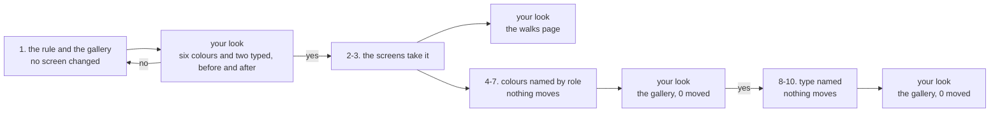

# The design system's next fixes: readable text on every client's colour, colours named, type named

## At a glance

What it is for: the design system for its real user, the staff of a small business in Vietnam (the
milestone of 2026-11-19). White text sits on a client's colour even where it cannot be read: on seven
of the nine stock colours of 2026-11-04 the buttons gave 2.25 to 3.77:1, under the 4.5:1 small text needs (your
pick of 2026-11-20 replaced the nine by six, of which only emerald's buttons fall under it; the case lives on in
typed light colours). Your
answer of 2026-11-20: "yes, switch to dark text, judged in the gallery first".

The cheapest path builds on what exists: the palettes, `shadesOf`, the `--credo-*` variables and the
gallery. The price: about 130 machine minutes, three picture runs of yours and four looks.

## The slice

One slice: a client's colour, from the gallery to every screen of both apps, in three landings on
`pre-merge`, each walkable. **A**: the text on a client's colour follows the colour, its pictures
moving on the colours that change. **B**: every colour a screen draws is read by what it is for, and
`tokens.ts` holds each value once (the memo's D, item 508). **C**: weights and sizes read by name.
B and C move no picture on any of the six colours. The memo's order stands: A is what clients see,
B makes A's names the norm, C needs neither.

It follows `docs/plans/2026-11-12-design-system.md` (its landings 1 to 4: the home, the values, the
gallery) and `docs/plans/2026-11-17-gallery-workbench.md` (the gallery at `/48b74d079/gallery`, its
colour picker over the palettes, six since your pick of 2026-11-20). Light only stays (item 307). Stage 1 is step 1 on the gallery;
stage 2 each step's gates; stage 3 the gallery and the walks page; stage 4 is not stood up, since no
resource, hop or key changes: ridge gets each landing by your push.

**Not in it:** the memo's appendix of eight new stock colours, which waits on your pick (A's rule
serves any colour, so a later swap changes nothing here); a fourth component level, or `parts/`
swept into `components/` (the memo's D, item 498 stands).

## The brief, checked

The memo is Claude (Cowork)'s, forwarded; piece 202 read it against `main`, and this plan reread
each claim it rests on in this worktree.

- **"6 of the 9"**: white fails 4.5:1 on the primary, shade 6, for **seven** (all but forest and
  steel); six is shade 7's count (the read, `contrast.out.txt`; `ui/src/design-system/tokens.ts#L10`).
- **"Screens ask for `brand.6`, `gray.5`"**: neither appears outside the design system. The raw
  shades screens do name are 31 lines (21 in `ui/src/frame/frameLook.module.css`, 4 in
  `frame.module.css`, 5 in `components/`, `ui/src/pages/SignIn.tsx#L26`) plus `c="orange.9"`
  (`ui/src/pages/client/OrderPage.tsx#L221`).
- **"~78 `c=` props"**: 78 are `c="dimmed"`, Mantine's own role name; they stay.
- **The read's "the walks draw one palette"**: they draw the data set's company in `#2f7d6d`, a typed
  colour (`shared/src/demo.ts#L30`), credo's own screens in steel (`shared/src/config.ts#L39`), and
  brick after one settings step (terracotta before the pick of six).
- **"Small capitals written three ways, `lts=` in screens"**: no `lts=` exists; `TOKENS.fieldLabel` and
  `TOKENS.sectionTitle` (`tokens.ts#L20`, `#L22`) are each spread by one component.
- **"Colour is locked down, case 7"**: two checks: case 7 reads the stylesheets
  (`ui/src/design-system/literals.test.ts#L10`), and a lint block (`eslint.config.js#L73-L87`)
  refuses a hex or `rgb(` in `.ts`/`.tsx` outside the design system; the read's "does not look at
  `.tsx`" holds for case 7 alone.
- **The `number` style** (tabular figures): no screen draws one (`grep -rnE
  'tabular|font-variant-numeric' ui/src` counts 0), so it is left out: "invent none".
- **Missed:** a filled button's hover is shade 7, so its text must pass there too; the header's and
  menu's white washes (`ui/src/frame/frame.module.css#L37`, `#L48`, `#L57-L66`, `#L93`, `#L99`) must
  follow the text; and brand-coloured text on a light ground (12 `Anchor`s, the back link, the white
  header's name and open item, light buttons) fails on the same colours, contrast being symmetric: a
  new item, filed at step 1.

## Landing A: the text follows the colour

**The rule, one function, `onBrand(shades, surface)`, in a new `ui/src/design-system/onBrand.ts`**
beside `shadesOf` (`appTheme.ts#L96`), pure, read by the theme, the variables' resolver and the
gallery. Each surface names the shades it spans under white text and under dark text:

| Surface | Under white | Under dark | Who draws it |
| --- | --- | --- | --- |
| filled | 6, hover 7 | 6, hover 5 | Mantine's filled variant: buttons, the badge, the checks' mark |
| header | 7 to 9 | 5 to 7 | the shell's header (`ui/src/frame/Shell.tsx#L143`), the sign-in band and button (`ui/src/pages/SignIn.tsx#L76`, `#L202`), the join and operator sign-in buttons (`ui/src/pages/operator/JoinPage.tsx#L138`, `OperatorSignIn.tsx#L43`), the gradient variant (`tokens.ts#L33`) |
| menu | 9 to 8 | 9 to 8 | the side menu (`Shell.tsx#L244`) |

White wins where it reaches 4.5:1 against every shade of its span; else dark text if it does; else
the span moves a shade at a time, darker under white, lighter under dark, the nearer pass winning.
Dark is the theme's darkest grey, `NEUTRAL[9]` (`appTheme.ts#L33`), read. Shade 7, the client's
colour, stays at one end of the header under either text. *Rejected:* darkening every primary until
white passes (a light colour such as terracotta's turns brown, the brand gone); Mantine's `autoContrast`, whose
`luminanceThreshold: .3` is not the ratio and reaches neither the gradients nor the `--credo-*`
colours. The theme's `variantColorResolver` (rest, hover, text) and the checks' `iconColor` apply
it, so no screen holds a copy.

Measured by this plan's scratch run of the rule on the nine stock colours of 2026-11-04, before your pick of six (step 1's test measures again; of those nine, only steel, emerald, shown below, and the typed colours remain to read):

| Colour | Buttons | Header | Menu |
| --- | --- | --- | --- |
| terracotta, sandstone, autumn, olive, ocean, coin (all six left the stock set; a light typed colour such as `#d97757` stands for them) | dark, 6.70 to 7.88 | dark over 5 to 7, 5.22 to 6.25 | white over 9 to 8, its fade kept (`#d97757`: 4.64; the nine's old read, 9 alone, 4.77 to 6.31, is replaced); amber `#ffbf00`, a typed colour, takes dark text over 8 to 7 |
| emerald | dark, 4.71 | white as today, 5.48 | white as today, 7.68 |
| steel (forest, the other, left; brick, bronze, plum and indigo, new, keep white on every surface) | white as today, 4.74 and 4.71 | white as today | white as today |

Typed colours: a grid of 4,096 (16 steps a channel) finds a pass on every surface. The walks'
company, `#2f7d6d`, reads neither text at shade 6 (white 4.37, dark 4.06), so its buttons move to
shade 7, its own colour, under white (4.91), hover 8; its header and menu stay. Pure red moves its
header to 8 to 9 under white, the one case where the client's shade leaves it. Steel, credo's own
colour, draws exactly as today.

**The variables follow:** `credoVariables` (`ui/src/design-system/cssVariables.ts#L5`) reads the
theme's brand shades and writes `--credo-on-filled`, `--credo-on-header`, `--credo-on-menu`, the
gradients' spans, and each wash at its share of its ground's text (5 to 90 %, as today's white), so
markup is the same under every colour. The argument goes to `docs/memo/ui.md` at step 2.

## Landing B: colours named by role, and one home for each value

Each role is a `--credo-<role>` variable, written once from the palettes and A's rule by
`credoVariables`; `FRAME_COLOURS`' value names (`tokens.ts#L56-L66`) go. Named by what each is for,
fitted to the 32 references above and to A's:

| Role | Today | Read by |
| --- | --- | --- |
| `surface`, `surface-sunken` | neutral 0, neutral 1 | the white look's header and menu; the sign-in ground |
| `text`, `text-muted`, `border`, `border-strong` | neutral 8, 7, 2, 3 | the white look; the door card's and avatar's edge |
| `hover-ink` | `ink-04` | the white look's hover and chip |
| `brand-text` | brand 7 | the back link, the white look's name and open item, the phone bar's open icon |
| `brand-tint`, `brand-tint-strong`, `brand-line`, `on-brand-tint` | brand 0, 1, 2, 9 | the band, the open item, the badge, the logo tile's edge, text on a tint |
| `on-filled`, `on-header`, `on-menu` and the washes | A's | A |
| `tip`, `on-tip` | neutral 8, white | the icon strip's tip |
| `warning-text` | orange 9 | the order page's late line |

`gray.6` in the phone bar (`frame.module.css#L127`) reads Mantine's `dimmed`, its own name for that
grey; `red` and `green` stay Mantine's names, fixed for every tenant (`appTheme.ts#L36`). Where two
values serve one purpose, both stay as two roles and the tick names the drift: a merge would move a
pixel. **The memo's D:** `TOKENS.badgeRadius` and `TOKENS.cardPadding` (`tokens.ts#L12`, `#L24`) read
the theme's `sm` and `lg` (`appTheme.ts#L128-L129`), closing items 508 and 596; `doorPadding`,
`doorBody` and `logoTile` stay component settings, said in the file's doc comment.

**The check extends**: case 7 refuses `--mantine-color-<name>-<n>` in a stylesheet outside the design
system, and the lint block refuses a shade-numbered colour (`brand.7`, `orange.9`) and that variable
in `.ts`/`.tsx`; its ignores stay the design system, the tests and the mock harness, with no new
exception.

## Landing C: type by name

Named in `tokens.ts` from what screens draw today: `pageTitle` (the theme's 22 at 700,
`appTheme.ts#L125`), `sectionLabel` and `fieldLabel` (today's two small-capital entries, renamed),
and three weights by role, `label` 500, `emphasis` 600 and `title` 700, for the 19 `fw=` in screens,
parts, the frame and components (13 files) and the frame stylesheets' 3 weights. Each use is read and
given its role; one that fits none keeps its number in a pinned list with its reason. The sizes join,
the count being small: one `fz={12}` (`SignIn.tsx#L97`) and four pixel sizes in the frame stylesheets.
The check then refuses a numeric `fw=`, `fz=`, `fontWeight` and `font-weight`/`font-size` outside the
design system, closing item 309. Item 308 (the phone's smaller title) waits for your look.

## The palette check: nothing moves on any of the six

The picture run draws the walks' company, credo's steel, and brick after one settings step
(`walk/specs/piece-1.spec.ts#L163`); the gallery has none (item 515). So B's first step adds
`visual/src/resolved.test.ts`: every screen of the walks page, drawn once as the capture draws it
(`visual/src/capture.ts`'s `matchingRules`), its markup and matching rules with every variable
resolved under each of the six colours and three typed ones, the walks' company's, pure red and
yellow (Mantine's `rem` read at scale 1), one
hash a screen and colour, compared with `visual/src/resolved.pinned.txt`, written from the tree A
landed. Equal resolved styles cannot draw a different pixel, so its 0 holds B and C on all six. It
stays as a standing check; a later look change rewrites its file by `--write`, read as a diff. It
rests on markup that is the same under every colour, which A's variables keep.

## The cases

| # | The case | Held by |
| --- | --- | --- |
| 1 | Every stock colour gives every surface a text at 4.5:1 or more against every shade of its span | `ui/src/design-system/onBrand.test.ts` |
| 2 | Each of 4,096 typed colours and the five named ones (yellow, cyan, amber, pure red, mid grey) finds a pass on every surface | same |
| 3 | White stays wherever it passes, so steel's and forest's spans are today's | same |
| 4 | White on autumn's shade 6 is refused (the planted failing pair) | same |
| 5 | Dark text is the theme's darkest grey, read from the theme | same |
| 6 | Mantine's filled parts and the checks' mark take the pick at rest and on hover | `ui/src/design-system/appTheme.test.tsx` |
| 7 | The header, the sign-in band and buttons and the join button draw the header's pick, their washes following | `ui/src/frame/Shell.test.tsx`, `ui/src/pages/SignIn.test.tsx` |
| 8 | The menu draws the menu's pick | `ui/src/frame/Shell.test.tsx` |
| 9 | The gallery's "On the brand" draws the six colours' and two typed ones' (the walks' company's and a light one) header, buttons and menu, today's and the rule's, each with its ratio | `ui/src/design-system/Gallery.test.tsx` |
| 10 | No stylesheet or script outside the design system names a numbered shade | `literals.test.ts`, the lint block |
| 11 | No resolved style of any screen moves on any of the twelve colours | `visual/src/resolved.test.ts` |
| 12 | The badge's corners and the card's padding are written once, read from the theme | `appTheme.test.tsx` |
| 13 | No weight or size number stands outside the design system | `literals.test.ts`, the lint block |
| 14 | The field label's spacing is held, not only its weight (item 513) | `ui/src/components/atoms/FieldLabel.test.tsx` |
| 15 | A moves no picture of steel's screens; B and C move none at all | the picture run |

## The steps

Each step's gate is `pnpm --filter @credo/ui check` and the citation test,
`pnpm --filter @credo/scripts exec vitest run src/citations.test.ts`; from step 2, also
`pnpm --filter @credo/visual check`. No step has a review: one comes before `main` moves (QA rule 5).
The runs log's median for builds, 4 minutes, is the docs pages' shape; each size below is the design
system's own earlier row of the same shape.

**Landing A: the text follows the colour.**

- [x] **1. The rule and the gallery, no screen changed.** `onBrand.ts`, cases 1 to 5 each red once
      (case 4 by the rule mutated to always white); "On the brand" in the gallery's Foundations, case 9.
      The records: the `docs/decisions.md` row (the text follows the colour, the colour stays the
      client's; it beat white as the old app has it, item 94's yes of 2026-11-05; its home this plan's
      Landing A); item 94's update, its part (1) moved to the new item; items 630 and 631 filed as the
      orchestrator branch's `worktrees/pieces/196-gallery-pc-review.md` allocates them; the new item
      (brand-coloured text and the switch's thumb on a light ground), its number given at the send.
      _Done when:_ the gates exit 0, and `git diff --name-only pre-merge...HEAD -- ui/src/frame
      ui/src/pages ui/src/parts ui/src/components` prints nothing. **12 min** (piece 147's step 4, 10;
      piece 126's step 3-rest, 2).
      _Evidence:_ code `d9c81355`, records `d633ce7e`; `pnpm --filter @credo/ui check` (typecheck,
      eslint, prettier, test at 100 %, knip) exit 0, the citations test exit 0, and the path diff
      against `pre-merge` empty. Cases 1 to 5 each red once on a planted change (case 1 the ratio
      floor at 3, case 2 the span's moves capped at one shade, case 3 white needing 7:1, case 4 the
      rule always white, case 5 the ink `#000000`); case 3 was first tried with dark tried first,
      which cannot bite (dark never passes where white does at the span's own shades) and was
      replaced. Case 9 red once with "Today" drawn as the rule. The gallery's "On the brand" is
      Foundations' second part, three states (Buttons, Header, Menu), nine rows each. `NEUTRAL`
      moved from `appTheme.ts` to `palettes.ts` so the rule and the theme share it without a cycle
      at step 2. Items 630, 631 and 636 filed; item 94 updated. Look 1 is the human's.
- [x] **1b. The stock colours replaced by the human's pick** (his answer of 2026-11-20 14:4x:
      "yes, as you suggestion"). `PALETTES` becomes steel, emerald, brick, bronze, plum, indigo (the
      memo's appendix hex, exactly); the names in both languages, every test, fixture and the walk's
      settings step moved to kept palettes, a light palette's dark-text case to the typed `#d97757`;
      the gallery's "On the brand" shows six; the `docs/decisions.md` row, items 83 and 94 true.
      _Done when:_ `bash ops/gate.sh ui`, the citation test and the walk package's typecheck and
      lint exit 0, and the removed names and shade 7s stand only in dated records. **15 min**
      (step 1's shape). Step 2 onward reads the six: no stock colour but emerald's buttons takes
      dark text now, so the walk's settings step (brick) keeps white text, and the dark-text case is
      the typed light colour's, shown in the gallery's two typed rows and held by the unit tests;
      the plan's text above reads so.
      _Evidence:_ code `b59c21ae`; `bash ops/gate.sh ui` and `bash ops/gate.sh walk` (its test step
      skipped by the gate) exit 0, the citations test exit 0; `git grep -n -i` for each removed
      name and shade 7 stands only in the decisions, the open items and these plans, and in
      `onBrand.test.ts`'s typed `#d97757`, the light colour that keeps the dark-text cases; case 4's
      mutation (the rule always white) still reddens cases 1 to 5; the walk's settings step, picking
      Brick, replayed in `ui/src/App.test.tsx` with the real router. Names in Vietnamese are the
      machine's (item 638). Look 1 reads six rows, where only emerald's buttons turn dark.
- [x] **2. The screens take it** (after your yes at point 1). The theme's resolver and the checks'
      `iconColor`; `credoVariables` writes A's variables; the shell, the sign-in, join and operator
      pages and `frame.module.css` read them; `docs/memo/ui.md` and `ui/CLAUDE.md`'s design-system line
      grow. Cases 6 to 8, each red once; the frame's snapshots rewritten, each diff read to hold
      variable names alone. _Done when:_ the three gates exit 0. **16 min** (piece 126's steps 5 and 9,
      8 each).
      _Evidence:_ code in this step's commit; `bash ops/gate.sh ui`, the citations test and `bash
      ops/gate.sh visual` exit 0. The theme's `variantColorResolver` (filled and gradient parts) and the
      checks' `iconColor` read `onBrand`; `credoVariables` writes `--credo-on-filled`, `-on-header`,
      `-on-menu`, `-header-gradient`, `-menu-gradient` and the washes (`--credo-on-header-12`, `-18`,
      `-22`, `-55`, `-90`, `--credo-on-menu-05`, `-10`), replacing the `white-*` names, and where the
      filled parts move (the walks' company `#2f7d6d`, shade 7, hover 8) it rewrites Mantine's
      `--mantine-color-brand-filled`, `-filled-hover` and pins `-brand-text` at shade 6, since a button,
      check or badge with no colour of its own reads those by name; a plain badge is named filled only
      where the rule changes it. Cases 6 (three mutations: the text always white, the check's icon
      colour dropped, the hover shade as the ground's), 7 (the header's span fixed at 7 to 9; a sign-in
      button and the join button each without the text) and 8 (the menu's text fixed white) each red
      once and reverted. `frameKept`'s two changed snapshots (the operator's passkeys, the ways to sign
      in) diffed to variable names alone: a gradient written out becomes `var(--credo-header-gradient)`
      or `var(--credo-menu-gradient)`, `var(--credo-white)` becomes `var(--credo-on-header)` or
      `var(--credo-on-menu)`; the session-ended prompt's did not change. The plan's `#d97757` menu is
      today's (white, 9 to 8, 4.64), so it keeps its fade, not the one dark shade the
      look-1 text promised; amber `#ffbf00` is a typed colour whose menu takes dark text over 8 to 7. `docs/memo/ui.md` and `ui/CLAUDE.md` grew; item 638
      closed by the human's yes. Step 3's picture run: the walks' company's buttons, checks and chips
      move to shade 7 (hover 8); credo's own steel and brick draw as today.
- [x] **3. Landing A.** `pre-merge` taken in first (done, a merge in this branch); then your run of all twelve walks in this worktree with
      `--moved all --write` (its counts show credo's own screens at 0), then one with no flags; the
      bases committed alone; only then the orchestrator lands the branch whole, bases with it, on
      `pre-merge`, which stays free for piece 206 meanwhile.
      _Done when:_ your second run reads `== verdict: green` with every count 0. **7 min** (piece 126's
      12-takein and 12-bases), **and your runs, about 16.**
      _Evidence:_ `pre-merge` taken in by the merge `40f28f3f` (parents `e245d499` and `e32759f0`). The
      human's write run of 2026-11-20 at 16:03 (all twelve walks, `--moved all --write`),
      ends `== verdict: green: 35 comparisons, every raw count as asked` and `== done at 16:23:17`;
      its "full-1 to the bases" lines: six walks moved (piece-1 42, piece-2 188, admin-lists 120,
      office-orders 36, driver-deliveries 18, office-reconcile 6 pictures), the six operator walks
      (operator, passkeys, services, root-password, team, delete-client) 0, none new, none without a
      counterpart, none unreadable. The bases committed alone in `58710f78`, 410 pictures. The human's
      check run of the same day at 16:26 (no flags),
      ends `== verdict: green: 35 comparisons, every raw count as asked` and `== done at 16:45:34`,
      every "full-1 to the bases" line at 0 moved, 0 new, 0 without a counterpart, 0 unreadable. The
      bases and the plan land on `pre-merge` with the branch, the orchestrator's next act.

**Landing B: colours named by role** (after step 3's landing, its base).

- [ ] **4. The palette check.** `resolved.test.ts` and its file from the tree as landed, case 11 red
      once on a planted role value. _Done when:_ the gates exit 0. **20 min** (piece 126's step 7, the
      last new check, its lock wait included).
- [ ] **5. The roles.** The table above in `tokens.ts`, the 32 references and A's names moved, D's two
      tokens, the gallery's Values listing the roles; case 12. _Done when:_ the gates exit 0 with case
      11 unchanged. **8 min** (piece 126's step 5).
- [ ] **6. The shades refused.** Case 10, each half red once on a planted `brand.7`. _Done when:_ the
      gates exit 0; `grep -rnE --exclude='*.test.*' '"[a-z]+\.[0-9]"|--mantine-color-[a-z]+-[0-9]'
      ui/src/pages ui/src/parts ui/src/frame ui/src/components` prints nothing. **20 min** (piece 126's
      step 7).
- [ ] **7. Landing B.** As step 3, your run of all twelve walks with no flags. _Done when:_ green, every
      count 0. **7 min, and your run.**

**Landing C: type by name** (after your yes at point 3).

- [ ] **8. The styles.** The names above; the 19 weights, 3 stylesheet weights and 5 sizes moved;
      case 14 red once. _Done when:_ the gates exit 0 with case 11 unchanged. **13 min** (piece 126's
      step 4, a move across nine importers).
- [ ] **9. Weights and sizes refused.** Case 13, red once each. _Done when:_ the gates exit 0.
      **20 min** (piece 126's step 7).
- [ ] **10. Landing C.** As step 7. **7 min, and your run.**

## Keeping every test and walk green

- **The walks page asks again for every screen with the frame** at each landing, a version being its
  markup and matching rules (`visual/src/capture.ts#L260`); the run's counts say which moved.
- **No case is edited to fit a move**: the frame's pins of `--credo-white` follow the new names; any
  other red is the move being wrong.
- **A no at point 2 after B has started** rewrites B's file with A's fix, its diff A's surfaces only.

## The human's points

1. **The six colours and two typed, before and after (step 1).** In the gallery (in the piece's `ui/`,
   `pnpm exec vite --open /48b74d079/gallery`; Ctrl-C ends it), Foundations, "On the brand": each
   colour's header, buttons, badge, check and menu, today's beside the new, with each ratio. Of the six,
   only emerald's buttons turn dark; below them two typed colours show the rest of the rule: the
   walks' company's `#2f7d6d`, whose buttons move a shade under white, and a light `#d97757`, which gets
   dark text on a lighter header ending at its own colour, dark button text and a menu that keeps white text
   and its fade (9 to 8, 4.64:1); amber `#ffbf00`, typed, is the colour whose menu takes dark text. Does each read as that client's colour, now readable? A yes starts step 2; a no names the colour and surface, and step 1 reopens.
2. **The screens, on the walks page (step 3).** Every client screen's buttons now wear the company's
   own green, a shade darker, with white text; the screens after the colour turns brick keep white
   text, as no stock colour but emerald's buttons takes dark text now; credo's own screens did not move. Does each read right? A
   yes lets the push take it to ridge; a no names the screen, and step 2 reopens.
3. **Colours named, nothing moved (step 7).** In the gallery, "Values" lists each colour by what it is
   for, in whichever colour you pick; the palette check reads 0 moved over all six and your run 0.
   Do the names read as what each colour is for? A yes starts landing C; a no names the role, and
   step 5 reopens.
4. **Type named, nothing moved (step 10).** "Values", Type, shows each text style by name with its
   size and weight; both checks read 0. Does each name say what the text is for? A yes closes the
   piece; a no names the style, and step 8 reopens.

## The open items in reach

| Item | What this plan does |
| --- | --- |
| 83, the menu's white at shade 8 | closes, step 3 |
| 94, white on shade 7 | updates at step 1 (your reversal), its part (2) closed at step 3, its part (1) moved to the new item |
| 307, light only | leaves: B makes a dark set one value a role, when you ask |
| 308, the phone's title | leaves, until your look asks |
| 309, numeric weights | closes, step 9 |
| 498, `parts/` beside `components/` | leaves; no level added |
| 508 and 596, two homes for two values | closes both, step 5 |
| 513, the label's spacing unasserted | closes, step 8 (its atom changes) |
| 515, no gallery picture | leaves: the palette check covers the screens, not the gallery's parts |
| 629, the gallery's hidden button names | leaves: no step changes the Show switch |
| 630 and 631 | filed by step 1 |
