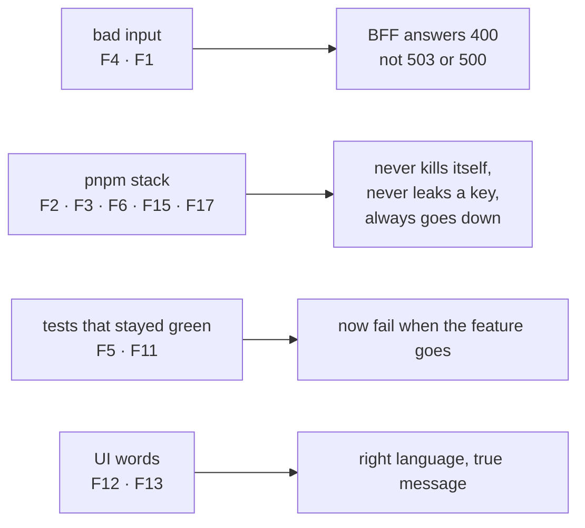

# App frame recap, 2026-10-28

## At a glance

A second model read steps 4 to 6 of piece 1 (the UI, the BFF, the stack, the walk spec) and found
17 things. This recap is **round 1** of the fix pass: everything outside `walk/` and `ui/src/mock/`.
Round 2 follows once the visual report's branch is in, because it changes the walk's screen list
and the mock.

| | Count |
| --- | --- |
| fixed | F1 to F8, F11 to F17 |
| rejected | none |
| deferred to round 2 | F9, F10, the mock's drawing of F1's refusal, and a mock test that runs near its 5 s limit (`ui/src/mock/MockPage.test.tsx`, "narrows to one language…", 4.97 s alone) and times out under load |
| parked as open items | one new, number 10 |

The UI changes (F1, F12, F13) can move pixels on the walk's screens. The human's re-run of the walk
comes after round 2, not before.

## What the review found

| # | Finding | Fate | Why, and how it was seen red |
| --- | --- | --- | --- |
| F1 | a logo over 200 KB, or a file that is not an image, got "try again", which can never work | **[FIXED]** | refused at the chooser (`ui/src/Settings.tsx`) with its reason in both languages, the draft's logo kept; a 400 on save is "refused", not an outage, with its own words (`ui/src/SettingsPage.tsx`). Red: the size check removed, the type check removed, the refusal clearing the logo, the 400 read as a failure |
| F2 | every `pnpm stack` rebuilt into the checkout's `ui/dist/app`, which Vite empties; a page request then killed a running stack | **[FIXED]** | the UI is built into the stack's own temp folder; an unreadable page answers 500; a request line `new URL` rejects answers 400; neither ends the process. Red: the old output folder; the 500 turned into a 200; the 400 turned into a dropped socket |
| F3 | in `pnpm stack -- <command>` nothing handled a signal: orphaned children, `credo-stack-*` left behind | **[FIXED]** | SIGINT, SIGTERM and SIGHUP are caught from the first line of `runStack` to its `finally`, forwarded to the command; one caught during the build keeps the command from starting. `scripts/src/main.test.ts` runs the real entry as a process, sends SIGTERM and reads that the BFF, c-storage and the front refuse connections, the command's PID is gone and no `credo-*` folder remains. Red: the handlers removed (exit by signal, not 143), the forwarding removed, the early check removed |
| F4 | bad input the BFF passed on to c-storage answered 503 or 500 | **[FIXED]** | `version` must be a 64-digit tag; `name` (200) and `password` (1024) are non-empty, well-formed text; all answer 400. A c-storage 400 answers 500, the BFF's own bug. Tests for `"v1"`, `""` and `"\ud800"`. Red: each rule dropped |
| F5 | the stored hash's length check was held by nothing | **[FIXED]** | a correctly derived 32-byte key for the right password is refused. Red: the check deleted |
| F6 | "the BFF never holds the super-admin key" was tested only in `readEnv`; the BFF inherited the stack's whole environment | **[FIXED]** | `bffEnvironment` (`scripts/src/stack.ts`) names exactly the BFF schema's variables, `HOST` included; `startProcess` gives a child only its own environment plus the temp-folder variables (the loader writes its cache there). Red: `X_SUPER_ADMIN_KEY` added; `process.env` merged back in |
| F7 | two coverage exclusions gave the wrong reason | **[FIXED]** | both name the real layer: the BFF's entry is run as a child by `scripts/src/main.test.ts` and `stack.test.ts`; the scripts' entry by `main.test.ts`. F3's spawn test holds both entries' SIGTERM path |
| F8 | `CLAUDE.md` said the helper sets `GOCACHE`; the stack's build did not | **[FIXED]** | one helper, `bff/tests/build.ts`, builds c-storage for the route tests and the stack, and sets `GOCACHE` under the temp folder when none is set; the line says so. Red: the default removed |
| F9 | (the walk's screen list) | **[DEFERRED] to round 2** | touches `walk/` |
| F10 | (the mock's new state) | **[DEFERRED] to round 2** | touches `ui/src/mock/` |
| F11 | three negative tests stayed green when their feature vanished | **[FIXED]** | the refusal test asserts 401, the "more than three days" test asserts 200, the stack test asserts the sign-in succeeded and that the scanned bytes hold `scrypt$`. Red: a refusal answering 404; a null session; a wrong password; `xcrypt$` |
| F12 | before the settings load, a device that had booted spoke Vietnamese unless its user had chosen a language | **[FIXED]** | each successful boot keeps the language shown (`credo.shown`); it is read before the settings load; Vietnamese only when nothing is kept. Red: not stored, not read, the choice not checked against the offered languages |
| F13 | the load-failed message promised "nothing you typed is lost" where the draft was already gone | **[FIXED]** | "This page could not be loaded. Try again." and "Không tải được trang này. Hãy thử lại." |
| F14 | the plan said "no code holds it yet" and "a fixed seed" | **[FIXED]** | both reworded and stamped |
| F15 | a command killed by any signal read as 143 | **[FIXED]** | `128 + os.constants.signals[signal]`; SIGKILL reads 137. Red: the old two-way guess |
| F16 | an exported `HOST` could move the BFF | **[FIXED]** | with F6: `HOST: '127.0.0.1'` is set explicitly |
| F17 | the up-check could read a stranger on the port as the child | **[FIXED]** | `waitUntilUp` also needs the child's own log to say it is listening; a stranger answering on the port, with a silent child, is not "up". Open item 9 says so. Red: the log check removed |

| Other | Fate | Why |
| --- | --- | --- |
| a 5xx log carried the record path `user.<name>` | **[FIXED]** | a c-storage error names the call and the record's kind, never its key. Red: the key put back |
| sessions keyed by a client-chosen device id | **[DEFERRED]** | open item 10, for piece 2: harmless with one root |
| the Vitest "Isolate 13 workers" hint | **[REJECTED]**, stays | it is a speed estimate (about half a second a run) that appears under load; `isolate: false` would let the files share one jsdom, and a cross-file leak is what the 100 % gate cannot see. Step 6's "no warning" is true of every run but a loaded one |
| QA rule 8's hint at `scripts/src/processes.ts` | **[FIXED]** | its reason now says the hook runs only on a normal exit of this process (a crash with the child up). After F3 it still holds: a signal is now handled, so the hook is reached only by a crash |

## What was rejected, at what price

Nothing in the review was rejected. One thing not done: a second signal during shutdown is not
caught (the default takes the process down, the way out of a stuck stop), which leaves the children
running; it costs a manual kill and buys an exit that cannot hang.

## What remains the human's

- Round 2: the merge of the visual report's branch, then F9, F10 and the mock's drawing of the
  refused logo; then the walk's re-run in the human's terminal, which can move pixels on the screens
  F1, F12 and F13 touched.
- A signal sent from a terminal reaches the command twice, once from the terminal and once
  forwarded by the stack. A command that treats a second Ctrl-C as "stop now" stops sooner.
- Pushing the branch.
