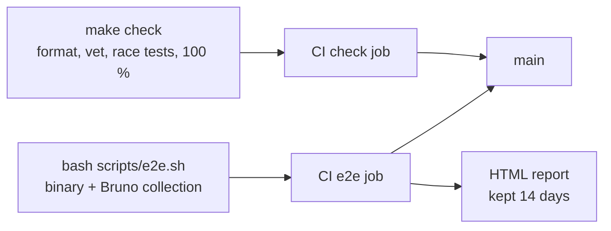

# c-storage recap, 2026-10-28

## At a glance

c-storage is the key-value service behind the BFF: one Go binary, one SQLite file, five routes.
This step puts it, its memo, its CI and its end-to-end check on `main`, after a review of the
whole by a second reader (QA rule 5).

| Reaches `main` | Where |
| --- | --- |
| the service and its memo | `c-storage/`, `docs/memo/c-storage.md` |
| the CI gate | `.github/workflows/c-storage.yml`, job `check` |
| a Bruno collection, 25 requests over the five routes and their refusals | `c-storage/bruno/` |
| the end-to-end run and its HTML report | `c-storage/scripts/e2e.sh`, job `e2e`, artifact `c-storage-e2e-report` |
| a README with a tested "try it in 10 minutes" | `c-storage/README.md` |

Of the thirteen findings below, twelve are fixed, one is deferred to ridge's unit file and none stands
open. What stays the human's is at the end.

## What the review found

| # | Finding | Fate | Why |
| --- | --- | --- | --- |
| F1 | an empty `If-Match:` or `If-None-Match:`, or a second line, read as no precondition, so the write ran unconditional | **[FIXED]** | presence is read from the header map; empty, doubled or both is 400, on every write route. Seen red: the old code answered 204 to an empty `If-Match` |
| F2 | `bru` turns a file it cannot parse into a skipped result and exits 0 | **[FIXED]** | `e2e.sh` needs every result to pass with a test, and the passed count to equal the request files. Seen red with a broken first line |
| F3 | nothing held "a tag never meets an absent record" | **[FIXED]** | a remove, then a push and a remove naming the earlier tag, are 412. Seen red by changing the comparison |
| F4 | the shutdown-order test did not hold `Run`'s half (the database closing after `serve`) | **[FIXED]** | the test closes the database as `Run` does and reads the rows back from the reopened file. Seen red with `Shutdown` in a goroutine: the in-flight push answered 500 |
| F5 | a failed `Run` (port taken) exiting 1 was held by nothing | **[FIXED]** | `e2e.sh` starts a second server on the port and wants exit 1 and `bind the listener`; the missing-variable check runs under `env -i`. Seen red with that `os.Exit(1)` changed |
| F6 | Go 1.25 is past support | **[FIXED]** | `toolchain go1.26.7` in `go.mod`; `make check` green on it. The root `CLAUDE.md` and the plans change on `app-frame` |
| F7 | `OPTIONS *` answered 200 without a key, from net/http | **[FIXED]** | `DisableGeneralOptionsHandler`; a raw `OPTIONS *` test wants 401. Seen red with the flag removed |
| F8 | no bound on a hung test, a probe or a stop | **[FIXED]** | `go test -timeout 3m`; `curl -m 2` on every probe; 20 s to stop after SIGTERM, then the hang is named |
| F9 | the collection and e2e could be deleted as "unconsumed" | **[FIXED]** | `c-storage/CLAUDE.md` says they are the human's call, with his words |
| F10 | the memo said "keys are stored only as a hash" | **[FIXED]** | a service's key is hashed; the internal and super-admin keys sit in the environment |
| F11 | the database file's mode | **[DEFERRED]** | belongs to ridge's systemd unit (`UMask=0077`), where the orchestrator sent it; no open item, it has a home |
| F12 | a second signal during the grace period was swallowed | **[FIXED]** | `stop()` runs after the first signal, so the second gets the default action |
| F13 | the checkouts kept the token | **[FIXED]** | `persist-credentials: false` on both |

| Other | Fate | Why |
| --- | --- | --- |
| `ubuntu-latest` is moving to Ubuntu 26 | **[FIXED]** | both jobs run on `ubuntu-24.04` |
| Bruno's last removal was never read back | **[FIXED]** | request 17 reads the record: 404 |
| `busy_timeout` had no test | **[FIXED]** | every pooled connection reports 5000 ms. Seen red with the value changed |
| `TestEveryRouteAnswersWithItsKeys` accepts 404 | **[REJECTED]** | covered elsewhere: a read of a key nothing pushed is 404 past every gate, and the same routes' real answers are asserted by their own tests and the collection |
| a visual report for review | **[FIXED]** | `bru` writes an HTML report with no key in it; `e2e.sh` decodes it and fails if one appears. Seen red without the skip flags, and with headers skipped alone, because a register body carries an access key |

## What remains the human's

- push the branch, and read the first real run on GitHub: nothing has run there yet
- the first `act` run is local only; the `e2e` job's Node 26 with Bruno 4.2.0 is untried on GitHub
- ridge's unit file takes F11 (`UMask=0077`)
- the app frame's own lines about Go and about the collection change on `app-frame`, not here
