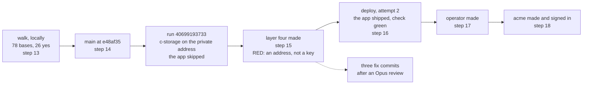

# ridge-app recap, 2026-10-28

## At a glance

The app is on ridge. From `main` at `e48af35`, one push released c-storage on the box's private
address and the human re-ran the same run to ship the app. The human then made the operator, made a
client (`acme`) from the operator's page, opened its link and signed in as its root: "finished 1~5,
it's ok". Piece 2's plan is next.

| Step | What happened | Where read |
| --- | --- | --- |
| 14 | `main` fast-forwarded to `e48af35`; run 40699193733, five jobs green | [step 14](../plans/2026-10-28-ridge-app.md#L758) |
| 15 | layer four: 15 adds and one in-place modify; the apply green, then a RED that was no key | [step 15](../plans/2026-10-28-ridge-app.md#L774) |
| 16 | the first app deploy: service registered, `shipped e48af35`, the check green, 33 ok and 0 not ok | [step 16](../plans/2026-10-28-ridge-app.md#L795) |
| 17 | `ops/operator.sh ridge`: the operator made, the password on the terminal alone; a second run refused | [step 17](../plans/2026-10-28-ridge-app.md#L809) |
| 18 | the human's walk on ridge: yes | [step 18](../plans/2026-10-28-ridge-app.md#L819) |

The one surprise on ridge itself: the box's private address was printed
into the human's local stack log, and the log's own scan, which cannot tell an address from a key,
called it a key. Nothing was replaced. It is fixed in code and in the test; the address is still in
that local log and in the history of one doc ([what remains](#what-remains-the-humans)).

## What shipped

- **The edge.** An HTTP API in front of the BFF's function, behind CloudFront. The function-URL
  design could not be built in Malaysia: [the edge](../plans/2026-10-28-ridge-app.md#L228).
- **A client is a tenant**, named by its code in the link, made by the operator at `/operator`, never
  edited there: [the operator](../plans/2026-10-28-ridge-app.md#L150).
- **Layer four** (`ops/env.yml`): the subnet, the BFF's function and group, the UI bucket, the API
  and the distribution, and the deploy role's code-only rights:
  [layer four](../plans/2026-10-28-ridge-app.md#L281).
- **One workflow ships c-storage, the BFF and the UI.** c-storage binds the box's private address
  alone; the app ships after it once the stack holds layer four, and the check reads both through the
  app's address as a partner would.
- **`ops/operator.sh`** makes the operator, shows its first password on the terminal and in no log.

What the check proved on ridge, through the app's address (run 40699193733, attempt 2,
`logs/ridge-app-deploy-2.log`): the client's link answers 200; `/api/config` reaches the BFF
uncached; the root signs in through the edge (200, 1 s), is known by its handle, signs out (204) and
is then refused (401); an unknown client code is the BFF's 404, a missing one 400, and the operator's
door answers 401 without a session. Bruno ran 25 of 25 requests and 33 of 33 tests through the
tunnel. The app's CloudFront address is in the human's local log and in no committed file.

## The RED after the apply

The apply of layer four (`logs/2026-10-28-215737-stack-ridge.log`, 21:57 to 22:02) finished all 8
steps `== green`, then the end-of-run scan printed `RED  a key is in this log` and the script exited
1. An Opus diagnosis read it: step [6/8] had printed `BoxAddress`, the box's private address, since
`stack.sh` printed every output except two. The address is masked only later, at `box_open`, and the
scan searches the log for every masked value, so it found it. It was not a key, nothing was
replaced, and the plan says no address is printed.

Three commits fix it, the first two reviewed by Opus before the third:

- `6409adc`: `outputs_print`, `BoxAddress` masked before it, `mask` takes a label so the RED line
  says what matched ([`mask`](../../ops/lib.sh#L154), [the RED lines](../../ops/lib.sh#L128)), and a
  README line on reading it ([the check](../../ops/README.md#L196), and [the bootstrap](../../ops/README.md#L45)); the evidence line in
  [the ridge plan](../plans/2026-10-28-ridge.md#L634) no longer writes the address.
- `845ccb5`: a separate noise in main's GitHub run, `Bad file descriptor`, printed twice inside the passing
  guards (`logs/ridge-app-deploy-1.log#L7440`, `#L7442`). A test stand-in called `mask` with fd 3
  closed, which a real run never does; the case passed because a failed `printf` in an `if` does not
  stop it. It now opens fd 3, and a check asserts empty stderr.
- `2145949`, the review's fix pass:

| Finding | Tag | Fix, and the red seen |
| --- | --- | --- |
| **M-1, Medium:** the test copied `stack.sh`'s read-back, so deleting the role's mask stayed green | **[FIXED]** | `outputs_show` ([`lib.sh`](../../ops/lib.sh#L249)) holds the three masks and the print; `stack.sh` calls it ([`#L255`](../../ops/stack.sh#L255)); the test calls it. Seen red: the role's mask removed, the fd 3 mask count `wanted '3', got '2'`; `stack.sh` calling `outputs_print` instead, the guard refuses |
| **L-1:** the guard caught one printer shape in `stack.sh` alone | **[FIXED]** | the case is renamed to what it holds, and `stack.sh env ridge` is run whole on stand-ins for `aws`, `gh` and `ssh` ([the cases](../../ops/test.sh#L1666)): neither the fake address nor the fake ARN in the log or the terminal, the app's address printed, the log ending `ok   no key in this log` |
| **L-2:** a masked value with a newline put the labels out of step with the secrets, and leaked in `::add-mask::` | **[FIXED]** | `mask` takes each line as a secret with its label. Seen red: a two-line key whose second line leaked was named as the address; `wanted '2\|22', got '1\|21'` |
| **L-3:** no case where a key and the address leak together | **[FIXED]** | one case asserts both RED lines, the key's first, and no `ok` line |
| **L-4:** the secrets went on jq's command line | **[FIXED]** | passed in jq's environment; a case checks `lib.sh` has no `--arg secrets`. No red was run for this one |
| **L-5:** `outputs_print` printed by default | **[FIXED]** | an allow-list ([`OUTPUTS_PRINTED`](../../ops/lib.sh#L227)): any other output prints `(not printed)`. Seen red: an unknown output `wanted '1 0', got '0 1'`. I added the network and github stacks' outputs, since they print through it too (`ProviderArn` among them, which the ridge plan accepts in the local log) |
| **L-6:** `mask` failed quietly when fd 3 is closed | **[FIXED]** | it dies, `mask: fd 3 is closed; log_start opens it`. Seen red: `wanted a refusal naming 'fd 3 is closed', got exit 0` |
| **L-7:** nothing asserted `printed_outputs`' fd 3 | **[FIXED]** | held by L-6's die and the mask count; seen red with the redirect removed |
| **L-8, Low, older than this fix:** `--plan` on an unchanged stack fell through to the read-back, opening the box and writing GitHub's environment and secret | **[FIXED]** | `--plan: nothing changed` and exit 0 ([`stack.sh`](../../ops/stack.sh#L218)). Seen red: the exit removed, `wanted '0 0 0', got '5 1 1'` |
| Info: the RED's wording, a pointer in the bootstrap, a reason in `(not printed)` | **[FIXED]** | "the box's private address is in this log: redact it in this log; nothing to replace"; [the README](../../ops/README.md#L45); `(not printed: the account id)` and its kin |

## What was rejected, and at what price

| Rejected | Price, and the trigger to revisit |
| --- | --- |
| Rotating keys on the RED, as the runbook's "a key is in this log" says | nothing in the log was a key, so it was not done; the label now makes the RED say what matched |
| The function URL for the BFF | not offered in Malaysia; the HTTP API costs about $1.25 a client a month ([the calls](../plans/2026-10-28-ridge-app.md#L526)) |
| A lockfile for Bruno CLI in CI | the 500-odd dependencies run beside the deploy role, defended by `--ignore-scripts` and a clean environment; [open item 12](../open-items.md) |
| The `credo-github` stack's `ProviderArn` hidden from the local log | it holds the account id; accepted by the human at the ridge plan's step 10 and left in the local log; an account id is no credential |

## What remains the human's

Three questions were asked at 23:3x, and nothing assumes their answers:

- **The stack log of the apply** (`logs/2026-10-28-215737-stack-ridge.log`) holds the box's private
  address: redact it or delete it.
- **Whether the terminal's output of that run was shared** anywhere.
- **The address in public history:** `main`'s history holds one doc line that wrote it out, and
  `6409adc` removes it only from the tip. Accept it, or rewrite the history. It is the human's call, asked
  separately.

And:

- **The push of `2145949` and the fixes**, when needed. Its run deploys the same app again; nothing
  new reaches ridge until then, and the fixes change only `ops/`.
- **The acme root's password**: the human pasted its first password into a chat. It was not used or
  recorded here. Change it before partners use ridge. There is no route to change a root's password
  yet ([left behind](../plans/2026-10-28-ridge-app.md#L839)).
- **Walks-sharing's own steps**, on its own branch.
- **The hand-off lesson:** the operator's one-liner ran `pnpm install` first, because `main`'s
  worktree had no `node_modules`; a worktree that runs a script needs its install done.

## Earlier in the piece

Steps 9 to 13 are in [the plan](../plans/2026-10-28-ridge-app.md#L663), each with its evidence.
Act's four runs read red before green, for these causes: act's setup-go race; cfn-lint's `Null` key
and `ExecuteApiArn`; vitest's workers starving under load (the workflow caps them); a Go module
fetch timing out on the Mac's network; and a flaky password-dash test. GitHub's run 40693034032 on the branch was green. The
walk ran twice locally: 78 bases at `threshold: 0`, and the human's yes to all 26 screens. Two items
went to [the log](../open-items.md): 14, the deleted Lambda-URL item, and 15, the visual package's
act warnings.
