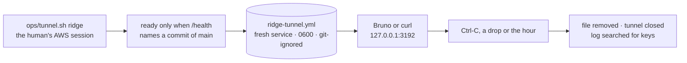

# ridge's tunnel recap, 2026-10-28

## At a glance

[The plan](../plans/2026-10-28-ridge-tunnel.md), steps 1 to 6, is done. One command on the human's
Mac, `ops/tunnel.sh ridge`, holds ridge's c-storage open at `http://127.0.0.1:3192` for Bruno or
curl, and puts nothing on the internet. It is on `main`, deployed, and the human's first run
answered in Bruno and ended clean.

Nothing is left for the human to run. Three things to know:

1. Each run is a fresh service: what is saved through the tunnel stays on ridge and no one can read
   it again (call 1, below).
2. ridge only: the command refuses any other environment, because a client's admin keys would land
   on this disk.
3. The tunnel does not reconnect: it ends at Ctrl-C, a drop or the endpoint's hour, and a new run
   makes a new service.

## What shipped

| Part | What it is |
| --- | --- |
| the command | [`ops/tunnel.sh`](../../ops/tunnel.sh#L22): one page, run from a worktree at `main`; port 3192 is fixed, so a second run is refused before it opens or writes anything |
| the tunnel | [`box_open`](../../ops/lib.sh#L345) with `ExitOnForwardFailure`, the same connection `check.sh` opens, held by [`tunnel_hold`](../../ops/lib.sh#L386) until it ends; one connection, an hour at most |
| ready | printed only once `/health` through the port names a commit of `origin/main` |
| what lands on the Mac | one file, `c-storage/bruno/environments/ridge-tunnel.yml`, written by [`bruno_env_write`](../../ops/lib.sh#L473): ridge's keys and a fresh service `tunnel-<UTC time>`, 0600, git-ignored, removed on every exit; no key is printed or logged |
| the moves | the port's refusal, the environment writer and the `/health` read moved into `lib.sh`; `check.sh` calls them, so the deploy's check runs the same code |
| the runbook | [the tunnel's section](../../ops/README.md#L135): the steps and the branches (a taken port, a killed run's leftovers, a drop) |

To use it: `ops/tunnel.sh ridge`, wait for `ready:`, open the collection `c-storage/bruno` in Bruno,
pick the environment `ridge-tunnel`, run Health, then the collection once; Ctrl-C when done.

## What was rejected, and at what price

| Rejected | Price paid for the choice | Trigger to revisit |
| --- | --- | --- |
| **Call (a) taken, so its alternative was not**: one standing service for the human, its key kept between runs | what is saved in one run cannot be read in the next; the alternative would have put a service key on disk for good, with a first-run path and a reuse path to build, and a lost file strands its records | the human wanting tomorrow what was saved today, or piece 1 writing to ridge |
| any environment but ridge | the command cannot be pointed at a client's stack, even by the human | the guard that refuses a client's stack exists ([ridge's plan, left behind](../plans/2026-10-28-ridge.md#left-behind)) |
| reconnecting in a loop | a drop ends the run and the human starts another; the endpoint's hour is untested, since waiting an hour shows nothing the drop case does not | the first session the hour cuts short |
| a flag on `check.sh` | one more script; `check.sh` ends in a verdict, this one holds | none |
| a public URL (planned, then parked) | the data is reachable from this Mac only | a need to look from elsewhere |

## The review

Another model reviewed `73beb20..e369cd1` read-only and found no regression in `check.sh` and no key
leaked on any exit but `kill -9`. Twelve findings, all `[FIXED]`; the table is in
[the plan](../plans/2026-10-28-ridge-tunnel.md#review). The ones that changed behaviour:

| # | Tag | Finding | Fate |
| --- | --- | --- | --- |
| 1 | Medium, `[FIXED]` | `tunnel.sh` held by no behavioural test | the real script now runs whole in `ops/test.sh` on stand-ins for `aws` and `ssh` with the real c-storage behind the forward, seen red under the reviewer's two mutations |
| 2 | Low, `[FIXED]` | `check.sh`'s port refusal unheld | held, seen red with the refusal deleted |
| 3 | Low, `[FIXED]` | a second Ctrl-C cut `on_exit` short | `on_exit` ignores INT, TERM and HUP from its start |
| 4 | Low, `[FIXED]` | a bind failure named only the endpoint | both messages name both causes |
| 5 | Low, `[FIXED]` | five hard-coded `127.0.0.1` on the box | one variable, `BOX_LISTEN_ADDR` |
| 6 to 12 | Low and Info, `[FIXED]` | a swapped-lines test that passed, a hold test that raced, a mask and an ignore check deletable, `kill -9`'s leftovers unnamed, long comment lines | each held, named in the runbook, or wrapped |

The machine added one more of its own: the refusal of any environment but ridge, seen red with it
deleted.

## The two reds

- **GitHub, at `41d827f`: a bug in the test.** Four cases of `ops/test.sh` run the whole script, and
  GitHub's job sets `GITHUB_ACTIONS` for everything under it. The script obeyed it, wrote its
  `::add-mask::` lines, and the test counted those lines as leaked keys. Nothing leaked. The runs now
  unset the variable (`5f5eb82`), and one case holds that the mask writes three lines when it is set.
  The red log is kept as `ridge-tunnel-gh-1-red.log`.
- **act, run 1: act's container, plus one test that assumed a normal machine.** Inside act the
  container's first process reaps nothing, so the master the drop case killed stayed a zombie that
  `kill -0` still found, and the run never saw the drop. The case now removes the master's pid file
  as `-O exit` does. The worktree copied into the container also has a `.git` that names a folder of
  the Mac, so git could not read the ignore rule and the test read it as kept. It now prints one
  `== skipped:` line when git cannot read it, and the runbook says how to read an act run
  (`58d13b7`). act's cache step was noise of act's own. Run 2 was green, and GitHub's run reads the
  rule (`ok   the real repository ignores ridge-tunnel.yml and ridge.yml`).

## The evidence

- act run 2: `check`, `e2e` and `ops` each `Job succeeded`; the one `== skipped:` is the ignore rule.
- GitHub, `ridge-tunnel` at `58d13b7`: green, whole. Then `main` at `a9a2d4e`, run 40662821363: all
  four jobs green. Its `deploy` ran the moved `check.sh` against the real box, every row `ok`, Bruno
  `Tests 33/33` and 25 requests passed and asserted, `== green`.
- The first real run (`2026-10-28-162038-tunnel-ridge.log`): the four steps, `/health` naming
  `a9a2d4e`, the ready lines, `ok   no key in this log`, `== exit 130`. The human saw Bruno answer on
  `ridge-tunnel`. Afterwards `environments/` held no `ridge-tunnel.yml`.

The log was a short run. It shows no request through the tunnel, since Bruno's calls are not in it,
and it does not show the file during the run; the human's word and the Ctrl-C's clean end carry
those.

## What remains the human's

Nothing to run. Later:

- **The whole app moves c-storage to the private address** ([open item 7](../open-items.md#L58)).
  The tunnel then follows the stack's `BoxAddress` output. Today the one variable
  [`BOX_LISTEN_ADDR`](../../ops/lib.sh#L338) is what changes, and `check.sh` and the tunnel move
  together.
- **A client's stack**: the command stays ridge-only until the guard exists
  ([tunnel.sh's refusal](../../ops/tunnel.sh#L31)).
- **A killed run** (`kill -9`) leaves the keys file and a scratch folder: the runbook's branch names
  both ([the tunnel's section](../../ops/README.md#L135)).
