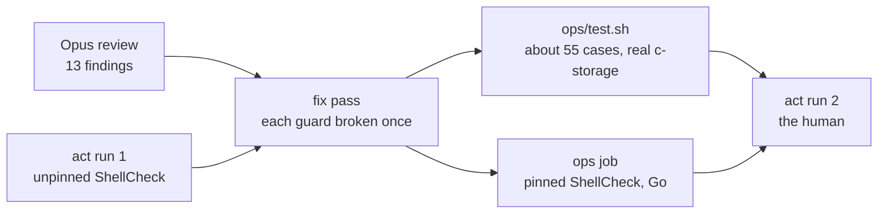
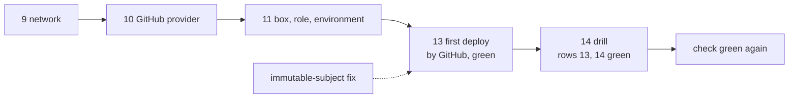

# ridge recap, 2026-10-28

## At a glance

Step 8 of [the ridge plan](../plans/2026-10-28-ridge.md): a model other than the author's (Opus) read
the scripts, templates and `ops` job read-only and found thirteen things, plus act's first run found
one more. This is the fix pass. Every guard the review found unheld is now held by a test that was
seen red once, and the claims in the plan, the runbook and the comments now say only what is held.

Of the fourteen items, thirteen are fixed and F8 is deferred in part to step 12 (the account id in
AWS error text). One fix is a choice you may want to overrule (the failed release, under F13).
Nothing was rejected. Nothing ran against AWS, so the scripts that call it are still read, not run.

## What the review found

| # | Finding | Fate | Why |
| --- | --- | --- | --- |
| F1 | a planned, failed or interrupted creation left the stack in `REVIEW_IN_PROGRESS`, and the next run chose UPDATE with previous values | **[FIXED]** | the stack's status picks the kind: `REVIEW_IN_PROGRESS` is a creation with fresh parameters, `ROLLBACK_COMPLETE` stops with "delete the stack" for all three kinds. The cleanup is defined and armed before `create-change-set`. `--plan` on a first creation deletes the empty stack too, so a plan changes nothing; the runbook says so. Seen red: the status held as UPDATE, and a rollback let through |
| F2 | the `Dynamic` and `Conditional` clauses of the filter were held by no test | **[FIXED]** | two hand-written change sets, each named. Seen red by deleting each clause. Every "recorded" in the plan, runbook and test now says hand-written |
| F3 | `check.sh` counted Bruno's results, so a skipped (unparseable) request file read green | **[FIXED]** | one proof, `c-storage/scripts/bruno-proof.cjs`, which `e2e.sh` and `check.sh` both call: the summary's passed requests equal the request files, and every result passed with a test. The count of request files lives in it too. Seen red in both callers with a malformed request file, and in `ops/test.sh` once per clause |
| F4 | an `env` update re-derived `Repository` from the local `origin`, so a fork's clone could move the deploy role's trust | **[FIXED]** | an update keeps `Repository`, stops when the clone's `origin` differs, and runs the `gh` calls against the stack's value. Seen red with the refusal removed |
| F5 | the `/health` guard ran against a Python stand-in, so the Makefile's `-X` stamp was held by nothing | **[FIXED]** | `ops/test.sh` reads `STAMP_VAR` from the Makefile and builds the real `cmd/server` with one stamp, another, and none; it runs each on a free loopback port with throwaway keys. The stand-in is deleted and the `ops` job installs Go. Seen red with `STAMP_VAR` pointing nowhere: the stamped binary answered `dev`. About 13 s with a warm Go cache |
| F6 | step 7 was ticked with two done-when items unread | **[FIXED]** | step 7 is unticked with its evidence kept, and says what it waits for: [the step](../plans/2026-10-28-ridge.md#L520) |
| F7 | the keys were read, and so masked, after the restart and the journal output | **[FIXED]** | `read_keys` runs right after the keys are made. Untested: it is an order of lines, and a test would need a box. The order is in the code and was read |
| F8 | the account id sits in AWS error text in a public log | **[DEFERRED]** | to step 12, the deploy job's credentials step (`mask-aws-account-id: true`): [step 12](../plans/2026-10-28-ridge.md#L561). Now: `stack.sh` no longer prints `DeployRoleArn` into its log, it masks it so the end-of-run search covers it, and the comment saying the ARN never goes in a log is true. Untested: a print, and a test would need a stack |
| F9 | after Ctrl-C or SIGTERM the log ended `== exit 0` | **[FIXED]** | traps in `log_start` make the codes 130, 143 and 129; `ops/test.sh` sends each signal to a child and reads the log's last line, the closed tunnel and the removed scratch folder. Seen red with a trap removed |
| F10 | three claimed behaviours were held by nothing | **[FIXED]** | all three: the floor now has a swap floor (1024 MiB total, the box has 2048) and a test for each of disk, memory and swap; the keys file's checksum is compared before and after every release, with the comparison tested; `wait_build` is tested on a server that answers late and first with the old build. Seen red for each. The remote half of "the keys are made once" is `untested`: it needs root on a box, and the comparison fails the release if it ever rewrites the file |
| F11 | the deploy role carried two describes nothing calls | **[FIXED]** | `ec2:DescribeSubnets` and `ec2:DescribeVpcs` are gone; cfn-lint is clean |
| F12 | `release.sh` and `check.sh` trusted a stale local `origin/main` | **[FIXED]** | each script fetches `origin/main` and stops when `ops/` here differs from it, tracked or not. I added the same to `stack.sh` and `drill.sh`, which also act under your AWS session. The fetch itself was not run: the sandbox has no SSH key for GitHub, so the refusal is tested on a local ref. Seen red for the edit and for the untracked file |
| F13 | the doc lines | **[FIXED]** | Bruno's 25; the jobs run in parallel; the 30 s bound is the real one (31 tries, about 3 minutes at worst); the test header no longer says `check.sh` waits; the leaked-key steps are "delete the file, then `ops/release.sh ridge`"; the listener's trigger is layer four in the memo and `c-storage/CLAUDE.md`. The failed release is below |

| Other | Fate | Why |
| --- | --- | --- |
| a failed release "leaves the box as it is" was false: the rename came before the restart | **[FIXED]** | both renames (binary and unit) now sit in the one command that restarts, after the keys, so nothing that runs changes before it. A failure after it leaves the new binary installed, and the plan and runbook say so; the way back is the re-run of the last green deploy. An automatic rollback stays rejected until the first client's stack |
| act run 1: the `ops` job relied on the image's ShellCheck | **[FIXED]** | the job installs ShellCheck 0.11.0 from its release, checking a SHA-256 per architecture (x86_64 on GitHub, aarch64 under act); both sums are the release's own digests, and I downloaded both archives and hashed them to confirm |
| step 5, c-storage in `main` | **[FIXED]** | ticked, with `47f21c8` and run 40563154471 as its evidence |
| the reviewer's two questions | **[DEFERRED]** | who may deploy to ridge is in [step 12](../plans/2026-10-28-ridge.md#L561); the account-wide describes in [left behind](../plans/2026-10-28-ridge.md#L626). Neither is asked now |

Four small additions the findings pulled in: step 12 checks out with full history (`release.sh` asks
whether its commit is an ancestor of `origin/main`, which a shallow checkout cannot answer); the
`ops/test.sh` header and the workflow comment name what is held now; `bruno-proof.cjs` prints its
count of request files, so the callers do not each count; `OPS_LOG_DIR` lets the test write its logs
elsewhere.

## What remains the human's

- **Run act again**, run 2 of the `ops` job. It is the first time the pinned ShellCheck install, Go
  and the real-binary check run in a container. Step 7 stays unticked until the orchestrator reads the
  job's first run on GitHub: [step 7](../plans/2026-10-28-ridge.md#L520).
- **Answer, at step 12, who may deploy to ridge** (the options and a recommendation are in
  [the step](../plans/2026-10-28-ridge.md#L561)); and at the first client's stack, the account-wide
  describes ([left behind](../plans/2026-10-28-ridge.md#L626)).
- **Read the F13 choice on a failed release.** I moved the renames into the restart command instead
  of building a rollback. The window is one command, but a failure inside it still leaves the new
  binary. If you want a failed release to restore the old one, that is the rollback the plan rejects
  for ridge; say so and it returns.
- **The scripts that call AWS have not run.** `stack.sh`'s new cleanup (it deletes a
  `REVIEW_IN_PROGRESS` stack) and the new fetch are held by reading and by the tests of their
  decisions, not by a run. The first `--plan` of `ops/stack.sh network` is where they are first seen.
- **One line left alone**: [the app frame plan](../plans/2026-10-27-app-frame.md#L229) still says "the
  first box needs its listener on the private address". It lives on another branch.

## Step 12, the `deploy` job: the fix pass (2026-10-28)

A model other than the author's (Opus) read the job at `6dbf591`, read-only, and found eight things.
This section is the fix pass. Nothing ran against AWS or GitHub; the job's first run is step 13's.
The human's act run, then the human's push, follow, and [step 12](../plans/2026-10-28-ridge.md#L613)
stays unticked until both and the first deploy are read.

| # | Finding | Fate | Why |
| --- | --- | --- | --- |
| F1 | the concurrency group sits behind `needs`, so deploys queue in the order their gates finish, and an older commit could overwrite a newer one with every check green | **[FIXED]** | ridge never moves backwards: before it sends anything, `release.sh` reads `/health` and, when ridge runs a commit with its own as a strict ancestor, ends `superseded: ridge runs <sha>`, exits 0 and changes nothing. `check.sh` still checks what runs, which is then the newer commit, a commit of `main` all the same; its comment says so. Seen red: against the real binary stamped newer, with the ancestor test removed (four cases), with the same-commit test removed, and with the answer removed |
| F2 | the job compared `ops/` with the freshly fetched `origin/main`, so a push landing mid-deploy turned a sound deploy red, and refused the way back when it was needed | **[FIXED]** | overrides step 12's acceptance, for the reviewer's reason (call 1 rejects reds that teach people to read past red). Under `GITHUB_ACTIONS=true` the scripts compare `ops/` with the checked-out commit (and an untracked file is refused), and still require that commit to be an ancestor of `origin/main`. By hand the comparison with `origin/main` stays. The way back is a revert pushed to `main`; a re-run of an older run ends superseded. Runbook and plan rewritten. Seen red: the job's mode removed (four cases), its ancestor test removed |
| F3 | the guard missed a workflow-level `cancel-in-progress: true` and any `continue-on-error` | **[FIXED]** | the guard refuses any `cancel-in-progress` of the file that is not `false`, and any `continue-on-error` in the deploy job; one refusal case for the workflow-level cancel, two for `continue-on-error` (the job's and a step's). Seen red: each check dropped once |
| F4 | Bruno CLI's 533 unpinned npm packages run in the one job that holds the role | **[FIXED]**, the lockfile **[DEFERRED]** | both `deploy` and `e2e` install with `--ignore-scripts`; `check.sh` runs `bru` through `bru_clean`, which removes the AWS keys and the OIDC and runtime tokens from its environment (the OIDC variables are what a package could use to mint the role's token); the session lasts 1200 s, as long as the job. A lockfile is [open item 12](../open-items.md). Checked here: the CLI installed into a scratch prefix with `--ignore-scripts` reports 4.2.0, and `scripts/e2e.sh` run with it was green (25 requests); `ops/test.sh` reads what a stand-in `bru` sees and that `check.sh` calls no bare `bru`, seen red for one credential left out and for a bare call |
| F5 | red cases for 4 of the guard's 15 conditions | **[FIXED]** | sed-made refusals for `needs`, the concurrency group, the environment and the Region, beside F3's. 10 of the guard's 17 conditions now have a refusal seen red; [rows 9 and 11](../plans/2026-10-28-ridge.md#the-checks) say exactly which, and which are read with no refusal of their own (the `runs-on` label, the job timeout, `id-token` and `contents` in the job, the credentials step's pin, the single secret, the install flag, the session length) |
| F6 | the pinned action prints the role's unique id (`AROA…`) before it masks the account id, and that id may decode to the account id | **[REJECTED]** | accepted by the human (10-28, "uhm, let accept"), with the reasons: an account id is no credential; the role's trust (this repository's `ridge` environment, `main` alone) is the gate; replacing the official action with our own login script would put more custom code in the most sensitive step. The mask stays as it is. No code changed |
| F7 | `mask` wrote `::add-mask::` to fd 3 while `tee` writes the same pipe, so the line could land mid-line and print the key | **[FIXED]** | the line now opens with a newline (`printf '\n::add-mask::%s\n'`). Seen red with the newline removed |
| F8 | docs against code | **[FIXED]** | the workflow's header describes the deploy; the comment on the group says what it does and does not order; the plan (ridge never moves backwards, the way back, the mid-deploy push, rows 9, 11 and the new 19 to 21), the runbook (superseded, a deploy shown cancelled: "a newer push to `main` took its place", the way back) |

**Answered by the human** (10-28): who may deploy to ridge is **(a), for today**, the environment's
main-only policy alone, answered about 11:00. (b), a protected `main`, comes when a second person
can push `main`; (c), the OIDC subject pinned, with the first client's stack. With a parked
`deployment/ridge` branch, as the human later asked, (c) pins that branch.

**Seen red** (QA rule 2): F1 four times, F2 twice, F7, F4's two, and F3's and F5's six guard checks
(needs, group, environment, Region, workflow-level cancel, `continue-on-error`), each by breaking the
line and putting it back. Run in the background, the suite's `INT` case reads a signal the shell
ignores there; it is green in the foreground.

**What remains the human's:** the act run (the `e2e` job is where `--ignore-scripts` shows; the
deploy job is all skipped there), the push, and step 11 before the merge.

## The first deploy refused: GitHub's immutable subject (2026-10-28)

**[FIXED]** in the template and the script; the re-run is the human's, and step 13 stays unticked
until it is read.

ridge's first deploy, GitHub run 40636117633 on `main` at `29cad9b`, failed at "Take the deploy
role": `Could not assume role with OIDC: Not authorized to perform sts:AssumeRoleWithWebIdentity`,
twelve tries, nothing on the box. The human's read-only diagnosis found the cause. GitHub's settings
for this repository read `use_default` true and `use_immutable_subject` true, with a
`sub_claim_prefix` of the owner and the repository each followed by `@<numeric id>`; CloudTrail's
three refused calls show GitHub sent `<that prefix>:environment:ridge`, while the role's trust
expected `repo:<owner>/<name>:environment:ridge`. The audience and the federated principal matched.
No review, test or run could have seen it: the subject GitHub issues is a setting of the repository,
read nowhere in the templates, and the trust had never been taken before the deploy.

The human chose to move the trust to the immutable subject (10-28). It is also the safer form: a
repository deleted and made again under the same name never gets the same ids.

What changed:

- `env.yml` takes `SubjectPrefix` (`repo:owner[@id]/name[@id]`), and the trust's subject is
  `${SubjectPrefix}:environment:${Env}`. The audience and the federated principal are as they were.
  `Repository` stays, as the stack's record of the repository (it is now an output too).
- `stack.sh env` reads the prefix from `gh api repos/<Repository>/actions/oidc/customization/sub`:
  `sub_claim_prefix` when given; `repo:<Repository>` when there is no immutable subject and no
  prefix. It refuses custom claim keys (`use_default` false), an immutable subject without its
  prefix, an answer it cannot read, and a prefix of another shape than the template takes. The log
  prints the prefix, which holds no account id.
- On an update the stack's `SubjectPrefix` is kept (the previous value) and a differing GitHub
  prefix is refused, as F4 of step 8 does for `Repository`: a fork's clone has other ids. ridge
  holds none today, so its update sets the prefix from GitHub, and the change set is a Modify of
  `DeployRole` in place with no replacement (the role's name is not set, and the trust document
  replaces nothing). `ops/test.sh` holds that on a hand-written change set, as CloudFormation shows
  it, run through the guard's filter.

Seen red (QA rule 2): each branch of the reading (the prefix taken, the immutable subject without its
prefix, custom keys, an answer with no `use_default`, a prefix of the wrong shape), the update's
refusal, the previous-or-set choice, the pattern kept equal to the template's, the template's trust
(built from `Repository` again, a lost audience) and the change set (a replacement), each by breaking
the rule and putting it back. Nothing ran against AWS or GitHub; `gh api` is read from hand-written
answers, with placeholder ids.

The human's order from here is in [the runbook](../../ops/README.md): this change merges into
`main` and is pushed (that push's `deploy` is red at the role unless the update lands first);
`ops/stack.sh env ridge --plan`, then `ops/stack.sh env ridge`, an update changing only the trust;
then the re-run of that push's run (it deploys `main`'s tip; one re-run, or none if it went green).

### The review of this fix

An Opus review found the fix right: one in-place Modify of `DeployRole`, no wildcard can pass,
forks refused, nothing unsafe printed. Its findings:

| # | Finding | Fate | Why |
| --- | --- | --- | --- |
| F1 | the plan, the recap and the runbook said to re-run run 40636117633 | **[FIXED]** | the way forward is the re-run of the push that brings this fix to `main` (it deploys `main`'s tip; one re-run), or none when the update landed before the role step stopped retrying. All four places say so |
| F2 | the runbook gave the update without `--plan` and said "replacement none" where the log prints `replacement=False` | **[FIXED]** | the order is `--plan`, read `Modify DeployRole (AWS::IAM::Role) replacement=False` and `subject prefix:`, then the update |
| F3 | the shape check ran line by line, so a two-line value passed | **[FIXED]** | a whole-string match, `[[ $prefix =~ $SUBJECT_PREFIX_RE ]]`. Seen red: with `grep -Eq` the two-line case passed |
| F4 | a prefix naming another repository was accepted, and a test asserted it | **[FIXED]** | each `@<digits>` is dropped and the rest compared with `repo:<owner/name>`, case aside; the test now asserts the refusal, with the accepting cases beside it. Seen red with the comparison removed |
| F5 | the refusal on a changed subject setting blamed a fork | **[FIXED]** | the message and the runbook name both causes (a fork's clone, or the repository's OIDC subject setting changed) and point to the plan's trust section |
| F6 | `StringLike`, the `repo:${Repository}` check, the "not JSON" refusal and stack.sh's previous-or-set branch had no case | **[FIXED]** | one case each. The "not JSON" message is now distinct. The branch moved into lib.sh as `add_subject_param` (with `add_param`) so the test runs it. Seen red each by removing the guard or flipping the choice; the first version of the helper let a refusal pass inside `$(...)`, which the new case caught |
| F7 | the fallback (`repo:<Repository>` when GitHub gives no prefix) has a case but ridge never uses it | **[REJECTED]** | it is the plain-subject form for a repository without the immutable setting; the case is cheap and the refusals around it need it. Kept, unused on ridge |

### The first deploy, green (2026-10-28)

GitHub run 40641839897 deployed `37af006` with no re-run (step 13, [evidence in the plan](../plans/2026-10-28-ridge.md)). Seen, within the plan: the public job log prints the box's instance id once, in the release's line; the checks table's row 8 names keys and the account id only, and an instance id grants nothing without the account's credentials.

## ridge stands: steps 9 to 15 (2026-10-28)

**What shipped.** ridge, the staging environment, is live: a network, a box with no public address,
and a deploy role that only `main`'s runs in environment `ridge` can take. Each push of `main` that
touches c-storage is released and checked by GitHub Actions. The first deploy (run 40641839897,
`37af006`) ended green with no re-run, Bruno 25/25 requests and 33/33 tests over the tunnel
([step 13](../plans/2026-10-28-ridge.md#L670)). The drill then killed c-storage (it answered again as
a new process) and rebooted the box cleanly (back in about 26 s on the same build, the code
registered before the reboot still answering 409, so the data outlived it), and `ops/check.sh` read
green after it ([step 14](../plans/2026-10-28-ridge.md#L714); rows 13 and 14 of
[the checks](../plans/2026-10-28-ridge.md#L469)).

**What was rejected, and its price.**

| Rejected | Price paid |
| --- | --- |
| Replacing the official login action with a script of our own, to hide the role's unique id (`AROA…`) | The id prints once in the public job log. The human accepted it: an account id is no credential, the gate is the trust. The instance id prints once as well (the release's line) and grants nothing without the account's credentials |
| A rollback for a failed release | A failure inside the restart command leaves the new binary; the way back is a revert pushed to `main` |
| Protecting `main` now (option (b)) | Only the environment's main-only policy stands, while only the human can push `main`; (b) when a second person can, (c) with the first client's stack |
| A public URL in front of c-storage | None yet: it is parked ([the memo](../memo/c-storage.md#L188), open item 13) until a person or machine beyond the human's Mac needs it |

**What was seen and left alone.**
- The first deploy needed the trust update (the immutable subject) before it went green; the
  update landed while `deploy` was queued, so nothing was re-run.
- The drill's log prints neither the new pid, the boot ids nor the restart's seconds, so row 13's
  "within 10 s" rests on the script's own check ([the loop](../../ops/drill.sh#L58)), not on a line
  the reader can see.
- In `check.sh`, `expect "every request ran, passed and asserted ($requests)" 0 "$proof"`
  ([the line](../../ops/check.sh#L140)) prints `(25)` for the requests and a trailing `: 0` that is the
  proof script's exit code, `0` meaning every request passed with a test. It reads as a count of
  zero. **Small follow-up**, not done: a change under `ops/` re-deploys on its push, so it waits
  for the next `ops/` change.

**What remains the human's.**
- Push `main` with what has been merged since `37af006` (the parked URL's records), when ready; a
  push touching `ops/` or c-storage deploys.
- The parked items: the public URL (open item 13), and the tunnel command, planned as its own piece
  on another branch.
- At layer four, probe whether Lambda function URLs are offered in `ap-southeast-5` (open item 14);
  the answer decides the BFF's front door ([the plan's fourth layer](../plans/2026-10-28-ridge.md#L736)).
