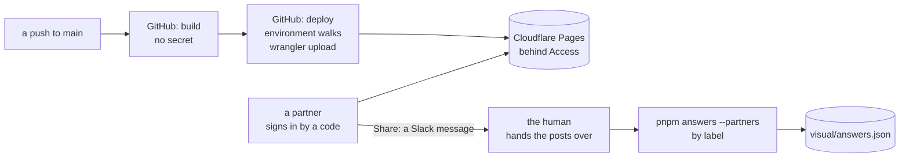

# Sharing the walks with partners, recap, 2026-10-29

## At a glance

[The plan](../plans/2026-10-28-walks-share.md), steps 1 to 7, is done. The walks page, the daily
review of every screen, is live at one address on Cloudflare Pages, behind Cloudflare Access: a
partner signs in by a code sent to their email, answers each screen Yes or No in both languages,
types a label and presses Share. The partner posts the Slack message it copies; the human hands the
posts to the machine, and `pnpm answers --partners` keeps each answer in git under the post's
label, apart from the human's own. A push to `main` that touches the page deploys it by GitHub.

Drawn from [`walks.yml`](../../.github/workflows/walks.yml), [`send.tsx`](../../visual/src/send.tsx)
and [`take.ts`](../../visual/src/take.ts).

What stays the human's, in short: the real partners' labels (a label is never a name), and one
open item that waits for a paste of several Slack posts
([item 16](../open-items.md#L122)).

## What shipped

| Part | What it is |
| --- | --- |
| the page | `pnpm report`'s one HTML file, the screens drawn in the viewer's browser: no pictures, 2 files and about 1.5 MB, so Pages alone holds it and R2 is not needed |
| the host | a Cloudflare Pages project by direct upload; the project's address and every deploy's own address are behind two Access applications, one policy each, the partners' emails and the human's own |
| the deploy | [`walks.yml`](../../.github/workflows/walks.yml#L33): `build` holds no secret; [`deploy`](../../.github/workflows/walks.yml#L79) runs in the environment `walks`, `main` alone, with three secrets, checks that the project's address refuses a visitor before it uploads, uploads with one pinned wrangler, then reads back that the newest production deploy carries the commit and that its own address refuses a visitor |
| the guards | [`ops/walks-refused.sh`](../../ops/walks-refused.sh), [`walks-digest.sh`](../../ops/walks-digest.sh) and [`walks-served.sh`](../../ops/walks-served.sh), each case seen red in `ops/test.sh` |
| Share | the page's label field and Share button write one Slack message: a readable part, then the machine's lines in a code block, one line more than "Copy my answers": `By: <label>` |
| taking | [`parseBlock`](../../visual/src/block.ts#L113) reads one paste of several blocks; [`takeAnswers`](../../visual/src/take.ts#L20) holds each line against the screen's words now; a partner's row is kept under `<key>@<label>`, so one label replaces its own row only |
| the screens | each screen shows the partners' answers by label; only the human's yes or no marks a screen, counts in the bar and closes a walk |

Read back, each against its "done when" line in the plan:

- **Step 3, the setup:** one script in the human's terminal made the project, proved the address
  answers openly before Access, waited for the Access steps in the dashboard, proved both addresses
  refused after, made the environment and set its three secrets. Read whole in
  `logs/20261029-0113-walks-setup.log`.
- **Step 5, the first deploy:** the push of `main` at `85d5a2b`; the deploy job green with every
  guard read, in `logs/20261029-0211-push-main-walks-walks.log`; `ci.yml` green on the same push in
  `logs/20261029-0211-push-main-walks-ci.log`.
- **Step 6, the round trip:** a Share post from the live page, copied back out of Slack. Plain
  `pnpm answers` refused the whole paste with one line; `--partners` took its three answers (3
  written, 0 refused) in a dry run on a copy; the fingerprints equal the live page's; Slack's copy
  equals Share's output. It was the human's own test, so nothing was kept.

## What was rejected, and its price

| Rejected | Price paid |
| --- | --- |
| R2 for pictures, with Pages ([the hosting](../plans/2026-10-28-walks-share.md#the-hosting)) | none now; the page draws every screen itself, so there are no pictures to store. *Trigger:* a deploy near 20,000 files or a file near 25 MiB, or pictures to keep across deploys |
| a path on ridge's CloudFront | none; it has no sign-in of its own, and the review page would ride ridge's deploys |
| a public page, or an unguessable address | none; a public page shows the human's product to anyone the link reaches, and a forwarded link opens for anyone |
| the pictures made on the runner | the pictures stay in the human's terminal; the visual report's call 4 stands for them |
| a `by` field in each row of `answers.json` | a key with `@<label>` instead, so the human's rows and every reader of them stay as they were |
| each answer's fingerprint inline in the readable part | the fingerprints sit in the code block, where Slack formats nothing, so no key reads as an emoji code |
| the page refusing "Copy my answers" once a label is kept | the human's own browser may keep a label from trying Share; a mixed paste is held by the command instead |
| Access's own team name and the project's name in any log or doc | the setup and the push scripts mask them; the logs are for the machine to read |

Known prices that stay: the token reaches every Pages project in the account (Cloudflare offers
nothing narrower); a label is not a sign-in, so a partner may type another's; the run's artifact can
be downloaded for a day by anyone signed in to GitHub, and holds nothing the repository does not.

## What the reviews found

Each review was by Opus, a model other than the author's, and each finding is tagged as the plan
records it.

**The workflow (step 4), 13 findings,** all [FIXED]: [the plan's step 4](../plans/2026-10-28-walks-share.md#L482).

**Step 6, first review, 10 findings** ([the plan](../plans/2026-10-28-walks-share.md#L576)):

- F1 [FIXED] a partner's "Copy my answers" block beside a Share post could overwrite the human's yes:
  the command now decides whose a block is, never the paste.
- F2 [FIXED] two rows cited a module that held nothing: the reds are named.
- F3 [FIXED] nothing failed if a partner's yes settled a card: a fixture holds it.
- F4 [FIXED] the bad labels lacked `@` and `:`: added.
- F5 [FIXED] a mangled line vanished or was taken with a tail: the chat's marks are cleaned, and a
  title with no answer line under it is refused.
- F6 [FIXED] a chat name such as `Jane | Acme` was refused: a line starts like an answer only with a
  key.
- F7 [FIXED] a real first name stood in two tests: an invented name.
- F8 [FIXED] the built page's own script is run in jsdom.
- F9 [FIXED] a type removes a case that `partnerLine` lacked.
- F10 [FIXED] the textarea is labelled "The text to paste", and `cli.ts` says what the human and a
  partner paste.

**Second review, 8 findings** ([the plan](../plans/2026-10-28-walks-share.md#L606)):

- G1 [FIXED] the late `By:` after an answer was unpinned in plain mode: a test holds it.
- G2 [FIXED] plain `pnpm answers` on a mixed paste wrote the no-`By:` blocks: it now writes nothing
  from a paste holding any partner mark, with one refusal naming `--partners`
  ([`parseBlock`](../../visual/src/block.ts#L113)); the page refusing "Copy my answers" was
  [REJECTED].
- G3 [FIXED] plain mode knew a partner's block only by the exact prefix: any line that looks like
  `By:` marks it ([`BY_LIKE`](../../visual/src/block.ts#L55)).
- G4 [FIXED] `--partners` was parsed outside coverage: [`parseArgs`](../../visual/src/cli.ts#L17) is
  tested, first and last.
- G5 [FIXED, one part DEFERRED] a second `By:` spoils the block, and a code fence's end ends it
  ([the fence](../../visual/src/block.ts#L197)); a lost title and `By:` with no fence between is
  [DEFERRED] to [item 16](../open-items.md#L122).
- G6 [FIXED] the how-to said a word partners do not know:
  [now](../../visual/src/page.tsx#L157) "not for partners".
- G7 [FIXED] every kind of space is a space and zero-width characters go
  ([`cleaned`](../../visual/src/block.ts#L67)).
- G8 [FIXED] the plan's drift: who runs which mode, the key's shape
  ([`ANSWER_LIKE`](../../visual/src/block.ts#L53)), the diagram, two cosmetic lines.

**Third review, 5 findings** ([the plan](../plans/2026-10-28-walks-share.md#L643)):

- H1 [FIXED] a reason ending in triple backticks cut the human's own block short: backticks become
  quotes ([`oneLine`](../../visual/src/block.ts#L33)).
- H2 [FIXED] a Share post that lost its `By:` but kept its header was the human's in plain mode:
  the header is a mark ([`SHARE_HEADER`](../../visual/src/block.ts#L57)).
- H3 [FIXED] a coverage exclusion that did nothing: an `untested:` note beside
  [`include`](../../visual/vitest.config.ts#L14).
- H4 [FIXED] a second `By:` written another way was missed in `--partners`.
- H5 [FIXED] the plan's state, a throw outside an assertion, a test trimmed to what the block
  prints.

**Fourth review, 3 findings** ([the plan](../plans/2026-10-28-walks-share.md#L659)):

- I1 [FIXED] the "written another way" branch was held by no test.
- I2 [FIXED] the refusal's reason says so; item 16 names the case it does not cover.
- I3 [FIXED] the plan named a deleted workflow file, and one hazard was marked done.

## What remains the human's

- **The real partners' labels.** A label is a short word the human gives, never a name: `answers.json`
  is public. The human tells each partner theirs; a partner types it once on the page. A different
  label later is a re-share under it, or the human's edit of the post's `By:` line before taking it.
- **The first real take.** The round trip was the human's own test, so no partner's answer is in
  `visual/answers.json` yet. The human hands the machine the posts, saying they are partners'.
- **[Open item 16](../open-items.md#L122).** Several posts in one paste, with Slack's name-and-time
  lines between them, are unconfirmed: the copy of a single post carried none. A post that loses its
  title and `By:` outside a code fence would join the one above it; the fence closes the case that
  fences cover. It waits for the first paste of several posts.
- **Old deploys.** Every deploy stays at its own address until deleted;
  [the retention step](../plans/2026-10-28-walks-share.md#retention-later) plugs in after the
  read-back when called.
- **The token's end date.** The token was made with one; renewing it, and the three secrets
  with it, is the human's.
