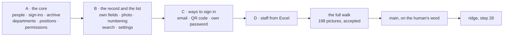

# The employee list, recap, 2026-10-30

## At a glance

[The plan](../plans/2026-10-29-employee-list.md), piece 2, steps 1 to 27, is done on `employee-list`.
The root of a company now keeps its departments, positions and fields; adds, edits, archives and
imports its people; gives each a sign-in by code, by email or by a QR code; and sets what each may do.
A person changes their own password. Every page is drawn on a phone, a tablet and a PC. The human
walked 33 screens in two languages and accepted the full walk of 16:39 today; its 198 pictures are
the committed base images.

Drawn from the plan's [steps](../plans/2026-10-29-employee-list.md#L523) and the code below.

What stays the human's, in short: the merge into `main` on the human's word, the push, ridge's
step 28 (everyone signs in again), open items 23 to 31 on this branch, and Decide 30's next step
([what remains](#what-remains-the-humans)).

## What shipped

Each group ran the human's flow: its pages on the fake with invented data, the human's preview, then
the back end, then a review by another model, then the full walk. The screens are 16 (A), 23 (A and
B), 29 (A to C) and 33 (all four).

| Group | What a person can do | Where it lives |
| --- | --- | --- |
| **A**, the core | the root keeps departments and positions, adds and edits people, archives them (it takes effect at the next request), hands out a first password, sets permissions by department, position and person; every route checks the permission on the server | the staff routes [`staff.ts`](../../bff/src/staff.ts#L102), the add [`addPerson`](../../bff/src/staff.ts#L299), the layers [`layersOf`](../../shared/src/permissions.ts#L30), the setup page [`StaffSetupPage.tsx`](../../ui/src/StaffSetupPage.tsx#L195), the list [`StaffListPage.tsx`](../../ui/src/StaffListPage.tsx#L60), the person [`PersonPage.tsx`](../../ui/src/PersonPage.tsx#L544), a company's own fields in `extra` [`extra.ts`](../../shared/src/extra.ts#L34), c-storage's list of one service's records under a prefix [`handlers.go`](../../c-storage/internal/server/handlers.go#L89) |
| **B**, the record and the list | a person's own fields, a photo, the code numbering (a freed number is never given again), a code change, a search kept in the address, Settings by permission | the photo panel [`PhotoPanel.tsx`](../../ui/src/PhotoPanel.tsx#L36), the code route [`staff.ts`](../../bff/src/staff.ts#L511), the photo routes [`staff.ts`](../../bff/src/staff.ts#L600), the search [`staffFilter.ts`](../../ui/src/staffFilter.ts#L24) |
| **C**, ways to sign in | an email as a second sign-in name (with the company's switch on), a QR code the root issues and a phone spends once within 15 minutes, a person's own password | the sign-in routes [`app.ts`](../../bff/src/app.ts#L253) (password, email, QR at [L277](../../bff/src/app.ts#L277)), the email route [`staff.ts`](../../bff/src/staff.ts#L655), the QR issue [`staff.ts`](../../bff/src/staff.ts#L686), the panels [`SignInPanels.tsx`](../../ui/src/SignInPanels.tsx#L12), the landing [`QrLanding.tsx`](../../ui/src/QrLanding.tsx#L15), the own password [`OwnPasswordPage.tsx`](../../ui/src/OwnPasswordPage.tsx#L21) |
| **D**, staff from Excel | the root downloads a template, reads a file in the browser, sees a preview with each row's problem, and sends the rows 100 a call; each goes through the add, without a sign-in, and is answered `added`, `refused` or `busy` | the page [`ImportPage.tsx`](../../ui/src/ImportPage.tsx#L70), the route [`staff.ts`](../../bff/src/staff.ts#L387), its wire [`import.ts`](../../shared/src/import.ts#L12) |

Beside the groups: the fake `Api` and the `?fake` switch ([`fake.ts`](../../ui/src/fake.ts#L68)), the
stack's data from one data set and its seed door ([`generator.ts`](../../scripts/src/generator.ts#L50)),
and the walk ([`piece-2.spec.ts`](../../walk/specs/piece-2.spec.ts#L495)) with its 198 base images in
`walk/specs/piece-2.spec.ts-snapshots/`.

## What was rejected, and its price

| Rejected | Price paid, and the trigger |
| --- | --- |
| a reactivation of an archived person | none; a reactivation would hand a fresh sign-in to whoever may change a record. The old app's rule, kept |
| a code freed by a change given again | a number is burned for good; harmless. The human: "no, 8 count past" |
| a BigInt and a special 409 for a code of 16 digits | `EMP-9999999999999999` fails with a 400 the add page reads as "try again", [open item 24](../open-items.md#L139); the human: it never happens |
| the import as one transaction | a row the system was busy on is `busy`, and its retry is the human's: a retry of a row with no code can add a second person (the accepted window of D-5) |
| a guard for leaving the import page during a send | the send goes on and all rows go in, but nothing says so; reading the same file again adds every row without a code a second time (Decide 26 (a)). *Trigger:* staff meet it |
| a message when a QR code is opened on a phone already signed in | a good code switches the phone to the code's person and a used one is ignored silently (Decide 27 (a)). *Trigger:* staff find the silence confusing |
| a limit on wrong passwords | each wrong try costs the guesser one hashing; ridge's stage throttles at 10 a second. [Open item 28](../open-items.md#L187), before the first client's own stack |
| a scrollbar always shown on a phone's wide table | nothing shows the table scrolls sideways, [open item 31](../open-items.md#L196) |
| one record for each register, with a version on each row | none; a record per person and a c-storage list, since every change rewrote the register |
| a second service for the sign-in | none; the code is claimed first and the person written last, so the list never shows a person before their sign-in |
| mail for the email sign-in | none; the email is a second name, with no message sent to it |
| a retry setting or a longer timeout for the reds under load | a red is a defect ([QA](../conventions/qa.md) rule 6); the cause was found for one, [open item 27](../open-items.md#L155) holds the rest |

## What the reviews found

Each review was by a model other than the author's (Opus), and each finding is tagged as QA rule 5
asks. The plan records a third tag, "accepted", for a finding judged real and left as it is; it is
`[REJECTED]` here, with its reason and its trigger. Every `[FIXED]` was seen red from its assertion,
by a mutation of the rule's line, before its fix. The detail, with each red, is in the plan.

**Step 10, group A, and its re-review** ([the plan](../plans/2026-10-29-employee-list.md#L732)):

- S1 to S10 on the server, C1 to C12 on the client and T1 to T5, D1, D2 on the re-review, all
  `[FIXED]` bar two. Among them: two adds of a code cannot both win (a claim is taken over only when
  older than 60 seconds); a session is a generation and a password is checked in one Unicode form; a
  staff call reads five records; the seed door answers first; the full run's script reads
  Playwright's real wording.
- C4 `[DEFERRED]` to step 12.
- T4 `[DEFERRED]` to step 14: written into step 14's text.
- The reviewer's three observations, former open items 19 to 21, were fixed at step 12 and deleted.

**Step 15, group B, S1 to S4, R5 to R7, C1 to C10, N1, and the reviewers' mutations M1 to M36**
([the plan](../plans/2026-10-29-employee-list.md#L984)):

- S1 `[FIXED]` the person is parsed with the schema before the first write. R5 `[FIXED]` the last
  number given is a record, raised over its tag. S3 `[FIXED]` a code change carries the hash.
- C1 to C7, C9, C10, N1, M4, M6, M10, M19, M21, M22 `[FIXED]`: the photo and typed details survive a
  save and a code change; a value the page cannot show narrows nothing; a person opened from the list
  returns to the list's address.
- M17 `[REJECTED]`: the photo route, like the details route, checks the permission and not the
  archive; nothing in the UI reaches it for a person who left.
- C8's remainder `[DEFERRED]` to [open item 24](../open-items.md#L139), on the human's word.

**Step 20, group C, R1 to R6, E, two Info, N1, N2, Q** ([the plan](../plans/2026-10-29-employee-list.md#L1169)):

- R1 and E `[FIXED]` a change of the email, and of the code, frees the old record only over the tag
  read before the claim, so a change back is not lost. R2 to R4 `[FIXED]` three tests that held
  nothing now do. R5 `[FIXED]` a record that moved under one's own password ends the session with
  401, not a 403 to a person who typed it right. R6, Info 2 `[FIXED]` a sign-in by email, and a QR
  opening, read each record once. Info 1 `[FIXED]` the fake refuses an email while the switch is off.
  N1, N2, Q `[FIXED]` the removal loop, the QR opening that could give Lan's code holder another
  person's session.
- H `[REJECTED]`, no code: three acts on one person within one round trip leave a person with no
  sign-in record. *Trigger:* a second root in a company, or people changing their own codes.
- Q2 `[REJECTED]`, no code: an archive landing inside a QR opening answers 200, then 401 at the next
  step, which row 15 holds. *Trigger:* row 15 read to need the opening itself refused.
- The QR code of an archived person, and a 403 for a wrong current password `[REJECTED]`, as they are.
- The brute-force limit `[DEFERRED]` to [open item 28](../open-items.md#L187).

**Step 25, group D, D1 to D7, D-1 to D-6, and a flaky red** ([the plan](../plans/2026-10-29-employee-list.md#L1377)):

- D1 to D7 `[FIXED]`: the answered calls are kept; a refused row is told apart from a taken one; the
  staff list is read once a call (704 c-storage calls became 405); the import answers with the person
  `addPerson` wrote.
- D-1 `[FIXED]` (Medium): Choose another file stayed enabled during a send, and the results were read
  against the wrong file, which could crash the app. It is disabled while a send runs.
- D-2 to D-6 `[FIXED]`: the walk's template step waits for the file; two guards held by no test are
  held; a code taken in a numbered try; a lost answer read back once; the root's own name refused in the
  preview.
- The flaky red of the template test `[FIXED]`: the test asserted the saved file before the lazy
  libraries had loaded, a defect of the test, not of load (`b0a1150`).
- The slow `StaffRecord.test.tsx` stories under load `[DEFERRED]` to [open item 27](../open-items.md#L155);
  its cause was found and the two stories were made cheap (`4b3bbb3`), the `SLOW` stories remain.
- Leaving the import page while a send runs `[REJECTED]` (Decide 26 (a)), above.

**Step 26, the walk's own defects, both `[FIXED]`** ([the plan](../plans/2026-10-29-employee-list.md#L1488)):

- the walk's `open` never cleared a session, so the phone opened signed in (`ec1a880`);
- the fake took one shot where a base is written once two shots agree, so a hover scrollbar and a
  100 ms border transition made six pictures differ (`7450420`).

## The human's decisions

| Decide | The human's answer |
| --- | --- |
| 1 and 2 (the plan) | the root configures who sees and who changes; and all of the old app's parts come in, in groups B to D |
| 18a, 19a | the setup is read first and handed on (step 19); a row the system was busy on is its own result and the call goes on (step 24) |
| 23 (a) | the words of D1 and D4 (`import.failed`, `failedPart`, `addRest`, `doneInvalid`, `refusedRow`) are kept in en and vi |
| 26 (a) | leaving the import page during a send is recorded, not fixed |
| 27 (a) | a QR link on a phone already signed in: a good code switches the person, a used one is ignored; recorded, not changed |
| 29 (a) | the phone's hidden scrollbar is parked as [open item 31](../open-items.md#L196) |
| 31 (a) | the full walk of 16:39 is accepted |
| 30, **not in force** | see [what remains](#what-remains-the-humans) |

## The walk's evidence

The human's full walk ran 16:39:13 to 16:50:18 on `949fdb4`; its log is `logs/20261030-1438-full-run-employee-list.log`
from its line 753, and its pictures `walks/full-run-2026-10-30-163915-949fdb4/`, both in the credo root.

| What was compared | Read |
| --- | --- |
| the full stack's pictures against the fake's | 0 of 198 differ, 198 screens reached |
| the bases written against the fake's | 0 differ; passes 2 and 3 each 6 of 6 |
| the fake against the committed bases | only the five expected screens differ (staff-1-list, staff-8-left, staff-14-search, setup-1-departments-positions, setup-2-fields: 30 pictures); 60 new for C's and D's 10 screens |
| piece 1's bases | 6 moved, all `5-language-menu` (C's "Change password" in the user menu); 12 of 12 written and compared |
| the operator's bases | none moved; 12 of 12 written and compared |

The script's verdict is red, for one reason: a gate ran before the stack for "others" (`#L1301`,
`#L1468`). Another repo's session ran `vitest` on this Mac during steps 8 and 9, after piece 2's bases
were written and compared. A second process can make a run red, never wrongly green. The human
accepted the walk (Decide 31 (a)).

The bases are committed in `47ba1c6`: 96 files (90 of piece 2, 6 of piece 1), and all 198 of piece 2's
byte equal with the run's `bases-after/`. The last whole `pnpm check` before the walk was exit 0 at
100 % (`logs/20261030-1517-employee-list-main-merge-check-2.log`). The walks page was not rebuilt after
the walk; it last read 0 waiting, 0 asked again, 0 no, 92 yes, and no screen's words have changed since.

## What remains the human's

- **The merge into `main`**, on the human's word; the orchestrator does it. `main` is already merged in
  (`a9c4e9f`).
- **The push**, when the human calls for it.
- **ridge, step 28**, after that push ([the step](../plans/2026-10-29-employee-list.md#L1511)). The deploy
  ships c-storage's list, the BFF and the UI. Every handle there stops resolving once (the sessions),
  so each person signs in again. On a client's link: sign in as its root, set a department's
  permissions, add a person in it, sign in as them in a second browser, show a QR code to a phone.
  The one question: would a partner follow this without help?
- **The open items on this branch**, none blocking the merge:
  - [23](../open-items.md#L129), a scripts test that depends on how fast a child starts;
  - [24](../open-items.md#L139), a code of 21 characters at the numbering's limit;
  - [25](../open-items.md#L146), the fixed top bar landing mid-page in a full-page picture;
  - [27](../open-items.md#L155), the whole gate red under load on tests that pass alone;
  - [28](../open-items.md#L187), no limit on wrong passwords, before the first client's own stack;
  - [31](../open-items.md#L196), a phone's wide table with no sign it scrolls (new);
  - [18](../open-items.md#L117), the seed door, is older and also still open. Items 26, 29 and 30 are
    decisions (the plan's Decides), not items.
- **Decide 30, the human's rule, not yet in force:** a moved pixel is a raw pixel count. The same input
  gives the same output, so anything random (a date, a time) is fixed at its source or masked with a
  colour box. Today's walks were read by Playwright's comparator, which skips anti-aliasing pixels,
  and the fake and the full stack differ raw at the 390 logo (14 pixels, 38 pictures, every run). **The
  next step:** find that cause and change the script, as its own small piece after this one. Only then
  is the rule written into [QA](../conventions/qa.md); it is not changed here.
