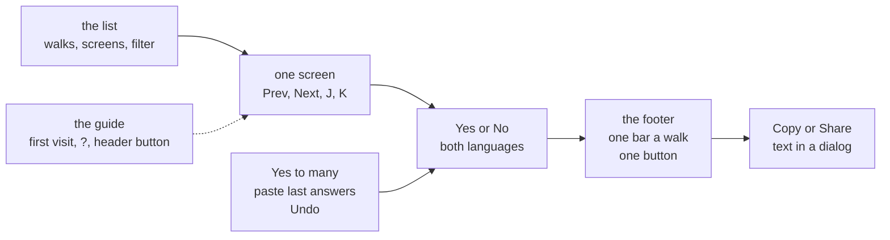

# The walks page, one screen at a time, recap, 2026-10-30

## At a glance

[The plan](../plans/2026-10-29-walks-nav.md), steps 1 to 5 and the two previews (7c), is done on
`walks-nav`. The walks page now shows one screen at a time, drawn as tall as it is and no taller,
with Prev and Next, J and K, and a "next unanswered" button; a list of walks and screens on the
side; "Only unanswered"; Yes to many at once with Undo; a paste of earlier answers; a guide, "How
this page works", that opens on a first visit, from "?", from the ? key and from a button in the
header; and a one-row footer with one bar a walk and one button that gives the text to post. The
block, the fingerprints, the report and the take command are as they were.

Drawn from [`page.tsx`](../../visual/src/page.tsx), [`nav.ts`](../../visual/src/nav.ts) and
[`bulk.ts`](../../visual/src/bulk.ts).

What stays the human's, in short: the merge into `main` is the orchestrator's after this recap; the
push is the human's.

## What shipped

| Part | What it is |
| --- | --- |
| one screen | [`screen.tsx`](../../visual/src/screen.tsx) and [`rail.tsx`](../../visual/src/rail.tsx): the list on the side, the screen in the middle, the question beside it |
| moving | [`nav.ts`](../../visual/src/nav.ts): Prev, Next, J, K and "Next unanswered", which goes to the other language first and wraps |
| the filter | "Only unanswered" keeps the list, the moves and the bar's links to screens with an answer left |
| many at once | [`bulk.ts`](../../visual/src/bulk.ts): Yes to a section or to all, Clear, and Undo of the last one |
| the paste | [`fill.ts`](../../visual/src/fill.ts): an earlier block or Share message fills the page where key and fingerprint match, says first what it fills and leaves, and can be undone |
| the guide | [`guide.tsx`](../../visual/src/guide.tsx): the keys, the one button, many at once, the paste, and whose page it is; the header's "How this page works" button opens it when the browser has seen it already |
| the footer | one row, one bar a walk, one button; Copy and Share open the text in a dialog ([`modal.tsx`](../../visual/src/modal.tsx)) |
| the frame | [`Frame.tsx`](../../ui/src/mock/Frame.tsx) reads the screen's height at the iframe's floor and stops growing |

Read back, each against its "done when" line in the plan:

- **Step 7a:** rows 22 to 29 held and rows 2, 7, 9, 14 and 15 as amended, each seen red; `pnpm check`
  exit 0 with no warning, `visual/` 324 tests and `ui/` 125 at 100 %.
- **Step 7b:** `pnpm check` exit 0, no warning; `visual/` 340 tests and `ui/` 129 at 100 %; 53 of 53
  mutations caught.
- **Step 7c:** the rebuilt preview, 84 waiting and the guide's name three times in it; the human's
  second look came back as a copied block of 86 lines, 84 `| yes |`, so the page works to Copy. The
  block's "branch HEAD" is only the scratch build being detached. The new button was not remarked
  on; rows 17 to 19, the guide opening, and the phone's frames were not seen by the human and stay
  as built ([7c's evidence](../plans/2026-10-29-walks-nav.md#L586)).

## What was rejected, and its price

| Rejected | Price paid |
| --- | --- |
| a long view of every screen | none; one screen at a time is the page's point. *Trigger:* when a walk asks for one |
| swipes on a phone | none; Prev and Next work by tap. *Trigger:* a partner answers on a phone |
| Undo of a single answer | none; each answer is one press to change |
| a lighter frame | each frame copies the page's 839 kB of styles; one to three at a time no longer pay for a lighter one |
| a paste of several people's posts at once | none; each page fills its own viewer's answers |
| a segment per answer in the footer | none; one bar a walk, the list holds each screen |
| a new flag for the header's button, or opening the guide on every load | none; the first-visit rule and its one flag stay (row 29), a button does the rest |

## What the reviews found

Each review was by a model other than the author's, and each finding is tagged as the plan records
it. Four tags below say [REJECTED] for nothing: the plan records none, so none is claimed.

**First review, step 6, 9 findings,** all [FIXED] ([the plan](../plans/2026-10-29-walks-nav.md#L508)):

- W1 [FIXED] a partner's page with no label kept had Yes to the unanswered on: it is off, as Share
  needs a label, and a paste is judged under its own label.
- W2 [FIXED] Undo after a paste that set the label puts the label back, in the store too.
- W3 [FIXED] a stray `%` in the address falls back to the raw text.
- W4 [FIXED] `reason` is checked before `done`.
- W5 [FIXED] Y, N and L do nothing while no screen shows.
- W6 [FIXED] opening a walk with nothing left in it, under only unanswered, opens the first screen
  waiting anywhere and says so.
- W7 [FIXED] a choice older than 14 days is not read on load either.
- W8 [FIXED] a key given twice in a paste is counted "repeated, the later line kept".
- W9 [FIXED] five surviving mutations each have a test red under them.

**The human's first look, step 7, 3 findings,** all [FIXED] by step 7a: a guide, a calmer footer,
and frames that stop growing.

**Second review, step 7b, 11 findings** ([the plan](../plans/2026-10-29-walks-nav.md#L546)):

- F1 [FIXED, one part DEFERRED] the frame took its height from a `scrollHeight` held by the shell's
  `min-height`: it is read at the iframe's floor. The red stopped-scene note, F1's other half,
  belongs to piece 2's branch and went there.
- F2 [FIXED] the frame listens to `loadingdone` as well, and measures again when a font arrives.
- T2 [FIXED] a paste filled under one label could be shared under another: answers are taken back
  when the label is judged.
- T3 [FIXED] the label was judged at every keystroke: on blur and at Share.
- T5 [FIXED] the keys a bulk action answered lived only in memory: kept in the browser.
- G1 [FIXED] the guide never said whose page it is: one line.
- G2 [FIXED] the focus landed on Close at the guide's foot: it lands on the title.
- K19, K21, K22, K23 [FIXED] four gaps found by mutation, each now held by a test in
  `panel.test.tsx`.

**Step 7c, 1 finding,** [FIXED]: from the human's look, "cannot found the modal". The guide opens by
itself once ever; after that the only ways in were the ? key, a bare circle and a header sentence
that was plain text. The header's sentence now ends in a button, "How this page works"
(`c5af783`, [`guide.test.tsx`](../../visual/src/guide.test.tsx)).

Counted by tag: 24 [FIXED] (one with a part [DEFERRED]), 0 [REJECTED].

## What remains the human's

- **The merge into `main`** is the orchestrator's: the whole `pnpm check` on the merge is the step
  8 line still unticked.
- **The push**, when the human calls for it.
- **The scratch worktrees** `preview-walks` and `review-walks` are still listed by `git worktree
  list`.
