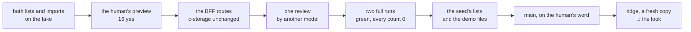

# Customers and products from Excel, recap, 2026-10-31

## At a glance

[The plan](../plans/2026-10-31-customers-products.md), slice 1 of the road to the demo on ridge on
11-04, steps 1 to 8, is done on `customers-products`. The company's root now opens **Customers** and
**Products** from the menu, reads each list in code order, downloads an Excel template in Vietnamese or
English, chooses the filled file, sees each row read with the reason for any refused, and presses Add.
The human answered all 16 screens yes (10-31 09:3x) and ran the full walk twice, green with every count
0 (12:30). Each demo copy starts with its company's lists.

## What shipped

| What | Where it lives |
| --- | --- |
| the two routes of each list, root-only: a `GET` in code order (a short list is a 500, never a part) and an import of up to 100 rows a call, each row one add checked against the list read once a call (`added`, `taken`, `invalid`, `busy`) | [`registerListRoutes`](../../bff/src/lists.ts#L63) |
| the wire and the keys: `customerSchema`, `productSchema` (with `stocked`), the add requests, one reply shape for both imports | [`lists.ts`](../../shared/src/lists.ts#L9), [`records.ts`](../../shared/src/records.ts#L26) |
| the list pages and the one import page, the template, the preview and the fake's four calls | [`ListPage.tsx`](../../ui/src/ListPage.tsx#L14), [`ListImportPage.tsx`](../../ui/src/ListImportPage.tsx#L66), [`readList`](../../ui/src/listSheet.ts#L172) |
| the stack's data: the same data set as the fake, sent through the import routes | [`generator.ts`](../../scripts/src/generator.ts#L50) |
| the demo seed: S1 30 builders, 60 stocked materials and 2 services; S2 80 shops, 250 stocked goods and 1 service, written at a copy's first fill | [`customersOf`](../../scripts/src/demo/lists.ts#L93), [`addLists`](../../scripts/src/demo/apply.ts#L172) |
| `pnpm demo-files`: eight Excel files for the presenter's step 2 (ten rows each: eight new, one code already there, one refused), written outside git | [`writeDemoFiles`](../../scripts/src/demo-files.ts#L16) |
| the walk `admin-lists` (8 screens, 48 pictures), its own two projects, and its row in `walk/run.sh`; the menu's two new pages moved 116 pictures of piece 1 and piece 2 | [`playwright.config.ts`](../../walk/playwright.config.ts#L45), [`run.sh`](../../walk/run.sh) |

A `pnpm demo` run read the counts through the API: S1 30 customers and 62 products (2 not stocked),
S2 80 and 251 (1 not stocked). The whole check was green at 100 % in every package.

## What was rejected, and why

| Rejected | Why |
| --- | --- |
| a claim record per code, as the email's | a second write a row for a list with one writer; the price accepted: two imports at once into one copy can both add a code. *Trigger:* editing by hand, or slice 2 adding a customer from an order |
| a view permission for office staff | it adds rows to the permission editors and moves piece 2's walked screens; nothing calls it before slice 2 |
| lifting staff's import page onto the new one | it re-opens four accepted screens for no demo gain; the send loop lives in two places (about 60 lines). *Trigger:* one workbook for all three lists |
| a stock quantity, goods receipts | the `stocked` flag only (the human, 10-31 09:0x); the rest waits until after 11-04 |
| an empty code numbered, as the staff import does | a numbering record and its claims, for lists an SME's accounting tool already codes |

## The review's findings (Opus, on `5fbba5b`)

`[FIXED]` the code-order test depended on random ids (now fixed ids, red every time without the
sort); the 403 test granted three of five permissions; the products file's comment named the wrong
rows; a doc comment sat above the wrong function; a write that landed but whose read-back failed left
its code free for a later row of the call. `[DEFERRED]` three technical rows held weakly (the 500's
log, the write's precondition, the fake's code order): [open item 34](../open-items.md#L219).
`[REJECTED]` four notes the plan already holds (the in-memory `taken` check, the typed fields, the
1,000-record 500, "moved" answered `busy`).

## What remains the human's

- **The push**, and the merge into `main` on the orchestrator's word. The branch also carries
  `main`@`b4e08ee`, taken in once (one conflict, `walk/playwright.config.ts`, kept both).
- **ridge, on a fresh mapped code:** the seed fills only a fresh client, so a copy made before this
  deploy gets no lists. Make a fresh copy of an S1 and an S2 client at `/operator`, fill it by the seed
  (`ops/seed.sh ridge`), run `pnpm demo-files` from the repository, and walk demo step 2 as its root.
  The plan's step 10 asks the one question: would a prospect follow step 2 without help?
- **The look** of both lists with 60 and 250 products on a real copy; nothing has shown them at that
  size on a screen.
- **Open item 34**, until the lists are next touched.
