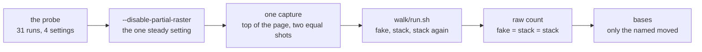

# The walk made steady, and one run script for every walk, recap, 2026-10-31

## At a glance

[The plan](../plans/2026-10-31-walk-steady.md), steps 1 to 9, is done on `walk-steady`. The walk's
pictures no longer move from run to run: the same screen taken on the fake, on a stack and on fresh
stacks again reads the same pixel for pixel, on all 306 pictures of the three walks. One command runs
any walk, `bash walk/run.sh <walk>… [--moved <screen>,…|all] [--write]`, and counts every moved pixel
raw, with no tolerance. QA rule 7 says so now.

Drawn from [`support.ts`](../../walk/support.ts), [`run.sh`](../../walk/run.sh) and
[`walks.ts`](../../scripts/src/walks.ts).

## What shipped

- **The cause, shown.** The browser draws a rounded edge one of two ways, run by run (a card's corners,
  the client's logo on a phone). Playwright's comparator skips such softened pixels, so every run read
  "0 differ" while git saw the files move. The probe (31 runs, four settings) found one setting steady
  in both sets: `--disable-partial-raster` ([`playwright.config.ts`](../../walk/playwright.config.ts)).
  The logo was not only the first shot against the settled one: the flip lay under it, which `7450420`
  had hidden for one run.
- **One capture** ([`support.ts`](../../walk/support.ts)): pointer parked, page scrolled to the top
  (open item 25, done), full-page shots until two in a row are equal by the raw reader, at most ten.
  `toHaveScreenshot`, its update modes and the snapshot templates are gone.
- **The raw reader and the strays' choice** in `scripts/` ([`pixels.ts`](../../scripts/src/pixels.ts),
  [`strays.ts`](../../scripts/src/strays.ts), [`walks.ts`](../../scripts/src/walks.ts)), under the gate
  at 100 %.
- **`walk/run.sh`**, tested on stand-ins for node, pnpm, ps and uptime ([`walk-run.test.ts`](../../scripts/src/walk-run.test.ts)),
  ShellCheck in CI. Refusals stop before any act; strays of a killed stack are stopped first.
- **QA rule 7**, amended on the human's yes ([`qa.md`](../conventions/qa.md)); the four masks each name
  their unit test.
- **154 bases rewritten** (piece 1 24, piece 2 106, the operator 24), read by eye by a second model: the
  large piece-2 moves were old bases shot scrolled down, with the fixed bar painted mid-page.
- **The proof, the human's two runs:** the first with `--moved all --write`, the second without flags,
  both `== verdict: green`, the second with every count 0.

## What was rejected

| Rejected | Why |
| --- | --- |
| `--run-all-compositor-stages-before-draw --disable-checker-imaging` | unsteady in both probe sets |
| a `will-change: transform` stylesheet at the shot | steady at 1280, never tried at 390, and it changes how the page is composited, where a switch changes only how it is drawn |
| `toHaveScreenshot` as the capture | its settling and its comparison both skip softened pixels |
| Playwright's bundled PNG decoder, `pngjs` | an internal path pinned to 1.64; a dependency for some 60 lines |
| all in bash, all in TypeScript | the parsing drew four to six fixes a review; a second runner beside `pnpm stack` for a dozen commands |
| red on any `vitest` seen mid-run | two false reds on 10-30; with one steady capture a loaded Mac shows as a moved pixel |
| a tolerance, a threshold, a mask over what moves | each hides the next real move of one shade |

## The review's findings (Opus, steps 4 to 6 together)

`[FIXED]` the strays' choice matched file names in any process and a relative entry of another repo
(an editor, a tmux or another repo's server would have been stopped); a missing base called "1 moved";
"named, not moved" printed when one language moved, and a typo in `--moved` silent; `--moved --write`
taking the option as the list; the listings reading stdin; `mkdir` failing after the strays were
stopped said "refused"; the interrupt verdict claiming the stacks were down; a test that stayed green
if a tolerance were added to the capture. `[DEFERRED]` a Ctrl-C during the first step's listings ending
as a refusal, and the stray-stop loop and Ctrl-C path never run: [item 33](../open-items.md).
`[REJECTED]` an independent PNG encoder fixture: the reviewer ran the reader against Playwright's
encoder once (0 mismatches over filters 0 to 4, RGB and RGBA).

## What remains the human's

- **Merge into `main`:** the orchestrator's call; the branch changes `.github/workflows/ci.yml`
  (ShellCheck takes `walk/*.sh`), `pnpm-lock.yaml` (the walk depends on `@credo/scripts`, one entry),
  `CLAUDE.md`, `qa.md` and the 154 bases. CI's ShellCheck has not run on `walk/run.sh` there; it is
  clean locally on the same version.
- **Piece 2's three runs:** the probe's 390 set rested on 3 runs; the 306 pictures read steady over
  the fake and two stacks twice, which is the evidence the plan asked for.
- **The console's step 9** runs on this script once the console takes it in; it adds
  `operator-passkeys` to the table, and a screen the fake draws differently from the stack is red until
  fixed at the source or masked under rule 7.
- **Left out:** children that end with their parent (source fix for the orphans, for the next piece
  touching `scripts/src/stack.ts`); a Mac-wide test lock; a second machine's bases.
