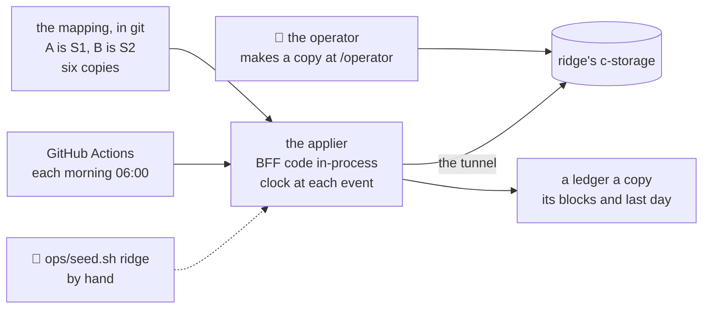

# The demo seed, recap, 2026-11-01

## At a glance

[The plan](../plans/2026-10-29-demo-seed.md), steps 1 to 9, is done on `demo-seed` and is in `main`. Two
invented companies, S1 building materials and S2 drinks and household goods, each get a copy for every
partner (six in all), started with a week of history and added to each morning by about 06:00 Vietnam time.
Every record goes through the BFF's own routes, its clock at each event's time, so a rule of the product
holds on the data. The human looked at one copy of each on `pnpm demo` (10-29 16:21: "it's perfect").
The seed has since gained each copy's customers and products (slice 1); the blocks for slices 2 to 4, orders,
deliveries and closed days, are in `main` (`abb184b`, its fix `7b14a38`). The review of step 8 is read and all its findings are
fixed or parked; this is its recap, left until the slices' blocks landed.

Drawn from the plan and the code below. Serves the demo's every step: it is the data they show.

## What shipped

| What | Where it lives |
| --- | --- |
| the scenarios S1 and S2 (profiles, data alone), the stream seeded by client, scenario and date, the staff generator, the mapping of clients to copies and codes | [`mapping.ts`](../../scripts/src/demo/mapping.ts#L21), `scenarios.ts`, `stream.ts`, `staff.ts`, commit `35c2a7a` |
| the applier: the first fill (settings, staff as they stood a week ago, then each of the last 7 days), then each day to yesterday, at most 30 at once; a fill only of a fresh client; what users changed wins (a 409 or 404 is a skip, named); `pnpm demo` | [`applyCopy`](../../scripts/src/demo/apply.ts#L271), [`isFresh`](../../scripts/src/demo/apply.ts#L105), [`applyAll`](../../scripts/src/demo/apply.ts#L363), commit `3899b72` |
| the ledger, a record a copy outside every list the BFF reads: its scenario, first day, last day applied | [`ledger.ts`](../../scripts/src/demo/ledger.ts#L6), [`records.ts`](../../shared/src/records.ts) |
| ridge's run: `ridge_cli seed`, `ops/seed.sh` (writes nothing unless `/health` names its own commit, refuses below the box's floor), the scheduled and manual workflow in its own concurrency group, the runbook's section | [`ridge.ts`](../../scripts/src/ridge.ts#L105), [`seed.sh`](../../ops/seed.sh), [`seed.yml`](../../.github/workflows/seed.yml), commits `7ee3f38`, `3460a1a` |
| each copy's customers and products, written at the first fill through the import routes | [`customersOf`](../../scripts/src/demo/lists.ts#L93), [`addLists`](../../scripts/src/demo/apply.ts#L176), commit `72cfda5` (slice 1's recap) |
| the blocks of slices 2, 3 and 4: orders, deliveries by each request's own driver, past days closed by an office person; the ledger names the blocks a copy was filled with | [`orders.ts`](../../scripts/src/demo/orders.ts), [`reconcile.ts`](../../scripts/src/demo/reconcile.ts), `apply.ts`, commits `abb184b`, `7b14a38`; a `pnpm demo` run (11-01, one partner's copies) read S1: 90 orders, 76 delivered with 76 photos (largest 727 bytes), 60 driver-days closed, 12 with a gap; S2: 282 orders, 235 delivered with 235 photos, 110 driver-days closed, 27 with a gap |

The gates at the review's last fix: `pnpm check` exit 0 (shared 75 tests, bff 185, ui 236, scripts 140 at
100 %, visual 219), `bash ops/test.sh` all checks passed, ShellCheck on every `ops/*.sh` exit 0. The human's
`act` run of the workflow started and ended with no user step reaching AWS. After `main` was merged in (`ff1a3b4`)
one whole `pnpm check` read exit 0 (`logs/20261030-1716-demo-seed-main-merge-check.log`).

## What was rejected, and why

| Rejected | Why |
| --- | --- |
| the product's API over HTTP; c-storage written directly; the stack's seed door | the API needs an operator's session (passkeys only) and stamps every record now; direct writes copy each piece's layout into the seed and no rule holds; the door is a loopback door of `pnpm stack` alone. The BFF's own code run by the script wins |
| one shared copy per client | one partner's customers archive a person or confirm an order and change another's demo mid-meeting |
| all six scenarios, 30 days of history | the human: two scenarios and a week; S3 to S6 wait in the plan |
| a terminal run that makes every copy and writes a sheet of passwords | passwords at rest and a deletion path to build; the operator makes each copy at `/operator`. *Trigger:* more than about five partners |
| an AWS schedule, or the Mac, for the daily run | a function, role and schedule in `env.yml` and the keys copied; or an AWS session each morning; GitHub's schedule costs $0 |
| a reset of a copy | a messed-up copy is replaced by a new one under a new code |
| a seed user or a password in each copy | the run issues the root a session with the BFF's own `createSessions` and ends it; it makes and shows no password |

## The review's findings (a model other than the author's, on `acef65d` and `d1842c4`)

Step 8's first pass R1 to R10 and a re-check N1 to N6, each seen red before its fix, 42 mutants in the first
pass (39 caught at once, three after tests were added). `[FIXED]` among them: a running commit that is an
ancestor of `main` and differs in no path the deploy reads is accepted, and the list of those paths fails
closed when a line cannot be read (R1, N1); the BFF function's description must equal `/health`'s commit (R2);
a root that only signed in is still fresh, a changed name, logo, colour or language is not (R3, N4); a cut fill
and a cut run resume (R4, R5); a hire into a renamed department is skipped and named (R6); each hire leaves
after 270 to 459 days, so standing staff stay near the size (R7, N6); a ledger of another client or scenario is
refused (R8). `[DEFERRED]` N2, a deploy stopped between the function's description and its code, to
[open item 29](../open-items.md#L241).

## What remains the human's

- **The gate's time:** `scripts`' tests are now about 207 s in the whole check, from about 91 s, since every
  fresh fill also does orders; watch it against the budget.
- **Step 10, ridge:** make the six copies at `/operator` under their mapped codes, **after** the slices'
  deploy: the seed fills a client only once, so a copy made earlier stays at staff and lists. Then
  `ops/seed.sh ridge` once by hand, its log read whole; open one copy and answer "would a partner's customer
  take this for a running company of this trade?"; read the next morning's scheduled run.
- **The look** of a fresh demo copy with every block filled: orders, a driver's deliveries with photos, closed
  days; nothing has shown them together on a screen.
- **Open item 29**, until `ops/app.sh` is next changed.
- **Hazards no gate catches:** GitHub disables a public repository's schedule after 60 days without activity;
  the daily job runs under the deploy role, so a change to `seed.yml` or `ops/seed.sh` acts on ridge the next
  morning; a copy made by hand with a mistyped code is not in the mapping and stays empty.
