# The driver's phone, with a photo, recap, 2026-11-01

## At a glance

[The plan](../plans/2026-11-01-driver-phone.md), slice 3 of the road to the demo on ridge on 11-04,
steps 1 to 7, is done on `driver-phone`. A driver the root has allowed to deliver scans their QR code and
lands on **My deliveries**, today's requests sent to them, waiting first. A tap opens one: the customer,
the phone (a tap calls), the address, the goods, the money to collect. **Delivered** opens the camera, shows
the photo to send or take again, and sends it; the request is delivered and its order fulfilled. The office
sees **Fulfilled** in Orders and **Delivered**, with the photo, in the request. The human answered all 10
business rows yes (11-01 09:0x) and the preview 20 of 20 yes (11-01 10:2x); the full walks are green
(11-01 17:34).

```mermaid
flowchart LR
  rows["the 10 rows<br/>yes"] --> in2["slice 2 taken in"]
  in2 --> fake["the phone's pages<br/>on the fake"]
  fake --> preview["the human's preview<br/>20 yes"]
  preview --> bff["the BFF routes<br/>c-storage unchanged"]
  bff --> review["one review<br/>by another model"]
  review --> run["the full walks<br/>green, 0 moved"]
  run --> seed["the seed's block<br/>past days delivered"]
  seed --> ridge["ridge, a real phone<br/>👤 the look"]
```

Serves demo steps 5 and 6 (the driver delivers with a photo; the office sees it). Three screens from open
to delivered: the big picture's criterion 2, read at this walk.

## What shipped

| What | Where it lives |
| --- | --- |
| the wire: the states `delivered` and `fulfilled`, `deliveredAt` (optional, so slice 2's requests still read), the photo's limits (JPEG, PNG or WebP, 200 KB, 1280 px), the delivery's key outside the day's prefix | [`photo.ts`](../../shared/src/photo.ts#L12), [`orders.ts`](../../shared/src/orders.ts#L62), [`records.ts`](../../shared/src/records.ts#L45), commit `f32799f` |
| the routes: the driver's list, Delivered (the photo, then the request over its tag, then the order fulfilled), the photo's read, the order's cancel refusing a delivered pair | [`mustBeDriver`](../../bff/src/routes/orders.ts#L434), [`my-deliveries`](../../bff/src/routes/orders.ts#L441), [`deliver`](../../bff/src/routes/orders.ts#L467), commit `862678a` |
| the pages: My deliveries, the request with the camera, the preview and the send; the shrink before the send; the menu's first page for a driver; the office's request with its photo | [`MyDeliveriesPage.tsx`](../../ui/src/MyDeliveriesPage.tsx#L17), [`MyDeliveryPage.tsx`](../../ui/src/MyDeliveryPage.tsx#L39), [`shrinkToProof`](../../ui/src/photo.ts#L44), [`nav.ts`](../../ui/src/nav.ts#L29), commit `4af2aff` |
| the stack's data: the data set's past requests delivered by their own drivers, each with one of three drawn pictures | [`replayWeek`](../../scripts/src/generator.ts#L246), commit `862678a` |
| the walk `driver-deliveries` (6 screens on the phone's width) and `office-orders`' two screens 11 and 12: 8 new screens, 16 answers; the walk's own 6 screens are 36 pictures | [`driver.spec.ts`](../../walk/specs/driver.spec.ts), [`walks.ts`](../../visual/src/walks.ts#L1393), commit `b129224` |

The whole check after the review's fixes read exit 0, every package at 100 % (shared 115 tests, bff 376,
ui 493, scripts 206, visual 452; `logs/20261101-1056-driver-phone-check.log`). The full walks
(`logs/20261101-1449-full-walks.log` from line 1502, `== verdict: green` at #L3801) wrote the walk's 36 pictures and
read them again with 0 moved, the fake against the stack included. The walks' own defect was in the spec, not
the app: the driver's office cancel listed today's requests where the order's own day was needed (`dff183f`).

## What was rejected, and why

| Rejected | Why |
| --- | --- |
| S3 behind presigned uploads for the photo | a bucket and a credential in each stack for a demo (Decide 45); the photo is a c-storage record beside its request, $0 a month. *Trigger:* a signed client, whose 30 photos a day outgrow one SQLite file |
| the photo in the day's list | its key does not start with the day's prefix, so a list never carries a photo (S2's 40 a day would be 10 MB) |
| the time of delivery on a screen | stamped, shown nowhere: the walk's own delivery would carry the run's real time and move its pictures (QA rule 7) |
| a sign-in per driver in the seed | the copy's root would find them in Staff; the seed delivers as each driver through the BFF's own route |
| an app icon for the phone's home screen, no signal, GPS, a signature, part deliveries | the plan's row 10 and parked 2 to 4, the human's to move |
| the office marking a request delivered, or the root delivering | Delivered is the whole request, marked once, by its own driver |

## The review's findings (Opus, on `a2739bf`)

No High, one Medium, five Low, eight Info. `[FIXED]` the Medium: step 6's red evidence claimed reds that
rows 1, 6 and 8 never had; three red runs from their own assertions replaced it. `[FIXED]` step 9's list of
moved screens. `[REJECTED]` "never the root" against row 7: the root reads the photo as the office does.
`[DEFERRED]` the rest to [open item 39](../open-items.md#L406): the order's cancel racing a delivery (slice
2's finding 3), the read check held by no test, a 503 when only the order's write fails, a body of 1 MiB read
before the 200 KB check, `imageOrientation` on an old browser, and the smaller ones; one line to item 27.

## What remains the human's

- **The seed's block:** the demo copies' past days delivered, today's waiting, QR sign-in on so the root can
  show a driver their code (plan rows 9, 24, 25). A `pnpm demo` run (11-01, one partner's copies, counted by a script) read, in S1, 76 requests delivered, 5 cancelled, none waiting on a past day, 76 photos (the largest 727 bytes); in S2, 235 delivered, 12 cancelled, 235 photos (the largest 727 bytes). The seed delivers as each request's own driver; the 401 or 403 is strict (`7b14a38`): a driver missing from `GET /api/drivers` is named and the request left waiting, any other refusal stops the run.
- **ridge, with a real phone, on a fresh mapped code:** the camera, the shrink and the orientation run only
  in a real browser; the walk's browser takes a file. A copy made before this deploy keeps its past requests
  waiting. Make a fresh S1 and S2 copy, fill it, scan a driver's QR code on the phone, deliver with a
  photo, and open Orders and the request on the PC. The plan's step 13 asks the one question: would a
  prospect follow steps 5 and 6 without help? The photo must come upright; a sideways or refused one becomes
  a case.
- **Open item 39**, until the deliveries are next touched.
- **A hazard no gate catches** (review finding 9): an office tab opened before the deploy fails to parse
  `fulfilled`, `delivered` and `deliveredAt` until it is reloaded, and a BFF rolled back past this slice
  answers 500 for any day with a delivered request.
- **Disk:** the seed's copies add about 120 photos a day under 10 KB each; a photo from a phone is 200 KB.
  *Trigger:* under 2 GB free on ridge's 8 GB.
