# Đối soát, each driver's day settled, recap, 2026-11-01

## At a glance

[The plan](../plans/2026-11-01-driver-reconcile.md), slice 4 and the last of the road to the demo on ridge
on 11-04, steps 1 to 7, is done on `driver-reconcile`. In **Delivery requests** each driver's group now shows
what they are to bring back, delivered n of m, and whether the day is open. The office opens a driver's
**Đối soát**: the requests delivered with their totals and the sum, those still waiting apart. It types the
cash handed in and sees the gap at once, exact, short or over. **Close the day** asks first, then closes it
for good and cancels the requests still waiting, whose orders offer to be sent again. The human answered all
10 business rows yes (11-01 13:0x) and the preview 62 yes, 0 no (11-01 14:03); the full walks are green
(11-01 17:34).

```mermaid
flowchart LR
  rows["the 10 rows<br/>yes"] --> fake["the office's pages<br/>on the fake"]
  fake --> preview["the human's preview<br/>62 yes"]
  preview --> bff["the BFF routes<br/>c-storage unchanged"]
  bff --> review["one review<br/>by another model"]
  review --> main["main taken in<br/>one whole check"]
  main --> run["the full walks<br/>green, 0 moved"]
  run --> seed["the seed's block<br/>past days closed"]
  seed --> ridge["ridge, a fresh copy<br/>👤 the look"]
```

Serves demo step 7 (settle a driver's day, close it, look at yesterday). Every figure comes from slices 2
and 3: a delivered request's total to collect, whole đồng, summed by the app.

## What shipped

| What | Where it lives |
| --- | --- |
| the wire: a closed day (one a driver a day), the close's request naming the requests the page showed and the cash, `driverDay` as the one place a day is summed, the gap, the record's key | [`reconciliations.ts`](../../shared/src/reconciliations.ts#L35), [`driverDay`](../../shared/src/reconciliations.ts#L62), [`records.ts`](../../shared/src/records.ts#L49), commit `f443129` |
| the routes: a day's closed days (`orders.canView`) and the close (`orders.canEdit`): each waiting request cancelled over its tag and its order freed, then the day written once with `If-None-Match: *`; a different set or a closed day is a 409; Confirm and send refuse a driver whose day is closed (400) | [`registerReconciliationRoutes`](../../bff/src/reconciliations.ts#L33), commit `f46e3de` |
| the pages: a line and a button a driver in Delivery requests, a driver's day with the cash field, the gap, the close's check and Closed; no menu entry, nothing new on the phone | [`DriverDayPage.tsx`](../../ui/src/DriverDayPage.tsx#L38), [`DeliveriesPage.tsx`](../../ui/src/DeliveriesPage.tsx#L18), commit `1138d11` |
| the stack's data: the data set's past days closed by an office person, yesterday's one driver short 20,000 đồng | [`closeWeek`](../../scripts/src/generator.ts#L309), commit `bfb4c61` |
| the walk `office-reconcile` (8 screens, 16 answers, 48 pictures), a sixth part "the day's end" on the walks page map, its two projects and its row in `walk/run.sh` | [`reconcile.spec.ts`](../../walk/specs/reconcile.spec.ts), [`walks.ts`](../../visual/src/walks.ts#L1488), commit `33b0c69` |

The whole check after `main` was taken in (`7799ff7`, no conflict) read exit 0, every package at 100 %
(shared 142 tests, bff 471, ui 621, scripts 217, visual 478; `logs/20261101-1430-driver-reconcile-check.log`).
The full walks (`logs/20261101-1449-full-walks.log` from line 1502, `== verdict: green` at #L3801) wrote the walk's 48
pictures and read them again with 0 moved. The walk's spec had one defect, a path that held the fake's employee
id where the stack mints its own; the spec now reads the minted id from the BFF (`305c3f9`).

## What was rejected, and why

| Rejected | Why |
| --- | --- |
| rounding the cash, part hand-ins, who approves a gap and a note for it, reopening a closed day, a cashier's own right | a client's money rules, the human's, asked at that client's setup (parked 1); the demo keeps one hand-in a driver a day, exact đồng, a gap as typed, a closed day final |
| a new permission to close | a new right adds rows to piece 2's editors and re-asks their walked screens (slice 2 paid 26 answers); `orders.canEdit` closes, `orders.canView` sees |
| a menu entry for the day's end | it moves every office and root picture; the office is on Delivery requests at the day's end anyway |
| the driver's own total on the phone, debts per customer, transfers, expenses, returns, an export | not in this slice (the plan's row 10 and parked 3, 4). *Trigger:* a driver who asks, a real client |
| a field added to slice 2's or 3's records | a tab opened before the deploy would read them as before; the closed day is a record of its own |

## The review's findings (Opus, on `beeaedb`)

No High, no Medium; 6 Low and 5 Info, all `[DEFERRED]` to [open item 41](../open-items.md#L429) under the
11-04 demo's exception. Among them: the closed day's `If-None-Match` and the order's free are held by no test
(finding 2, 3; finding 3 also in [item 35](../open-items.md#L305)); a close that stops part way leaves the page
showing requests it already cancelled (5); the editors' words for `orders.canEdit` do not say it closes a day
(6). Row 5's two clauses are held by the reviewer's runs, red at the BFF and in the UI
(`logs/20261101-1424-driver-reconcile-review-runs.log`).

## What remains the human's

- **The seed's block:** the demo copies' past days closed by an office person, most exact, about one in five
  short by 5,000 to 50,000 đồng, now and then over; today's open (plan rows 9, 22, 23). A `pnpm demo` run (11-01, one partner's copies,
  counted by a script) read 60 driver-days closed in S1 (12 with a gap) and 110 in S2 (27 with a gap). The run's day was a
  Sunday, so no today's day was closed; on a working day today's stay open.
- **ridge, on a fresh mapped code:** a copy made before this deploy keeps its past days open. Make a fresh S1
  and S2 copy, fill it, walk demo step 5 on a phone, then step 7 on the PC as an office person the root gives
  a sign-in. The plan's step 12 asks the one question: would a prospect follow step 7 without help?
- **Open item 41**, until the day's end is next touched.
- **Hazards no gate catches:** a request sent to the driver inside a close's milliseconds waits on a closed
  day, and no closed day holds its cash; a PC set a day ahead offers to close a day not yet over, and the
  close cancels what still waits; a request delivered whose phone read "Not sent" (item 39, finding 4) is
  counted, since it reads delivered.
- **The big picture** now reads đối soát per driver per day as built here; the money rules a client sets stay
  in "Not yet".
