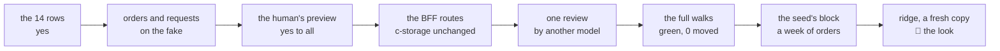

# Orders and delivery requests, recap, 2026-11-01

## At a glance

[The plan](../plans/2026-10-31-orders-delivery.md), slice 2 of the road to the demo on ridge on 11-04,
steps 1 to 7, is done on `orders-delivery`. An office person now lands on **Orders**, the last 7 days';
makes a new order from slice 1's two lists, priced by the app; presses **Confirm**, picks the driver and
the day, and the order is confirmed with a delivery request made, each with its number. **Delivery
requests** shows a day's, one group a driver. The human answered all 14 business rows yes (10-31 13:1x)
and the preview yes to all (10-31 15:0x); the full walks that cover this slice are green (11-01 17:34).

Serves demo steps 1, 3 and 4 (sign in on Orders; a new order; confirm to a driver).

## What shipped

| What | Where it lives |
| --- | --- |
| the wire: an order, its lines and total, a delivery request, their numbers `DH-` and `GH-`, three permissions (`orders.canView`, `orders.canEdit`, `deliveries.canDeliver`), the keys by day | [`orders.ts`](../../shared/src/orders.ts#L78), [`wire.ts`](../../shared/src/wire.ts#L44), [`records.ts`](../../shared/src/records.ts#L39), commit `478a9e4` |
| the routes: the week's orders, save, confirm, send, cancel; a day's requests; the drivers allowed to deliver; each write names the tag it read, and the order of writes leaves every stop valid | [`registerOrderRoutes`](../../bff/src/routes/orders.ts#L92), commit `8b09b32` |
| the pages: the list, the order's form and page, the requests by driver, a request's page; the menu lists Orders first | [`OrdersPage.tsx`](../../ui/src/OrdersPage.tsx#L24), [`OrderPage.tsx`](../../ui/src/OrderPage.tsx#L418), [`DeliveriesPage.tsx`](../../ui/src/DeliveriesPage.tsx#L18), [`DeliveryPage.tsx`](../../ui/src/DeliveryPage.tsx#L23), commit `81bd4eb` |
| the stack's data: the data set's week of orders and requests, sent through the routes at fixed times | [`replayWeek`](../../scripts/src/generator.ts#L246), commit `4b50927` |
| the walk `office-orders` (10 screens, 20 answers, 72 pictures), its two projects and its row in `walk/run.sh` | [`orders.spec.ts`](../../walk/specs/orders.spec.ts), [`walks.ts`](../../visual/src/walks.ts#L1218), commit `71003b9` |

The whole check after the review's fixes read exit 0, every package at 100 % (shared 111 tests, bff 363,
ui 468, scripts 205, visual 442; `logs/20261101-0903-orders-delivery-check.log`), after two reds, each
reported as a red. The full walks (`logs/20261101-1449-full-walks.log` from line 1502, `== verdict: green` at #L3801)
wrote this walk's 72 pictures, read them again with 0 moved (fake to stack, stack to stack, stack to bases)
and moved only the 44 named screens of earlier walks whose menu or permission rows changed (`bcd26a7`).

## What was rejected, and why

| Rejected | Why |
| --- | --- |
| the BFF's clock for an order's day | the walk's order would be filed under the run's real day and its pictures move run to run (QA rule 7); the page sends its today, the BFF's clock stamps `madeAt` alone. *Trigger:* a real client, whose days the BFF then checks against its own |
| a company's own number prefix | nothing asks for one yet |
| the demo-slice ceremony's re-review and second check (Decide 46) | one preview and one full run suffice for a demo; the review of the code stayed |
| the root alone to see orders, as slice 1 did | demo step 1 is the office signing in; the price, 26 answers asked again (the permission editors' words), which the human accepted as they are |
| a change after confirm, or back to draft; stock; payments; VAT; sending many at once | the plan's row 14, the human's to move |

## The review's findings (Opus, on `8c3c536`)

`[FIXED]` a viewer-only person could confirm, send or cancel a request (no test held the guard,
`1592608`); step 6's red evidence was mostly the setup helper's 404, so rows 3, 6, 10 were seen red from
their own assertion (`ab6626f`); step 8's list of moved screens was written. `[DEFERRED]` six findings to
[open item 36](../open-items.md#L323) (a cancel that ignores a moved request write, a re-save that drops
`extra`, a draft priced from today's lists, the numbering's second half untested, request order as text,
a loose version check) and one to [open item 35](../open-items.md#L305). `[DEFERRED]` finding 9 is the
hazard below. Findings 11 to 13 `[REJECTED]`, each for the review's reason; 10 is done by taking `main` in.

## What remains the human's

- **The seed's block**, the last step of this slice: the demo copies' week of orders (about 10 a working
  day for S1, about 30 for S2, plan row 13). A `pnpm demo` run (11-01, one partner's copies, counted by a script) read, in S1, 90 orders (3 drafts, 5 cancelled, 76 fulfilled, 6 sent for the next working day) and, in S2, 282 (20 drafts, 12 cancelled, 235 fulfilled, 15 sent). The run's day was a Sunday, so no request waited for today; on a working day today's requests wait.
- **ridge, on a fresh mapped code:** the seed fills only a fresh client, so a copy made before this
  slice's deploy has no orders. Make a fresh copy of an S1 and an S2 client at `/operator`, fill it
  (`ops/seed.sh ridge`), and walk demo steps 1, 3 and 4. The plan's step 12 asks the one question: would a
  prospect follow steps 1, 3 and 4 without help?
- **Open items 35 and 36**, until the orders are next touched.
- **A hazard no gate catches** (review finding 9): the three new permission ids sit in a strict
  permission layer. A tab opened before the deploy fails `me` until it is reloaded, and a BFF rolled back
  past this slice cannot read a setup or a person saved with an orders right.
- **Until slice 3's block runs**, every past day's request reads waiting.
