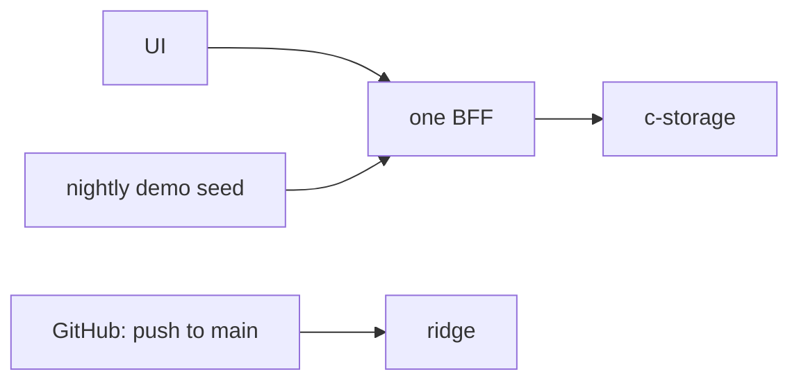

# The road to 11-04, recap, 2026-11-02

## At a glance

The new credo app is UI → one BFF → c-storage, running on ridge, the staging environment. The demo shows
an office taking an order from an Excel-filled customer and product list through a driver's phone, with a
photo, to the day's cash settled. On 2026-11-02 every demo feature is built, reviewed, walked in full on the
local stack and running on ridge at `e9fe5f7`. The demo is on 11-04, each partner on their own demo copy.

## What was built, in order

| Piece | Landed | What it gives | Recap |
| --- | --- | --- | --- |
| App frame | 10-28 | the UI, the BFF and the local stack, with a walk of the screens | [recap](2026-10-28-app-frame.md) |
| c-storage | 10-28 | the key-value service behind the BFF, with its own CI | [recap](2026-10-28-c-storage.md) |
| ridge and its tunnel | 10-28 | the shared environment, and one command to reach its c-storage from a Mac | [ridge](2026-10-28-ridge.md), [tunnel](2026-10-28-ridge-tunnel.md) |
| The whole app on ridge | 10-28 | the operator makes a client; its root signs in | [recap](2026-10-28-ridge-app.md) |
| The walks page and its sharing | 10-29 | partners answer each screen yes or no behind a sign-in | [recap](2026-10-29-walks-share.md) |
| The employee list | 10-30 | a company's people, sign-ins by code, email or QR, and permissions | [recap](2026-10-30-employee-list.md) |
| The operator's dashboard | 10-30 | the operator's frame and the list of clients | [recap](2026-10-30-operator-dashboard.md) |
| The walks navigation | 10-30 | the walks page one screen at a time | [recap](2026-10-30-walks-nav.md) |
| Steady pictures and `walk/run.sh` | 10-31 | the walk's pictures no longer move; one command runs any walk | [recap](2026-10-31-walk-steady.md) |
| Slice 1: customers and products | 10-31 | both lists read from Excel, with a preview | [recap](2026-10-31-customers-products.md) |
| The demo seed | 11-01 | two invented companies, a copy per partner, filled each morning | [recap](2026-11-01-demo-seed.md) |
| Slice 2: orders and delivery requests | 11-01 | a priced order, confirmed with a driver and a day | [recap](2026-11-01-orders-delivery.md) |
| Slice 3: the driver's phone | 11-01 | My deliveries, Delivered with a photo, the order fulfilled | [recap](2026-11-01-driver-phone.md) |
| Slice 4: đối soát | 11-01 | each driver's day settled against the cash, then closed | [recap](2026-11-01-driver-reconcile.md) |
| Operator console, A and C | 11-01 | operators sign in by passkey; a services status page | [plan](../plans/2026-10-29-operator-console.md) |
| The seed made safe | 11-02 | a closed day no longer fails the run; the run moved to 03:17 | [recap](2026-11-02-seed-demo-safe.md) |
| The ridge root-password command | 11-02 | a new root password on a demo copy, typed once, never shown | [recap](2026-11-02-ridge-root-password.md) |

## The demo, step by step

| Step | Who | What | Feature |
| --- | --- | --- | --- |
| 1 | office | signs in, lands on Orders, opens Delivery requests | slice 2 |
| 2 | root | fills Customers and Products from Excel | slice 1 |
| 3 | office | makes a new order, two products | slice 2 |
| 4 | office | confirms it with a driver and a day | slice 2 |
| 5 | root, driver | shows the driver's QR; the phone lands on My deliveries and sends Delivered with a photo | slice 3 |
| 6 | office | sees the order Fulfilled and the request Delivered with its photo | slice 3 |
| 7 | office | opens a driver's đối soát, types the cash, closes the day | slice 4 |

## How it was built

- One piece per worktree, each a vertical slice from the UI to c-storage, ending walkable.
- Fake-first: the UI is walked on invented data and the human answers yes or no, before the BFF is built.
- A 100 % gate on every piece, and a review by another model before it merges.
- The full walks, on the fake and on a real stack, compare every moved pixel raw, with no tolerance.
- A push to `main` deploys to ridge by CI; the demo seed fills the six copies each morning.

## Not in the demo, after 11-04

- The console's B (operators) and D (a client's root password), which is built to its step 4 on its branch and not merged.
- Stock beyond the flag, and goods receipts.
- The parked open items, in [the open items](../open-items.md), numbers 1 to 56.
- The human will reopen how heavy the process is against demo-data work ("this class of problem") after the demo.

## What remains the human's

- The demo itself, on 11-04.
- A glance at the nightly seed run (03:17 +07; GitHub may start it up to about 3 hours late) on the mornings of 11-03 and 11-04.
- The partners' first words.
