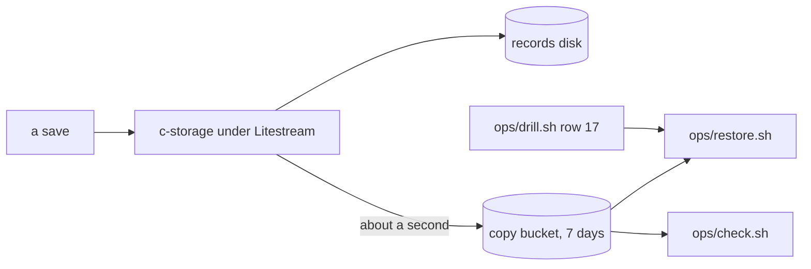

# Every save copied, the records on a disk of their own, a restore, recap, 2026-11-12

Written before the landing on `pre-merge`. Built and tested on this machine; nothing of it has run on ridge yet.

## The picture

## What happened

Before, ridge's records were one file on the box's system disk and nothing held a copy. Now they sit on a disk of their own, and Litestream, with c-storage as its child, copies every change to a bucket through a free private door. The check reads the copy's age and the disk's room, the restore puts the records back on the box, and the drill's row 17 finds a save made before. A new reading, `GET /api/status`, gives the free bytes and the last write.

## What a reader should keep

- **A blank disk with a copy waiting is a restore, never a fresh start.** The release refuses, or an empty file would be copied over the real one. *Rejected:* a nightly backup first, built and then replaced.
- **The restore runs on the box, never on the Mac,** under a role that may add and read, never delete. *Rejected:* a second program as another user, which cannot read c-storage's file.
- **The first build read the wrong layout.** Litestream 0.5.18 keys a full copy as `0009/`, not `ltx/9/`; the check now reads that.
- **Review, tagged.** The High (no region in the copy's address, so c-storage would never start), three Mediums and eight Lows [FIXED]; Medium 2 by the smaller fix, after a restart the check says the lag was not read, and the reading itself is item 378 [DEFERRED]. Items 379, 380, 381 and 382 [DEFERRED]. The reread's two Mediums, a restore onto a replacement box and the free-space sum with no write-ahead file [FIXED].
- **A push to `main` turns the deploy job red** until ridge's stack change adds the bucket and disk; the release stops before installing anything.

## Still yours

- Your two stack runs: <!-- FILL: network change and ridge change, read back -->
- The first release with the copy on ridge: <!-- FILL: release and check -->
- The drill's restore on ridge: <!-- FILL: drill row 17 -->
- **The look: does a restore that finds a save made seconds before read as a lost disk costing about a second?** <!-- FILL: the human's look --> A yes closes item 6's backup half. A no reopens the piece at the row that did not convince you.

## Evidence

- Steps 1 to 6 and the fix passes are ticked in the plan, each guard row seen red by a mutation, put back.
- Step 1: a copy, a restore, 409 on the same code, 201 to a moment before.
- `docs/products.md` gains the copy's row and its known gap is reworded.
