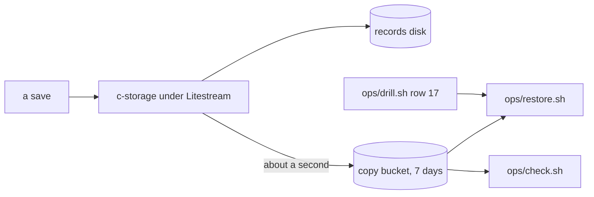

# Every save copied, the records on a disk of their own, a restore, recap, 2026-11-12

Written before the landing on `pre-merge`; the ridge lines were filled once they ran, on 2026-11-13.

## The picture

## What happened

Before, ridge's records were one file on the system disk and nothing held a copy. Now they sit on a disk of their own, and Litestream copies every change to a bucket through a free private door. The check reads the copy's age and the disk's room, and the restore puts the records back.

## What a reader should keep

- **A blank disk with a copy waiting is a restore, never a fresh start.** The release refuses, or an empty file would be copied over the real one.
- **The restore runs on the box, never on the Mac,** under a role that may add and read, never delete.
- **Review, tagged.** The High (no region in the copy's address), three Mediums, eight Lows and the reread's two Mediums [FIXED]; items 378 to 382 [DEFERRED]. 

## On ridge

- Your two stack runs: the network stack added the private door alone; ridge's made the bucket, the disk and the Slack channel, nine changes as planned, none removed.
- The first release: the push's deploy ended red once, as designed. The rerun stopped at the disk's mount check, which read a root-only folder as an ordinary user; after the fix, the rerun and the check were green, the copy within 300 seconds of the last write.
- The drill on ridge, green: a killed c-storage answered again within 10 seconds; a code registered before a reboot answered 409 after it; a restore of the newest copy held the code, one to a moment before did not.
- **The look, yes:** a save made just before the box died came back from the copy, and the copy can be taken back to an earlier moment. That answers item 6's backup half.

## Evidence

- Plan steps 1 to 6 and the fix passes ticked.
- `docs/products.md` gains the copy's row and its known gap is reworded.
