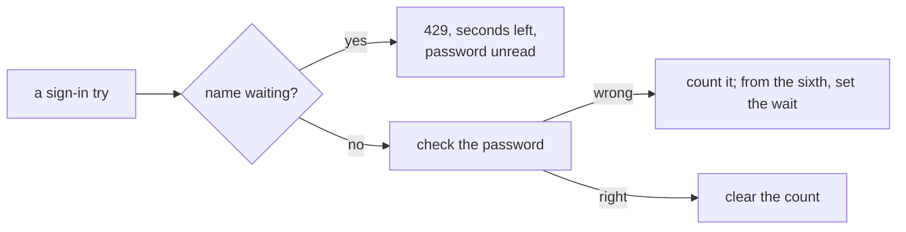

# A growing wait after wrong passwords, recap, 2026-11-12

Written before the landing on `pre-merge`.

## What happened

Five wrong passwords in a row for one name are free, the next wrong one makes that name wait 30 seconds, each wrong try after a wait doubles it to at most 15 minutes, and a right password clears the count. A second back end honours a wait the first began. Item 28 is closed and deleted.

## What a reader should keep

- **The wait is per name, not per address.** One guesser trying many names meets only the door's throttle, and each invented name leaves a small record (item 256).
- **The record's key is a keyed hash of the name.** A copy of the store's data holds no name and no hash a dictionary can run against. Whoever also holds the service key can (item 339 asks the pages to name both places that hold it).
- **Review, tagged.** Medium, item 319, the remedy parked: a wrong try sent as each wait ends keeps a known name waiting with no end. Medium, fixed: the hash was plain. Low, fixed: a citation three lines short. Low, items 338, 339 and 340, deferred. *Rejected:* a key the box does not hold, since it needs a new setting and a deploy change.

## Still yours

**Parked by you at 12:05: the remedy for item 319,** the endless hold of a known name, by device or any lock; it stays as it is. **Asked, not decided: does the wait itself land with that hold left in?**

The look at screen 12 was answered yes at 09:46. The reviewer's reread of the fix pass, on opus: may land. All three findings fixed; three Lows are items 338 to 340.

## Evidence

- Base `1467a9f0`. Commits: `e1d5d933`, `11091821`, `2cae8768`, `583f8291`, `83c7e94f`, `dd9633b1`, `737dfaf8`.
- The last commit's `shared` and `bff` checks ended green at every step.
- Your walk run at 10:36 ended green: 72 pictures against its twin, 0 moved; against the bases 66, 0 moved, 6 new, screen 12's.
