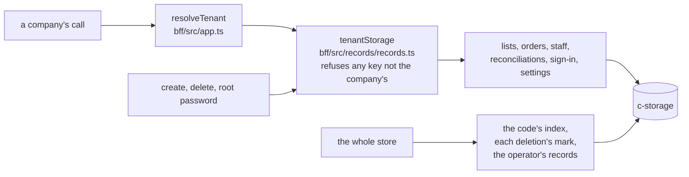

# The storage client that serves one company, recap, 2026-11-12

Written before the landing on `pre-merge`.

## The picture

## What happened

Before, every route was handed the whole store, so one slip could reach another company's records and only the route tests would notice. Now `resolveTenant` makes one client for the company the call names, and no route module can reach anything else. A key outside that company is refused before anything is sent, as a 500 naming the call, never the key. The operator's three acts make the client of the company they name. Nobody sees a change on screen.

## What a reader should keep

- **The wall is the client's, not the store's.** c-storage still knows no company. *Rejected:* the check in c-storage, a company inside the Go service.
- **A client made for the wrong company passes every key of that company.** Only `resolveTenant` and the operator's three acts decide which company a client serves, and the route tests hold them (item 284 asks the memo to say all four).
- **Review, tagged.** Two Medium, fixed: the memo and item 227 named a case the guard stops and missed the one it does not; the client's name drifted from `storage`, which the call count reads, and went back (`company` stays in `clients.ts`, where the whole client holds `storage`). One Low, filed as item 283: the refusal throws before it returns a promise. One Info on the reread, item 284.

## Still yours

**The look: is this the wall you want between companies that share a box?** A yes means the pooled shape builds on it as drawn. A no names what should also be walled, and the plan's second step reopens.

## Evidence

- Build: `c5db9ec1` (the guard, two lists), `bb72e97a` (every other call), `a889e662` (the pages). Fix: `75e21674`.
- Each build step's back-end check ended green at full coverage, and the fix pass's did too; the citation test exited green.
- Seen red on their own assertions and put back: the prefix check passing everything, refusing everything, and the key put in the message; the whole store handed to `resolveTenant` turned the typecheck red.
- No existing test was changed; the one new test file is `bff/src/records/records.test.ts`.
- `docs/products.md` changes no row: an internal wall adds nothing a partner or an operator can do.
