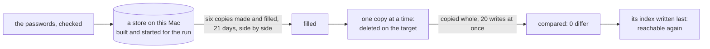

# Every long run under 15 minutes, recap, 2026-11-13

## What happened

The remake of ridge's six demo copies no longer fills them on ridge. It starts a store of its own
on this Mac, makes and fills the six copies there with their three weeks of orders, then carries
each copy to the target whole, one at a time: deleted there, copied, compared to zero, and only
then made reachable again. It prints how many minutes each part took. On this Mac, against a
second local store standing in for ridge, the whole remake took 0.8 minutes: 0.3 to build the
store and fill the six copies, 0.5 to carry 9,201 records. Ridge adds the tunnel's wait to each
write; the plan aims the whole at 10 minutes there.

A fill that fails on this Mac stops the run before anything on the target is deleted, and names
each copy that failed. The remake's script still runs its rounds of the fill afterwards; they now
find every copy up to date and end at once, until the script loses them.

## What was rejected

- Deleting on the target before the fill on this Mac, as the old remake did: a fill that failed
  would then leave ridge's copies gone. The fill comes first, so a failure there touches nothing.
- Filling ridge in parallel groups inside the fill: every order raises one numbering record per
  company, so 20 saves at once would make 19 retries.
- A batch write in the store: 20 copy writes at once suffice.

## Still yours

- Your run of the remake on ridge, once this is in `main`, pushed and deployed: its log should end
  green with each part's minutes, the whole under 15. <!-- FILL: your run, not yet made -->

## Evidence

**The fill on a local store, end to end on this Mac.**

- Case 1's test, `scripts/src/ridge-remake-local.test.ts`, passed alone against two local stores
  (the test's target and the remake's own): one test, 53 seconds. It was seen red once, with the
  copy loop cut after its first 200 writes: the run ended "the target differs after the copy",
  and the file was put back to its backup byte for byte.
- One remake against a local target printed its minutes: the store built and the six copies
  filled, 0.3; the deletes 0.0 and the copies 0.5; 0.8 in all. Each copy's compare after the copy
  read 0 differ: 843 records for each building-materials copy, 2,224 for each drinks copy.
- The scripts gate, on the tree with `pre-merge` taken in: all five steps ended 0, 451 tests in 40
  files, 100 % of statements, branches, functions and lines. Its test step took 258 seconds,
  against the 217 the plan measured. The cause per file was not measured; the likeliest is that
  three runs of the old remake test (the shared one, the rival's and the unfinished deletion's) now
  each fill all six copies on this Mac before they reach the target. The lock was free at the end. Knip's one configuration
  hint, an ignore entry it no longer needs, predates this piece and is item 416.
- The rows of `scripts/src/ridge-remake.test.ts` that pinned the fill on the target follow the new
  order already, since a commit needs the gate green (the plan had them in its second step): rows
  5, 6, 7, 8 and 11 read one shared remake; row 10 starts its rounds from copies first-filled with
  no day; the rival on the copy's ledger is retired, as the copy's own test holds a record changed
  on the target mid-copy; and a new row holds that a fill that stops on this Mac deletes nothing on
  the target. Cases 2 to 5 stay the second step's.
- Model files: `scripts/src/stack.ts`'s `startStack` for starting the store, now
  `scripts/src/local-store.ts`'s `startStore`, which both call; the `copy-company` verb's loop for
  the carry, now `carryCompany` in `scripts/src/ridge.ts`, which both verbs call.
