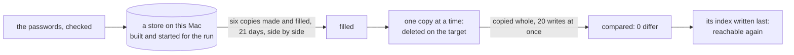

# Every long run under 15 minutes, recap, 2026-11-13

## What happened

The remake of ridge's six demo copies no longer fills them on ridge. It starts a store of its own
on this Mac, makes and fills the six copies there with their three weeks of orders, then carries
each copy to the target whole, one at a time: deleted there, copied, compared to zero, and only
then made reachable again. It prints how many minutes each part took. On this Mac, against a
second local store standing in for ridge, the whole remake took 0.8 minutes: 0.3 to build the
store and fill the six copies, 0.5 to carry 9,201 records. Ridge adds the tunnel's wait to each
write; the plan aims the whole at 10 minutes there.

A fill that fails on this Mac stops the run before anything on the target is deleted, and names
each copy that failed. The remake's script still runs its rounds of the fill afterwards; they now
find every copy up to date and end at once, until the script loses them.

The script has now lost them. It opens one tunnel to ridge, runs the remake on it with a line every
30 seconds, and says it may take up to 15 minutes. A run that stops after the fill, a dropped tunnel
say, keeps the store this Mac filled; the same command with `--go-on` starts that store again, asks
no password, leaves each copy it had already finished as it is, and writes only the records that
differ. A copy cut off mid-copy stays unreachable on ridge until a run ends equal. A store on this
Mac that does not start, or a fill that stops there, now reads as a refusal: nothing on ridge was
deleted, and the log says so.

## What was rejected

- Deleting on the target before the fill on this Mac, as the old remake did: a fill that failed
  would then leave ridge's copies gone. The fill comes first, so a failure there touches nothing.
- Filling ridge in parallel groups inside the fill: every order raises one numbering record per
  company, so 20 saves at once would make 19 retries.
- A batch write in the store: 20 copy writes at once suffice.
- Filling a new store for `--go-on`: each fill mints new company ids and password salts, so every
  record would differ and the whole copy would run again. The filled store is kept instead, in the
  credo root, until a run ends green.

## Still yours

- Your run of the remake on ridge, once this is in `main`, pushed and deployed: its log should end
  green with each part's minutes, the whole under 15. <!-- FILL: your run, not yet made -->

## Evidence

**The fill on a local store, end to end on this Mac.**

- Case 1's test, `scripts/src/ridge-remake-local.test.ts`, passed alone against two local stores
  (the test's target and the remake's own): one test, 53 seconds. It was seen red once, with the
  copy loop cut after its first 200 writes: the run ended "the target differs after the copy",
  and the file was put back to its backup byte for byte.
- One remake against a local target printed its minutes: the store built and the six copies
  filled, 0.3; the deletes 0.0 and the copies 0.5; 0.8 in all. Each copy's compare after the copy
  read 0 differ: 843 records for each building-materials copy, 2,224 for each drinks copy.
- The scripts gate, on the tree with `pre-merge` taken in: all five steps ended 0, 451 tests in 40
  files, 100 % of statements, branches, functions and lines. Its test step took 258 seconds,
  against the 217 the plan measured. The cause per file was not measured; the likeliest is that
  three runs of the old remake test (the shared one, the rival's and the unfinished deletion's) now
  each fill all six copies on this Mac before they reach the target. The lock was free at the end. Knip's one configuration
  hint, an ignore entry it no longer needs, predates this piece and is item 416.
- The rows of `scripts/src/ridge-remake.test.ts` that pinned the fill on the target follow the new
  order already, since a commit needs the gate green (the plan had them in its second step): rows
  5, 6, 7, 8 and 11 read one shared remake; row 10 starts its rounds from copies first-filled with
  no day; the rival on the copy's ledger is retired, as the copy's own test holds a record changed
  on the target mid-copy; and a new row holds that a fill that stops on this Mac deletes nothing on
  the target. Cases 2 to 5 stay the second step's.
- Model files: `scripts/src/stack.ts`'s `startStack` for starting the store, now
  `scripts/src/local-store.ts`'s `startStore`, which both call; the `copy-company` verb's loop for
  the carry, now `carryCompany` in `scripts/src/ridge.ts`, which both verbs call.

**The remake script and its guards.**

- `ops/demo-remake.sh` lost its rounds, its 160-minute notice, `MAX_ROUNDS` and the open-tunnel
  stop's hint: one tunnel for the deletes and the copies, a line every 30 seconds with the tunnel
  read, a notice of 15 minutes with its clock time, four steps (it counted six for five). The
  node half's exit 2 is now the script's refusal. `scripts/src/demo/apply.ts`'s `DAYS_PER_ROUND`,
  its guard in `ops/test.sh`, `seed --round` and its check for copies not remade are gone; the
  seed's 7.5-minute chain stays.
- `--go-on` is `remake --go-on` in `scripts/src/ridge.ts`: the store this Mac filled is kept in
  the credo root's `.demo-remake-store`, with its keys and a file naming the day of the fill, and
  removed by a run that ends green. A copy whose index on the target already names the kept
  store's company is compared and not deleted.
- Case 2, in `scripts/src/ridge-remake-local.test.ts`: a remake cut after 1,250 writes on the
  target stopped red in the second copy, the first reachable, the second with no index and its
  root's sign-in refused, the store kept. Seen red once with the index written before the copy:
  the second copy's index was there.
- Case 3, the same file: `--go-on` ended 0, wrote nothing for the first copy, and wrote exactly the
  records each compare found differing plus the five indexes not yet written; every copy compared
  at 0 after, and the kept store was gone. Seen red once with a carried copy deleted all the same:
  the first copy's "not deleted" line was missing. Its refusal without a kept store, in
  `scripts/src/ridge-remake.test.ts`, was seen red once with the refusal cut: status 1 for 2.
- Case 4, the same file: after the `--go-on`, each copy's root signs in on the target with its
  partner's password and is refused with the other two. Seen red once with a wrong password set on
  this Mac: 401 for 200.
- Case 5: in `scripts/src/ridge-remake.test.ts`, a store whose folder cannot be made is status 2
  before any delete, the target's copy untouched; seen red once with the failure rethrown as it
  was, status 1 for 2. In `ops/test.sh`, the stand-in's exit 2 ends the run refused, exit 2, with
  no closing line; seen red once with the script's branch for it removed: exit 1 and no refusal
  line. Each mutation was put back from its backup, its sha read equal.
- The rows of `scripts/src/ridge-remake.test.ts` on the rounds (row 10's two, row 5's last round)
  are retired with `seed --round`; row 7's stopped fill is status 2 now. `ops/test.sh`'s remake
  rows follow the one tunnel: one open and one close, the store's folder the credo root's in the
  run and its `--go-on`, a copy that stops after a delete red and naming `--go-on`.
- The two remake test files passed together: 16 tests in 125 seconds.
- Open items: 386 (no line while the remake ran) is done and deleted; 384 and 395 keep only what
  is left of them.
- The gates, on the tree with `pre-merge` taken in: the scripts gate, all five steps 0, 455 tests
  in 40 files, 100 % of statements, branches, functions and lines, its test step 204.5 seconds;
  knip's one hint is item 416. A first run of it was red on prettier alone, for two files this
  step wrote; they were formatted and the gate run again. ShellCheck on the three folders, 0.
  `bash ops/test.sh`, all checks passed; its four notices of a stand-in server stopped are the
  check's and the keys' sections' own, as before this step. In this sandbox it needs Go's build
  cache in the temp folder, as the route tests' build helper sets it. The citation test, 32
  passed. The lock was free at the end of each.
