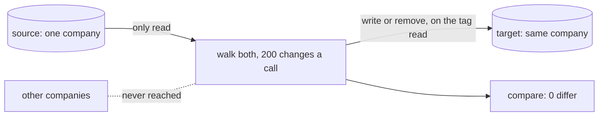

# Lists in pages, and one company copied, recap, 2026-11-13

## What happened

A store list now comes back in pages of up to 1,000 records or about 4 MiB, each starting after the last key. The back end reads every page, so a company past 1,000 customers sees a whole list; a test reads 2,500 in three pages. No screen changed.

One company's records can be copied to another store and compared. `ops/company-restore.sh ridge <code>` restores a demo copy from the continuous copy and leaves the other copies as they are. A copy stopped halfway and run again ends equal; a record changed in the target mid-copy stops it, named. The local test copied 422 records, left a neighbour whose id begins with the copied one's untouched, and a rerun wrote nothing. No copy rate was measured.

A second model's review gave two Medium findings, both fixed; its reread found every claim holding and two `date -r` lines that fail on CI's Ubuntu; they now use the repo's `clock`, not run on Linux. Two plan lines did not hold: case 10's mutation stays green, and step 3 removed two test lines.

## What was rejected

A copy inside c-storage; paging by offset; a `limit` parameter.

## Still yours

- Is this the copy a move and a one-company restore should stand on? A yes lets the pooled shape build on it; a no reopens the copy tool. <!-- FILL: your answer, not yet known -->
- Your restore run of one demo copy on ridge, the wrapper's first; it waits on ridge's repair. <!-- FILL: do not write a result, a count, a time or a log name -->
- Items 392 to 394 and 400 to 406 are in `docs/open-items.md`.

## Evidence

- Fifteen commits since the merge base `9b4563cd`, four take-ins of `pre-merge`; the tip is `eabb93c2`.
- c-storage's `make check` ended 0 at 100 % on step 1's tree; the `scripts` gate ended 0 (443 tests, 100 %) after the fix pass and the date fix; `ops/test.sh` ended 0 after the date fix.
- `docs/products.md`: one row added.
