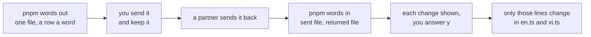

# The app's words to a spreadsheet and back, recap, 2026-11-16

You wanted partners to check the app's words, in English and Vietnamese, and take the wording you judge right. Two commands now do it; no screen of the app changed.

## What happened

`out` writes all 759 words into one file (key, English, Vietnamese, note) that Excel, Sheets and Numbers open with the accents right. `in` compares the returned file with the file you sent, so keep the file you send. It refuses a broken file whole, naming each row: a lost placeholder, an emptied cell, a repeated key. It shows each change, clash and note, and writes nothing unless you answer y. A written word changes its own lines only.

Rejected: a CSV package (about 60 lines are written here instead) and regenerating the word files (it would move lines nobody changed).

## Looks

Your first look, the exported file in a spreadsheet, was answered yes. Your second look, one returned correction shown, then written as one line, the English untouched, was answered yes too.

## Evidence

- Commits `46a54516`, `9b8b7eb9`, `fd0c0cd9` (steps 1 to 3), `8f7aef3d` (the fix pass), on `words-csv`; `pre-merge` taken in twice.
- The review (Opus) said may merge with five Lows, all fixed in the fix pass: writes go through temporary files, accents and spaces read as one word, placeholders compare as a list, two comments. Two Infos stay: the clash check uses the files as read before the question, and "outside the repository" in the usage is not checked.
- The fix pass's scripts check exited 0.
- Item 549 (parked): an English word changed by a partner reddens `ui` tests that query it by text.
- `docs/products.md`: a `pnpm words` row, on a branch.
