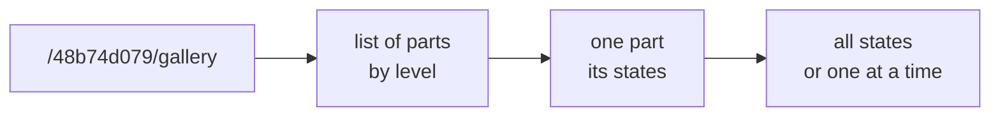

# The gallery as a workbench, recap, 2026-11-17

You said the gallery was hard to check and asked for a Storybook-like layout at its own address. It now is a page of the app itself, a chunk only its visitor downloads, at `/48b74d079/gallery`: the parts down one side by level, one part at a time with its states side by side, and a switch to show one state at a time. No sign-in; the page holds samples only.

## Looks

- **Answered:** your yes on the mock, 2026-11-17 10:45.
- **Open:** your look on ridge at step 6, on a computer and a phone: does it read as the mock? A yes closes the piece; a no names what differs and step 2 reopens. Open item 560 (the frame's `100vh` against a phone's toolbar) waits for that look.

## What came from where

- Step 1, `5ab6020c`: the address, end to end on the fake; the old `gallery.html` removed.
- Step 2, `e67c9b02`: the workbench, with the table of parts in `entries.tsx`.
- Step 3: the review by another model. Its findings are in step 4's tick in the plan.
- Step 4, `d59d8dfb`: eight findings fixed, one deferred (item 560).
- Step 5, this commit: the recap and the records; `pre-merge` taken in.

## What is left

Step 6 stays open: the push, the deploy, and your look. Rejected: a second entry served at the address (it would change ridge's rewrite) and the gallery in the main entry.
