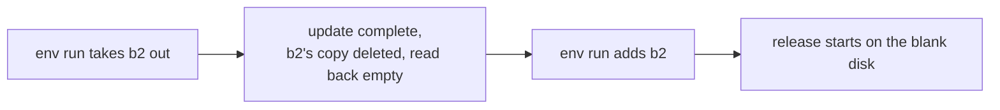

# A box taken out and added back by command, recap, 2026-11-17

Taking a box out with `ops/stack.sh env` now takes its copy of the records in the bucket with it, and adding the name back clears any leftover first. The restore takes a box. All of it ran on stand-ins, nothing on ridge.

## What changed

- **The removal's copy** (`6c6af09b`): the run deletes everything under the box's own name, and only that, once the stack's update is complete, and reads it back empty; `--plan` shows the path first. 
- **The add** (`22841568`): a leftover under the name is cleared before the change set runs, a versioned bucket is refused, and the template's no-versions premise is pinned.
- **The restore** (`916824dc`): `ops/restore.sh` takes `--box <name>`, and the release's refusal on a box added names it. Without the flag the home box is acted on as before.
- **The runbook** (`5efc0f71`) says what the box command deletes and that the restore takes a box.

## Review

Opus read steps 1 to 4: no High, one Medium, six Lows. The Medium: a prefix past 1000 objects was counted one page at a time, so the delete's own check died after deleting. The fix pass (`b49f07c0`) reads both as JSON, seen red first with a stand-in that pages as the CLI does. The Lows are items 565, 566 and 575 to 578; the same count in `ops/destroy.sh` joined item 382 as (c). The reread found the fix sound, plus one Low, item 579.

## Evidence

- The fix pass's whole run of `ops/test.sh` exit 0, 1367 ok lines; step 3's and step 2's whole runs exit 0.
- The merged tree's shellcheck, whole `ops/test.sh` and `cfn-lint` rows each exit 0.
- `pre-merge` was already in the branch (`ddef2ae0`); the take-in changed nothing.
- No row in `docs/products.md` changes: nothing an operator can do is new until the next box sitting runs it on ridge.
- Open: items 563 and 564, until the next box sitting.
