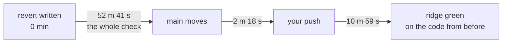

# Ridge's deploy order fixed and its way back timed, recap, 2026-11-17

A client's release can be undone: a revert travelled the whole path to ridge, and it took 65 minutes 58 seconds from the revert being written to ridge running the code from before. The production lane itself stays parked until a paying company has a date.

## What happened

- **The order fix.** The deploy now names its commit on the BFF's function only after the code arrived, so a deploy stopped halfway can no longer pass the check on a commit behind. Item 29 is closed by it.
- **Case 6, the harmless line.** One comment line under `ops/` went to ridge by your push. The run ended success; ridge's own check read green, with `/health`, the function and the app naming one commit. Push to deploy end was 11 m 19 s.
- **Case 7, the revert.** The revert went the same way. Ridge ran the revert's commit, `ops/app.sh` is as before the line (`git diff --quiet fcf5ea07^ 751bbe8f -- ops/app.sh` exit 0), and the same check read green.
- **Where the minutes went.** 52 m 41 s of the 65 m 58 s passed before `main` moved: the revert waited for `pre-merge`'s whole check. Your push to ridge green is 10 m 59 s, of which the deploy job alone is 4 m 53 s. The whole check was not started at once: the revert reached `pre-merge` at 13:49, the check that moved `main` ran from 14:31 to 14:40 and ended green; it waited because a whole check runs at most every two hours.

## What stays yours

Point 2, whether 66 minutes is acceptable as the way back for a live company. Open item 301 now carries these minutes: the wait for the whole check is most of them.

## Evidence

- Commits: `39853f12` (the order fix, step 1 and its fix pass, an ancestor of `main`), `fcf5ea07` (the harmless line), `751bbe8f` (its revert).
- The stamps are from the script's read of the run and `main`'s reflog.
- No row in `docs/products.md` changes: nothing a partner or operator can do is new.
