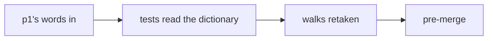

# The ui tests find a screen's words by key, recap, 2026-11-17

A partner's returned words file changed 1,176 words and turned 457 ui tests red, each one finding a word by its typed English. Those tests now read the word from the dictionary the screen draws from, so the next returned file reddens nothing, whatever English it changes.

## What changed

- **The tests** (`fb594580`, `31b15b58`, `2fdf7313`, `e339337c`, `e062be63`): `ui/` and `visual/` tests find a word by its key; names, codes and numbers stay typed. `ui/CLAUDE.md` says so, and item 549 is fixed.
- **The fake build's style order** (`e0654fa7`): nine walks read as moved because the fake build drew fields as boxes. The theme now loads Mantine's styles first; the default build is unchanged.
- **The eight failure words** land as the partner wrote them, the human's decision.

## Review

Opus found no High, one Medium and Lows. [FIXED] The list page's test read a twin key in 13 lines, and typed words, "Menu" and the key detectors' blind spot, in the fix pass (`ae6c7eed..a61ec425`); the reread found them sound. [DEFERRED] Items 587 (the operator page's test reads the app's name for the brand's), 588 (a stranded doc comment), 589 (words still typed) and 591 (the plan names the wrong chunks as sharing the theme). The style fix's own review: may merge.

## Evidence

- At the fix pass's tip the ui check passed 933 tests, and the citation test and the visual check passed. After the style fix the ui check and citation test passed again.
- A key changed in a screen reddened its test, then was put back.
- The products table changes no row.
- Walks rerun on the retaken bases: the nine walks that first read red, rerun after the style fix, read green: every comparison from fake to stack read 0 moved, and the bases were written.
- Pictures retaken and committed: all twelve walks' pictures are committed on the partner's words (three after the first run, nine after the rerun).
- Open: the walks page asks again each screen p1's words moved.
