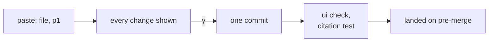

# A partner's returned words, read in by one paste, recap, 2026-11-17

`ops/words-in.sh` reads a partner's returned words file into the app from one pasted line: it makes a branch from `pre-merge`, shows every change, commits the two word files on your y, runs the ui check and the citation test, and lands the branch on `pre-merge`.

## What changed

- **The script** (`759ddba0`, `b81b7372`): the seven stages, a lock for the landing, `--land` to land a kept branch again, and every refusal held by a case, each seen red once by one mutation. Step 1 ran end to end on a scratch copy and landed.
- **The runbook** (`5bdfdba3`): the whole round trip in seven parts, from making the file to send to the pictures after a landing.

## Review

Opus read steps 1 to 3: no High, two Mediums, Lows. [FIXED] The ui check's output was captured to a file, so the human's wait went silent and the log missed it; it streams through `tee` now (`65c67b37`). [FIXED] The guideline's Downloads folder is guarded by macOS; the returned file is saved in `words-returned/` in the credo root. [FIXED] The `--land` line printed relative; it prints absolute. [DEFERRED] Items 580 to 585 hold the other Lows. The reread found every fixed line sound, plus one Low, [DEFERRED] item 586: the printed line's paths are unquoted.

## Evidence

- The human's real run of step 1's version read in 1176 changes, then stopped on a red ui check, nothing landed: the log holds no line of the check, as the first Medium says.
- Step 2's whole `ops/test.sh` run exit 0, 44 checks in the script's section; the fix pass's whole run exit 0, 46.
- The merged tree, `pre-merge` taken in (`714f4a64`): shellcheck, `cfn-lint` and the whole `ops/test.sh` each exit 0, 46 checks in the script's section, the take-in's own box tests running whole beside it.
- The `pnpm words` row in `docs/products.md` names the script (step 3); no other row changes.
- Open: the human's first real paste with the finished script, and p1's sent copy confirmed as the file sent.
