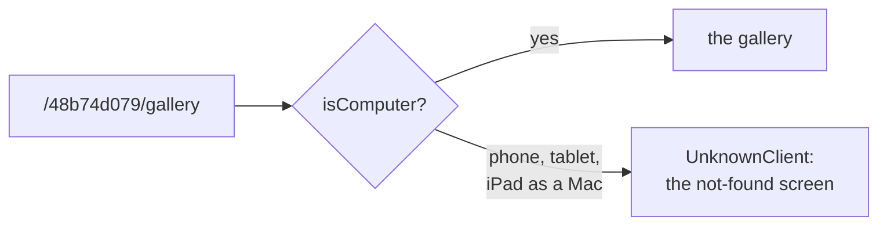

# The gallery for a computer only, recap, 2026-11-19

You said the gallery needs no phone: "Actually no need for phone. Plz disable mobile / ipad display (404 page is OK)". Read as the gallery alone; no other screen changed. On a phone or a tablet the gallery's address now shows the app's not-found screen; on a computer it is as before.

## What it does now

- A phone, a tablet and an iPad that reports itself as a Mac (Mac platform with touch points) get the screen the app already shows for an address that names no company. The gallery's code is not fetched for them.
- A Mac with no touch points and a Windows computer, a touch screen included, open the gallery as before.
- The gallery's two narrow-width style blocks are gone. A computer window narrower than about 800 px gets the wide layout: the burger still hides the list, and the part squeezes.
- The products page's gallery card now needs a PC; its step 4 opens the address on a phone or a tablet.

## What was found

- The app has no router table and its hosting has no not-found page: every path without a dot is served as the app's page with status 200. The not-found answer is the client app's screen for an unknown company, in Vietnamese, the app's first language.
- No walk, visual test or end-to-end test opens the gallery, on any viewport.

## Looks

- **Open:** on a phone and a tablet, on ridge after the push, the not-found screen shows; no browser starts in the sandbox.
- **Void:** the phone look the side-list recap left open; the gallery no longer has one.

## What came from where

`isComputer` in `ui/src/computer.ts` (four cases tested; the three refusals red before the change); the route's check in `ui/src/App.tsx`'s `App`; one commit on `gallery-desktop-only`, from `pre-merge` at `a782c3ca`. The decision is the 2026-11-19 line of `docs/decisions.md`. No open item filed.

## Not known

- Whether a phone's browser asking for the desktop site is turned away.
