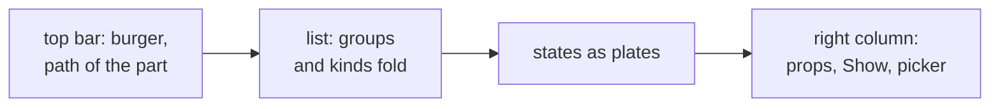

# The gallery's side list and colour themes, recap, 2026-11-19

You asked for the gallery's list to hide, fold and group in levels, and for a choice of colour theme in Mantine's parts. All of it is in, laid out as the mock's layout B.

## What it does now

- A burger hides and shows the list; each group and kind folds, and a fold stays across a hide.
- A Mantine `Select` lists the nine stock palettes, steel the app's own. The choice redraws every part and is kept in the browser; the app outside the gallery keeps its colour.
- A right column holds the name, description, props, the Show switch and the picker.

## Looks

- **Answered:** your look at 00:46 on a computer, in dev mode (the piece file's line).
- **Open:** the phone, on ridge, after the push. The landing took the list above the part away on a phone; piece 193 restores it. No test reads a media query, so only your look settles it.

## What came from where

Five commits on `cleanup`, landed on `pre-merge` as `f2370c0a` inside the cleanup campaign (piece 158): `69a85da1` hide and folds, `001fc54a` themes, `10cff6d3` fix pass, `3e83242b` layout B, `ba0c5ca8` the picker as `Select`. The campaign dropped the per-step review; the one review before `main` found two blocks, fixed in piece 193.

## Not known

- Which five old cases went red under layout B, and why: the causes were left unread.
- Open item 560 (the frame's `100vh` on a phone): its fate is not read here.
