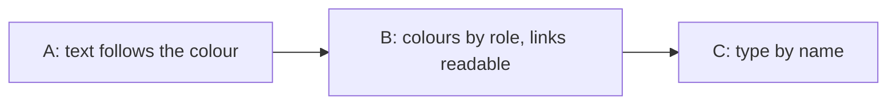

# The design fixes, recap, 2026-11-20

You asked for readable text on every client's colour, colours named by what they are for, and type named. Landings A, B and C are in `main`.

## What changed

- **A:** the text on a client's colour follows the colour: white where it reaches 4.5:1, else the theme's darkest grey. Only emerald's buttons take dark text (4.71:1); the walks' company's buttons move to its shade 7 (4.91:1).
- **B:** each colour is named by its role, written once as a `--credo-<role>` variable or a Mantine slot; 32 raw shades moved, and the badge's corners and the card's padding have one home (items 508, 596). Links take the first shade reaching 4.5:1 on white: emerald's 3.77 becomes 5.48, the company's 4.37 becomes 4.91.
- **C:** the text styles are named and weights by role (label 500, emphasis 600, title 700); no `number` style. 20 weights and 24 captions moved; the gallery's Type shows each.

## What was rejected

Darkening each primary until white passes; Mantine's `autoContrast`; the memo's one start at shade 6 for brand text, which would move the back link on five colours that already pass; four of the memo's extra roles.

## What was proved

Two checks, each red once on a planted fault, refuse a numbered shade (case 10) and a numeric weight or size (case 13, item 309 closed). A palette check hashes every screen's resolved styles on ten colours; it moved only where step 7 said. Pictures: A moved 410 of six client walks, B 162 of five, the operator walks 0; B's second run read green, 35 compares 0 moved; C moved none, its one run read green the same way (35 compares, 0 moved, 0 new).

## What is left

- The looks, the six colours and the type names in the gallery, and points 2 to 4: answered yes on 11-21.
- Item 636 stays open for the switch's thumb: terracotta (2.91) and amber (1.61) fail 3:1. Item 308, the phone's title, stays parked, no look asked.

## Evidence

A: `d9c81355`, `d633ce7e`, `b59c21ae`, bases `58710f78`. B: `bf6b6ce9`, `9a6437ea`, `72a6da8b`, `52e277bb`, `a644d480`, bases `c1d2153f`. C: `3b93f29e`, `4a189bf5`. Each step's gates exited 0.
